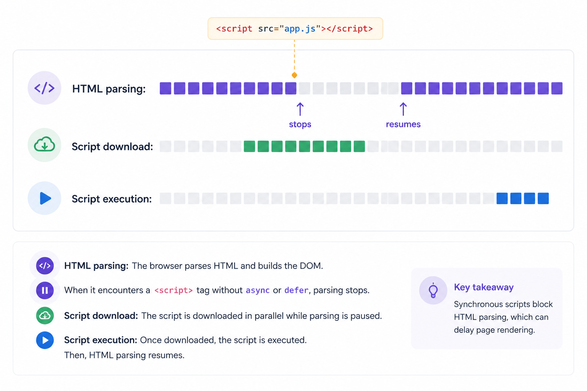
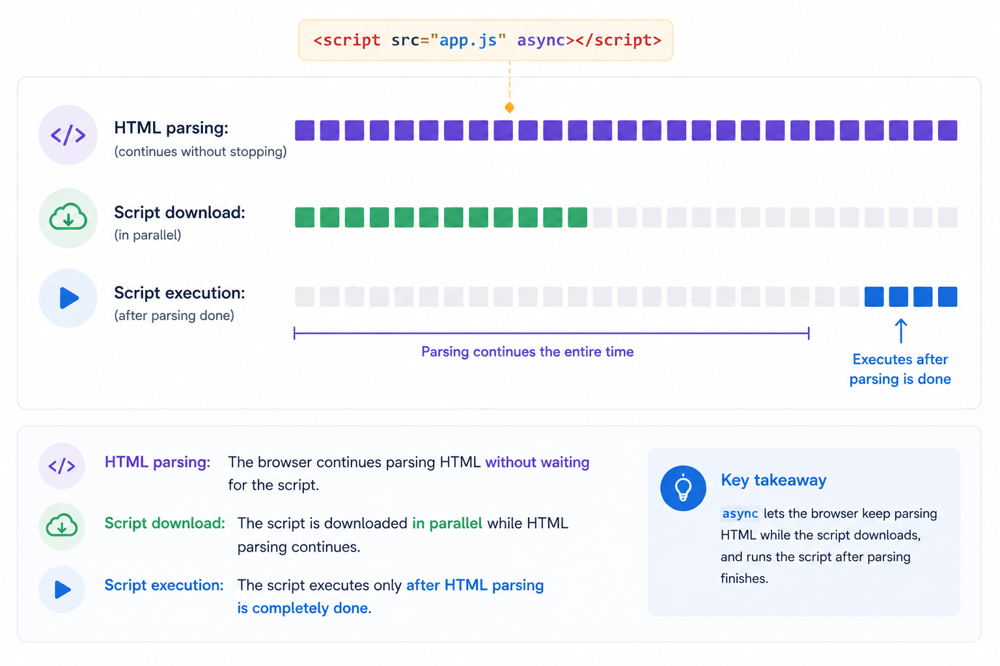
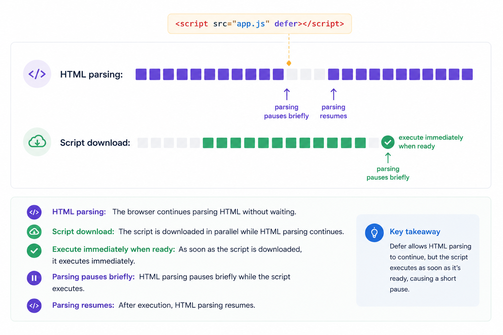

# Loading and resource hints

*9 min read · Updated 2 Jul 2026 Topic 3 of 77 Bookmark Mark done 1C · Topic 3 of 77*

**Source:** [https://www.geekyfrontend.in/learn/complete-frontend-kit/loading-and-resource-hints](https://www.geekyfrontend.in/learn/complete-frontend-kit/loading-and-resource-hints)

---

# 1C. Loading & Resource Hints

**Questions:** 2  
**Difficulty:** Junior to Mid  
**Companies:** Amazon, Flipkart, Walmart, Razorpay, Google, Swiggy

These two questions sit at the intersection of HTML and performance. They show up in theory rounds, but their real impact is in system design discussions when the interviewer asks "How would you optimize the initial load?" Knowing resource hints and script loading strategies lets you give concrete, specific answers instead of vague ones.

---

## Q 1.9 What's the difference between `async`, `defer`, and `type="module"` on script tags?

Normal vs defer vs async scripts<script>parsefetchrunparseparsing STOPS to fetch + rundeferparsefetchrunruns after parse, in orderasyncparsefetchrunparseruns the moment it arrivestime →

*defer keeps HTML parsing smooth and runs scripts in order after the page is built — the safe default. async is for independent scripts (analytics) where order does not matter.*

**Difficulty:** Junior  
**Asked at:** Amazon, Flipkart, Walmart, Razorpay

This question is about HTML, not JavaScript. It's about how the browser loads and executes scripts based on the attributes you put on the `<script>` tag, and how that affects page rendering.

**No attribute (default behavior):**

The browser stops parsing HTML the moment it hits the `<script>` tag. It downloads the script, executes it completely, then resumes parsing HTML. If your script is in the `<head>` and takes 2 seconds to download, the user stares at a blank page for 2 seconds.



`async`**:**

The browser downloads the script in parallel while continuing to parse HTML. Once the download finishes, it pauses HTML parsing to execute the script immediately. If you have multiple async scripts, the execution order is not guaranteed — whichever finishes downloading first, executes first.



`defer`**:**

The browser downloads the script in parallel while continuing to parse HTML. But it waits to execute the script until HTML parsing is completely done. Multiple `defer` scripts execute in the order they appear in the document. This is the critical difference from `async` — order is preserved.



`type="module"`**:**

Behaves like `defer` by default — downloads in parallel, executes after HTML parsing, maintains document order. Additionally, it enables `import`/`export` syntax, runs in strict mode automatically, has its own scope (variables don't leak to the global scope), and each module is only executed once regardless of how many times it's imported.

html

```
<!-- Blocks rendering — almost never what you want -->
<script src="app.js"></script>

<!-- Downloads in parallel, executes ASAP — order NOT guaranteed -->
<script async src="analytics.js"></script>
<script async src="ads.js"></script>

<!-- Downloads in parallel, executes after HTML parsing — order IS guaranteed -->
<script defer src="vendor.js"></script>
<script defer src="app.js"></script>

<!-- Module: deferred by default, supports ES module imports -->
<script type="module" src="app.mjs"></script>
```

**When to use which:**

`defer` — Your main application scripts. You need them to run after the DOM is ready and in a specific order. `vendor.js` must load before `app.js` — defer guarantees this while still downloading both in parallel.

`async` — Independent scripts that don't depend on the DOM, other scripts, or execution order. Analytics scripts, tracking pixels, A/B testing snippets, third-party chat widgets. If the script works regardless of when it runs, use async.

`type="module"` — Modern applications using ES module syntax. This is what your bundler likely outputs. If you're using Vite, Next.js, or any modern build tool, your output scripts are modules.

**No attribute** — Almost never in 2026. The only case is a critical inline script that must execute during parsing to set up global state that subsequent HTML depends on (extremely rare). If you find yourself using a bare `<script>` tag, question whether `defer` would work instead.

**Inline scripts behave differently:**

html

```
<!-- Inline scripts execute immediately regardless of defer/async -->
<script defer>
  console.log("defer is ignored on inline scripts — this runs immediately");
</script>

<!-- Exception: inline modules ARE deferred -->
<script type="module">
  console.log("this runs after HTML parsing, like defer");
</script>
```

`defer` and `async` only apply to external scripts (with a `src` attribute). Inline scripts execute immediately when parsed — except for inline modules, which are deferred.

**Follow-up:** "If a script tag has both `async` and `defer`, which one wins?"

`async` takes precedence. If the browser supports `async`, it ignores `defer`. Adding both is a compatibility pattern — older browsers that don't support `async` fall back to `defer` behavior, which is still better than the default blocking behavior.

**Follow-up:** "Where should you place your script tags — head or body?"

With `defer` or `type="module"`, it doesn't matter — they don't block parsing regardless of position. Placing them in `<head>` is actually better because the browser discovers and starts downloading them earlier, while still executing them after the DOM is ready. The old advice of "put scripts at the bottom of `<body>`" was a workaround for the blocking behavior of bare `<script>` tags — with `defer`, it's unnecessary.

---

## Q 1.10 What are `preload`, `prefetch`, `preconnect`, and `dns-prefetch`? When would you use each?

Resource hints, by urgencypreconnectwarm up a connection (DNS+TCP+TLS) earlydns-prefetchjust resolve DNS — a lighter preconnectpreloadfetch a critical asset for THIS page nowprefetchfetch a likely NEXT-page asset, low priority

*preload = "I need this now"; prefetch = "I might need this soon". preconnect/dns-prefetch just shave off connection setup for third-party origins.*

**Difficulty:** Mid  
**Asked at:** Google, Amazon, Flipkart, Swiggy, Razorpay

These are resource hints — instructions to the browser saying "I'll need this resource soon, start working on it early" so the resource is ready before it's actually needed. Each hint has a different level of urgency and a different performance trade-off.

`preload` **— "I need this NOW, on this page, for the current navigation"**

html

```
<link rel="preload" href="/fonts/Inter-Regular.woff2" as="font" type="font/woff2" crossorigin />
<link rel="preload" href="/hero-image.webp" as="image" />
<link rel="preload" href="/critical-styles.css" as="style" />
```

Preload is the most aggressive hint. The browser starts downloading immediately with high priority. You must specify the `as` attribute (`font`, `script`, `style`, `image`, `fetch`) so the browser knows how to prioritize it correctly. Without `as`, the browser downloads it with low priority — defeating the purpose.

If you preload a resource and don't use it within a few seconds, Chrome logs a console warning: "The resource was preloaded using link preload but not used within a few seconds." This is a signal that you're wasting bandwidth.

**Use preload for:**

- Fonts — browsers discover fonts late (during CSS parsing, not HTML parsing), so they start downloading late. Preloading fonts saves 100-500ms.
- Hero images above the fold — especially if they're set via CSS `background-image` (which is discovered even later than `` tags)
- Critical JS/CSS chunks that are dynamically imported and needed immediately

`prefetch` **— "I MIGHT need this for the NEXT navigation"**

html

```
<link rel="prefetch" href="/about-page.js" />
<link rel="prefetch" href="/dashboard-data.json" />
```

Prefetch downloads the resource during idle time with the lowest priority. It's for resources the user will likely need on the next page, not the current one. The browser caches the prefetched resource so when the user navigates, it's already available.

**Use prefetch for:**

- The JavaScript bundle for the next step in a checkout flow
- The dashboard bundle that loads after login
- Data that's likely to be needed on a page the user will visit next

`preconnect` **— "I'll make a request to this origin, start the connection early"**

html

```
<link rel="preconnect" href="https://api.example.com" />
<link rel="preconnect" href="https://fonts.googleapis.com" crossorigin />
```

Preconnect establishes the full connection to a remote server — DNS resolution + TCP handshake + TLS handshake — but doesn't download anything. A full connection setup takes 100-500ms depending on server distance and network conditions. Doing it early saves that time when the actual request happens later.

**Use preconnect for:**

- Your API server (if it's on a different domain)
- Your CDN origin
- Google Fonts, analytics servers, authentication providers
- Any third-party origin you know you'll make requests to on this page

**Important:** Don't preconnect to more than 4-6 origins. Each preconnect holds a TCP connection open, consuming server and browser resources. Too many preconnects compete with each other and the actual page resources.

`dns-prefetch` **— "Resolve this domain's DNS, nothing else"**

html

```
<link rel="dns-prefetch" href="https://analytics.example.com" />
<link rel="dns-prefetch" href="https://ads.example.com" />
```

DNS prefetch is the lightest hint. It only performs DNS resolution (10-50ms savings) without establishing a connection. Use it for origins you might connect to but aren't sure about — analytics services, ad networks, third-party widgets that may or may not load.

**The hierarchy from lightest to most aggressive:**

javascript

```
dns-prefetch  →  preconnect  →  prefetch  →  preload
  (DNS only)     (DNS+TCP+TLS)  (download,    (download,
                                 low priority)  high priority)
```

**Practical example — an e-commerce product page:**

html

```
<head>
  <!-- Critical font — we need this NOW for the page to render correctly -->
  <link rel="preload" href="/fonts/brand-bold.woff2" as="font" type="font/woff2" crossorigin />

  <!-- Hero image — above the fold, needed immediately -->
  <link rel="preload" href="/images/product-hero.webp" as="image" />

  <!-- API server — we'll fetch product data from here -->
  <link rel="preconnect" href="https://api.store.com" />

  <!-- Image CDN — product images load from here -->
  <link rel="preconnect" href="https://images.cdn.store.com" crossorigin />

  <!-- User will likely go to checkout next -->
  <link rel="prefetch" href="/checkout/main.js" />

  <!-- Analytics will load eventually, just resolve DNS -->
  <link rel="dns-prefetch" href="https://analytics.store.com" />

  <!-- Ad network might load -->
  <link rel="dns-prefetch" href="https://ads.partner.com" />
</head>
```

**The** `fetchpriority` **attribute (newer):**

html

```
<!-- Tell the browser this image is more important than others -->


<!-- Tell the browser this image can wait -->


<!-- Works on preload too -->
<link rel="preload" href="/critical.css" as="style" fetchpriority="high" />
```

`fetchpriority` gives you finer control over resource prioritization. The browser already prioritizes resources based on type (CSS > JS > images), but when you have multiple resources of the same type, `fetchpriority` lets you signal which ones matter most.

**Common mistake:** Preloading everything. If everything is high priority, nothing is high priority. Each preloaded resource competes for bandwidth with other critical resources. Preload 2-4 critical resources maximum — the font, the hero image, maybe a critical CSS file. Everything else should use a lighter hint or load naturally.

**Follow-up:** "How do you know what to preload? How do you identify critical resources?"

Open Chrome DevTools → Network tab → Sort by waterfall. Look for resources that start downloading late but are needed early (fonts are the classic example — they don't start downloading until CSS is parsed, which is after HTML is parsed). Those are your preload candidates. You can also use Lighthouse which specifically recommends preload opportunities in its report.

---

## Learn More

- [rel=preload (MDN) MDN](https://developer.mozilla.org/en-US/docs/Web/HTML/Attributes/rel/preload)
- [Preload, prefetch & preconnect YouTube](https://www.youtube.com/watch?v=PLYIrkT4OCg)
- [async & defer made easy YouTube](https://www.youtube.com/watch?v=RaPMjzYFF9Y)
- [An intro to resource hints YouTube](https://www.youtube.com/watch?v=6q75MVFLlok)
