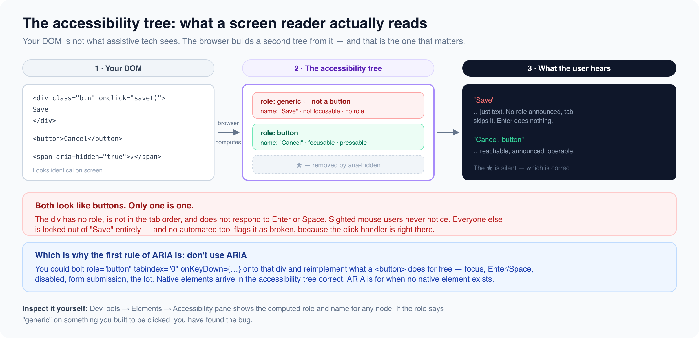

# Aria and semantics

*13 min read · Updated 16 Jul 2026 Topic 4 of 77 Bookmark Mark done 2A · Topic 4 of 77*

**Source:** [https://www.geekyfrontend.in/learn/complete-frontend-kit/aria-and-semantics](https://www.geekyfrontend.in/learn/complete-frontend-kit/aria-and-semantics)

---

# 2A. ARIA & Semantics

**Questions:** 4 **Difficulty:** Mid to Senior **Companies:** Google, Microsoft, Amazon, Atlassian, Adobe, Flipkart

---



## Q 2.1 What is ARIA? What's the first rule of ARIA?

**Difficulty:** Mid **Asked at:** Google, Microsoft, Amazon, Atlassian

ARIA stands for Accessible Rich Internet Applications. It's a set of HTML attributes that communicate the purpose, state, and behavior of UI elements to assistive technologies like screen readers. ARIA doesn't change how an element looks or behaves for sighted users — it only changes what assistive technology announces.

The first rule of ARIA — and this is what interviewers want to hear — is **don't use ARIA if a native HTML element already does the job.**

html

```
<!-- Bad: Recreating what <button> already provides -->
<div
  role="button"
  tabindex="0"
  aria-pressed="false"
  onclick="toggle()"
  onkeydown="if(event.key === 'Enter' || event.key === ' ') toggle()"
>
  Subscribe
</div>

<!-- Good: Native element handles everything automatically -->
<button onclick="toggle()">Subscribe</button>
```

The `<button>` element already has an implicit role of `"button"`, is focusable by default, responds to Enter and Space keypresses, and is announced correctly by screen readers. When you use `role="button"` on a `<div>`, you then need to manually handle keyboard events, add `tabindex` for focus, manage `aria-pressed` state, and ensure proper announcements. You're writing 5 lines of code to badly replicate what the browser gives you in 1 line.

This applies broadly. `<a href>` instead of `role="link"`. `<input type="checkbox">` instead of `role="checkbox"`. `<select>` instead of `role="listbox"`. Use native first, ARIA only when no native element exists.

**When ARIA is actually necessary:**

ARIA becomes essential when you're building custom widgets that don't have native HTML equivalents — tabs, comboboxes, tree views, carousels, and similar interactive patterns:

html

```
<!-- Tabs: No native HTML element for this pattern -->
<div role="tablist" aria-label="Account settings">
  <button role="tab" id="tab-1" aria-selected="true" aria-controls="panel-1">
    Profile
  </button>
  <button role="tab" id="tab-2" aria-selected="false" aria-controls="panel-2" tabindex="-1">
    Security
  </button>
  <button role="tab" id="tab-3" aria-selected="false" aria-controls="panel-3" tabindex="-1">
    Notifications
  </button>
</div>

<div role="tabpanel" id="panel-1" aria-labelledby="tab-1">
  <!-- Profile settings content -->
</div>
<div role="tabpanel" id="panel-2" aria-labelledby="tab-2" hidden>
  <!-- Security settings content -->
</div>
<div role="tabpanel" id="panel-3" aria-labelledby="tab-3" hidden>
  <!-- Notification settings content -->
</div>
```

No native HTML element creates a tabbed interface. Without ARIA, a screen reader user would see a list of buttons and some content blocks — they wouldn't know the buttons control which content is visible, or that they're in a tab interface. ARIA bridges that gap.

**The three categories of ARIA attributes:**

**Roles** define what an element *is*: `role="tab"`, `role="tabpanel"`, `role="alert"`, `role="dialog"`, `role="navigation"`, `role="search"`, `role="toolbar"`, `role="tree"`, `role="treeitem"`, `role="menu"`, `role="menuitem"`

**States** define the element's *current condition* (these change dynamically): `aria-selected="true"`, `aria-expanded="false"`, `aria-checked="mixed"`, `aria-disabled="true"`, `aria-hidden="true"`, `aria-pressed="true"`, `aria-busy="true"`

**Properties** define *characteristics* that don't change often: `aria-label="Close dialog"`, `aria-labelledby="heading-id"`, `aria-describedby="help-text-id"`, `aria-controls="panel-id"`, `aria-haspopup="true"`, `aria-required="true"`, `aria-live="polite"`

**Follow-up:** "What's the difference between `aria-label`, `aria-labelledby`, and `aria-describedby`?"

`aria-label` provides a text label directly on the element. Use it when there's no visible text label.

`aria-labelledby` points to another element whose text content becomes the label. Use it when the label is visible on the page but isn't programmatically associated with the element.

`aria-describedby` provides additional descriptive text — help text, format instructions, error messages. The screen reader announces the label first, then the description after a brief pause.

html

```
<div>
  <label id="pw-label" for="password">Password</label>
  <input
    type="password"
    id="password"
    aria-labelledby="pw-label"
    aria-describedby="pw-hint pw-error"
  />
  <span id="pw-hint">Must be at least 8 characters</span>
  <span id="pw-error" role="alert">Password is too short</span>
</div>

<!-- Screen reader announces:
     "Password, edit text, must be at least 8 characters, password is too short" -->
```

Notice `aria-describedby` accepts multiple IDs separated by spaces. The screen reader reads them in order.

---

## Q 2.2 What are landmark roles and why do they matter?

**Difficulty:** Mid **Asked at:** Microsoft, Amazon, Adobe, Atlassian

Landmarks are regions of a page that screen reader users can jump to directly using shortcut keys. Instead of tabbing through every single element from top to bottom, a screen reader user can press a key (D in NVDA, the Rotor in VoiceOver) to list all landmarks and jump to any one instantly. It's the screen reader equivalent of visually scanning a page and clicking on the section you want.

HTML5 semantic elements automatically create landmarks:

html

```
<header>     →  banner landmark
<nav>        →  navigation landmark
<main>       →  main landmark
<aside>      →  complementary landmark
<footer>     →  contentinfo landmark
<section>    →  region landmark (ONLY when it has an accessible name)
<form>       →  form landmark (ONLY when it has an accessible name)
<search>     →  search landmark (new HTML element)
```

**The rules that trip people up:**

`<header>` **and** `<footer>` **are only landmarks at the top level.** A `<header>` inside an `<article>` is not a "banner" landmark — it's just a header for that article. Only the page-level header and footer get the `banner` and `contentinfo` landmark roles.

html

```
<!-- This <header> IS a banner landmark (top-level) -->
<header>
  <nav>...</nav>
</header>

<main>
  <article>
    <!-- This <header> is NOT a landmark (nested inside article) -->
    <header>
      <h2>Article Title</h2>
      <time>March 15, 2026</time>
    </header>
  </article>
</main>
```

`<section>` **only becomes a landmark when it has an accessible name.** A bare `<section>` without a label is semantically meaningless to screen readers — it's no different from a `<div>`. You need to add either `aria-label` or `aria-labelledby`:

html

```
<!-- NOT a landmark — no accessible name -->
<section>
  <h2>Recent Orders</h2>
  <ul>...</ul>
</section>

<!-- IS a landmark — screen reader announces "Recent Orders, region" -->
<section aria-labelledby="orders-heading">
  <h2 id="orders-heading">Recent Orders</h2>
  <ul>...</ul>
</section>
```

**Label your** `<nav>` **when you have more than one.** If your page has a primary nav in the header and a secondary nav in the footer, screen reader users need to tell them apart:

html

```
<nav aria-label="Main">
  <a href="/">Home</a>
  <a href="/products">Products</a>
  <a href="/about">About</a>
</nav>

<!-- ... page content ... -->

<nav aria-label="Footer">
  <a href="/privacy">Privacy Policy</a>
  <a href="/terms">Terms of Service</a>
  <a href="/contact">Contact</a>
</nav>
```

Without labels, a screen reader lists both as "navigation" with no way to distinguish them.

**There should be exactly one** `<main>` **per page.** This is the primary content area. Skip-to-content links (the first focusable element on many sites) typically jump to `<main>`.

html

```
<a href="#main-content" class="skip-link">Skip to main content</a>
<header>...</header>
<nav>...</nav>
<main id="main-content">
  <!-- Primary page content -->
</main>
<footer>...</footer>
```

css

```
.skip-link {
  position: absolute;
  left: -9999px;
}

.skip-link:focus {
  position: fixed;
  top: 0;
  left: 0;
  background: #000;
  color: #fff;
  padding: 8px 16px;
  z-index: 9999;
}
```

The skip link is invisible until focused (via Tab key), then appears at the top of the page. Clicking it jumps focus to `<main>`, skipping the entire navigation. This is one of the most basic accessibility features and one that interviewers notice when it's present in a machine coding solution.

**Follow-up:** "How does a screen reader user actually navigate using landmarks?"

In VoiceOver (Mac): Open the Rotor (VO + U) → select Landmarks → navigate with arrow keys. In NVDA (Windows): Press D to jump to the next landmark, Shift+D for the previous. In JAWS: Press R for the next landmark. Users can also get a complete list of all landmarks and jump to any one directly. A well-structured page with proper landmarks lets a screen reader user navigate as efficiently as a sighted user visually scanning the page.

---

## Q 2.3 What is `tabindex` and what are its three states? Explain the roving tabindex pattern.

**Difficulty:** Mid **Asked at:** Google, Amazon, Flipkart, Microsoft

`tabindex` controls two things: whether an element can receive keyboard focus, and where it falls in the tab order.

`tabindex="0"` **— "Add this element to the natural tab order"**

Makes a non-interactive element focusable via the Tab key. The element appears in the tab order at its natural position in the DOM (after the previous focusable element, before the next).

html

```
<!-- This div is now keyboard-focusable -->
<div role="button" tabindex="0" onclick="handleClick()">
  Custom Action
</div>
```

Use this when you must create a custom interactive element from a non-interactive tag. But remember the first rule of ARIA — if you can use `<button>`, use `<button>`.

`tabindex="-1"` **— "Focusable by JavaScript only, not by Tab key"**

The element can receive focus via `element.focus()` in JavaScript, but the user cannot Tab to it. It's invisible to keyboard navigation.

html

```
<!-- Focus can be moved here programmatically -->
<main tabindex="-1" id="main-content">
  <!-- Content -->
</main>

<h2 tabindex="-1" id="section-heading">Search Results</h2>
```

This is the workhorse of focus management. Every time you need to move focus to something that isn't naturally interactive — the main content area after a skip link click, an error summary after form validation fails, a section heading after a route change — you use `tabindex="-1"` and call `.focus()`.

`tabindex="1"` **(or any positive number) — "Put me first in the tab order"**

Positive tabindex values force elements to the front of the tab order, before all `tabindex="0"` and naturally focusable elements. **Never use this.** It creates a tab order that doesn't match the visual layout, confusing both keyboard users and developers:

html

```
<!-- Don't do this — creates bewildering tab order -->
<input tabindex="3" placeholder="Third visually, first focused" />
<input tabindex="1" placeholder="First visually, but wait — this gets focus first!" />
<input tabindex="2" placeholder="Second visually, second focused" />
<button>Submit</button>  <!-- This has implicit tabindex=0, so it comes AFTER all positive values -->
```

Every accessibility guideline explicitly warns against positive tabindex values. If you need to change tab order, restructure the DOM instead.

**The roving tabindex pattern — for composite widgets:**

Some widgets contain multiple interactive elements but should behave as a single tab stop. A tab bar, a toolbar, a radio group. The user presses Tab to enter the widget, then uses Arrow keys to move between items inside it, then presses Tab again to leave.

html

```
<div role="tablist" aria-label="Dashboard tabs">
  <button role="tab" tabindex="0" aria-selected="true" id="tab-overview">
    Overview
  </button>
  <button role="tab" tabindex="-1" aria-selected="false" id="tab-analytics">
    Analytics
  </button>
  <button role="tab" tabindex="-1" aria-selected="false" id="tab-settings">
    Settings
  </button>
</div>
```

Only the active tab has `tabindex="0"` — it's the one the user lands on when they Tab into the tablist. All other tabs have `tabindex="-1"` — they're skipped by Tab but reachable via Arrow keys. When the user presses the Right Arrow:

javascript

```
const tabs = Array.from(tablist.querySelectorAll('[role="tab"]'));
let currentIndex = 0;

tablist.addEventListener('keydown', (e) => {
  let newIndex;

  switch (e.key) {
    case 'ArrowRight':
      newIndex = (currentIndex + 1) % tabs.length;
      break;
    case 'ArrowLeft':
      newIndex = (currentIndex - 1 + tabs.length) % tabs.length;
      break;
    case 'Home':
      newIndex = 0;
      break;
    case 'End':
      newIndex = tabs.length - 1;
      break;
    default:
      return;
  }

  e.preventDefault();

  // Remove current tab from tab order
  tabs[currentIndex].setAttribute('tabindex', '-1');
  tabs[currentIndex].setAttribute('aria-selected', 'false');

  // Add new tab to tab order and focus it
  tabs[newIndex].setAttribute('tabindex', '0');
  tabs[newIndex].setAttribute('aria-selected', 'true');
  tabs[newIndex].focus();

  currentIndex = newIndex;

  // Show the corresponding panel
  showPanel(tabs[newIndex].getAttribute('aria-controls'));
});
```

The beauty of roving tabindex is that if the user Tabs away from the tablist and later Tabs back, focus returns to the last active tab (the one with `tabindex="0"`), not the first one. The widget remembers the user's position.

**Where roving tabindex is used:**

- Tab bars (`role="tablist"`)
- Toolbars (`role="toolbar"`)
- Menu bars (`role="menubar"`)
- Radio groups (`role="radiogroup"`)
- Tree views (`role="tree"`)
- Grid cells (`role="grid"`)

**Follow-up:** "What's the alternative to roving tabindex?"

`aria-activedescendant`. Instead of moving DOM focus between items, you keep focus on the container and update `aria-activedescendant` to point to the visually highlighted item. The screen reader follows `aria-activedescendant` instead of actual DOM focus. This is commonly used in comboboxes and listboxes where the input field maintains focus while the user arrows through options.

---

## Q 2.4 What does `prefers-reduced-motion` do and why should you care about it?

**Difficulty:** Mid **Asked at:** Google, Microsoft, Atlassian, Amazon

Some users experience motion sickness, dizziness, seizures, or vestibular disorders triggered by screen animations. Parallax scrolling, sliding page transitions, auto-playing carousels, and complex animations can make a website physically painful or impossible to use for these people. The `prefers-reduced-motion` media query detects when a user has enabled the "Reduce motion" accessibility setting in their operating system and lets you serve an alternative experience.

**The "reduce" approach — start with animations, remove them for sensitive users:**

css

```
.card {
  transition: transform 0.3s ease, opacity 0.3s ease;
}

.card:hover {
  transform: translateY(-8px);
  box-shadow: 0 8px 24px rgba(0, 0, 0, 0.15);
}

@media (prefers-reduced-motion: reduce) {
  .card {
    transition: none;
  }

  .card:hover {
    transform: none;
    /* Keep the shadow change — it's subtle enough */
  }
}
```

**The better "no-preference" approach — start with no animations, add them only for users who are fine with motion:**

css

```
/* No animation by default — safe for everyone */
.hero-element {
  opacity: 1;
}

/* Only animate if the user hasn't requested reduced motion */
@media (prefers-reduced-motion: no-preference) {
  .hero-element {
    animation: fadeSlideIn 0.6s ease-out;
  }

  @keyframes fadeSlideIn {
    from {
      opacity: 0;
      transform: translateY(30px);
    }
    to {
      opacity: 1;
      transform: translateY(0);
    }
  }
}
```

This approach is better because animation is opt-in rather than opt-out. Users who haven't configured their system settings (which is most users) still get animations, but the default is safe.

**Detecting in JavaScript:**

javascript

```
const prefersReducedMotion = window.matchMedia(
  '(prefers-reduced-motion: reduce)'
).matches;

if (prefersReducedMotion) {
  // Skip animation, show content immediately
  element.style.opacity = 1;
} else {
  // Run the full animation
  element.animate(
    [{ opacity: 0, transform: 'translateY(20px)' }, { opacity: 1, transform: 'translateY(0)' }],
    { duration: 500, easing: 'ease-out', fill: 'forwards' }
  );
}

// Listen for changes (user toggles the setting while your page is open)
window.matchMedia('(prefers-reduced-motion: reduce)')
  .addEventListener('change', (event) => {
    if (event.matches) {
      disableAllAnimations();
    } else {
      enableAnimations();
    }
  });
```

**What "reduced motion" means — it's not "no motion":**

You don't need to remove all visual feedback. Subtle opacity changes, color transitions, and instant state changes are fine. What you should remove or replace:

- Sliding page transitions → instant page swaps
- Parallax scrolling → static backgrounds
- Auto-playing carousels → manual navigation only
- Complex entrance animations → simple fade or instant appearance
- Bouncing/pulsing attention indicators → static indicators or subtle opacity pulse
- Scroll-triggered animations → content visible immediately

**Why interviewers care about this:**

In machine coding rounds, adding `prefers-reduced-motion` support to your components — even a single CSS media query — shows awareness that doesn't come from following tutorials. It comes from building products for real users. It takes 30 seconds to add and signals experience disproportionate to the effort.

**Follow-up:** "What other `prefers-*` media queries should you know?"

`prefers-color-scheme: dark | light` — for dark mode support. `prefers-contrast: more | less | no-preference` — for high contrast mode. `prefers-reduced-transparency: reduce` — for reducing transparent/blur effects. `forced-colors: active` — for Windows High Contrast Mode, which overrides your colors entirely.

---

## Learn More

- [ARIA (MDN) MDN](https://developer.mozilla.org/en-US/docs/Web/Accessibility/ARIA)
- [What the heck is ARIA? YouTube](https://www.youtube.com/watch?v=aHNULzcGtDc)
- [Using ARIA in web development YouTube](https://www.youtube.com/watch?v=G6OjlKrBJw4)
- [ARIA attributes — the ultimate guide YouTube](https://www.youtube.com/watch?v=3BPxDkj9UzQ)
