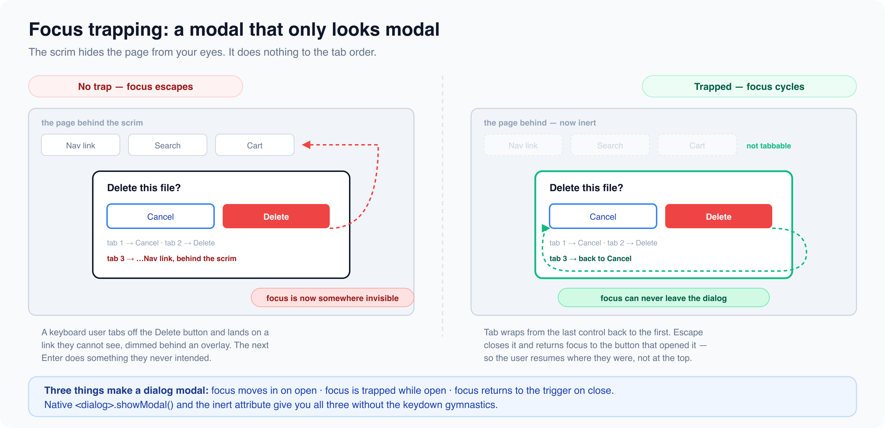

# Focus management

*10 min read · Updated 16 Jul 2026 Topic 5 of 77 Bookmark Mark done 2B · Topic 5 of 77*

**Source:** [https://www.geekyfrontend.in/learn/complete-frontend-kit/focus-management](https://www.geekyfrontend.in/learn/complete-frontend-kit/focus-management)

---

# 2B. Focus Management

**Questions:** 3 **Difficulty:** Senior **Companies:** Google, Amazon, Flipkart, Microsoft, Atlassian, Walmart, Cred

Focus management is where accessibility goes from theoretical to practical. These three questions come up directly in machine coding rounds — every time you build a modal, a drawer, a route change, or an overlay, focus management is part of the evaluation. Candidates who handle focus correctly are demonstrating production experience.

---

## Q 2.5 How do you manage focus in a single-page application?

**Difficulty:** Senior **Asked at:** Google, Amazon, Flipkart, Microsoft

In a traditional multi-page website, navigating to a new page resets everything — the browser loads a fresh document, focus moves to the top, and the screen reader announces the new page title. The user knows something changed.

In a single-page application, route changes happen entirely in JavaScript. The URL updates, the DOM changes, but the browser doesn't know a "navigation" happened. Focus stays wherever it was — maybe on a nav link that's still visible, maybe on an element that no longer exists. A screen reader user gets no indication that the page content changed. They might keep tabbing forward, interacting with what they think is the old page.

This is a real problem. If a screen reader user clicks "Products" in the navigation, the page content changes to show products, but their focus is still on the nav link. They have no idea products loaded. They might think the link is broken.

**The fix has three parts:**

**1. Move focus on route change**

jsx

```
function App() {
  const location = useLocation();
  const mainRef = useRef(null);

  useEffect(() => {
    // Move focus to the main content area after every route change
    mainRef.current?.focus();

    // Scroll to top (SPA doesn't do this automatically)
    window.scrollTo(0, 0);
  }, [location.pathname]);

  return (
    <>
      <nav>
        <a href="/">Home</a>
        <a href="/products">Products</a>
      </nav>
      <main ref={mainRef} tabIndex={-1} style={{ outline: 'none' }}>
        <Routes>
          <Route path="/" element={<Home />} />
          <Route path="/products" element={<Products />} />
        </Routes>
      </main>
    </>
  );
}
```

`tabIndex={-1}` makes `<main>` programmatically focusable without adding it to the tab order. The user can't Tab to `<main>` (which would be weird), but your code can `.focus()` it. The `outline: 'none'` removes the focus ring since the user didn't navigate here via keyboard — focus was moved by the application.

**2. Announce the route change to screen readers**

Moving focus to `<main>` helps screen readers know where they are, but it doesn't tell them *what* changed. Add a live region that announces the new page:

jsx

```
function RouteAnnouncer() {
  const location = useLocation();
  const [announcement, setAnnouncement] = useState('');

  useEffect(() => {
    // Build announcement from route or page title
    const pageTitle = document.title;
    setAnnouncement(`Navigated to ${pageTitle}`);
  }, [location.pathname]);

  return (
    <div
      role="status"
      aria-live="polite"
      aria-atomic="true"
      style={{
        position: 'absolute',
        width: '1px',
        height: '1px',
        overflow: 'hidden',
        clip: 'rect(0, 0, 0, 0)',
        whiteSpace: 'nowrap',
      }}
    >
      {announcement}
    </div>
  );
}
```

This visually hidden element announces the navigation to screen readers without disrupting sighted users. The `aria-live="polite"` ensures the announcement waits until the screen reader finishes what it's currently saying.

**3. Update the document title**

jsx

```
function Products() {
  useEffect(() => {
    document.title = 'Products - ShoeStore';
  }, []);

  return <h1>Products</h1>;
}
```

Many screen readers announce the document title when focus enters a new page context. Updating the title on route changes is cheap and gives screen readers additional context.

**Why this is a senior-level question:** It tests whether you understand the gap between visual UX and accessible UX. A sighted user sees the content change and immediately understands they navigated. A screen reader user gets no such feedback unless you explicitly build it. This gap exists across all SPA frameworks — React, Vue, Angular, Svelte — and the fix is the same everywhere.

**Follow-up:** "Does Next.js or React Router handle this automatically?"

Next.js App Router handles route announcements and focus management partially — it updates the document title and announces route changes. React Router does not handle focus management at all — you need to implement it yourself. This is a common gap in React applications and one that accessibility audits consistently flag.

---



## Q 2.6 Explain focus trapping. When and how would you implement it?

**Difficulty:** Senior **Asked at:** Google, Atlassian, Walmart, Cred, Amazon

Focus trapping means restricting keyboard focus to stay inside a specific container. When a user presses Tab at the last focusable element, focus wraps back to the first focusable element instead of escaping to the page behind. When they press Shift+Tab at the first focusable element, focus wraps to the last.

**Why it's necessary:**

When a modal is open, the page behind it is visually covered by a backdrop. A sighted user can't interact with it. But for a keyboard user, if focus isn't trapped, pressing Tab after the last modal button moves focus to elements behind the backdrop — buttons, links, form fields they can't see. A screen reader user might unknowingly submit a form or click a link on the hidden page.

**Implementation:**

javascript

```
function trapFocus(container) {
  const focusableSelectors = [
    'a[href]:not([disabled]):not([tabindex="-1"])',
    'button:not([disabled]):not([tabindex="-1"])',
    'input:not([disabled]):not([tabindex="-1"])',
    'select:not([disabled]):not([tabindex="-1"])',
    'textarea:not([disabled]):not([tabindex="-1"])',
    '[tabindex]:not([tabindex="-1"]):not([disabled])',
  ].join(', ');

  const focusableElements = container.querySelectorAll(focusableSelectors);
  const firstElement = focusableElements[0];
  const lastElement = focusableElements[focusableElements.length - 1];

  function handleKeyDown(e) {
    if (e.key !== 'Tab') return;

    if (e.shiftKey) {
      // Shift + Tab on first element → jump to last
      if (document.activeElement === firstElement) {
        e.preventDefault();
        lastElement.focus();
      }
    } else {
      // Tab on last element → jump to first
      if (document.activeElement === lastElement) {
        e.preventDefault();
        firstElement.focus();
      }
    }
  }

  container.addEventListener('keydown', handleKeyDown);

  // Focus the first element when the trap starts
  firstElement?.focus();

  // Return a cleanup function
  return () => container.removeEventListener('keydown', handleKeyDown);
}
```

**Using it in a React modal:**

jsx

```
function Modal({ isOpen, onClose, title, children }) {
  const modalRef = useRef(null);
  const previouslyFocused = useRef(null);

  useEffect(() => {
    if (!isOpen) return;

    // Remember what was focused before the modal opened
    previouslyFocused.current = document.activeElement;

    // Start the focus trap
    const cleanup = trapFocus(modalRef.current);

    // Handle Escape key
    function handleEscape(e) {
      if (e.key === 'Escape') onClose();
    }
    document.addEventListener('keydown', handleEscape);

    return () => {
      cleanup();
      document.removeEventListener('keydown', handleEscape);

      // Restore focus to the element that opened the modal
      previouslyFocused.current?.focus();
    };
  }, [isOpen, onClose]);

  if (!isOpen) return null;

  return (
    <div className="backdrop" onClick={onClose}>
      <div
        ref={modalRef}
        role="dialog"
        aria-modal="true"
        aria-labelledby="modal-title"
        onClick={(e) => e.stopPropagation()}
      >
        <h2 id="modal-title">{title}</h2>
        {children}
        <button onClick={onClose}>Close</button>
      </div>
    </div>
  );
}
```

**Three things that must happen for a complete focus trap:**

1. **On open:** Focus moves inside the modal (to the first focusable element, the close button, or the modal container itself). Store a reference to the previously focused element.
2. **While open:** Tab and Shift+Tab cycle within the modal only. Escape closes the modal.
3. **On close:** Focus returns to the element that triggered the modal. This is the step most implementations miss — and it's jarring for keyboard users when focus suddenly jumps to the top of the page after closing a modal.

**Edge cases to handle:**

- The modal content changes dynamically (e.g., a multi-step wizard inside a modal). The list of focusable elements changes, so you need to recompute the first/last elements. A MutationObserver or recalculating on each Tab press handles this.
- There are zero focusable elements inside the modal (e.g., a read-only alert). Focus the modal container itself (with `tabindex="-1"`) and let the user press Escape to close.
- Nested modals (a confirmation dialog opens from within a modal). The inner modal traps focus; closing it returns focus to the outer modal. This is handled naturally if each modal manages its own trap and stores its own `previouslyFocused` reference.

**The shortcut answer:** If you're using `<dialog>` with `.showModal()`, the browser handles focus trapping automatically. You don't need to implement any of this. But interviewers ask about manual focus trapping because they want to know you understand the mechanics, not just which API to call — and because there are cases (custom drawers, slide-in panels, non-dialog overlays) where you need to implement it yourself.

---

## Q 2.7 What is the `inert` attribute and how does it help with accessibility?

**Difficulty:** Senior **Asked at:** Google, Microsoft, Amazon

The `inert` attribute makes an entire subtree of the DOM non-interactive and invisible to assistive technologies. Think of it as a single switch that simultaneously applies `aria-hidden="true"`, `tabindex="-1"`, `pointer-events: none`, and `user-select: none` to an element and every single one of its descendants.

**The problem it solves:**

When a modal is open, the page behind it should be completely inert — unfocusable, unclickable, invisible to screen readers. Before `inert`, achieving this required:

- Setting `aria-hidden="true"` on every sibling of the modal
- Preventing Tab from reaching elements behind the modal (focus trapping)
- Preventing scroll on the body
- Preventing click events behind the backdrop
- Remembering to undo all of this when the modal closes

This was tedious, error-prone, and different implementations missed different things.

**With** `inert`**, it's one attribute:**

html

```
<body>
  <div id="page-content" inert>
    <header>
      <nav>
        <a href="/">Home</a>
        <a href="/products">Products</a>
      </nav>
    </header>
    <main>
      <h1>Dashboard</h1>
      <button>Click me</button>
      <input type="text" placeholder="Type here" />
    </main>
    <footer>...</footer>
  </div>

  <dialog open>
    <h2>Confirm deletion</h2>
    <p>This action cannot be undone.</p>
    <button>Cancel</button>
    <button>Delete</button>
  </dialog>
</body>
```

When `inert` is set on `#page-content`:

- Every link, button, and input inside becomes unfocusable (Tab skips them)
- Click events don't fire on any element inside
- Text inside can't be selected
- Screen readers skip the entire subtree completely
- Find-in-page (Ctrl+F) won't match text inside the inert region
- The content is still visually present but completely non-interactive

**In JavaScript:**

javascript

```
function openModal(dialog) {
  const pageContent = document.getElementById('page-content');

  // Make everything behind the modal inert
  pageContent.setAttribute('inert', '');

  // Show the modal
  dialog.showModal();

  dialog.addEventListener('close', () => {
    // Remove inert when the modal closes
    pageContent.removeAttribute('inert');
  }, { once: true });
}
```

**In React:**

jsx

```
function App() {
  const [isModalOpen, setModalOpen] = useState(false);

  return (
    <>
      <div inert={isModalOpen || undefined}>
        <Header />
        <Main />
        <Footer />
      </div>

      {isModalOpen && (
        <Modal onClose={() => setModalOpen(false)}>
          <p>Are you sure?</p>
        </Modal>
      )}
    </>
  );
}
```

React requires `inert={isModalOpen || undefined}` because React doesn't handle boolean HTML attributes well — setting `inert={false}` renders `inert="false"` in HTML, which is truthy (any value makes `inert` active). Setting it to `undefined` removes the attribute entirely.

`inert` **vs** `<dialog>.showModal()` **— they're complementary:**

`showModal()` handles focus trapping *inside* the dialog. `inert` handles making everything *outside* the dialog non-interactive. For the most robust modal pattern, use both:

javascript

```
function openModal() {
  pageContent.setAttribute('inert', '');   // Disable everything behind
  dialog.showModal();                       // Focus trap inside + backdrop + Escape
}

function closeModal() {
  dialog.close();
  pageContent.removeAttribute('inert');
}
```

**Other use cases for** `inert`**:**

html

```
<!-- Disable a sidebar while content is loading -->
<aside inert>
  <nav>...</nav>
</aside>

<!-- Disable previous steps in a multi-step wizard -->
<div class="step step-1" inert>
  <!-- Already completed — visible but not interactive -->
</div>
<div class="step step-2">
  <!-- Current step — active and interactive -->
</div>

<!-- Disable a form while submitting -->
<form inert>
  <input name="email" value="ankit@example.com" />
  <button>Submitting...</button>
</form>
```

**Styling inert content:**

css

```
[inert] {
  opacity: 0.5;
  pointer-events: none;  /* Browser does this anyway, but being explicit */
}
```

**Follow-up:** "Is `inert` supported in all browsers?"

Yes. `inert` has full support across Chrome, Firefox, Safari, and Edge since late 2022. There's a polyfill (`wicg-inert`) for older browsers, but in 2026, you can use it without any compatibility concerns. It's in the HTML spec, not an experimental feature.

---

## Learn More

- [Keyboard-navigable widgets (MDN) MDN](https://developer.mozilla.org/en-US/docs/Web/Accessibility/Keyboard-navigable_JavaScript_widgets)
- [Web accessibility: keyboard, ARIA, contrast YouTube](https://www.youtube.com/watch?v=VyWRmepESoQ)
- [Keyboard navigation deep dive YouTube](https://www.youtube.com/watch?v=dmnI4r0mXDA)
- [Fixing keyboard focus in modern apps YouTube](https://www.youtube.com/watch?v=-8ll1Iqc95M)
