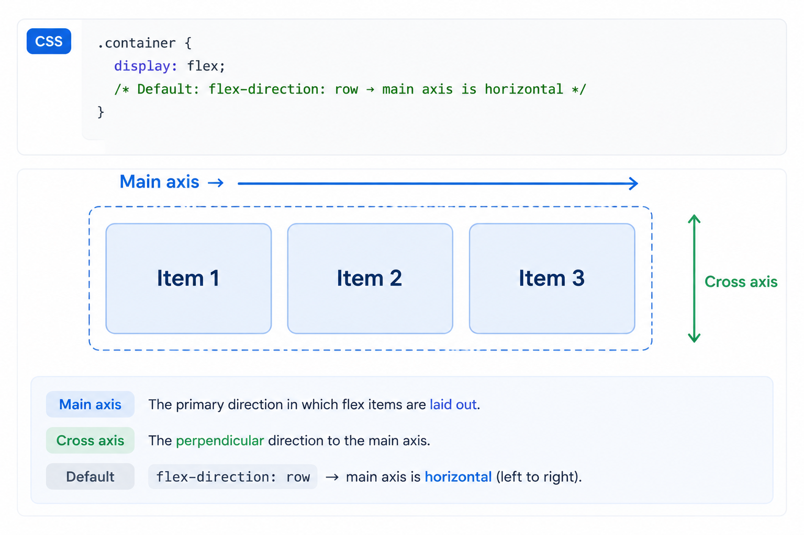

# Layout and visual

*17 min read · Updated 19 May 2026 Topic 7 of 77 Bookmark Mark done 3A · Topic 7 of 77*

**Source:** [https://www.geekyfrontend.in/learn/complete-frontend-kit/layout-and-visual](https://www.geekyfrontend.in/learn/complete-frontend-kit/layout-and-visual)

---

# 3A. Layout & Visual

**Questions:** 5 **Difficulty:** Junior to Mid **Companies:** Every company — CSS layout is tested in machine coding rounds universally

---

## Q 3.1 Explain the Flexbox layout model. How do main axis and cross axis work?

**Difficulty:** Junior **Asked at:** Every company (directly in machine coding, indirectly in theory)

Flexbox is a one-dimensional layout model — it arranges items along a single axis at a time, either horizontally or vertically. Understanding Flexbox means understanding two axes.

**The main axis** is the direction items flow. By default, it's horizontal (left to right). The cross axis is perpendicular to it (top to bottom by default).



When you change `flex-direction: column`, the axes swap:

css

```
.container {
  display: flex;
  flex-direction: column;
  /* Main axis is now vertical, cross axis is horizontal */
}
```

javascript

```
Cross axis →
┌──────────┐
│ [Item 1]  │  ↕ Main axis
│ [Item 2]  │
│ [Item 3]  │
└──────────┘
```

This is why the same `justify-content` property centers horizontally in `row` direction but vertically in `column` direction — it always operates along the main axis, regardless of which physical direction that is.

**The properties that control alignment:**

`justify-content` — distributes items along the **main axis**:

css

```
.container {
  justify-content: flex-start;     /* Items packed to the start (default) */
  justify-content: flex-end;       /* Items packed to the end */
  justify-content: center;         /* Items centered */
  justify-content: space-between;  /* Equal space between items, none at edges */
  justify-content: space-around;   /* Equal space around each item */
  justify-content: space-evenly;   /* Truly equal space everywhere */
}
```

`align-items` — aligns items along the **cross axis**:

css

```
.container {
  align-items: stretch;      /* Items stretch to fill container height (default) */
  align-items: flex-start;   /* Items aligned to cross-axis start */
  align-items: flex-end;     /* Items aligned to cross-axis end */
  align-items: center;       /* Items centered on cross axis */
  align-items: baseline;     /* Items aligned by their text baseline */
}
```

**The classic centering pattern:**

css

```
/* Center anything, horizontally and vertically */
.container {
  display: flex;
  justify-content: center;  /* Center on main axis */
  align-items: center;      /* Center on cross axis */
}
```

**Flex item properties:**

css

```
.item {
  flex-grow: 1;    /* How much of the remaining space this item should take */
  flex-shrink: 1;  /* How much this item should shrink when space is tight */
  flex-basis: 0;   /* The starting size before growing/shrinking */

  /* Shorthand — most common patterns */
  flex: 1;         /* flex: 1 1 0 — grow equally, shrink equally, from zero */
  flex: none;      /* flex: 0 0 auto — don't grow, don't shrink, use natural size */
  flex: auto;      /* flex: 1 1 auto — grow and shrink, starting from natural size */
}
```

`flex: 1` on all items makes them share space equally. `flex: none` on an item makes it rigid — useful for fixed-width sidebars, icons, or buttons.

**Common layout patterns:**

css

```
/* Navbar: logo on left, links centered, button on right */
.navbar {
  display: flex;
  align-items: center;
}
.navbar .logo { margin-right: auto; }
.navbar .auth { margin-left: auto; }

/* Card grid that wraps */
.card-grid {
  display: flex;
  flex-wrap: wrap;
  gap: 16px;
}
.card {
  flex: 1 1 300px;  /* Grow, shrink, minimum 300px before wrapping */
}

/* Footer pushed to bottom of page */
body {
  display: flex;
  flex-direction: column;
  min-height: 100vh;
}
main { flex: 1; }  /* Main content takes all available space */
footer { /* Naturally pushed to the bottom */ }
```

**The** `gap` **property:**

css

```
.container {
  display: flex;
  gap: 16px;       /* Space between items — no margin hacks needed */
  gap: 16px 24px;  /* row-gap column-gap */
}
```

`gap` replaced the old pattern of `margin-right` on every item except the last one (`:last-child { margin-right: 0 }`). It only creates space between items, never at the edges.

**Follow-up:** "What's the difference between `align-items` and `align-content`?"

`align-items` aligns items within a single line. `align-content` aligns the lines themselves when there are multiple rows (requires `flex-wrap: wrap` and extra space in the cross axis). If you have a single row of items, `align-content` has no effect.

---

## Q 3.2 When would you use CSS Grid over Flexbox? Explain template areas, auto-fit, and auto-fill.

**Difficulty:** Mid **Asked at:** Google, Flipkart, Amazon, Atlassian, Swiggy

The short answer: Flexbox is for one-dimensional layouts (a row OR a column). Grid is for two-dimensional layouts (rows AND columns simultaneously). But the practical answer is more nuanced.

**Use Flexbox when:**

- You're laying out items in a single direction (navigation bar, button group, card row)
- The content should dictate the layout (items size based on their content, then distribute space)
- You need items to wrap naturally to the next line

**Use Grid when:**

- You need precise control over both rows and columns simultaneously
- You're building a page-level layout (header, sidebar, main, footer)
- You want items to align to a fixed grid structure regardless of content size
- You need overlapping elements

**Grid fundamentals:**

css

```
.page-layout {
  display: grid;
  grid-template-columns: 250px 1fr 300px;  /* Sidebar, Main, Aside */
  grid-template-rows: auto 1fr auto;        /* Header, Content, Footer */
  gap: 16px;
  min-height: 100vh;
}
```

**Grid template areas — the most readable layout tool:**

css

```
.page-layout {
  display: grid;
  grid-template-areas:
    "header  header  header"
    "sidebar main   aside"
    "footer  footer  footer";
  grid-template-columns: 250px 1fr 300px;
  grid-template-rows: auto 1fr auto;
  gap: 16px;
}

.header  { grid-area: header; }
.sidebar { grid-area: sidebar; }
.main    { grid-area: main; }
.aside   { grid-area: aside; }
.footer  { grid-area: footer; }
```

Template areas let you visualize the layout directly in your CSS. Rearranging the layout for a mobile view is as simple as redefining the template:

css

```
@media (max-width: 768px) {
  .page-layout {
    grid-template-areas:
      "header"
      "main"
      "sidebar"
      "aside"
      "footer";
    grid-template-columns: 1fr;
  }
}
```

`auto-fit` **vs** `auto-fill` **— responsive grids without media queries:**

css

```
/* auto-fill: Creates as many columns as fit, leaving empty tracks */
.grid {
  grid-template-columns: repeat(auto-fill, minmax(250px, 1fr));
}

/* auto-fit: Creates as many columns as fit, collapsing empty tracks */
.grid {
  grid-template-columns: repeat(auto-fit, minmax(250px, 1fr));
}
```

The difference matters when you have fewer items than columns:

With `auto-fill`, the grid creates empty column tracks to fill the row — items don't expand beyond their `minmax` maximum. With `auto-fit`, empty tracks collapse to zero width, and existing items expand to fill the full row width.

For most cases, `auto-fit` is what you want — items expand to use available space. Use `auto-fill` when you want items to maintain a consistent size even if there's leftover space.

css

```
/* The most useful responsive grid pattern — no media queries */
.product-grid {
  display: grid;
  grid-template-columns: repeat(auto-fit, minmax(280px, 1fr));
  gap: 24px;
}
/* Items are at least 280px wide, grow to fill space, wrap automatically */
```

`subgrid` **— aligning nested grid items:**

css

```
.card-grid {
  display: grid;
  grid-template-columns: repeat(3, 1fr);
  gap: 24px;
}

.card {
  display: grid;
  grid-template-rows: subgrid;  /* Inherit row tracks from parent grid */
  grid-row: span 3;             /* Card spans 3 rows */
}
```

Subgrid makes card titles, content, and buttons align across cards even when content length varies. Without subgrid, each card's internal rows are independent, causing misalignment.

**Follow-up:** "Can you use Flexbox and Grid together?"

Absolutely, and you should. Grid for the page-level layout, Flexbox for component-level alignment. A Grid page layout contains components that use Flexbox internally — a navigation bar (Flexbox), a card grid (Grid), card contents (Flexbox), a form layout (Grid for labels and inputs, Flexbox for button groups).

---

## Q 3.3 Explain all CSS position values. How does stacking context and `z-index` work?

**Difficulty:** Mid **Asked at:** Amazon, Flipkart, Google, Microsoft, Atlassian

`position: static` (default) — The element follows normal document flow. `top`, `right`, `bottom`, `left`, and `z-index` have no effect.

`position: relative` — The element stays in normal flow (its original space is preserved) but can be offset from its natural position using `top`, `right`, `bottom`, `left`. Other elements don't move to fill the gap.

css

```
.badge {
  position: relative;
  top: -10px;    /* Shifted up 10px from where it would normally be */
  left: 5px;     /* Shifted right 5px */
}
/* The space where .badge originally was is still occupied */
```

Primary use: creating a positioning context for absolutely positioned children.

`position: absolute` — The element is removed from normal flow (its space collapses). It's positioned relative to its nearest positioned ancestor (any ancestor with `position` other than `static`). If no positioned ancestor exists, it's positioned relative to the viewport.

css

```
.dropdown-menu {
  position: absolute;
  top: 100%;    /* Just below the parent */
  left: 0;
  width: 200px;
}
/* The parent needs position: relative to serve as the reference point */
```

`position: fixed` — Removed from flow, positioned relative to the viewport. Stays in place during scroll.

css

```
.sticky-header {
  position: fixed;
  top: 0;
  left: 0;
  right: 0;
  z-index: 100;
}
```

Gotcha: if any ancestor has `transform`, `filter`, or `will-change` set, a fixed element becomes positioned relative to that ancestor instead of the viewport. This is a common source of "my fixed header isn't fixed" bugs.

`position: sticky` — A hybrid. The element behaves like `relative` until it reaches a scroll threshold, then behaves like `fixed` within its containing block.

css

```
.section-header {
  position: sticky;
  top: 0;             /* Sticks when it reaches the top of the viewport */
  background: white;  /* Needs a background or content behind shows through */
  z-index: 10;
}
```

Sticky elements stop sticking when their parent scrolls out of view. This is intentional — a sticky header inside a scrollable section stays at the top of that section, not the page.

Gotcha: `overflow: hidden`, `overflow: auto`, or `overflow: scroll` on any ancestor prevents `sticky` from working. The sticky element needs to be able to "escape" its parent visually, which overflow clipping prevents.

**Stacking context and** `z-index`**:**

`z-index` only works on positioned elements (`relative`, `absolute`, `fixed`, `sticky`) and flex/grid children. On a `static` element, `z-index` does nothing.

The key concept most people miss: `z-index` doesn't create a global stack. It creates a **stacking context** — a local layering scope.

css

```
/* These create new stacking contexts */
.parent-a { position: relative; z-index: 1; }
.parent-b { position: relative; z-index: 2; }

/* This child has z-index: 9999 but it's inside parent-a (z-index: 1) */
.child-of-a { position: absolute; z-index: 9999; }

/* This child has z-index: 1 but it's inside parent-b (z-index: 2) */
.child-of-b { position: absolute; z-index: 1; }

/* child-of-b appears ABOVE child-of-a because parent-b (2) > parent-a (1) */
/* z-index is compared within the same stacking context */
```

**What creates a new stacking context:**

- `position` with `z-index` other than `auto`
- `opacity` less than 1
- `transform` other than `none`
- `filter` other than `none`
- `will-change` with certain values
- `isolation: isolate` (deliberately creates a context)
- `contain: layout` or `contain: paint`

**Why this matters in practice:**

If your dropdown menu appears behind another component despite having `z-index: 9999`, it's almost always because the dropdown's parent has a stacking context with a lower z-index than the component covering it. The fix isn't a higher z-index — it's restructuring the DOM or the stacking contexts.

The modern solution is to use the browser's top layer (via `<dialog>` or the Popover API) which sits above all stacking contexts entirely.

**Follow-up:** "How do you debug z-index issues?"

Chrome DevTools → Elements panel → look for the "Stacking Contexts" section in the 3D view (under the Layers tab). This shows you the hierarchy of stacking contexts and which elements create them. Alternatively, the CSS property `isolation: isolate` lets you create a stacking context without affecting positioning — useful for containing z-index within a component.

---

## Q 3.4 How does CSS specificity work? How do you calculate it?

**Difficulty:** Junior **Asked at:** Amazon, Flipkart, Atlassian, Microsoft, Walmart

When multiple CSS rules target the same element, specificity determines which rule wins. It's a scoring system with four levels, read from left to right like a version number:

javascript

```
(Inline styles, IDs, Classes/Attributes/Pseudo-classes, Elements/Pseudo-elements)
```

css

```
/* Specificity: (0, 0, 0, 1) — one element selector */
p { color: black; }

/* Specificity: (0, 0, 1, 0) — one class */
.intro { color: blue; }

/* Specificity: (0, 0, 1, 1) — one class + one element */
p.intro { color: green; }

/* Specificity: (0, 1, 0, 0) — one ID */
#hero { color: red; }

/* Specificity: (0, 1, 1, 1) — one ID + one class + one element */
div#hero.active { color: purple; }

/* Specificity: (1, 0, 0, 0) — inline style (always wins, except !important) */
<p style="color: orange;">
```

Each level outranks the one below it entirely. One ID selector beats a thousand class selectors. One class beats a thousand element selectors.

css

```
/* This loses despite having more selectors total */
body div ul li a.link span { color: blue; }
/* Specificity: (0, 0, 1, 6) */

/* This wins because one ID > any number of classes/elements */
#nav a { color: red; }
/* Specificity: (0, 1, 0, 1) */
```

`!important` **— the override:**

css

```
p { color: red !important; }
```

`!important` overrides all specificity calculations. The only thing that beats `!important` is another `!important` with higher specificity. This is why `!important` should be used sparingly — it starts an escalation war where every rule needs `!important` to compete.

**When** `!important` **is acceptable:** overriding third-party CSS you can't modify, accessibility overrides (forced high contrast), and utility classes that should always apply (`display: none !important` on a `.hidden` class).

**Modern CSS selectors that affect specificity:**

`:where()` — zero specificity, regardless of what's inside:

css

```
/* Specificity: (0, 0, 0, 0) — where() adds nothing */
:where(.card, #hero, div.active) { padding: 16px; }

/* Easily overridden by any selector */
.card { padding: 24px; }  /* This wins */
```

`:where()` is useful for base styles and CSS resets that should be easy to override.

`:is()` — takes the highest specificity of its arguments:

css

```
/* Specificity: (0, 1, 0, 0) — takes the specificity of #hero (the highest) */
:is(.card, #hero, div) { padding: 16px; }
```

`:has()` **— the parent selector:**

css

```
/* Style a card differently if it contains an image */
.card:has(img) {
  grid-template-rows: 200px 1fr;
}

/* Style a form label when its input is invalid */
label:has(+ input:invalid) {
  color: red;
}
```

`:has()` has the specificity of its argument, like `:is()`.

`:not()` — takes the specificity of its argument:

css

```
/* Specificity: (0, 0, 1, 0) — specificity of .active */
:not(.active) { opacity: 0.5; }
```

**Follow-up:** "How do you avoid specificity wars in a large codebase?"

Use a methodology. BEM keeps everything at one class level — `.block__element--modifier` — so specificity is flat and predictable. CSS Modules scope classes automatically. Tailwind uses single utility classes. The newer `@layer` rule lets you explicitly control cascade order:

css

```
@layer base, components, utilities;

@layer base { a { color: blue; } }
@layer components { .btn { color: white; } }
@layer utilities { .text-red { color: red; } }
/* Utilities always win over components, components over base — regardless of specificity */
```

---

## Q 3.5 What modern CSS features should you know in 2026?

**Difficulty:** Mid **Asked at:** Google, Razorpay, Flipkart, Cred, Swiggy

CSS has evolved dramatically. Interviewers ask this to gauge whether you're keeping up with the platform or still writing CSS like it's 2018. These features are all production-ready with full browser support.

**Container queries — responsive components, not just responsive pages:**

css

```
.card-container {
  container-type: inline-size;
  container-name: card;
}

@container card (min-width: 400px) {
  .card {
    display: grid;
    grid-template-columns: 200px 1fr;
  }
}

@container card (max-width: 399px) {
  .card {
    display: flex;
    flex-direction: column;
  }
}
```

Media queries respond to the viewport width. Container queries respond to the parent container's width. A card component can have a horizontal layout when it's in a wide sidebar and a vertical layout when it's in a narrow one — without knowing anything about the page layout. This is the biggest shift in responsive design thinking since media queries.

**CSS nesting — native, no preprocessor needed:**

css

```
.card {
  padding: 16px;
  border-radius: 8px;

  .title {
    font-size: 1.25rem;
    font-weight: 600;
  }

  .body {
    color: #666;
    line-height: 1.6;
  }

  &:hover {
    box-shadow: 0 4px 12px rgba(0, 0, 0, 0.1);
  }

  @media (min-width: 768px) {
    padding: 24px;
  }
}
```

Native CSS nesting eliminates the need for Sass/Less just for nesting. The `&` character refers to the parent selector, same as Sass.

`@layer` **— explicit cascade control:**

css

```
@layer reset, base, components, utilities;

@layer reset {
  * { margin: 0; box-sizing: border-box; }
}

@layer components {
  .button { background: blue; color: white; }
}

@layer utilities {
  .bg-red { background: red; }
}
```

Rules in later layers override earlier layers regardless of specificity. A utility class in the `utilities` layer always beats a component style in the `components` layer — even if the component selector is more specific.

`clamp()` **— fluid responsive values:**

css

```
/* Font size scales from 16px to 24px based on viewport width */
h1 {
  font-size: clamp(1rem, 0.5rem + 2vw, 1.5rem);
}

/* Container padding scales fluidly */
.container {
  padding: clamp(16px, 4vw, 64px);
}
```

`clamp(min, preferred, max)` — the value is the `preferred` expression, constrained between `min` and `max`. This replaces media query breakpoints for many use cases.

**Modern viewport units:**

css

```
.hero {
  /* Old: 100vh doesn't account for mobile browser chrome (URL bar) */
  height: 100vh;

  /* New: dynamic viewport height — accounts for browser UI */
  height: 100dvh;
}
```

`dvh` (dynamic viewport height) changes as the mobile browser chrome appears/disappears. `svh` (small viewport height) is the viewport with chrome visible. `lvh` (large viewport height) is the viewport with chrome hidden. Use `dvh` for full-screen sections on mobile.

**CSS logical properties:**

css

```
/* Physical (breaks in RTL languages) */
.card {
  margin-left: 16px;
  padding-right: 24px;
  border-bottom: 1px solid #eee;
  text-align: left;
}

/* Logical (works in all writing directions) */
.card {
  margin-inline-start: 16px;
  padding-inline-end: 24px;
  border-block-end: 1px solid #eee;
  text-align: start;
}
```

`inline` = horizontal axis in LTR, `block` = vertical axis. `start` and `end` replace `left`/`right`/`top`/`bottom`. Essential if your product supports RTL languages (Arabic, Hebrew, Urdu).

`:has()` **— the parent selector that changes everything:**

css

```
/* Style a card differently if it has an image */
.card:has(img) {
  grid-template-rows: 200px auto;
}

/* Style the form label when its sibling input is focused */
.form-group:has(input:focus) {
  border-color: blue;
}

/* Show a clear button only when the input has content */
.search:has(input:not(:placeholder-shown)) .clear-btn {
  display: block;
}

/* Style the page when a dialog is open */
body:has(dialog[open]) {
  overflow: hidden;
}
```

`:has()` lets you style parent elements based on their children. Before `:has()`, you needed JavaScript for every one of these use cases.

`color-mix()` **— programmatic color manipulation:**

css

```
:root {
  --brand: #3b82f6;
}

.button {
  background: var(--brand);
}

.button:hover {
  /* 20% darker */
  background: color-mix(in srgb, var(--brand), black 20%);
}

.button:disabled {
  /* 50% opacity effect */
  background: color-mix(in srgb, var(--brand), transparent 50%);
}
```

Replaces the need for Sass `darken()` / `lighten()` functions.

**Follow-up:** "Which of these do you actually use daily?"

Container queries, nesting, `clamp()`, and `gap` are the most commonly used. `:has()` is transformative but you reach for it less frequently. `@layer` becomes essential in large projects or design systems. Logical properties matter if you support internationalization.

---

## Learn More

- [A Complete Guide to Flexbox css-tricks.com](https://css-tricks.com/snippets/css/a-guide-to-flexbox/)
- [A Complete Guide to Grid css-tricks.com](https://css-tricks.com/snippets/css/complete-guide-grid/)
- [Flexbox vs Grid — the real difference YouTube](https://www.youtube.com/watch?v=HheRpUCYN9Q)
- [Flexbox vs Grid — which & when YouTube](https://www.youtube.com/watch?v=18VLSXfsj94)
- [Why you need both flexbox & grid YouTube](https://www.youtube.com/watch?v=OlqQiUHaz0o)
