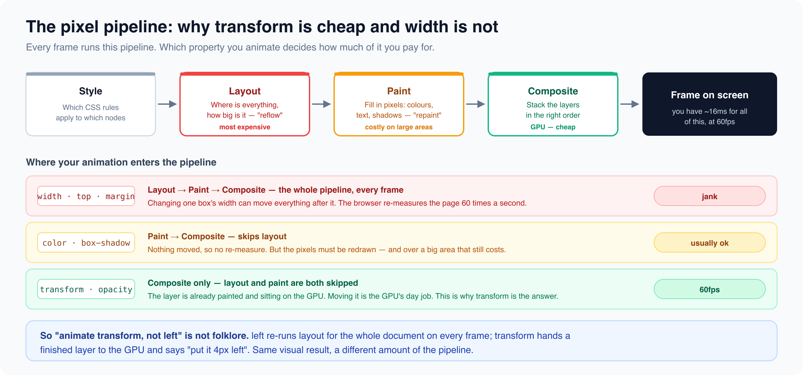

# Performance and animation

*12 min read · Updated 16 Jul 2026 Topic 9 of 77 Bookmark Mark done 3C · Topic 9 of 77*

**Source:** [https://www.geekyfrontend.in/learn/complete-frontend-kit/performance-and-animation](https://www.geekyfrontend.in/learn/complete-frontend-kit/performance-and-animation)

---

# 3C. Performance & Animation

**Questions:** 3 **Difficulty:** Mid to Senior **Companies:** Google, Amazon, Flipkart, Microsoft, Swiggy

These questions sit at the intersection of CSS and the browser rendering pipeline. When an interviewer asks "Why is this page slow?" or "Why does this animation jank?", the answer is almost always rooted in how CSS triggers layout, paint, and compositing. Understanding this pipeline lets you write CSS that cooperates with the browser instead of fighting it.

---



## Q 3.10 What causes reflows and repaints? How do you minimize them?

**Difficulty:** Mid **Asked at:** Google, Amazon, Flipkart, Microsoft

Every time you change CSS or manipulate the DOM, the browser goes through some or all of its rendering pipeline:

javascript

```
Style → Layout (Reflow) → Paint → Composite
```

**Layout (Reflow)** — The most expensive step. The browser recalculates the geometry (position and size) of elements. Any property that affects an element's dimensions, position, or affects the layout of surrounding elements triggers layout.

Properties that trigger layout: `width`, `height`, `padding`, `margin`, `border-width`, `top`/`left`/`right`/`bottom` (on positioned elements), `font-size`, `line-height`, `text-align`, `display`, `flex` properties, `grid` properties, `position`, `float`.

**Paint** — The browser fills in pixels. Changing visual properties that don't affect layout triggers paint without layout.

Properties that trigger only paint: `color`, `background-color`, `background-image`, `border-color`, `box-shadow`, `border-radius`, `visibility`, `outline`.

**Composite** — The cheapest step. The GPU combines pre-painted layers. Only a few properties trigger compositing alone.

Properties that trigger only compositing: `transform`, `opacity`, `filter` (when the element already has its own layer), `will-change`.

**Why reflows are expensive:**

A reflow on one element can cascade. Changing the height of a div above a list shifts everything below it. The browser must recalculate the position of every element that follows. In a complex DOM, a single reflow can affect hundreds of elements.

**Layout thrashing — the worst pattern:**

javascript

```
// BAD: Forces synchronous layout on every iteration
const items = document.querySelectorAll('.item');
items.forEach(item => {
  const height = item.offsetHeight;          // READ → forces layout
  item.style.width = `${height * 2}px`;      // WRITE → invalidates layout
  // Next read forces another layout calculation
});
```

The browser normally batches style changes and calculates layout once. But when you read a layout property (`offsetHeight`, `offsetWidth`, `getBoundingClientRect()`, `scrollTop`, `clientWidth`) after writing a style change, the browser must calculate layout immediately to give you the correct value. Interleaving reads and writes forces layout recalculation on every cycle.

javascript

```
// GOOD: Batch reads, then batch writes
const items = document.querySelectorAll('.item');

// Read phase
const heights = Array.from(items).map(item => item.offsetHeight);

// Write phase
items.forEach((item, i) => {
  item.style.width = `${heights[i] * 2}px`;
});
// Browser calculates layout once after all writes
```

**Minimizing reflows in practice:**

**1. Use** `transform` **instead of layout properties for movement:**

css

```
/* BAD: Triggers layout on every frame */
.animate-bad {
  transition: left 0.3s, top 0.3s;
}
.animate-bad:hover {
  left: 100px;
  top: 50px;
}

/* GOOD: Only triggers compositing */
.animate-good {
  transition: transform 0.3s;
}
.animate-good:hover {
  transform: translate(100px, 50px);
}
```

**2. Use** `opacity` **instead of** `visibility` **or** `display` **for showing/hiding with animation:**

css

```
/* Triggers layout (display changes flow) */
.hidden { display: none; }

/* Triggers only paint */
.hidden { visibility: hidden; }

/* Triggers only compositing (cheapest) */
.hidden { opacity: 0; pointer-events: none; }
```

**3. Batch DOM changes using** `DocumentFragment`**:**

javascript

```
const fragment = document.createDocumentFragment();
for (let i = 0; i < 1000; i++) {
  const li = document.createElement('li');
  li.textContent = `Item ${i}`;
  fragment.appendChild(li);  // No reflow — fragment isn't in the DOM
}
list.appendChild(fragment);  // Single reflow when fragment is attached
```

**4. Use** `content-visibility: auto` **for long pages:**

css

```
.section {
  content-visibility: auto;
  contain-intrinsic-size: 0 500px;  /* Estimated height for offscreen sections */
}
```

This tells the browser to skip layout, paint, and style calculations for offscreen sections entirely. On long pages with many sections, this can reduce initial rendering work by 50-90%.

**Follow-up:** "How do you identify reflow issues in practice?"

Chrome DevTools → Performance tab → record a profile → look for "Layout" entries in the flame chart. Long layout blocks (>10ms) indicate reflow issues. The "Recalculate Style" and "Layout" entries show exactly which code triggered the reflow. You can also enable "Layout Shift Regions" in the Rendering panel to see layout shifts happening in real time.

---

## Q 3.11 How do CSS animations work? Explain GPU compositing, the FLIP technique, and View Transitions API.

**Difficulty:** Senior **Asked at:** Google, Amazon, Flipkart, Microsoft

**CSS animations and transitions basics:**

css

```
/* Transition: animate between two states */
.button {
  background: #3b82f6;
  transform: scale(1);
  transition: background 0.2s ease, transform 0.15s ease;
}

.button:hover {
  background: #2563eb;
  transform: scale(1.05);
}

/* Animation: keyframe-based, can loop and have complex sequences */
@keyframes slideIn {
  from {
    opacity: 0;
    transform: translateY(20px);
  }
  to {
    opacity: 1;
    transform: translateY(0);
  }
}

.card {
  animation: slideIn 0.4s ease-out forwards;
}
```

**GPU compositing — why** `transform` **and** `opacity` **are fast:**

The browser's rendering pipeline has a final step called compositing. Elements on separate compositor layers are rendered by the GPU independently. When you animate a composited property (`transform`, `opacity`), the browser doesn't re-layout or re-paint the element — it just tells the GPU to move, scale, rotate, or fade the existing painted layer. This happens on a separate thread from JavaScript, so even if your main thread is busy, the animation stays smooth.

Properties that get their own compositor layer:

- `transform` (any value other than `none`)
- `opacity` (any value other than `1`)
- `will-change: transform` or `will-change: opacity`
- `position: fixed`
- `filter` / `backdrop-filter`

css

```
/* This animation runs at 60fps even if JavaScript is busy */
.smooth {
  transition: transform 0.3s ease, opacity 0.3s ease;
}

.smooth:hover {
  transform: translateY(-4px) scale(1.02);
  opacity: 0.95;
}

/* This animation may jank because width/height trigger layout */
.janky {
  transition: width 0.3s ease, height 0.3s ease;
}

.janky:hover {
  width: 120%;
  height: 110%;
}
```

`will-change` **— promoting an element to its own layer:**

css

```
.card {
  will-change: transform;  /* Browser creates a GPU layer ahead of time */
}

.card:hover {
  transform: scale(1.05);  /* Animation is instant — layer was pre-created */
}
```

Use `will-change` sparingly. Every compositor layer consumes GPU memory. Adding `will-change: transform` to 200 cards wastes memory. Only use it on elements you know will animate, and ideally add it just before the animation starts and remove it after.

**The FLIP technique — animating layout changes smoothly:**

FLIP stands for First, Last, Invert, Play. It lets you animate changes that normally cause layout reflows (like reordering a list or expanding a card) using only `transform`, which is cheap.

javascript

```
function flipAnimate(element, changeFunction) {
  // FIRST: Record the element's current position
  const first = element.getBoundingClientRect();

  // Apply the DOM change (causes layout reflow)
  changeFunction();

  // LAST: Record the element's new position
  const last = element.getBoundingClientRect();

  // INVERT: Calculate the difference and move element back to old position
  const deltaX = first.left - last.left;
  const deltaY = first.top - last.top;
  const deltaW = first.width / last.width;
  const deltaH = first.height / last.height;

  element.style.transform = `translate(${deltaX}px, ${deltaY}px) scale(${deltaW}, ${deltaH})`;
  element.style.transformOrigin = 'top left';

  // PLAY: Animate from old position to new position
  requestAnimationFrame(() => {
    element.style.transition = 'transform 0.3s ease';
    element.style.transform = '';  // Remove the inversion — element animates to final position
  });

  // Cleanup
  element.addEventListener('transitionend', () => {
    element.style.transition = '';
    element.style.transformOrigin = '';
  }, { once: true });
}

// Usage: animate a list reorder
flipAnimate(listItem, () => {
  list.prepend(listItem);  // DOM change — would normally be instant/janky
});
```

The trick: the layout change happens instantly (the element jumps to its new position). Then you immediately apply a `transform` that visually moves it back to where it was. Then you animate the removal of that transform. The user sees a smooth animation, but the browser only does one layout reflow and then a cheap GPU-accelerated transform animation.

**View Transitions API — browser-native page transitions:**

javascript

```
// Animate between two states with a crossfade
document.startViewTransition(() => {
  // Update the DOM (e.g., change route, update content)
  updateContent(newContent);
});
```

The browser automatically captures a screenshot of the old state, applies the DOM change, captures the new state, and crossfades between them. You can customize the animation with CSS:

css

```
::view-transition-old(root) {
  animation: fade-out 0.3s ease-out;
}

::view-transition-new(root) {
  animation: fade-in 0.3s ease-in;
}

/* Named transitions for specific elements */
.hero-image {
  view-transition-name: hero;
}

::view-transition-old(hero) {
  animation: shrink-out 0.4s ease;
}

::view-transition-new(hero) {
  animation: expand-in 0.4s ease;
}
```

Named view transitions are particularly powerful — you can animate a specific element (like a product thumbnail) from a list page to a detail page, and the browser handles the cross-state animation for that specific element. This was previously only possible with complex FLIP implementations or animation libraries.

**Follow-up:** "When would you use CSS animations vs JavaScript animations?"

CSS for simple, predefined animations (hover effects, transitions, loading spinners). JavaScript for dynamic animations where values are calculated at runtime, physics-based animations, scroll-driven animations with complex timing, or orchestrating multiple elements. The Web Animations API (`element.animate()`) gives you JavaScript control with CSS performance.

---

## Q 3.12 Explain `prefers-reduced-motion`, `prefers-color-scheme`, and `@media print`.

**Difficulty:** Mid **Asked at:** Google, Microsoft, Atlassian, Flipkart

These three media queries adapt your UI to user preferences and contexts that go beyond screen size. Supporting them shows an awareness of real-world usage that most candidates lack.

`prefers-color-scheme` **— dark mode:**

css

```
/* System-preference dark mode */
@media (prefers-color-scheme: dark) {
  :root {
    --color-bg: #0f172a;
    --color-text: #e2e8f0;
    --color-border: #334155;
  }
}
```

In practice, most applications combine system preference with a manual toggle:

css

```
/* Default: follow system preference */
:root {
  --color-bg: #ffffff;
  --color-text: #1e293b;
}

@media (prefers-color-scheme: dark) {
  :root:not([data-theme="light"]) {
    --color-bg: #0f172a;
    --color-text: #e2e8f0;
  }
}

/* Manual override */
[data-theme="dark"] {
  --color-bg: #0f172a;
  --color-text: #e2e8f0;
}

[data-theme="light"] {
  --color-bg: #ffffff;
  --color-text: #1e293b;
}
```

The logic: if the user hasn't set a preference (`data-theme` not present), follow the system. If they've explicitly chosen light or dark, respect that regardless of system settings.

**Dark mode gotchas:**

Don't just invert colors. Dark mode needs specific attention:

- Pure black (`#000`) backgrounds cause eye strain on OLED screens. Use dark gray (`#0f172a`, `#1a1a2e`) instead.
- Shadows are invisible on dark backgrounds. Replace box-shadows with subtle borders or lighter glows.
- Images and illustrations designed for light backgrounds look washed out or jarring. Consider dimming images: `img { filter: brightness(0.9); }` in dark mode.
- Reduce contrast slightly. White text on pure black is harsh. Use off-white (`#e2e8f0`) on dark gray.

`prefers-reduced-motion` **— covered in depth in Chapter 2 (Q2.4):**

css

```
@media (prefers-reduced-motion: reduce) {
  *, *::before, *::after {
    animation-duration: 0.01ms !important;
    animation-iteration-count: 1 !important;
    transition-duration: 0.01ms !important;
    scroll-behavior: auto !important;
  }
}
```

This nuclear option disables all animations site-wide for users who've requested reduced motion. A more nuanced approach is to handle it per-component, replacing animations with instant state changes rather than removing visual feedback entirely.

`@media print` **— the forgotten media query:**

When a user prints your page (or saves as PDF), the default result is usually terrible — navigation bars, fixed headers, background colors, and interactive elements all print. Print styles fix this.

css

```
@media print {
  /* Hide non-content elements */
  nav,
  footer,
  .sidebar,
  .ads,
  .cookie-banner,
  button,
  .no-print {
    display: none !important;
  }

  /* Remove backgrounds and shadows (saves ink) */
  * {
    background: white !important;
    color: black !important;
    box-shadow: none !important;
    text-shadow: none !important;
  }

  /* Make links show their URL */
  a[href]::after {
    content: " (" attr(href) ")";
    font-size: 0.8em;
    color: #666;
  }

  /* Prevent page breaks inside important elements */
  article, .card, table, figure {
    break-inside: avoid;
  }

  /* Force page break before major sections */
  h2, h3 {
    break-after: avoid;  /* Don't orphan headings at bottom of page */
  }

  /* Ensure content fills the page width */
  body {
    width: 100%;
    max-width: none;
    margin: 0;
    padding: 0;
  }

  /* Make images reasonable for print */
  img {
    max-width: 100%;
    page-break-inside: avoid;
  }
}
```

**When print styles matter:**

- E-commerce order confirmation pages (users print receipts)
- Recipe sites (users print recipes)
- Documentation sites (users print reference material)
- Invoice/billing pages
- Any content-heavy page that users might save as PDF

Most candidates don't know print styles exist. Mentioning them in an interview — especially in a system design discussion about an e-commerce checkout or a documentation site — signals thoroughness.

**Other preference media queries worth knowing:**

css

```
/* High contrast — useful for users with low vision */
@media (prefers-contrast: more) {
  :root {
    --color-border: #000;
    --color-text: #000;
  }
  button {
    border: 2px solid currentColor;
  }
}

/* Touch devices — no hover state available */
@media (hover: none) {
  .tooltip-trigger:hover .tooltip {
    /* Don't show tooltips on hover for touch devices */
    display: none;
  }
}

/* Windows High Contrast Mode */
@media (forced-colors: active) {
  .button {
    border: 1px solid ButtonText;
    /* forced-colors overrides your colors — use system color keywords */
  }
}
```

**Follow-up:** "How do you test print styles?"

Chrome DevTools → More tools → Rendering → Emulate CSS media type → select "print". This renders the page as if you're printing it, without actually printing. You can also use `window.matchMedia('print')` in JavaScript to test print-specific behavior.

---

## Learn More

- [CSS/JS animation performance (MDN) MDN](https://developer.mozilla.org/en-US/docs/Web/Performance/CSS_JavaScript_animation_performance)
- [How to create performant CSS animations YouTube](https://www.youtube.com/watch?v=4PStxeSIL9I)
- [What to animate (and what to avoid) YouTube](https://www.youtube.com/watch?v=39K1C92TkWo)
- [CSS vs JavaScript animations YouTube](https://www.youtube.com/watch?v=NEo6393TIFE)
