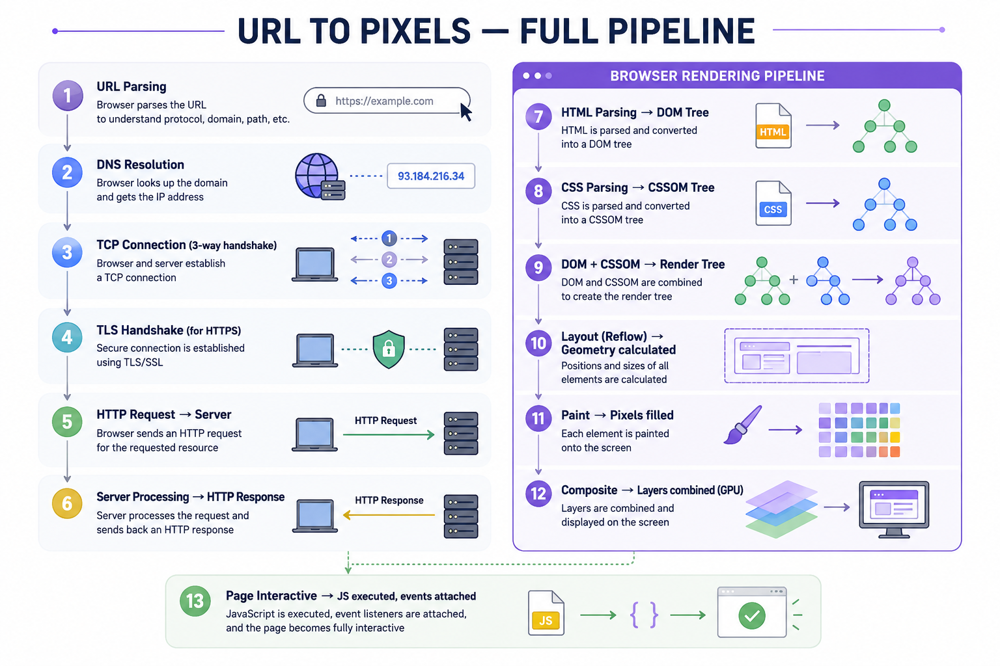
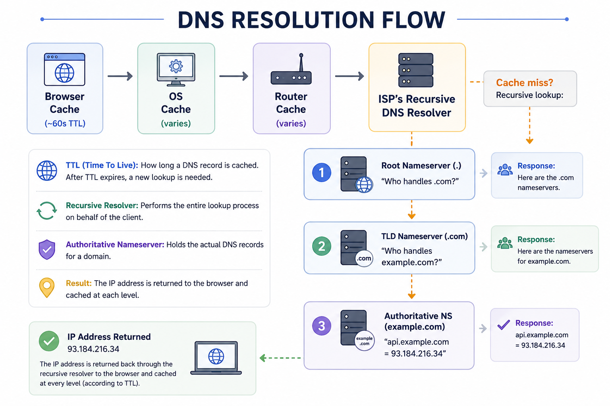
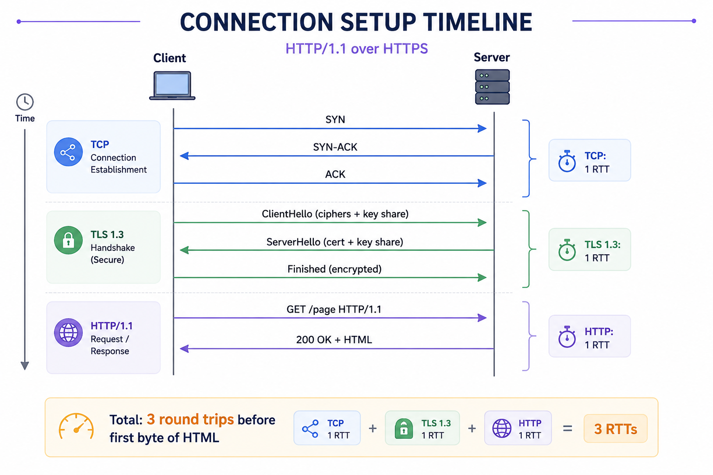
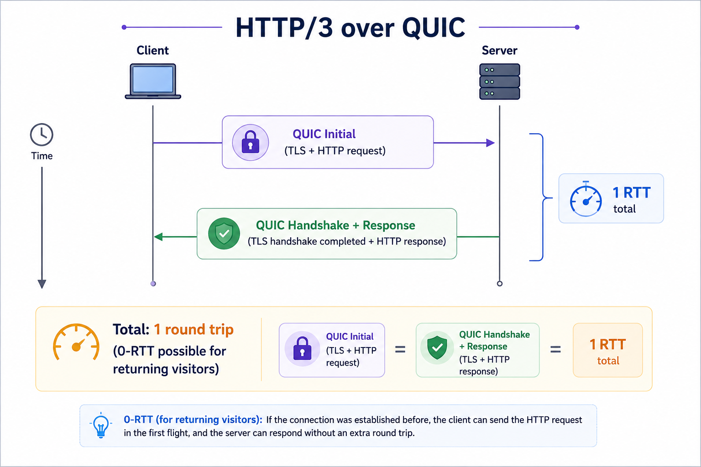
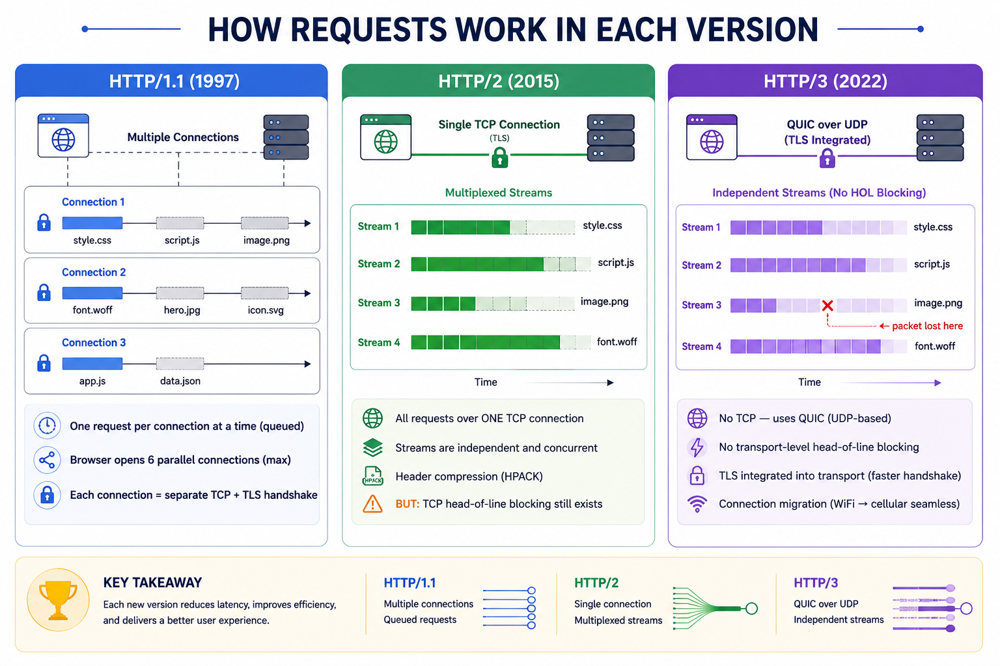
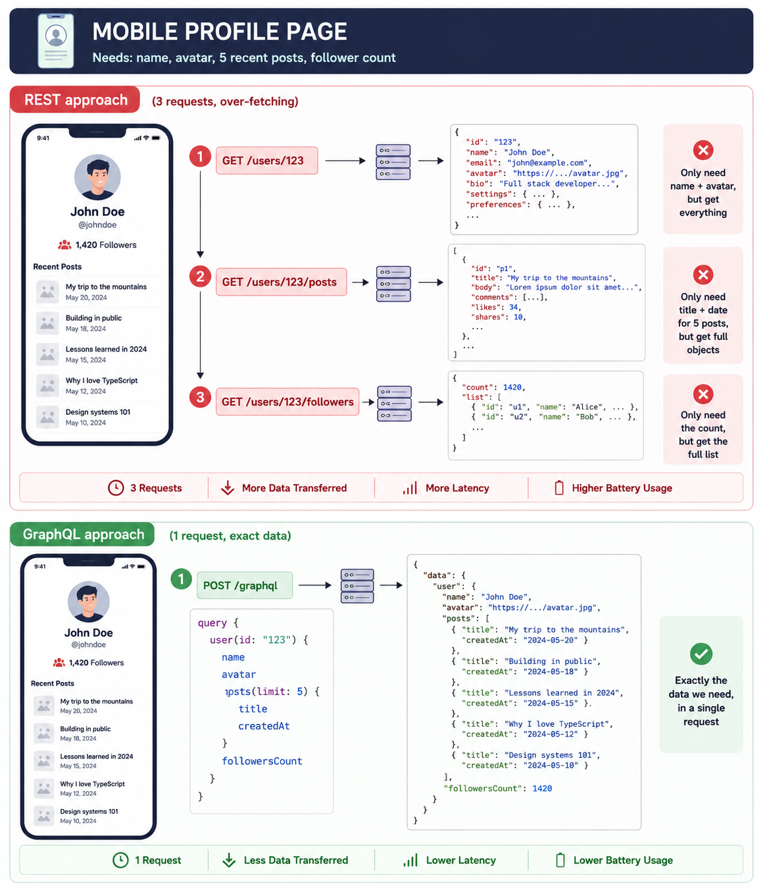

# Networking And Protocols

*12 min read · Updated 16 May 2026 Topic 13 of 77 Bookmark Mark done 5A · Topic 13 of 77*

**Source:** [https://www.geekyfrontend.in/learn/complete-frontend-kit/networking-and-protocols](https://www.geekyfrontend.in/learn/complete-frontend-kit/networking-and-protocols)

---

# 5A. Networking & Protocols

**Questions:** 6 **Difficulty:** Junior to Senior **Companies:** Google, Amazon, Flipkart, Razorpay, Swiggy, Microsoft, Atlassian

---

## Q 5.1 What happens when you type a URL in the browser and press Enter? Walk through the complete pipeline.

**Difficulty:** Junior-Mid (depth expected scales with experience) **Asked at:** Google, Amazon, Flipkart, Microsoft, Razorpay — asked at literally every company

This is the most commonly asked web fundamentals question. Interviewers don't want a memorized list — they want to see how deep you can go at each step.



**Steps 1-6: Network Phase**

**1. URL Parsing** — The browser breaks the URL into components:

javascript

```
https://www.example.com:443/products?category=shoes#reviews
  ─────   ───────────────  ───  ────────  ──────────────  ───────
  protocol     domain       port   path    query params    fragment
```

**2. DNS Resolution** — The browser converts the domain name to an IP address. Checks caches in order: browser cache → OS cache → router cache → ISP resolver. If none have it, a recursive lookup happens through root → TLD → authoritative nameservers. (See Q5.2 for the full breakdown.)

**3. TCP Connection** — Three-way handshake establishes a reliable connection:

javascript

```
Client ────── SYN ──────→ Server     "I want to connect"
  Client ←──── SYN-ACK ──── Server     "OK, acknowledged"
  Client ────── ACK ──────→ Server     "Great, we're connected"
                                        (1 round trip)
```

**4. TLS Handshake** — For HTTPS, encryption is established. TLS 1.3 does this in one round trip:

javascript

```
Client ──→ ClientHello (cipher suites + key share)
  Client ←── ServerHello (certificate + key share + finished)
  Client ──→ Finished (encrypted)
             ═══════════════════════════
             Encrypted connection ready
```

**5-6. HTTP Request & Response** — The browser sends the request, the server processes it and returns HTML.

**Steps 7-12: Rendering Phase**

**7. HTML Parsing → DOM** — The parser reads HTML byte-by-byte, building a tree:

javascript

```
document
               │
             <html>
            ┌──┴──┐
         <head>  <body>
            │       │
         <title>  <div>
                  ┌──┴──┐
                <h1>   <p>
```

When the parser encounters resources:

- `<link rel="stylesheet">` → Fetches CSS. **CSS is render-blocking** — nothing paints until CSSOM is built.
- `<script>` (no defer/async) → **Pauses HTML parsing**, fetches and executes the script.
- `<script defer>` → Downloads in parallel, executes after parsing.
- ``, `<video>` → Starts fetching but doesn't block parsing.

**8. CSS Parsing → CSSOM** — CSS is parsed into a tree that resolves inheritance, specificity, and cascade for every element.

**9. Render Tree** — DOM + CSSOM combined. Contains only visible elements:

javascript

```
DOM Tree          CSSOM             Render Tree
  ─────────    +    ──────     =      ───────────
  <html>            body{...}         <html>
    <body>          .hidden{          <body>
      <h1>            display:none      <h1> (with computed styles)
      <div hidden>  }                   │
      <p>           h1{...}             <p> (with computed styles)
                    p{...}
                                      (div hidden is EXCLUDED)
```

**10. Layout** — The browser calculates exact pixel positions and sizes. Percentages, flexbox, grid, viewport units all resolve to concrete numbers.

**11. Paint** — Fills in actual pixels: text, colors, images, borders, shadows.

**12. Composite** — Elements on separate GPU layers (elements with `transform`, `opacity`, `will-change`) are composited together. This is why `transform` animations are smooth — they skip layout and paint entirely.

**Why this matters for frontend performance:**

Every step is an optimization opportunity:

javascript

```
Step          │ Optimization
  ──────────────┼──────────────────────────────────────────────
  DNS           │ dns-prefetch, preconnect
  TCP/TLS       │ HTTP/2 (single connection), preconnect
  HTTP          │ Compression (Brotli), CDN, caching
  HTML Parsing  │ Streaming HTML, defer/async scripts
  CSS Parsing   │ Critical CSS inlining, code splitting
  Layout        │ Avoid layout thrashing, use transform
  Paint         │ Reduce paint complexity, use opacity
  Composite     │ Promote to GPU layers with will-change
```

**Follow-up:** "Where would you focus first to improve performance?"

Use Chrome DevTools Performance tab to identify the bottleneck. If the waterfall shows long bars on network requests — focus on DNS/connection/download. If the flame chart shows long "Parse HTML" or "Recalculate Style" — reduce bundle size and render-blocking resources. If you see repeated "Layout" events — you have layout thrashing. The answer is always "measure first, then optimize the bottleneck."

---

## Q 5.2 Explain DNS resolution step by step. What are the caching layers?

**Difficulty:** Mid **Asked at:** Google, Amazon, Microsoft

DNS translates human-readable domain names into IP addresses. Without it, you'd need to remember `142.250.80.46` instead of `google.com`.



Each step: if the cache has the answer, return immediately. If not, ask the next level. The full recursive lookup (root → TLD → authoritative) only happens on a complete cache miss, which is rare for popular domains.

**DNS record types frontend engineers should know:**

javascript

```
Record  │ Purpose                        │ Example
  ────────┼────────────────────────────────┼──────────────────────────
  A       │ Maps domain → IPv4 address     │ example.com → 93.184.216.34
  AAAA    │ Maps domain → IPv6 address     │ example.com → 2606:2800:...
  CNAME   │ Alias to another domain        │ www.example.com → example.com
  TXT     │ Text data (verification, SPF)  │ "v=spf1 include:_spf.google..."
  MX      │ Mail server for the domain     │ mail.example.com
```

**Why this matters for frontend performance:**

DNS adds 20-120ms per new domain. If your page loads from 5 different domains, that's potentially 5 sequential DNS lookups.

html

```
<!-- Resolve DNS early for domains you'll need -->
<link rel="dns-prefetch" href="https://api.example.com" />

<!-- Full connection setup (DNS + TCP + TLS) for critical domains -->
<link rel="preconnect" href="https://cdn.example.com" crossorigin />
```

**Follow-up:** "What happens when DNS fails?"

The browser shows `ERR_NAME_NOT_RESOLVED`. Causes: domain doesn't exist, DNS servers are down, DNS cache poisoned, or network-level DNS blocking. In production: use multiple DNS providers, set low TTLs for faster failover, and add health checks.

---

## Q 5.3 What happens during TCP connection and TLS handshake? Why should a frontend engineer care?

**Difficulty:** Mid **Asked at:** Google, Amazon, Flipkart



**TCP Three-Way Handshake** establishes reliable, ordered delivery. The three messages (SYN, SYN-ACK, ACK) ensure both sides are ready to communicate. This costs one full round trip — if the server is 50ms away, the handshake takes ~100ms.

**TLS 1.3 Handshake** adds encryption in one round trip. The client sends supported cipher suites and a Diffie-Hellman key share. The server responds with its certificate and its own key share. Both sides derive encryption keys from the key exchange.

**TLS Session Resumption:** On subsequent visits, TLS 1.3 supports **0-RTT resumption** — the client sends encrypted data in the very first message using keys from a previous session.

**Why frontend engineers should care:**

javascript

```
DNS:      ~50ms    (new domain)
  TCP:      ~50ms    (one round trip)
  TLS:      ~50ms    (one round trip, TLS 1.3)
  HTTP:     ~50ms    (request + response)
  ──────────────────
  Total:    ~200ms   before any HTML arrives
```

This is per domain. If your page loads resources from 4 different origins (your server, CDN, API, font provider), you're potentially paying this cost 4 times.

html

```
<!-- Save ~150ms per domain by doing DNS+TCP+TLS early -->
<link rel="preconnect" href="https://api.example.com" crossorigin />
<link rel="preconnect" href="https://fonts.googleapis.com" crossorigin />
```

**Follow-up:** "What's the difference between TCP and UDP, and why does HTTP/3 use UDP?"

TCP guarantees ordered, reliable delivery. If one packet is lost, everything waits for retransmission — this is head-of-line blocking. UDP doesn't guarantee order or reliability but is faster (no handshake, no blocking). HTTP/3's QUIC protocol builds on UDP but adds its own reliability per stream, so a lost packet only blocks the affected stream, not the entire connection.

---

## Q 5.4 Compare HTTP/1.1 vs HTTP/2 vs HTTP/3. What changed and why?

**Difficulty:** Mid **Asked at:** Google, Amazon, Flipkart, Razorpay, Swiggy

Each version solved fundamental problems with the previous one.



### Comparison Table

javascript

```
Feature              │ HTTP/1.1      │ HTTP/2         │ HTTP/3
  ─────────────────────┼───────────────┼────────────────┼────────────────
  Transport            │ TCP           │ TCP            │ QUIC (UDP)
  Connections needed   │ 6 per domain  │ 1 per domain   │ 1 per domain
  Multiplexing         │ No            │ Yes (streams)  │ Yes (streams)
  Header compression   │ No            │ HPACK          │ QPACK
  Head-of-line block   │ Yes (HTTP)    │ Yes (TCP)      │ No
  Handshake RTTs       │ 3 (TCP+TLS)   │ 2 (TCP+TLS)    │ 1 (0-RTT ok)
  Server Push          │ No            │ Yes (deprecated)│ No
  Binary format        │ No (text)     │ Yes            │ Yes
  Connection migration │ No            │ No             │ Yes
```

**What HTTP/1.1 workarounds became unnecessary with HTTP/2:**

- **Domain sharding** (cdn1.example.com, cdn2.example.com) — now counterproductive, hurts multiplexing
- **Sprite sheets** — many small requests are fine with multiplexing
- **CSS/JS concatenation into one giant file** — code splitting is now preferred
- **Inlining small images as data URIs** — no longer needed

**What's still relevant with HTTP/2:**

- Bundling JS/CSS is still useful (compression is more efficient on larger files)
- Image optimization (WebP/AVIF, responsive images) still matters
- Minimizing total payload size is always relevant

**Follow-up:** "Do you still need to bundle JavaScript with HTTP/2?"

Yes, but for different reasons. HTTP/2 eliminates the cost of many parallel requests, so you don't need one giant bundle. But bundling still helps with compression efficiency (one large file compresses better than hundreds of tiny ones), tree-shaking (removing unused code), and build-time optimizations. The modern approach is code splitting — not one giant bundle, not hundreds of tiny files, but a few strategically split chunks.

---

## Q 5.5 What are the key REST API design principles? What do status codes, methods, and idempotency mean?

**Difficulty:** Junior **Asked at:** Every company

REST is a set of architectural principles for designing APIs. Most APIs you'll consume as a frontend engineer follow REST conventions.

### HTTP Methods

javascript

```
Method  │ Action          │ Idempotent? │ Has Body? │ Example
  ────────┼─────────────────┼─────────────┼───────────┼──────────────────────
  GET     │ Read / Fetch    │ Yes         │ No        │ GET /users/123
  POST    │ Create          │ No          │ Yes       │ POST /users
  PUT     │ Replace entire  │ Yes         │ Yes       │ PUT /users/123
  PATCH   │ Update partial  │ Yes         │ Yes       │ PATCH /users/123
  DELETE  │ Remove          │ Yes         │ No        │ DELETE /users/123
```

**Idempotency** means calling the same request multiple times produces the same end state:

- `GET /users/123` — Idempotent. Call it 100 times, you get the same user.
- `DELETE /users/123` — Idempotent. First call deletes, subsequent calls return 404, but the end state is the same (user is gone).
- `POST /users` — NOT idempotent. Each call creates a new user. This is why accidental double-clicks on "Submit" can create duplicates.

Frontend implication: always debounce or disable submit buttons on POST/PUT/PATCH requests.

### Status Codes

javascript

```
Code │ Meaning                │ Frontend Action
  ─────┼────────────────────────┼──────────────────────────────────
  200  │ OK                     │ Process the response data
  201  │ Created                │ Show success, redirect to new resource
  204  │ No Content             │ Success, no data to process
  ─────┼────────────────────────┼──────────────────────────────────
  301  │ Moved Permanently      │ SEO — update links
  304  │ Not Modified           │ Use cached version
  ─────┼────────────────────────┼──────────────────────────────────
  400  │ Bad Request            │ Show validation errors
  401  │ Unauthorized           │ Redirect to login
  403  │ Forbidden              │ Show "access denied" message
  404  │ Not Found              │ Show 404 page
  409  │ Conflict               │ Show conflict resolution UI
  422  │ Unprocessable          │ Show semantic validation errors
  429  │ Too Many Requests      │ Back off, retry with delay
  ─────┼────────────────────────┼──────────────────────────────────
  500  │ Internal Server Error  │ Show generic error, log to Sentry
  502  │ Bad Gateway            │ Retry after delay
  503  │ Service Unavailable    │ Show maintenance page, retry
```

**REST URL conventions:**

javascript

```
GET    /users                    → List all users
  POST   /users                    → Create a new user
  GET    /users/123                → Get user 123
  PUT    /users/123                → Replace user 123
  PATCH  /users/123                → Update fields on user 123
  DELETE /users/123                → Delete user 123
  GET    /users/123/orders         → List orders for user 123
  GET    /users/123/orders/456     → Get specific order

  Filtering:  GET /products?category=shoes&sort=price&order=asc
  Pagination: GET /products?page=2&limit=20
```

Resources are nouns (`/users`), not verbs (`/getUsers`). The HTTP method is the verb.

**A well-typed API client:**

typescript

```
async function apiClient<T>(endpoint: string, options?: RequestInit): Promise<T> {
  const response = await fetch(`https://api.example.com${endpoint}`, {
    headers: { 'Content-Type': 'application/json' },
    ...options,
  });

  if (!response.ok) {
    if (response.status === 401) redirectToLogin();
    if (response.status === 429) await retryAfter(response);
    throw new ApiError(response.status, await response.text());
  }

  if (response.status === 204) return undefined as T;
  return response.json();
}
```

**Follow-up:** "What's the difference between 401 and 403?"

401 = "I don't know who you are" (missing or invalid credentials → redirect to login). 403 = "I know who you are, but you're not allowed" (valid credentials but insufficient permissions → show access denied).

---

## Q 5.6 When would you choose GraphQL over REST? What problems does it solve?

**Difficulty:** Mid **Asked at:** Razorpay, Flipkart, Swiggy, Cred, Amazon

### The Problem REST Has



### 

One request. Exactly the fields you asked for. No over-fetching, no under-fetching.

**Frontend implementation:**

typescript

```
const PROFILE_QUERY = `
  query UserProfile($id: ID!) {
    user(id: $id) {
      name
      avatar
      posts(limit: 5) { id, title, createdAt }
      followersCount
    }
  }
`;

async function fetchProfile(userId: string) {
  const response = await fetch("/graphql", {
    method: "POST",
    headers: { "Content-Type": "application/json" },
    body: JSON.stringify({
      query: PROFILE_QUERY,
      variables: { id: userId },
    }),
  });

  const { data, errors } = await response.json();
  if (errors) throw new GraphQLError(errors);
  return data.user;
}
```

### When to Choose Which

javascript

```
Scenario                          │ REST          │ GraphQL
  ──────────────────────────────────┼───────────────┼───────────────
  Simple CRUD                       │ ✓ Simpler     │ Overkill
  Multiple clients (web + mobile)   │ Over-fetching │ ✓ Each gets exact data
  Complex nested relationships      │ Multiple calls│ ✓ One query
  File uploads                      │ ✓ Native      │ Needs workarounds
  HTTP caching                      │ ✓ URL-based   │ Complex (normalized)
  Real-time subscriptions           │ Needs WS      │ ✓ Built-in support
  Rapidly evolving API              │ New endpoints  │ ✓ Add fields freely
  Team familiarity                  │ ✓ Universal   │ Learning curve
```

**The N+1 problem:**

graphql

```
query {
  posts {          # 1 DB query for posts
    title
    author {       # 1 DB query PER post for its author = N queries
      name
    }
  }
}
# 50 posts = 1 + 50 = 51 database queries
```

Fix: DataLoader batches all author IDs and fetches them in one query.

**Follow-up:** "Have you used GraphQL in production?"

Talk about: query complexity limits (prevent deeply nested queries that overload the server), schema versioning, the team's learning curve, and normalized caching with Apollo or urql. The honest take for many teams: REST with good API design covers 90% of use cases, and GraphQL's complexity is justified mainly when you have multiple clients consuming the same data in different shapes.

---

## Learn More

- [An overview of HTTP (MDN) MDN](https://developer.mozilla.org/en-US/docs/Web/HTTP/Overview)
- [DNS (MDN glossary) MDN](https://developer.mozilla.org/en-US/docs/Glossary/DNS)
- [Every network protocol, simply explained YouTube](https://www.youtube.com/watch?v=IKYZDm1f4pc)
- [DNS lookup, TCP handshake & HTTP in 3 min YouTube](https://www.youtube.com/watch?v=1XbvNSwvkAs)
- [Master network protocols YouTube](https://www.youtube.com/watch?v=y6atCDyKNYg)
