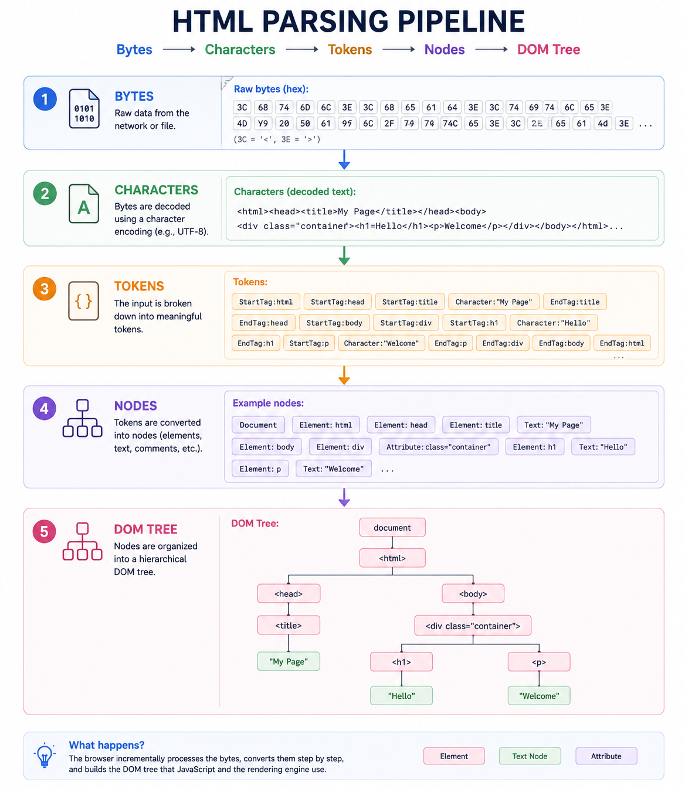
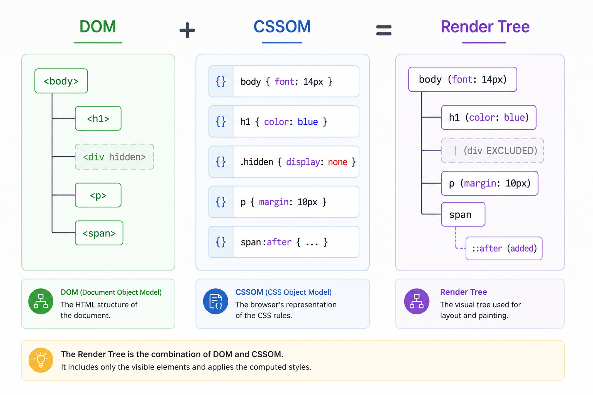
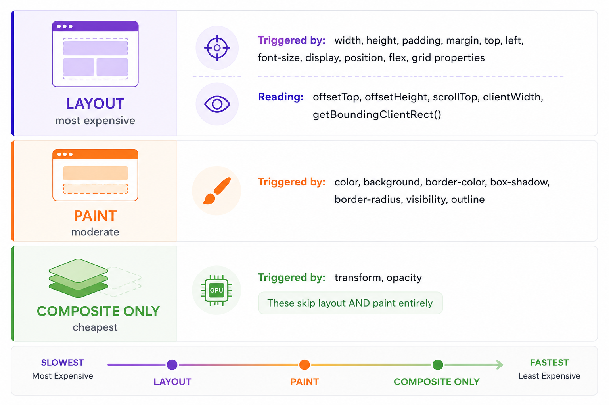
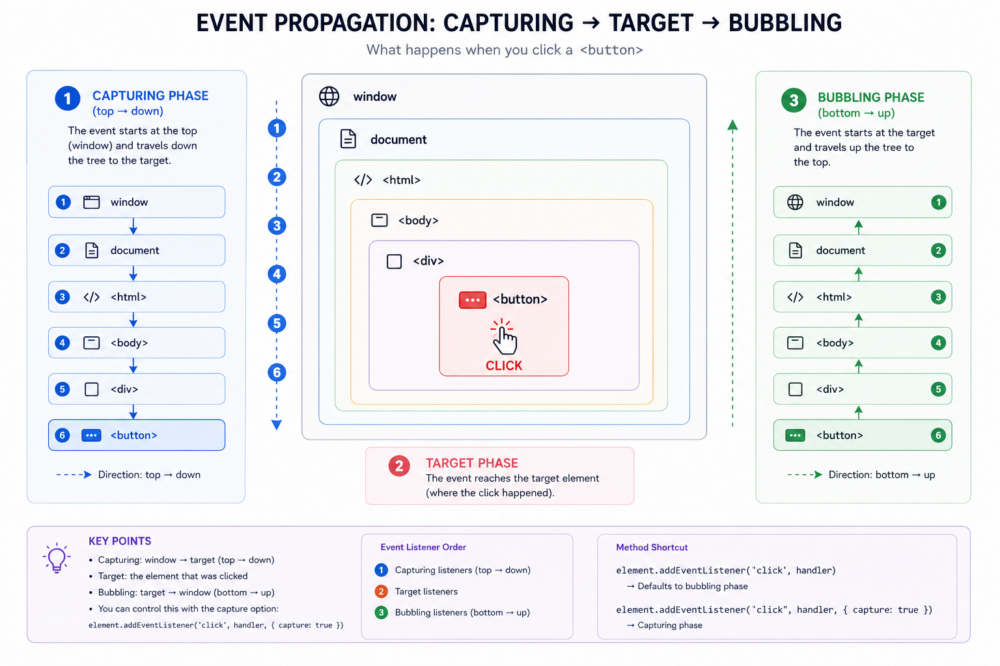
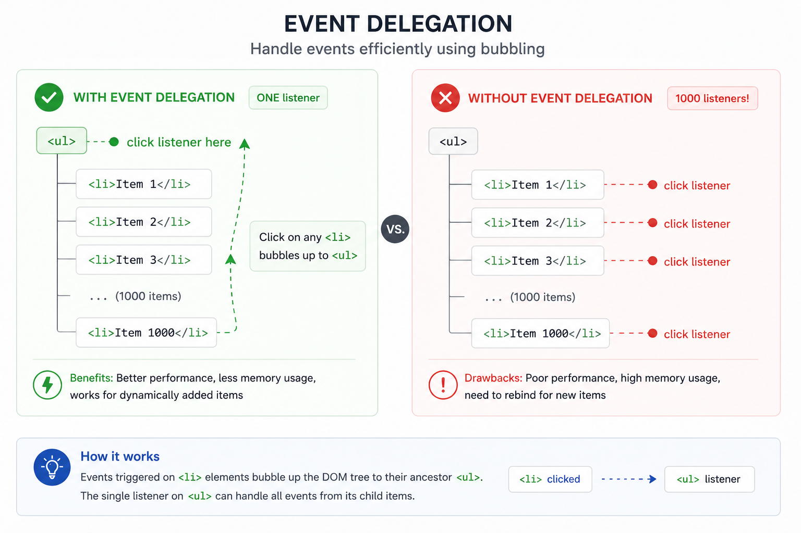
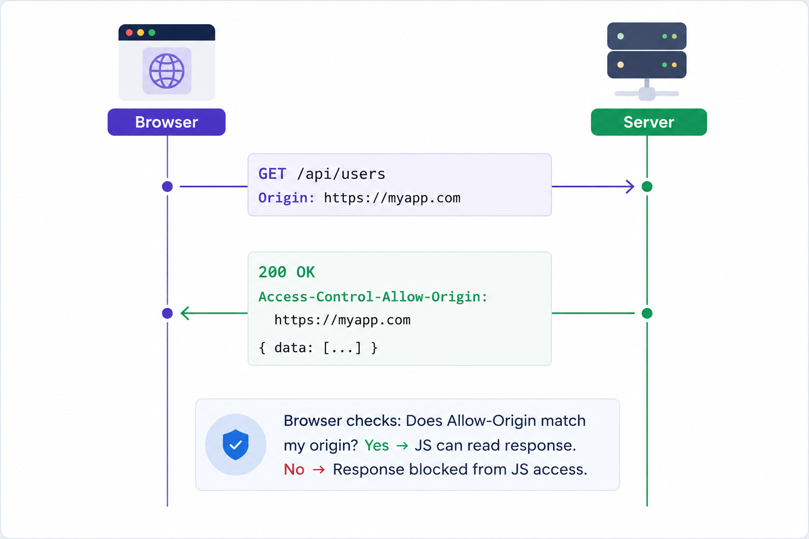
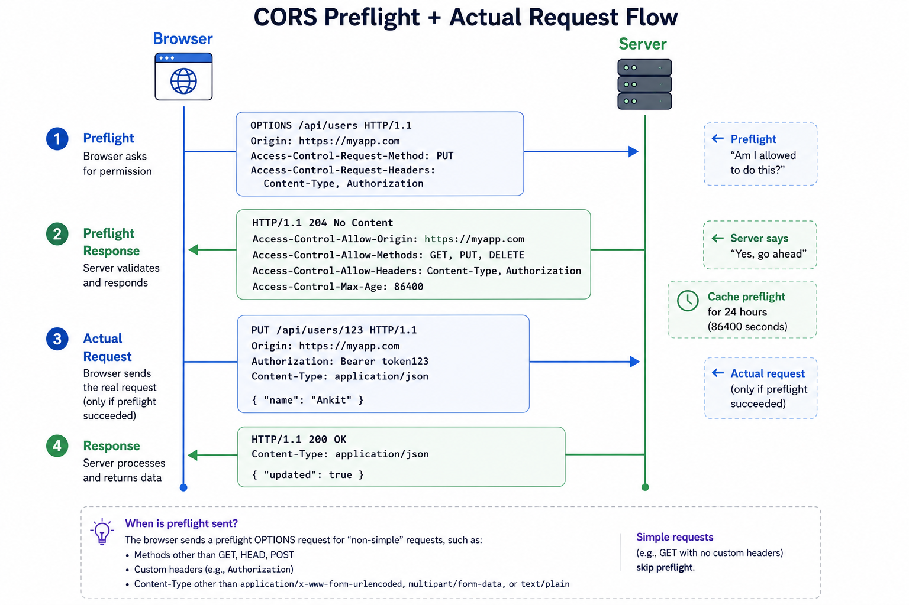
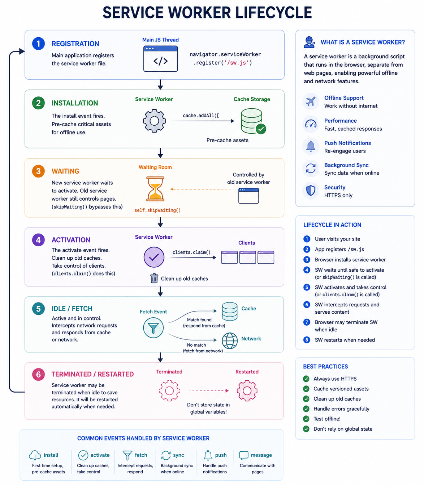
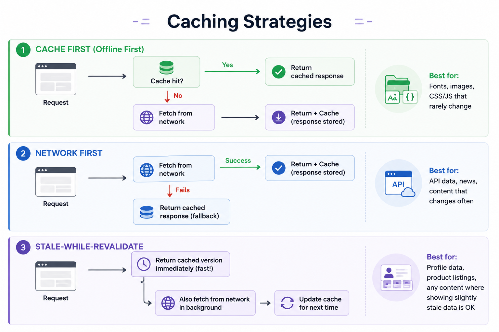
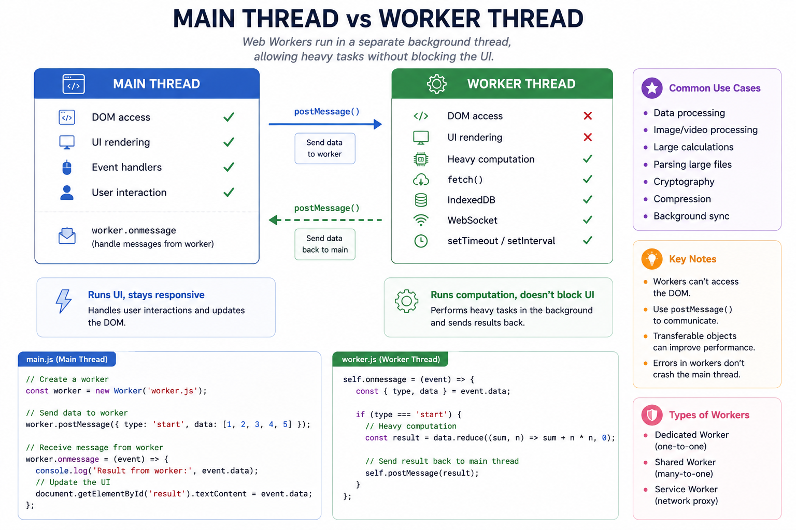

# Browser internals

*8 min read · Updated 16 May 2026 Topic 14 of 77 Bookmark Mark done 5B · Topic 14 of 77*

**Source:** [https://www.geekyfrontend.in/learn/complete-frontend-kit/browser-internals](https://www.geekyfrontend.in/learn/complete-frontend-kit/browser-internals)

---

# 5B. Browser Internals

**Questions:** 5 **Difficulty:** Mid to Senior **Companies:** Google, Amazon, Flipkart, Microsoft, Atlassian, Swiggy

---

## Q 5.7 How do the DOM and CSSOM work? Walk through construction, manipulation, and performance implications.

**Difficulty:** Mid **Asked at:** Google, Amazon, Flipkart, Microsoft

### DOM Construction Pipeline



### 

The parser handles errors gracefully — unlike JSON, malformed HTML doesn't crash. `<div><p></div></p>` is silently fixed. The parser auto-closes tags, fixes nesting, and builds a valid tree.

**CSSOM Construction** follows a similar pipeline. CSS is parsed into a tree that resolves inheritance, specificity, and cascade. CSS is **render-blocking** — the browser won't paint anything until the entire CSSOM is built because partial styling causes flash of unstyled content (FOUC).

### Render Tree = DOM + CSSOM



### Rules: • display: none → EXCLUDED from render tree (no space occupied) • visibility: hidden → INCLUDED in render tree (space occupied, not painted) • Pseudo-elements → ADDED to render tree (::before, ::after)

### Layout Thrashing — The Performance Killer

javascript

```
// BAD: Read → Write → Read → Write (forces layout on every cycle)
//
//  ┌─ Read offsetHeight ──→ forces layout calculation
//  │  Write style.width ──→ invalidates layout
//  │  Read offsetHeight ──→ forces layout AGAIN (expensive!)
//  │  Write style.width ──→ invalidates layout AGAIN
//  └─ ... repeat 1000 times
//
for (let i = 0; i < 1000; i++) {
  const h = items[i].offsetHeight;     // READ: forces synchronous layout
  items[i].style.width = `${h * 2}px`; // WRITE: invalidates layout
}

// GOOD: Batch all reads, then batch all writes
//
//  ┌─ Read all heights ──→ one layout calculation
//  └─ Write all widths ──→ one layout invalidation, recalculated once
//
const heights = Array.from(items).map(el => el.offsetHeight);  // ONE layout
items.forEach((el, i) => {
  el.style.width = `${heights[i] * 2}px`;                     // Batched writes
});
// Browser does ONE layout pass after all writes
```

### What Triggers Layout vs Paint vs Composite



### 

This hierarchy is why `transform: translateX(100px)` is fundamentally faster than `left: 100px` for animations — `transform` runs on the GPU compositor thread, while `left` triggers layout recalculation on the main thread.

**Follow-up:** "How does `requestAnimationFrame` fit into this?"

`requestAnimationFrame` schedules a callback right before the next paint. This ensures DOM reads and writes happen at the optimal point in the browser's render cycle, avoiding layout thrashing. It runs at 60fps (or the display's refresh rate) and pauses when the tab is hidden, saving resources.

---

## Q 5.8 Explain the event system — bubbling, capturing, delegation, and passive listeners.

**Difficulty:** Mid **Asked at:** Google, Amazon, Flipkart, Swiggy, Atlassian

### Event Propagation — Three Phases



### 

Most developers only use the bubbling phase (default). Capturing is used when you need to intercept an event before it reaches the target.

javascript

```
// Bubbling (default) — fires when event travels UP past this element
element.addEventListener("click", handler);

// Capturing — fires when event travels DOWN through this element
element.addEventListener("click", handler, { capture: true });
```

### Event Delegation

Instead of attaching listeners to every item, attach one listener to the parent:



javascript

```
// ONE listener handles unlimited items
document.querySelector('.list').addEventListener('click', (e) => {
  const item = e.target.closest('.list-item');
  if (!item) return;

  const id = item.dataset.id;
  handleItemClick(id);
});
```

Delegation benefits: works with dynamically added elements (no re-attaching), less memory (1 listener vs thousands), simpler cleanup.

**Passive listeners — for scroll performance:**

javascript

```
// Tells browser: "I won't call preventDefault(), scroll immediately"
element.addEventListener('wheel', handler, { passive: true });

// Chrome makes touchstart/touchmove passive by default since v56
```

Without `{ passive: true }`, the browser waits for your handler to finish before scrolling (in case you call `preventDefault()`). With passive, scrolling starts immediately.

`AbortController` **for cleanup:**

javascript

```
const controller = new AbortController();

window.addEventListener('resize', handleResize, { signal: controller.signal });
window.addEventListener('scroll', handleScroll, { signal: controller.signal });
window.addEventListener('keydown', handleKey, { signal: controller.signal });

// Remove ALL listeners at once
controller.abort();
```

This is cleaner than `removeEventListener` and works naturally with React's `useEffect` cleanup.

**Follow-up:** "In React, where are events attached?"

React uses delegation. In React 17+, all events are attached to the root DOM node (`createRoot` container), not to `document`. React's synthetic event system normalizes cross-browser differences.

---

## Q 5.9 What is the Same-Origin Policy? How does CORS work?

**Difficulty:** Mid **Asked at:** Every company — the "why is my API call blocked?" question

### Same-Origin Policy

javascript

```
Same origin = protocol + domain + port must ALL match

  https://example.com/page
    ↕
  https://example.com/api        ✓ Same (path doesn't matter)
  http://example.com/api         ✗ Different protocol (http vs https)
  https://api.example.com/data   ✗ Different subdomain
  https://example.com:8080/api   ✗ Different port
  https://other.com/api          ✗ Different domain
```

Without this policy, a malicious site could use your authenticated cookies to make requests to your bank's API and read your account data.

### CORS — Simple Request Flow



### CORS — Preflight Request Flow (PUT, DELETE, custom headers)



### 

**Common CORS errors and fixes:**

javascript

```
Error                                         │ Fix
  ──────────────────────────────────────────────┼──────────────────────────
  "No 'Access-Control-Allow-Origin' header"     │ Server must add the header
  "Must not be wildcard '*'" (with credentials) │ Server must specify exact origin
  "Header 'authorization' is not allowed"       │ Add to Allow-Headers on server
  "Method 'PUT' is not allowed"                 │ Add to Allow-Methods on server
```

**Key insight:** CORS is enforced by the browser, not the server. The server processes every request — CORS only controls whether the browser lets JavaScript read the response. Same request works from Postman/curl because they don't enforce CORS.

**Dev server proxy — the development workaround:**

javascript

```
// vite.config.js — proxy API requests through dev server (same origin)
export default {
  server: {
    proxy: {
      '/api': {
        target: 'https://api.example.com',
        changeOrigin: true,
      },
    },
  },
};
```

**Follow-up:** "Can you prevent CORS entirely?"

Only if you control both frontend and backend. Serve them from the same origin, or use a backend proxy. In production, the server must set proper CORS headers — there's no frontend-only fix.

---

## Q 5.10 What are Service Workers? Explain their lifecycle and caching strategies.

**Difficulty:** Senior **Asked at:** Google, Amazon, Flipkart, Microsoft

A Service Worker is a JavaScript file running in a separate thread that acts as a programmable proxy between your app and the network. It intercepts every network request and decides: return cached response? Fetch from network? Mix both?



### Caching Strategies



### 

**Implementation:**

javascript

```
// sw.js
self.addEventListener('install', (event) => {
  event.waitUntil(
    caches.open('v1').then(cache =>
      cache.addAll(['/', '/styles.css', '/app.js', '/offline.html'])
    )
  );
  self.skipWaiting();
});

self.addEventListener('activate', (event) => {
  event.waitUntil(
    caches.keys().then(keys =>
      Promise.all(keys.filter(k => k !== 'v1').map(k => caches.delete(k)))
    )
  );
  self.clients.claim();
});

// Stale-while-revalidate strategy
self.addEventListener('fetch', (event) => {
  event.respondWith(
    caches.open('dynamic').then(cache =>
      cache.match(event.request).then(cached => {
        const fetched = fetch(event.request).then(response => {
          cache.put(event.request, response.clone());
          return response;
        });
        return cached || fetched;
      })
    )
  );
});
```

**Key constraints:**

- HTTPS only (or localhost)
- Can't access DOM — communicates via `postMessage`
- Killed when idle, restarted when needed — no persistent state

**Follow-up:** "How do you handle updates?"

Version your cache names (`v1`, `v2`). Deploy new SW → it installs alongside the old one → `skipWaiting()` activates immediately → `activate` event cleans old caches. For critical updates, show a "new version available" banner prompting reload.

---

## Q 5.11 What are Web Workers and when would you use them?

**Difficulty:** Mid **Asked at:** Google, Amazon, Flipkart

JavaScript is single-threaded. Heavy computation blocks the main thread — no scrolling, no clicking, no animations during those 200ms of sorting 100,000 items.

### Web Worker Architecture



### 

javascript

```
// main.js
const worker = new Worker(
  new URL('./worker.js', import.meta.url),
  { type: 'module' }
);

worker.postMessage({ type: 'SORT', data: hugeArray });

worker.onmessage = (event) => {
  renderResults(event.data);  // UI stays responsive while sorting happened
};
```

javascript

```
// worker.js
self.onmessage = (event) => {
  const { type, data } = event.data;

  if (type === 'SORT') {
    const sorted = data.sort((a, b) => complexComparison(a, b));
    self.postMessage(sorted);
  }
};
```

**Transferable objects — avoiding copy overhead:**

javascript

```
const buffer = new ArrayBuffer(1024 * 1024); // 1MB

// Slow: copies entire buffer (2MB memory briefly)
worker.postMessage(buffer);

// Fast: transfers ownership (1MB total, buffer is empty in main thread after)
worker.postMessage(buffer, [buffer]);
```

**When to use Web Workers:**

javascript

```
Use Case                              │ Benefit
  ──────────────────────────────────────┼──────────────────────────
  Sorting/filtering 10,000+ items       │ UI stays responsive
  Parsing large CSV/JSON files          │ No main thread freeze
  Client-side search indexing           │ Search builds in background
  Image manipulation (Canvas)           │ Heavy pixel operations
  Markdown rendering (large documents)  │ Parsing off main thread
  Encryption/hashing                    │ CPU-intensive crypto ops
  ──────────────────────────────────────┼──────────────────────────
  DON'T use for:                        │
  Simple calculations (<16ms)           │ Message overhead > computation
  Anything needing DOM access           │ Workers can't touch DOM
  Small data transforms                 │ Copying data costs more than compute
```

**Follow-up:** "Web Workers vs Service Workers vs Shared Workers?"

Web Workers: dedicated to one page, die when page closes. For computation. Service Workers: network proxy, persists across pages, enables offline + push notifications. Shared Workers: accessible by multiple tabs of the same origin — useful for a shared WebSocket connection across tabs.

---

## Learn More

- [How browsers work (MDN) MDN](https://developer.mozilla.org/en-US/docs/Web/Performance/How_browsers_work)
- [How the browser renders a website YouTube](https://www.youtube.com/watch?v=SmE4OwHztCc)
- [How web browsers work, step by step YouTube](https://www.youtube.com/watch?v=yLY1MC0G6t4)
- [How web browsers work YouTube](https://www.youtube.com/watch?v=EoYkl8rwbiM)
