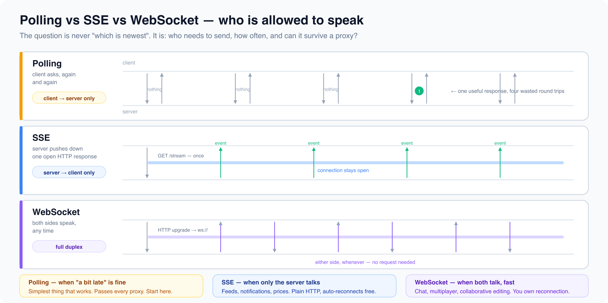

# Realtime and browser apis

*11 min read · Updated 16 Jul 2026 Topic 15 of 77 Bookmark Mark done 5C · Topic 15 of 77*

**Source:** [https://www.geekyfrontend.in/learn/complete-frontend-kit/realtime-and-browser-apis](https://www.geekyfrontend.in/learn/complete-frontend-kit/realtime-and-browser-apis)

---

# 5C. Real-time Communication & Browser APIs

**Questions:** 5 **Difficulty:** Mid to Senior **Companies:** Google, Amazon, Flipkart, Razorpay, Swiggy, Microsoft, Cred

---

## Q 5.12 How do WebSockets work? When would you use them and what are the scaling challenges?

**Difficulty:** Mid **Asked at:** Razorpay, Flipkart, Swiggy, Amazon, Cred

HTTP is request-response. The server can never send data to the client unless asked. For real-time features (chat, notifications, live scores), the client would need to constantly ask "any updates?" — that's polling, and it's wasteful.

WebSockets establish a persistent, bidirectional connection where both sides can send messages at any time.

### Connection Lifecycle

javascript

```
Client                                         Server
    │                                              │
    │  GET / HTTP/1.1                              │
    │  Upgrade: websocket                          │  ← HTTP upgrade request
    │  Connection: Upgrade                         │
    │─────────────────────────────────────────────→│
    │                                              │
    │  HTTP/1.1 101 Switching Protocols            │
    │  Upgrade: websocket                          │  ← Connection upgraded
    │←─────────────────────────────────────────────│
    │                                              │
    │ ═══════════ WebSocket Connection ═══════════ │
    │                                              │
    │  {"type": "chat", "msg": "Hello!"}          │
    │─────────────────────────────────────────────→│  ← Client can send anytime
    │                                              │
    │  {"type": "chat", "msg": "Hi there!"}       │
    │←─────────────────────────────────────────────│  ← Server can send anytime
    │                                              │
    │  {"type": "typing", "user": "Alice"}        │
    │←─────────────────────────────────────────────│  ← No request needed
    │                                              │
    │ ════════════════════════════════════════════ │
```

**Client implementation:**

javascript

```
const socket = new WebSocket('wss://api.example.com/ws');

socket.addEventListener('open', () => {
  socket.send(JSON.stringify({ type: 'join', room: 'general' }));
});

socket.addEventListener('message', (event) => {
  const data = JSON.parse(event.data);
  switch (data.type) {
    case 'chat_message':  appendMessage(data); break;
    case 'user_joined':   updateUserList(data.users); break;
    case 'typing':        showTypingIndicator(data.user); break;
  }
});

socket.addEventListener('close', (event) => {
  scheduleReconnect();  // Always implement reconnection
});
```

**Reconnection with exponential backoff:**

javascript

```
function createSocket(url) {
  let retryCount = 0;
  const maxRetries = 10;

  function connect() {
    const ws = new WebSocket(url);

    ws.onopen = () => { retryCount = 0; };

    ws.onclose = () => {
      if (retryCount < maxRetries) {
        const delay = Math.min(1000 * 2 ** retryCount, 30000);
        //                      1s, 2s, 4s, 8s, 16s, 30s, 30s...
        retryCount++;
        setTimeout(connect, delay);
      }
    };

    return ws;
  }
  return connect();
}
```



### WebSocket vs Polling vs SSE

javascript

```
Feature            │ Polling        │ Long Polling   │ SSE           │ WebSocket
  ───────────────────┼────────────────┼────────────────┼───────────────┼──────────────
  Direction          │ Client→Server  │ Client→Server  │ Server→Client │ Bidirectional
  Connection         │ New per request│ Held open      │ Held open     │ Persistent
  Overhead           │ High (headers) │ Medium         │ Low           │ Very low
  Real-time          │ Delayed        │ Near real-time │ Real-time     │ Real-time
  Complexity         │ Simple         │ Medium         │ Simple        │ Complex
  Scaling            │ Easy           │ Medium         │ Easy          │ Hard (stateful)
```

**Scaling challenges:**

- 10,000 concurrent users = 10,000 open TCP connections on your server
- Stateful connections — load balancing needs sticky sessions or a pub/sub layer (Redis) across servers
- Mobile networks drop connections frequently — robust reconnection is essential
- Heartbeats needed to detect dead connections (ping every 30s, timeout if no pong in 10s)

**Follow-up:** "When would you NOT use WebSockets?"

When data changes every few minutes (use simple polling or SSE), when you only need server→client updates (SSE is simpler), or when your infrastructure doesn't easily support persistent connections (serverless platforms like AWS Lambda have timeout limits).

---

## Q 5.13 What are Server-Sent Events? When would you choose SSE over WebSockets?

**Difficulty:** Mid **Asked at:** Google, Razorpay, Flipkart, Cred

SSE is one-directional streaming: server pushes data to the client over a single HTTP connection. The client can't send data back over the same connection.

### SSE vs WebSocket — Architecture Comparison

javascript

```
┌─── Server-Sent Events (SSE) ────────────────────────────┐
  │                                                          │
  │  Client ←──────────────────── Server                     │
  │          (one-way: server → client)                      │
  │                                                          │
  │  • Regular HTTP connection (text/event-stream)           │
  │  • Auto-reconnection built in                            │
  │  • Named events built in                                 │
  │  • Works through proxies/firewalls (it's just HTTP)      │
  └──────────────────────────────────────────────────────────┘

  ┌─── WebSocket ────────────────────────────────────────────┐
  │                                                          │
  │  Client ←─────────────────→ Server                       │
  │          (two-way: both can send)                        │
  │                                                          │
  │  • Protocol upgrade from HTTP                            │
  │  • Manual reconnection logic needed                      │
  │  • Raw messages (you parse everything)                   │
  │  • Sometimes blocked by corporate proxies                │
  └──────────────────────────────────────────────────────────┘
```

**Client implementation:**

javascript

```
const eventSource = new EventSource('/api/notifications');

// Default message event
eventSource.addEventListener('message', (event) => {
  const data = JSON.parse(event.data);
  showNotification(data);
});

// Custom named events
eventSource.addEventListener('price-update', (event) => {
  updateStockPrice(JSON.parse(event.data));
});

eventSource.addEventListener('breaking-news', (event) => {
  showBreakingBanner(JSON.parse(event.data));
});

// Auto-reconnects on failure — no manual logic needed!
eventSource.addEventListener('error', () => {
  console.log('Connection lost, auto-reconnecting...');
});
```

**The 2026 use case — AI response streaming:**

This is exactly how ChatGPT, Claude, and every AI product streams responses:

javascript

```
const eventSource = new EventSource('/api/chat?message=explain+closures');

let fullResponse = '';

eventSource.addEventListener('message', (event) => {
  if (event.data === '[DONE]') {
    eventSource.close();
    return;
  }

  const chunk = JSON.parse(event.data);
  fullResponse += chunk.text;
  updateChatUI(fullResponse);  // Each token appears as it's generated
});
```

**SSE limitation:** `EventSource` doesn't support custom headers. For authenticated streams, either pass the token as a query parameter or use `fetch()` with `ReadableStream`:

javascript

```
const response = await fetch('/api/stream', {
  headers: { Authorization: `Bearer ${token}` },
});

const reader = response.body.getReader();
const decoder = new TextDecoder();

while (true) {
  const { done, value } = await reader.read();
  if (done) break;
  handleChunk(decoder.decode(value));
}
```

**Choose SSE when:** server→client only updates (live scores, notifications, stock prices, AI streaming). **Choose WebSocket when:** bidirectional communication is needed (chat, collaboration, gaming).

---

## Q 5.14 Explain browser storage options — localStorage, sessionStorage, cookies, and IndexedDB.

**Difficulty:** Junior-Mid **Asked at:** Every company

### Storage Comparison

javascript

```
┌──────────────────┬───────────┬───────────┬──────────────┬────────────┐
  │                  │ local     │ session   │ Cookies      │ IndexedDB  │
  │                  │ Storage   │ Storage   │              │            │
  ├──────────────────┼───────────┼───────────┼──────────────┼────────────┤
  │ Size limit       │ ~5-10 MB  │ ~5-10 MB  │ ~4 KB each   │ 100s of MB │
  │ Lifetime         │ Forever   │ Tab close │ Expiry date  │ Forever    │
  │ Scope            │ All tabs  │ Per tab   │ All tabs +   │ All tabs   │
  │                  │ same      │ only      │ sent to      │ same       │
  │                  │ origin    │           │ server!      │ origin     │
  │ API              │ Sync      │ Sync      │ Ugly string  │ Async      │
  │ Sent to server   │ No        │ No        │ YES (every   │ No         │
  │                  │           │           │ request!)    │            │
  │ Access from JS   │ Yes       │ Yes       │ If not       │ Yes        │
  │                  │           │           │ HttpOnly     │            │
  └──────────────────┴───────────┴───────────┴──────────────┴────────────┘
```

### Decision Flowchart

javascript

```
Need to send data to server with every request?
    │
    Yes → COOKIES (auth tokens, session IDs)
    │     Use: HttpOnly + Secure + SameSite=Strict
    │
    No ──→ Is the data large or structured?
              │
              Yes → INDEXEDDB (offline data, large datasets, search indexes)
              │
              No ──→ Should it persist after the tab closes?
                        │
                        Yes → LOCALSTORAGE (theme, preferences, drafts)
                        │
                        No → SESSIONSTORAGE (wizard state, temp form data)
```

**localStorage:**

javascript

```
localStorage.setItem('theme', 'dark');
localStorage.setItem('cart', JSON.stringify([{ id: 1, qty: 2 }]));

const theme = localStorage.getItem('theme');  // 'dark'
const cart = JSON.parse(localStorage.getItem('cart'));

localStorage.removeItem('theme');
localStorage.clear();
```

**Cookies — important security attributes:**

javascript

```
// Setting a secure auth cookie (typically done by the server)
document.cookie = "session=abc123; path=/; max-age=86400; Secure; SameSite=Strict";

//  Secure     → Only sent over HTTPS
//  HttpOnly   → Not accessible via JavaScript (set by server only)
//  SameSite   → Strict: only first-party context
//               Lax: sent with top-level navigations
//               None: sent everywhere (requires Secure)
```

**The critical security mistake:**

javascript

```
┌─────────────────────────────────────────────────────────────┐
  │  NEVER store JWT/auth tokens in localStorage                │
  │                                                             │
  │  localStorage is accessible by ANY JavaScript on the page.  │
  │  If an XSS attack succeeds → attacker reads the token →    │
  │  full account takeover.                                     │
  │                                                             │
  │  Auth tokens belong in HttpOnly cookies.                    │
  │  JavaScript can't access HttpOnly cookies — XSS can't      │
  │  steal what JS can't read.                                  │
  └─────────────────────────────────────────────────────────────┘
```

**IndexedDB — for serious storage:**

javascript

```
const request = indexedDB.open('myapp', 1);

request.onupgradeneeded = (event) => {
  const db = event.target.result;
  const store = db.createObjectStore('products', { keyPath: 'id' });
  store.createIndex('category', 'category');
};

request.onsuccess = (event) => {
  const db = event.target.result;

  // Write
  const tx = db.transaction('products', 'readwrite');
  tx.objectStore('products').put({
    id: 1, name: 'Laptop', category: 'electronics', price: 999
  });

  // Read
  const readTx = db.transaction('products', 'readonly');
  readTx.objectStore('products').get(1).onsuccess = (e) => {
    console.log(e.target.result);
  };
};
```

Use IndexedDB for: offline PWA data, email client cache, document editor autosave, client-side search indexes. The API is callback-based and verbose — libraries like `idb` (by Jake Archibald) provide a promise-based wrapper.

---

## Q 5.15 What browser APIs should every frontend developer know in 2026?

**Difficulty:** Mid **Asked at:** Google, Amazon, Flipkart, Microsoft, Swiggy

**Intersection Observer — lazy loading and scroll triggers:**

javascript

```
const observer = new IntersectionObserver(
  (entries) => {
    entries.forEach(entry => {
      if (entry.isIntersecting) {
        entry.target.src = entry.target.dataset.src;  // Load image
        observer.unobserve(entry.target);
      }
    });
  },
  { rootMargin: '200px' }  // Start loading 200px before visible
);

document.querySelectorAll('img[data-src]').forEach(img => observer.observe(img));
```

Use for: lazy loading images, infinite scroll triggers, analytics (tracking viewport visibility), animate-on-scroll.

**ResizeObserver — responding to element size changes:**

javascript

```
const observer = new ResizeObserver((entries) => {
  for (const entry of entries) {
    const { width } = entry.contentRect;
    entry.target.classList.toggle('compact', width < 400);
  }
});

observer.observe(document.querySelector('.widget'));
```

Use for: responsive components that CSS container queries can't handle, chart resizing, dynamic layout adjustments.

`structuredClone()` **— deep cloning without hacks:**

javascript

```
const original = {
  name: 'Ankit',
  date: new Date(),
  nested: { scores: [1, 2, 3] },
  regex: /test/gi,
  map: new Map([['key', 'value']]),
};

const clone = structuredClone(original);
clone.nested.scores.push(4);

console.log(original.nested.scores);  // [1, 2, 3] — unaffected
```

Replaces `JSON.parse(JSON.stringify())` which breaks on Date, RegExp, Map, Set, undefined, and circular references.

**Broadcast Channel — cross-tab communication:**

javascript

```
// Tab 1: User logs out
const channel = new BroadcastChannel('auth');
channel.postMessage({ type: 'logout' });

// Tab 2: Receives the message
const channel = new BroadcastChannel('auth');
channel.onmessage = (event) => {
  if (event.data.type === 'logout') {
    window.location.href = '/login';
  }
};
```

Use for: syncing logout/login across tabs, theme changes, shared state consistency.

**Web Animations API — programmatic control:**

javascript

```
const animation = element.animate(
  [
    { transform: 'translateY(0)', opacity: 1 },
    { transform: 'translateY(-20px)', opacity: 0 },
  ],
  { duration: 300, easing: 'ease-out', fill: 'forwards' }
);

animation.pause();
animation.reverse();
animation.finished.then(() => element.remove());
```

Use for: dynamic animations where values are computed at runtime, orchestrating sequences, physics-based motion.

`AbortController` **— cancelling anything:**

javascript

```
const controller = new AbortController();

// Cancel a fetch
fetch('/api/data', { signal: controller.signal });

// Cancel event listeners
window.addEventListener('resize', handler, { signal: controller.signal });

// Cancel a timeout
const timeoutId = setTimeout(fn, 5000);
controller.signal.addEventListener('abort', () => clearTimeout(timeoutId));

// Cancel everything at once
controller.abort();
```

---

## Q 5.16 How does HTTPS work? What happens during TLS and why should a frontend engineer understand this?

**Difficulty:** Mid **Asked at:** Google, Amazon, Microsoft

### TLS 1.3 Handshake

javascript

```
Client                                         Server
    │                                              │
    │  ClientHello                                 │
    │  • Supported cipher suites                   │
    │  • Client random                             │
    │  • Key share (Diffie-Hellman public value)   │
    │  • SNI: "example.com"                        │
    │─────────────────────────────────────────────→│
    │                                              │
    │  ServerHello                                 │
    │  • Chosen cipher suite                       │
    │  • Server random                             │
    │  • Key share (server's DH public value)      │
    │  • Certificate (proving identity)            │
    │  • Finished (encrypted)                      │
    │←─────────────────────────────────────────────│
    │                                              │
    │  Both derive encryption keys from:           │
    │  client random + server random + DH exchange │
    │                                              │
    │  Client Finished (encrypted)                 │
    │─────────────────────────────────────────────→│
    │                                              │
    │  ═══ All traffic now encrypted ═══           │
```

**What TLS provides:**

1. **Encryption** — Data unreadable to anyone intercepting
2. **Authentication** — Server proves its identity via certificate
3. **Integrity** — Data can't be tampered with in transit

**Certificate chain verification:**

javascript

```
Browser's trusted CA list
         │
         ▼
  Root CA (DigiCert, Let's Encrypt)
         │ signed
         ▼
  Intermediate CA
         │ signed
         ▼
  Server Certificate (example.com)

  Browser checks:
  ✓ Signed by a trusted CA?
  ✓ Domain matches? (example.com or *.example.com)
  ✓ Not expired?
  ✓ Not revoked?

  Any check fails → "Your connection is not private" warning
```

**Why frontend engineers should care:**

**Mixed content** — An HTTPS page loading any resource over HTTP is broken:

html

```
<!-- BLOCKED on HTTPS pages -->

<script src="http://cdn.example.com/script.js"></script>

<!-- Correct -->

```

**HSTS** — forces HTTPS permanently:

javascript

```
Strict-Transport-Security: max-age=31536000; includeSubDomains; preload
```

After receiving this header, the browser will never make an HTTP request to this domain — it upgrades to HTTPS automatically, even if the user types `http://`.

**Where NOT to store secrets:**

javascript

```
┌──────────────────────────────────────────────────────┐
  │  Frontend code is PUBLIC. Everything is visible in    │
  │  browser DevTools.                                    │
  │                                                       │
  │  NEVER put in frontend code:                          │
  │  • API keys (even in .env / NEXT_PUBLIC_*)            │
  │  • Database credentials                               │
  │  • Secret tokens                                      │
  │  • Signing keys                                       │
  │                                                       │
  │  Secrets live on the server. Frontend authenticates    │
  │  via session cookies / OAuth tokens. Server adds API  │
  │  keys when proxying to third-party services.          │
  └──────────────────────────────────────────────────────┘
```

**Follow-up:** "What's the difference between TLS 1.2 and TLS 1.3?"

TLS 1.3 reduced the handshake from 2 round trips to 1 (and 0-RTT for returning visitors), removed support for insecure cipher suites (no more RSA key exchange, no CBC mode), and simplified the protocol. All modern browsers require TLS 1.2 minimum, and most servers now support TLS 1.3.

---

## Learn More

- [WebSockets API (MDN) MDN](https://developer.mozilla.org/en-US/docs/Web/API/WebSockets_API)
- [Server-sent events (MDN) MDN](https://developer.mozilla.org/en-US/docs/Web/API/Server-sent_events)
- [SSE vs WebSocket YouTube](https://www.youtube.com/watch?v=Zt2uGx2gsco)
- [WebSockets vs polling vs SSE YouTube](https://www.youtube.com/watch?v=OP99ry_vRcA)
- [WebSockets vs Server-Sent Events YouTube](https://www.youtube.com/watch?v=1pHEwnUovls)
