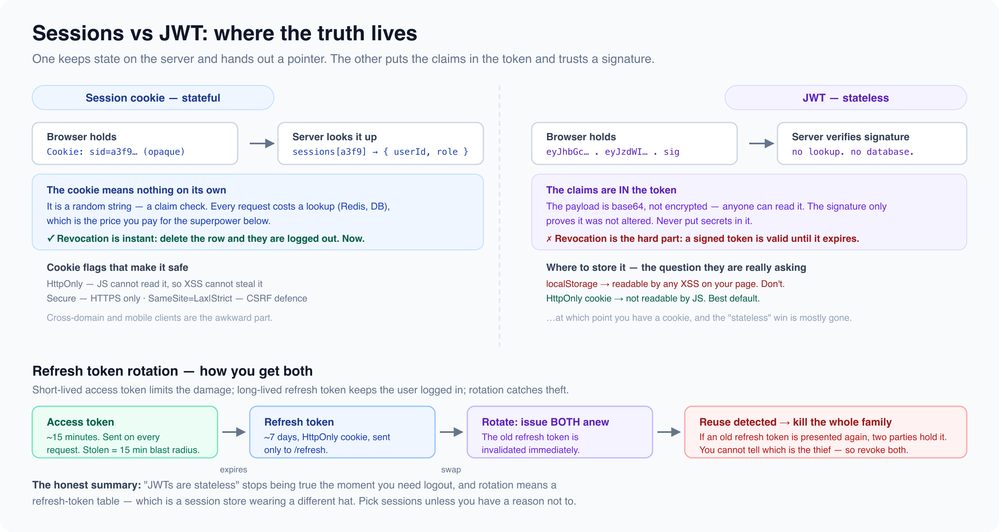

# Authentication and authorization

*10 min read · Updated 16 Jul 2026 Topic 17 of 77 Bookmark Mark done 6B · Topic 17 of 77*

**Source:** [https://www.geekyfrontend.in/learn/complete-frontend-kit/authentication-and-authorization](https://www.geekyfrontend.in/learn/complete-frontend-kit/authentication-and-authorization)

---

# 6B. Authentication & Authorization

**Questions:** 3 **Difficulty:** Mid to Senior **Companies:** Google, Amazon, Flipkart, Razorpay, PhonePe, Swiggy, Cred

---



## Q 6.5 JWT vs session cookies — how do they work, where should tokens be stored, and what's refresh token rotation?

**Difficulty:** Senior **Asked at:** Razorpay, Flipkart, PhonePe, Amazon, Cred

This is one of the most debated topics in frontend security. The answer depends on your threat model.

### Session-Based Authentication

javascript

```
┌──────────┐                              ┌───────────┐
  │  Browser  │                              │  Server   │
  │           │  POST /login                 │           │
  │           │  { email, password }         │           │
  │           │─────────────────────────────→│           │
  │           │                              │  Creates  │
  │           │  Set-Cookie: session=abc123  │  session  │
  │           │  HttpOnly; Secure; SameSite  │  in DB /  │
  │           │←─────────────────────────────│  Redis    │
  │           │                              │           │
  │  Cookie   │  GET /api/profile            │           │
  │  auto-    │  Cookie: session=abc123      │  Looks up │
  │  attached │─────────────────────────────→│  session  │
  │           │                              │  in DB    │
  │           │  200 OK { user data }        │           │
  │           │←─────────────────────────────│           │
  └──────────┘                              └───────────┘
```

Session lives on the server. Cookie is just an identifier. Server looks up the session on every request.

### JWT-Based Authentication

javascript

```
┌──────────┐                              ┌───────────┐
  │  Browser  │                              │  Server   │
  │           │  POST /login                 │           │
  │           │  { email, password }         │           │
  │           │─────────────────────────────→│           │
  │           │                              │  Creates  │
  │           │  { accessToken: "eyJ...",    │  JWT      │
  │           │    refreshToken: "xyz..." }  │  (signed, │
  │           │←─────────────────────────────│  not      │
  │           │                              │  stored)  │
  │  Stores   │  GET /api/profile            │           │
  │  token    │  Authorization: Bearer eyJ.. │  Verifies │
  │  in ??    │─────────────────────────────→│  signature│
  │           │                              │  (no DB   │
  │           │  200 OK { user data }        │   lookup) │
  │           │←─────────────────────────────│           │
  └──────────┘                              └───────────┘
```

JWT contains the user data (payload), signed by the server. Server verifies the signature without a database lookup — the token IS the session.

### Comparison

javascript

```
Aspect              │ Session Cookie           │ JWT
  ────────────────────┼──────────────────────────┼──────────────────────
  State               │ Stateful (server stores) │ Stateless (self-contained)
  Scalability         │ Needs shared session     │ Any server can verify
                      │ store (Redis) for        │ (just needs the secret)
                      │ multiple servers          │
  Revocation          │ Easy (delete from DB)    │ Hard (token valid until
                      │                          │ expiry, need a blocklist)
  XSS vulnerability   │ HttpOnly cookie =        │ If in localStorage,
                      │ JS can't read it         │ XSS steals it
  CSRF vulnerability  │ Needs SameSite or CSRF   │ Not vulnerable if using
                      │ tokens                    │ Authorization header
  Size per request    │ ~20 bytes (session ID)   │ ~800+ bytes (full JWT)
  Mobile/API clients  │ Awkward (cookies less    │ Natural (header-based)
                      │ common in native apps)    │
```

### Where to Store the JWT — The Critical Question

javascript

```
┌──────────────────────────────────────────────────────────────┐
  │  Option 1: localStorage                                      │
  │  ──────────────────────                                      │
  │  ✓ Easy to use                                               │
  │  ✓ Persists across tabs and refreshes                        │
  │  ✗ ANY JavaScript on the page can read it                    │
  │  ✗ XSS = complete token theft = account takeover             │
  │  ✗ NEVER use for sensitive applications                      │
  ├──────────────────────────────────────────────────────────────┤
  │  Option 2: HttpOnly cookie                                    │
  │  ────────────────────────                                    │
  │  ✓ JavaScript cannot access it (HttpOnly)                    │
  │  ✓ XSS cannot steal the token                                │
  │  ✓ Automatically sent with requests (no code needed)         │
  │  ✗ Needs CSRF protection (SameSite=Strict solves this)       │
  │  ✗ Slightly more complex server setup                        │
  │  ★ RECOMMENDED for web applications                          │
  ├──────────────────────────────────────────────────────────────┤
  │  Option 3: In-memory variable                                │
  │  ──────────────────────                                      │
  │  ✓ XSS can't steal it (no persistent storage)               │
  │  ✗ Lost on page refresh (needs silent re-auth)              │
  │  ✗ Lost on new tab (needs refresh token in HttpOnly cookie)  │
  │  ★ Used for access token with refresh token in cookie        │
  └──────────────────────────────────────────────────────────────┘
```

### Refresh Token Rotation

javascript

```
┌─ Initial Login ──────────────────────────────────────────────┐
  │                                                              │
  │  Server issues:                                              │
  │  • Access token (short-lived: 15 min) → stored in memory     │
  │  • Refresh token (long-lived: 7 days) → HttpOnly cookie      │
  └──────────────────────────────────────────────────────────────┘

  ┌─ Access Token Expires ───────────────────────────────────────┐
  │                                                              │
  │  Client ──→ POST /auth/refresh                               │
  │             Cookie: refresh_token=old_token                  │
  │                                                              │
  │  Server ──→ Validates old_token                              │
  │         ──→ Issues NEW access token + NEW refresh token      │
  │         ──→ Invalidates old refresh token                    │
  │                                                              │
  │  Why rotate? If an attacker steals the refresh token,        │
  │  the next time the real user refreshes, the old token is     │
  │  already used → server detects anomaly → revokes all         │
  │  tokens for that user.                                       │
  └──────────────────────────────────────────────────────────────┘
```

**The practical recommendation:**

For web applications: use HttpOnly cookies for the refresh token, keep the access token in memory (JavaScript variable), and use `SameSite=Strict` to prevent CSRF. When the access token expires (15 minutes), silently refresh it using the cookie-based refresh token. On page reload, make a silent refresh call to get a new access token.

**Follow-up:** "What happens if the user has multiple tabs open?"

Each tab has its own in-memory access token. When one tab refreshes and gets a new refresh token (rotation), the old refresh token is invalidated — the other tabs' next refresh call would fail. Solutions: use `BroadcastChannel` to share the new access token across tabs, or use a single-leader refresh pattern (one tab refreshes, others wait and reuse the result).

---

## Q 6.6 How does OAuth 2.0 work? What is PKCE and why do SPAs need it?

**Difficulty:** Senior **Asked at:** Google, Amazon, Razorpay, Cred

OAuth 2.0 lets users log in to your app using their Google/GitHub/Microsoft account without sharing their password with you. Your app never sees the user's Google password — it only receives a token that grants limited access.

### Authorization Code Flow with PKCE (for SPAs)

javascript

```
┌──────────┐         ┌───────────────┐         ┌──────────────┐
  │  Browser  │         │  Auth Server  │         │  Your API    │
  │  (SPA)    │         │  (Google)     │         │  Server      │
  └─────┬─────┘         └──────┬────────┘         └──────┬───────┘
        │                      │                         │
   1.   │  Generate:           │                         │
        │  code_verifier (random string)                 │
        │  code_challenge = SHA256(verifier)              │
        │                      │                         │
   2.   │  Redirect to Google: │                         │
        │  /authorize?         │                         │
        │    client_id=xyz     │                         │
        │    redirect_uri=     │                         │
        │      myapp.com/cb    │                         │
        │    code_challenge=   │                         │
        │      abc123          │                         │
        │    code_challenge_   │                         │
        │      method=S256     │                         │
        │─────────────────────→│                         │
        │                      │                         │
   3.   │  User logs in at     │                         │
        │  Google, consents    │                         │
        │                      │                         │
   4.   │  Redirect back:      │                         │
        │  myapp.com/cb?       │                         │
        │    code=authcode123  │                         │
        │←─────────────────────│                         │
        │                      │                         │
   5.   │  POST /token         │                         │
        │  { code: authcode123,│                         │
        │    code_verifier:    │  Verifies:              │
        │      original_random │  SHA256(verifier)       │
        │    client_id: xyz }  │  == stored challenge?   │
        │─────────────────────→│                         │
        │                      │                         │
   6.   │  { access_token,     │                         │
        │    id_token,         │                         │
        │    refresh_token }   │                         │
        │←─────────────────────│                         │
        │                      │                         │
   7.   │  GET /api/user       │                         │
        │  Authorization:      │                         │
        │    Bearer access_tok │                         │
        │──────────────────────┼────────────────────────→│
        │                      │                         │
   8.   │  { user data }       │                         │
        │←─────────────────────┼─────────────────────────│
```

**Why PKCE (Proof Key for Code Exchange)?**

Without PKCE, the authorization code in step 4 travels through the URL, which could be intercepted (browser extensions, shared computers, network logs). An attacker with the code could exchange it for tokens.

PKCE prevents this: the SPA generates a random `code_verifier` (step 1), sends the hash (`code_challenge`) to the auth server (step 2), and later proves it knows the original verifier (step 5). An attacker who intercepts the code can't use it because they don't have the original verifier.

javascript

```
// Generate PKCE values
async function generatePKCE() {
  const verifier = generateRandomString(128);
  const encoder = new TextEncoder();
  const data = encoder.encode(verifier);
  const digest = await crypto.subtle.digest('SHA-256', data);
  const challenge = btoa(String.fromCharCode(...new Uint8Array(digest)))
    .replace(/\+/g, '-').replace(/\//g, '_').replace(/=/g, '');

  return { verifier, challenge };
}

// Store verifier in sessionStorage (needed for step 5)
const { verifier, challenge } = await generatePKCE();
sessionStorage.setItem('pkce_verifier', verifier);

// Redirect to auth server (step 2)
window.location.href = `https://auth.google.com/authorize?` +
  `client_id=${CLIENT_ID}` +
  `&redirect_uri=${REDIRECT_URI}` +
  `&response_type=code` +
  `&scope=openid profile email` +
  `&code_challenge=${challenge}` +
  `&code_challenge_method=S256`;
```

**Why SPAs can't use the simpler "Implicit Flow":**

The implicit flow returned tokens directly in the URL (`myapp.com/cb#access_token=xyz`). This was convenient but insecure — tokens in URLs get logged in browser history, server logs, and referrer headers. The Authorization Code flow with PKCE is now the recommended approach for all SPAs.

**Follow-up:** "Should the token exchange (step 5) happen on the frontend or backend?"

Ideally on the backend. The SPA sends the authorization code to your own backend, which exchanges it for tokens server-side (where the `client_secret` can be safely stored). The backend then sets an HttpOnly cookie with the session/token. This keeps tokens out of the browser entirely. If you don't have a backend-for-frontend (BFF), PKCE makes the client-side exchange secure enough.

---

## Q 6.7 How do you handle input validation and sanitization? What's the difference between client-side and server-side?

**Difficulty:** Mid **Asked at:** Every company

javascript

```
┌──────────────────────────────────────────────────────────────┐
  │                                                              │
  │  Client-side validation = UX                                 │
  │  ─────────────────────────                                   │
  │  Purpose: Fast feedback for the user.                        │
  │  "Your password needs 8 characters."                         │
  │  Can be bypassed: curl, Postman, browser DevTools.           │
  │  NOT a security boundary.                                    │
  │                                                              │
  │  Server-side validation = SECURITY                           │
  │  ────────────────────────────                                │
  │  Purpose: Protect the system from malicious input.           │
  │  Cannot be bypassed by the client.                           │
  │  The ONLY real defense.                                      │
  │                                                              │
  │  You need BOTH. Client for UX, server for security.          │
  │                                                              │
  └──────────────────────────────────────────────────────────────┘
```

**Client-side validation patterns:**

javascript

```
// 1. Type checking and format validation
function validateEmail(email) {
  if (!email) return 'Email is required';
  if (!/^[^\s@]+@[^\s@]+\.[^\s@]+$/.test(email)) return 'Invalid email format';
  return null;
}

// 2. Length limits
function validateUsername(username) {
  if (username.length < 3) return 'Username must be at least 3 characters';
  if (username.length > 30) return 'Username must be under 30 characters';
  if (!/^[a-zA-Z0-9_]+$/.test(username)) return 'Letters, numbers, and underscores only';
  return null;
}

// 3. Schema validation with Zod (runtime type safety)
import { z } from 'zod';

const SignupSchema = z.object({
  email: z.string().email('Invalid email'),
  password: z.string().min(8, 'At least 8 characters')
    .regex(/[A-Z]/, 'Need one uppercase letter')
    .regex(/[0-9]/, 'Need one number'),
  age: z.number().min(18, 'Must be 18 or older'),
});

function handleSubmit(formData) {
  const result = SignupSchema.safeParse(formData);
  if (!result.success) {
    return result.error.issues;  // Show errors to user
  }
  // Send validated data to API
  await api.signup(result.data);
}
```

**Sanitization — when you must render user HTML:**

javascript

```
import DOMPurify from 'dompurify';

// User submitted rich text from a WYSIWYG editor
const userContent = '<p>Hello</p><script>stealCookies()</script>';

// DOMPurify strips dangerous tags/attributes, keeps safe HTML
const clean = DOMPurify.sanitize(userContent);
// Result: '<p>Hello</p>'
// <script> removed entirely, onerror attribute removed

// Customize what's allowed
const strictClean = DOMPurify.sanitize(userContent, {
  ALLOWED_TAGS: ['p', 'b', 'i', 'em', 'strong', 'a', 'ul', 'ol', 'li'],
  ALLOWED_ATTR: ['href', 'target'],
});
```

**The encoding rule by context:**

javascript

```
Context          │ Encoding method           │ Example
  ─────────────────┼───────────────────────────┼──────────────────
  HTML body        │ HTML entity encoding      │ < → &lt;
  HTML attribute   │ Attribute encoding        │ " → &quot;
  JavaScript       │ JS string escaping        │ ' → '
  URL parameter    │ encodeURIComponent()      │ & → %26
  CSS value        │ CSS escaping              │ \ → \\
```

React's JSX handles HTML body encoding automatically. The danger zones are `dangerouslySetInnerHTML`, dynamic `href` attributes (`javascript:` protocol), and style injection.

**Follow-up:** "Should validation logic be shared between frontend and backend?"

Ideally yes. Using Zod on both (Node.js backend + React frontend) means you define the schema once and validate in both places. The frontend schema catches formatting issues early (UX). The backend schema enforces the same rules as a security boundary. If the schemas are shared from a common package, they can't drift apart.

---

## Learn More

- [HTTP authentication (MDN) MDN](https://developer.mozilla.org/en-US/docs/Web/HTTP/Authentication)
- [Introduction to JWT jwt.io](https://jwt.io/introduction)
- [Auth vs authz: session vs JWT YouTube](https://www.youtube.com/watch?v=7IMMlUPX2OI)
- [Sessions vs JWT vs OAuth YouTube](https://www.youtube.com/watch?v=rUkCIfMm2NI)
- [Basic, Bearer, OAuth2, JWT & SSO YouTube](https://www.youtube.com/watch?v=9JPnN1Z_iSY)
