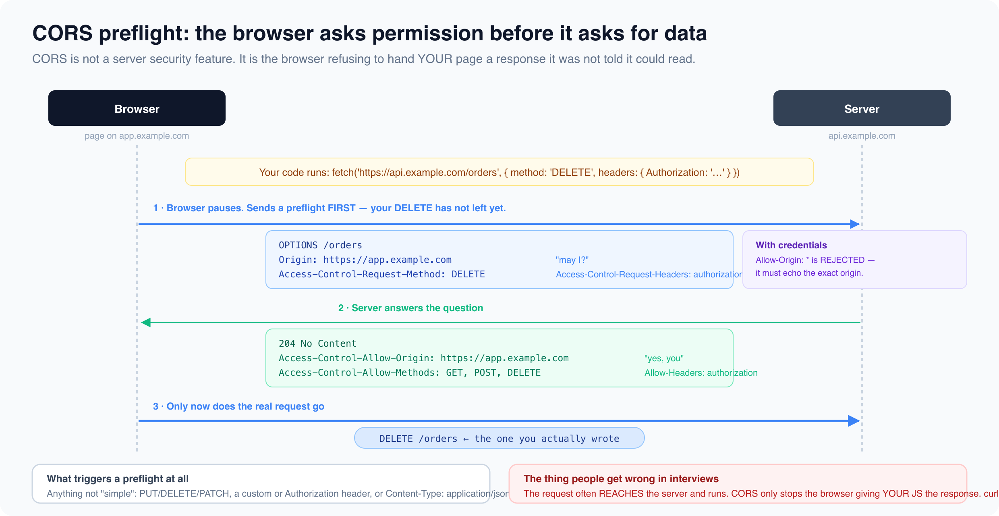

# Headers and infrastructure

*12 min read · Updated 16 Jul 2026 Topic 18 of 77 Bookmark Mark done 6C · Topic 18 of 77*

**Source:** [https://www.geekyfrontend.in/learn/complete-frontend-kit/headers-and-infrastructure](https://www.geekyfrontend.in/learn/complete-frontend-kit/headers-and-infrastructure)

---

# 6C. Headers & Infrastructure

**Questions:** 7 **Difficulty:** Mid to Senior **Companies:** Google, Amazon, Flipkart, Razorpay, Microsoft, Swiggy

---

## Q 6.8 What is Content Security Policy (CSP)? How do you configure it?

**Difficulty:** Senior **Asked at:** Google, Amazon, Razorpay, Microsoft

CSP is an HTTP header that tells the browser exactly which sources of content are allowed on your page. If an attacker injects a `<script>` tag via XSS, the browser refuses to execute it because the script's source isn't in the CSP whitelist. It's the single most powerful defense against XSS after output encoding.

javascript

```
Content-Security-Policy: 
  default-src 'self';
  script-src 'self' 'nonce-abc123' https://cdn.example.com;
  style-src 'self' 'unsafe-inline';
  img-src 'self' data: https://images.cdn.com;
  font-src 'self' https://fonts.googleapis.com;
  connect-src 'self' https://api.example.com;
  frame-ancestors 'self';
  base-uri 'self';
  form-action 'self';
```

### What Each Directive Controls

javascript

```
Directive      │ Controls                         │ Example
  ───────────────┼──────────────────────────────────┼─────────────────────
  default-src    │ Fallback for all resource types   │ 'self'
  script-src     │ JavaScript sources                │ 'self' 'nonce-abc'
  style-src      │ CSS sources                       │ 'self' 'unsafe-inline'
  img-src        │ Image sources                     │ 'self' data: https:
  font-src       │ Font file sources                 │ https://fonts.gstatic.com
  connect-src    │ fetch/XHR/WebSocket targets       │ https://api.example.com
  frame-src      │ iframe sources                    │ 'none'
  frame-ancestors│ Who can embed THIS page           │ 'self' (anti-clickjacking)
  base-uri       │ Valid <base> tag targets          │ 'self'
  form-action    │ Valid form submission targets      │ 'self'
  object-src     │ <object>, <embed>, <applet>       │ 'none' (always)
```

**The nonce-based approach (recommended for scripts):**

html

```
<!-- Server generates a random nonce per request -->
<script nonce="abc123">
  // This script runs because the nonce matches CSP
  console.log('Legitimate script');
</script>

<!-- An XSS-injected script WITHOUT the nonce is blocked -->
<script>
  // BLOCKED by CSP — no matching nonce
  stealCookies();
</script>
```

The server generates a new random nonce for every page load and includes it in both the CSP header and the legitimate script tags. Injected scripts can't know the nonce.

**Start with report-only mode:**

javascript

```
Content-Security-Policy-Report-Only: default-src 'self'; report-uri /csp-report;
```

This logs CSP violations without blocking anything. Deploy report-only first, monitor violations for a week, fix legitimate sources that were blocked, then switch to enforcement mode.

**Follow-up:** "What does `'unsafe-inline'` mean and why is it problematic?"

`'unsafe-inline'` allows inline `<script>` tags and inline event handlers (`onclick="..."`). This effectively disables XSS protection for scripts because injected inline scripts would also be allowed. Use nonce-based or hash-based CSP instead. For styles, `'unsafe-inline'` is more commonly accepted because inline style injection is lower risk than inline script injection.

---



## Q 6.9 How does CORS work in depth? Walk through preflight, credentials, and common debugging steps.

**Difficulty:** Mid **Asked at:** Every company

This was covered in Chapter 5 (Q5.9) at the conceptual level. Here we go deeper into the debugging and configuration side.

### Common CORS Configurations

javascript

```
Scenario                                │ Server Headers Needed
  ────────────────────────────────────────┼──────────────────────────────────
  Simple GET from different origin        │ Access-Control-Allow-Origin: *
                                          │   OR the specific origin
  ────────────────────────────────────────┼──────────────────────────────────
  POST with JSON body                     │ Allow-Origin + Allow-Headers:
                                          │   Content-Type
  ────────────────────────────────────────┼──────────────────────────────────
  Request with Authorization header       │ Allow-Origin (NOT *)
                                          │ Allow-Headers: Authorization
                                          │ Allow-Credentials: true
  ────────────────────────────────────────┼──────────────────────────────────
  PUT or DELETE request                   │ Allow-Origin
                                          │ Allow-Methods: PUT, DELETE
```

### Debugging Workflow

javascript

```
CORS error in console?
  │
  ├─ Is it a preflight (OPTIONS) failure?
  │   │
  │   Yes → Server needs to handle OPTIONS requests and return:
  │         Access-Control-Allow-Origin
  │         Access-Control-Allow-Methods
  │         Access-Control-Allow-Headers
  │
  ├─ "No Access-Control-Allow-Origin header"
  │   │
  │   └─ Server isn't returning the header at all.
  │      Fix: Add the header on the server / API gateway.
  │
  ├─ "Must not be wildcard '*'" error
  │   │
  │   └─ You're using credentials: 'include' but server says Allow-Origin: *
  │      Fix: Server must return the EXACT origin, not *.
  │
  └─ "Header 'X-Custom' is not allowed"
      │
      └─ Server needs: Access-Control-Allow-Headers: X-Custom
```

**The development workaround:**

javascript

```
// vite.config.js — proxy through dev server (same origin = no CORS)
export default {
  server: {
    proxy: {
      '/api': { target: 'https://api.example.com', changeOrigin: true },
    },
  },
};
```

In production, either serve frontend and API from the same origin, use a reverse proxy (nginx), or configure CORS headers properly on the API server.

**Follow-up:** "Why does CORS only affect browsers and not Postman or curl?"

CORS is a browser-enforced security policy. The browser adds the `Origin` header, makes the preflight, and blocks the response from JavaScript if headers don't match. Postman and curl don't enforce CORS — they're not protecting a user's cookies and session from malicious websites.

---

## Q 6.10 What is HSTS and why aren't HTTP redirects enough?

**Difficulty:** Mid **Asked at:** Google, Amazon, Microsoft

**The problem with HTTP→HTTPS redirects:**

javascript

```
User types: bank.com (no https://)
  │
  ├─ Browser sends: GET http://bank.com
  │  ↑ THIS request is unencrypted
  │  ↑ An attacker on the same WiFi can intercept it
  │  ↑ (man-in-the-middle attack)
  │
  ├─ Server responds: 301 Redirect → https://bank.com
  │  ↑ Too late — the first request was already intercepted
  │
  └─ Browser follows redirect to HTTPS
     (attacker may have already modified the response)
```

**HSTS (HTTP Strict Transport Security) fixes this:**

javascript

```
Strict-Transport-Security: max-age=31536000; includeSubDomains; preload
```

After receiving this header once (over HTTPS), the browser remembers: "Never make an HTTP request to this domain. Always upgrade to HTTPS automatically." No insecure first request ever happens again.

javascript

```
With HSTS (after first visit):
  
  User types: bank.com
  │
  └─ Browser internally upgrades to https://bank.com
     BEFORE making any network request.
     No HTTP request is ever sent.
```

`preload` goes further — submitting your domain to the browser's built-in HSTS preload list ([hstspreload.org](http://hstspreload.org)) means the browser knows to use HTTPS for your domain on the very first visit, before it's ever seen your HSTS header.

**Follow-up:** "What's the risk of setting a long `max-age`?"

If you accidentally set HSTS and then need to downgrade to HTTP (bad certificate, misconfiguration), users can't access your site over HTTP until `max-age` expires. Start with a short `max-age` (1 hour), verify HTTPS works correctly, then increase to 1 year.

---

## Q 6.11 What is Subresource Integrity (SRI)?

**Difficulty:** Mid **Asked at:** Google, Amazon, Razorpay

SRI protects against compromised CDNs. If you load a library from a CDN and the CDN is hacked, the attacker can modify the script to include malicious code. Every site using that CDN serves the malicious version.

html

```
<!-- Without SRI: if cdn.example.com is compromised, you serve malicious code -->
<script src="https://cdn.example.com/react.min.js"></script>

<!-- With SRI: browser checks the hash before executing -->
<script
  src="https://cdn.example.com/react.min.js"
  integrity="sha384-oqVuAfXRKap7fdgcCY5uykM6+R9GqQ8K/uxy9rx7HNQlGYl1kPzQho1wx4JwY8w"
  crossorigin="anonymous"
></script>
```

If the file content doesn't match the hash, the browser refuses to execute it. The attacker can modify the file, but they can't modify the hash in your HTML (that's on your server).

Generate SRI hashes:

bash

```
cat react.min.js | openssl dgst -sha384 -binary | openssl base64
# Or use srihash.org
```

**When to use SRI:** Any script or stylesheet loaded from a third-party CDN. Not needed for files served from your own origin (if your server is compromised, the attacker can change the hash too).

---

## Q 6.12 What secure headers should every frontend application set?

**Difficulty:** Mid **Asked at:** Google, Amazon, Flipkart, Microsoft

### The Secure Headers Checklist

javascript

```
Header                           │ Value                │ Purpose
  ─────────────────────────────────┼──────────────────────┼──────────────────────
  Content-Security-Policy          │ (see Q6.8)           │ XSS prevention
  Strict-Transport-Security        │ max-age=31536000;    │ Force HTTPS
                                   │ includeSubDomains    │
  X-Content-Type-Options           │ nosniff              │ Prevent MIME sniffing
  X-Frame-Options                  │ DENY or SAMEORIGIN   │ Clickjacking prevention
  Referrer-Policy                  │ strict-origin-when-  │ Control referrer info
                                   │ cross-origin         │ sent to other sites
  Permissions-Policy               │ camera=(), micro-    │ Disable browser features
                                   │ phone=(), geoloca-   │ you don't use
                                   │ tion=()              │
  X-DNS-Prefetch-Control           │ off                  │ Prevent DNS leaks
  Cross-Origin-Opener-Policy       │ same-origin          │ Isolate browsing context
  Cross-Origin-Embedder-Policy     │ require-corp         │ Protect against Spectre
```

`X-Content-Type-Options: nosniff` — Prevents the browser from guessing the MIME type of a response. Without it, a browser might interpret a text file as JavaScript and execute it.

`Referrer-Policy: strict-origin-when-cross-origin` — When navigating to another site, only send the origin (not the full URL path). Prevents leaking sensitive URL paths (e.g., `/admin/users/123/edit`) to third-party sites.

`Permissions-Policy` — Disables browser features you don't use. If your app doesn't need the camera, microphone, or geolocation, explicitly disable them. This prevents third-party scripts from accessing these features without your knowledge.

**Next.js security headers example:**

javascript

```
// next.config.js
const securityHeaders = [
  { key: 'X-Content-Type-Options', value: 'nosniff' },
  { key: 'X-Frame-Options', value: 'DENY' },
  { key: 'Referrer-Policy', value: 'strict-origin-when-cross-origin' },
  { key: 'Permissions-Policy', value: 'camera=(), microphone=(), geolocation=()' },
  { key: 'Strict-Transport-Security', value: 'max-age=31536000; includeSubDomains' },
];

module.exports = {
  async headers() {
    return [{ source: '/(.*)', headers: securityHeaders }];
  },
};
```

**How to verify:** Use [securityheaders.com](http://securityheaders.com) — enter your URL and it grades your headers A through F.

---

## Q 6.13 How do you handle dependency security? What are supply chain attacks?

**Difficulty:** Senior **Asked at:** Google, Amazon, Razorpay, Flipkart

### Supply Chain Attack Flow

javascript

```
┌──────────────────────────────────────────────────────────────┐
  │  Normal dependency chain:                                    │
  │                                                              │
  │  Your app ──→ react-query ──→ @tanstack/query-core           │
  │           ──→ date-fns                                       │
  │           ──→ zod                                            │
  │                                                              │
  │  Supply chain attack:                                        │
  │                                                              │
  │  Attacker compromises one package:                           │
  │                                                              │
  │  Your app ──→ some-utils (attacker published malicious       │
  │               version 2.1.1, your range ^2.0.0 accepts it)  │
  │               │                                              │
  │               └─→ Steals env variables on install            │
  │               └─→ Inserts crypto miner in bundle             │
  │               └─→ Exfiltrates data at runtime                │
  └──────────────────────────────────────────────────────────────┘
```

Real examples: `event-stream` (2018, added to steal Bitcoin), `ua-parser-js` (2021, crypto miner), `colors` and `faker` (2022, author intentionally corrupted).

**Defenses:**

**1. Lock your dependencies**

bash

```
# ALWAYS commit lockfiles — they pin exact versions
package-lock.json    (npm)
yarn.lock            (yarn)
pnpm-lock.yaml       (pnpm)
```

Without a lockfile, `npm install` resolves version ranges (`^2.0.0` could install `2.1.1` — the compromised version). With a lockfile, it installs the exact version you tested.

**2. Audit regularly**

bash

```
npm audit              # Check for known vulnerabilities
npm audit fix          # Auto-fix what's safe to update
npx npm-check-updates  # See what's outdatable
```

Run `npm audit` in CI — fail the build if critical vulnerabilities are found.

**3. Use exact versions for critical dependencies**

json

```
{
  "dependencies": {
    "react": "18.3.1",          // Exact version, not ^18.3.1
    "next": "14.2.15"           // Exact for framework
  }
}
```

**4. Review before updating**

Check the changelog and diff before updating. `npm diff some-package@2.0.0 some-package@2.1.0` shows exactly what changed.

**5. Use** `overrides` **to force-fix nested vulnerabilities**

json

```
{
  "overrides": {
    "vulnerable-package": "2.0.1"
  }
}
```

This forces all versions of `vulnerable-package` in the entire dependency tree to use `2.0.1`, even if other packages request older versions.

**Follow-up:** "What about Dependabot / Renovate?"

Automated tools that open PRs when dependencies have updates or known vulnerabilities. Dependabot (GitHub native) and Renovate (configurable, supports grouping updates) are the two main options. Configure them to auto-merge patch updates and require manual review for major versions.

---

## Q 6.14 What does a frontend security audit look like? What's the pre-release checklist?

**Difficulty:** Senior **Asked at:** Google, Razorpay, Flipkart, Amazon

### Pre-Release Security Checklist

javascript

```
┌─────────────────────────────────────────────────────────────┐
  │  TRANSPORT & HEADERS                                        │
  │  ─────────────────                                          │
  │  [ ] HTTPS everywhere, no mixed content                     │
  │  [ ] HSTS header set with long max-age                      │
  │  [ ] CSP header configured (at least report-only)           │
  │  [ ] X-Content-Type-Options: nosniff                        │
  │  [ ] X-Frame-Options or CSP frame-ancestors set             │
  │  [ ] Referrer-Policy set                                    │
  │  [ ] Permissions-Policy disables unused browser features    │
  │  [ ] securityheaders.com score is A or above                │
  ├─────────────────────────────────────────────────────────────┤
  │  AUTHENTICATION                                             │
  │  ──────────────                                             │
  │  [ ] Tokens stored in HttpOnly cookies, NOT localStorage    │
  │  [ ] SameSite=Strict or Lax on session cookies              │
  │  [ ] Secure flag on all cookies                             │
  │  [ ] Refresh token rotation implemented                     │
  │  [ ] Session timeout / idle timeout configured              │
  │  [ ] Password reset flow doesn't leak user existence        │
  │  [ ] Rate limiting on login / password reset endpoints      │
  ├─────────────────────────────────────────────────────────────┤
  │  INPUT & OUTPUT                                             │
  │  ─────────────                                              │
  │  [ ] All user input validated on server side                │
  │  [ ] HTML output is encoded (React JSX by default)          │
  │  [ ] dangerouslySetInnerHTML uses DOMPurify                 │
  │  [ ] No user data in href without protocol validation       │
  │  [ ] File uploads validate type, size, and content          │
  │  [ ] Error messages don't expose stack traces or internals  │
  ├─────────────────────────────────────────────────────────────┤
  │  DEPENDENCIES                                               │
  │  ────────────                                               │
  │  [ ] npm audit shows no critical/high vulnerabilities       │
  │  [ ] Lockfile is committed and up to date                   │
  │  [ ] No unnecessary dependencies (review package.json)      │
  │  [ ] SRI hashes on CDN-loaded scripts                       │
  │  [ ] Third-party scripts audited and minimized              │
  ├─────────────────────────────────────────────────────────────┤
  │  API & DATA                                                 │
  │  ──────────                                                 │
  │  [ ] CORS configured with specific origins, not *           │
  │  [ ] API rate limiting in place                             │
  │  [ ] Sensitive data not logged (passwords, tokens, PII)     │
  │  [ ] GraphQL depth/complexity limits configured             │
  │  [ ] No secrets in frontend code or .env files              │
  │      (NEXT_PUBLIC_* variables are PUBLIC)                    │
  ├─────────────────────────────────────────────────────────────┤
  │  MONITORING                                                 │
  │  ──────────                                                 │
  │  [ ] Error tracking (Sentry) configured                     │
  │  [ ] CSP violation reporting endpoint set up                │
  │  [ ] Login/auth anomaly alerting in place                   │
  │  [ ] Dependency vulnerability alerts enabled (Dependabot)   │
  └─────────────────────────────────────────────────────────────┘
```

**Automated tools you can run:**

bash

```
# Dependency vulnerabilities
npm audit

# Check security headers on a deployed URL
npx is-website-vulnerable https://yoursite.com

# Run OWASP ZAP for automated vulnerability scanning (CI)
docker run -t owasp/zap2docker-stable zap-baseline.py -t https://yoursite.com
```

**In the browser:**

- Chrome DevTools → Security tab → shows certificate, connection info, mixed content
- Lighthouse → Best Practices audit → catches insecure practices
- [securityheaders.com](http://securityheaders.com) → grades your response headers

**When interviewers ask this question**, they're testing whether you think about security as a process, not just a list of technologies. The checklist above is the answer they want — systematic, comprehensive, and actionable. Bonus points if you mention automating these checks in CI/CD so security isn't a manual step that gets skipped under deadline pressure.

**Follow-up:** "How do you handle a security incident (e.g., XSS found in production)?"

1. **Assess scope** — what data was potentially exposed, how many users affected
2. **Patch immediately** — fix the vulnerability, deploy hotfix
3. **Rotate secrets** — if tokens or keys were exposed, rotate them
4. **Notify affected users** — if user data was compromised
5. **Post-mortem** — how did it happen, what process failed, how to prevent recurrence
6. **Add regression test** — automated test that catches this specific vulnerability pattern

---

## Learn More

- [Content Security Policy (MDN) MDN](https://developer.mozilla.org/en-US/docs/Web/HTTP/CSP)
- [CORS (MDN) MDN](https://developer.mozilla.org/en-US/docs/Web/HTTP/CORS)
- [HTTP secure headers (CORS, CSP, HSTS) YouTube](https://www.youtube.com/watch?v=4bQeGUzHpOE)
- [CSP vs CORS explained YouTube](https://www.youtube.com/watch?v=OOYVPKeBmHo)
- [Stop copying CORS headers YouTube](https://www.youtube.com/watch?v=cGg7aRcIm8o)
