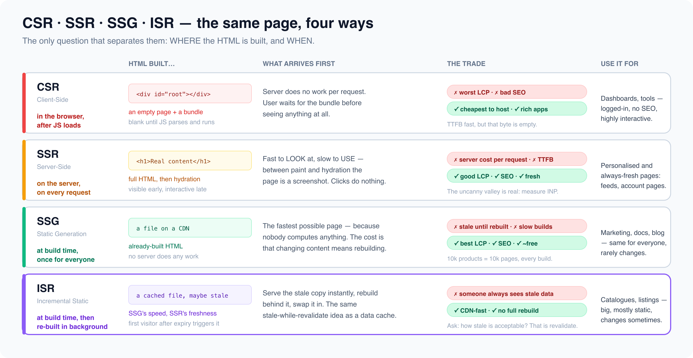

# Core rendering strategies

*9 min read · Updated 16 Jul 2026 Topic 19 of 77 Bookmark Mark done 7A · Topic 19 of 77*

**Source:** [https://www.geekyfrontend.in/learn/complete-frontend-kit/core-rendering-strategies](https://www.geekyfrontend.in/learn/complete-frontend-kit/core-rendering-strategies)

---

# 7A. Core Rendering Strategies

**Questions:** 4 **Difficulty:** Mid **Companies:** Google, Amazon, Flipkart, Razorpay, Swiggy, Microsoft, Atlassian

---



## Q 7.1 What is Client-Side Rendering (CSR)? What are its trade-offs?

**Difficulty:** Mid **Asked at:** Every company

CSR means the server sends a minimal HTML shell and a JavaScript bundle. The browser downloads the JavaScript, executes it, fetches data from APIs, and builds the entire page on the client. Until JavaScript runs, the user sees a blank page (or a loading spinner).

This is what you get with `create-react-app`, plain Vite + React, or any SPA without server-side rendering.

**How it works:**

The server responds with essentially this:

html

```
<!DOCTYPE html>
<html>
<head>
  <title>My App</title>
  <script defer src="/bundle.js"></script>
</head>
<body>
  <div id="root"></div>
  <!-- Empty. JavaScript will fill this. -->
</body>
</html>
```

The browser then downloads `bundle.js` (could be 200KB-2MB), parses and executes it, React mounts, API calls fire, and finally content appears.

**The timeline a user experiences:**

1. HTML arrives — blank page (just an empty `<div>`)
2. JavaScript downloads and parses — still blank
3. React mounts — loading spinner appears
4. API calls complete — actual content renders
5. Event listeners attach — page is interactive

The gap between step 1 and step 4 can be 2-5 seconds on a slow network. That's 2-5 seconds of nothing useful on screen.

**When CSR works well:**

- Dashboards and admin panels behind authentication (SEO doesn't matter)
- Highly interactive applications where the initial load is a one-time cost (Figma, Notion, Google Docs)
- Internal tools where users are on fast corporate networks
- Apps where the shell (sidebar, nav) is static and content loads progressively

**When CSR is the wrong choice:**

- Content-heavy pages that need SEO (product pages, blog posts, landing pages) — search crawlers see an empty page
- Marketing pages where First Contentful Paint matters for conversion
- Pages targeting users on slow mobile networks (3G in rural India)
- Any page where the user needs to see content before interacting

**The core metrics affected:**

- **FCP (First Contentful Paint):** Bad — nothing renders until JavaScript executes
- **LCP (Largest Contentful Paint):** Bad — main content waits for JS + API calls
- **INP (Interaction to Next Paint):** Can be good once loaded — all logic is client-side
- **CLS (Cumulative Layout Shift):** Risk — content popping in after API calls
- **SEO:** Poor unless you add SSR or prerendering

**Follow-up:** "How would you improve CSR performance without switching to SSR?"

Code splitting (load only the JS needed for the current route), preloading critical chunks, skeleton screens for perceived performance, service worker caching for return visits, and moving API calls to be route-aware so data fetching starts as early as possible (React Router loaders, TanStack Router).

---

## Q 7.2 What is Server-Side Rendering (SSR)? Explain the request flow and hydration.

**Difficulty:** Mid **Asked at:** Google, Amazon, Flipkart, Razorpay, Swiggy

SSR means the server generates the full HTML for a page on every request. The browser receives complete, renderable HTML — the user sees content immediately. Then JavaScript loads and "hydrates" the static HTML, making it interactive.

**The request flow:**

javascript

```
Browser                    Server                     Database/API
     │                         │                            │
  1. │── GET /products ───────→│                            │
     │                         │── fetch product data ─────→│
     │                         │←── products[] ─────────────│
     │                         │                            │
     │                         │ Renders React to HTML      │
     │                         │ (renderToString)           │
     │                         │                            │
  2. │←── Full HTML page ──────│                            │
     │                         │                            │
     │ User sees content                                    │
     │ (not interactive yet)                                │
     │                                                      │
  3. │ Downloads JS bundle                                  │
     │ React hydrates the HTML                              │
     │ (attaches event listeners                            │
     │  to existing DOM)                                    │
     │                                                      │
  4. │ Page is fully interactive                             │
```

**What hydration actually does:**

The server sends pre-rendered HTML. The browser displays it immediately — the user can read the content. Meanwhile, the JavaScript bundle downloads. When React loads, it doesn't throw away the server-rendered HTML and re-render. Instead, it "hydrates" — it walks through the existing DOM, attaches event listeners, and makes everything interactive. The HTML stays the same, but buttons now click, forms now submit, and state management kicks in.

jsx

```
// Server: renders React to HTML string
const html = renderToString(<App />);
// Result: <div><h1>Products</h1><ul><li>Shoes</li>...</ul></div>

// Client: hydrates the existing HTML (doesn't re-render)
hydrateRoot(document.getElementById('root'), <App />);
// React walks the DOM, attaches onClick handlers, sets up state
```

**Hydration mismatch errors:**

If the server-rendered HTML doesn't match what React expects on the client, you get a hydration mismatch warning. Common causes:

jsx

```
// BAD: Different output on server vs client
function Greeting() {
  return <p>Current time: {new Date().toLocaleString()}</p>;
  // Server renders at 10:00:01, client hydrates at 10:00:03
  // HTML doesn't match → hydration error
}

// FIX: Use useEffect for client-only values
function Greeting() {
  const [time, setTime] = useState(null);
  useEffect(() => {
    setTime(new Date().toLocaleString());
  }, []);
  return <p>Current time: {time ?? 'Loading...'}</p>;
}
```

Other common causes: browser extensions injecting attributes, `typeof window !== 'undefined'` checks producing different output, and locale-dependent formatting.

**When SSR is the right choice:**

- E-commerce product pages (SEO + fast FCP)
- Content sites (news, blogs, documentation)
- Marketing and landing pages (first impression matters)
- Any page where content should be visible before JavaScript loads

**When SSR adds unnecessary complexity:**

- Dashboards behind auth (no SEO need, users tolerate loading)
- Highly interactive apps where the "shell" is meaningless without JS (spreadsheets, design tools)
- Real-time apps where content changes every second anyway

**The cost of SSR:**

Every request runs through your server, rendering React on every page load. This means server compute cost scales with traffic, server response time (TTFB) depends on data fetching speed, and you need caching strategies (CDN, Redis) to avoid re-rendering identical pages. SSR also requires a Node.js server — you can't host on a static CDN like you can with CSR or SSG.

**Follow-up:** "What's the Time To Interactive (TTI) problem with SSR?"

The user sees content immediately (good FCP), but they can't interact until JavaScript hydrates (potentially seconds later). If a user clicks a button before hydration completes, nothing happens. This gap between "looks ready" and "is ready" is called the "uncanny valley" of SSR. Solutions: streaming SSR (Q7.5), progressive hydration (Q7.7), and React Server Components (Q7.6).

---

## Q 7.3 What is Static Site Generation (SSG)? When does it make sense?

**Difficulty:** Mid **Asked at:** Flipkart, Razorpay, Swiggy, Amazon

SSG renders pages to HTML at build time, not at request time. When a user visits the page, the server (or CDN) serves a pre-built HTML file. No server rendering happens per request. The pages are static files — the fastest possible delivery.

**How it works:**

javascript

```
Build Time (once, during deployment):
  ───────────────────────────────────────
  Framework fetches data from CMS/DB/API
  → Renders every page to static HTML
  → Outputs /products/shoes.html, /about.html, etc.
  → Deploys static files to CDN

  Request Time (every visit):
  ───────────────────────────────────────
  User requests /products/shoes
  → CDN serves pre-built shoes.html instantly
  → No server processing, no database queries
  → JavaScript hydrates for interactivity
```

Next.js SSG example:

jsx

```
// This runs at BUILD TIME, not request time
export async function generateStaticParams() {
  const products = await fetch('https://api.store.com/products').then(r => r.json());
  return products.map(p => ({ slug: p.slug }));
}

// This also runs at BUILD TIME
async function ProductPage({ params }) {
  const product = await fetch(`https://api.store.com/products/${params.slug}`).then(r => r.json());

  return (
    <main>
      <h1>{product.name}</h1>
      <p>{product.description}</p>
      <span>₹{product.price}</span>
    </main>
  );
}
```

**When SSG is the right choice:**

- Blog posts, documentation, marketing pages — content changes rarely
- Product catalog pages that update daily, not per-minute
- Any page where the content is the same for every user (no personalization)
- Sites where performance is critical — static files from a CDN are the fastest possible delivery

**When SSG doesn't work:**

- User-specific content (dashboard, profile, feed) — can't pre-build a different page per user
- Frequently updated content (live scores, stock prices) — stale within seconds
- Very large catalogs — building 10 million product pages at deploy time takes hours
- Content that changes based on request (geolocation, A/B tests)

**The build time problem:**

If you have 100,000 pages, SSG builds all 100,000 at deploy time. This can take 30-60 minutes. Every deployment, even if you only changed one page, rebuilds everything. This is where ISR (next question) comes in.

**Follow-up:** "Can you mix SSG with client-side data fetching?"

Yes, and this is the common pattern. The static HTML contains the unchanging content (product name, description, images), and client-side JavaScript fetches dynamic content (current price, inventory status, user reviews) after hydration. The user sees the static content instantly and the dynamic parts load moments later.

---

## Q 7.4 What is Incremental Static Regeneration (ISR)? How does stale-while-revalidate apply to pages?

**Difficulty:** Mid **Asked at:** Flipkart, Razorpay, Google, Amazon

ISR is the answer to SSG's biggest limitation: stale content. It lets you use static pages but refresh them in the background without a full rebuild.

The concept is borrowed from HTTP's `stale-while-revalidate` caching strategy: serve the cached (stale) version immediately, then regenerate the page in the background so the next visitor gets a fresh version.

**How it works:**

javascript

```
1. First request: Page doesn't exist yet
     → Server renders it (like SSR)
     → Caches the result
     → Returns HTML to the user

  2. Subsequent requests (within revalidation window):
     → Serves cached HTML instantly (like SSG)
     → No server rendering

  3. Request after revalidation period expires:
     → Serves stale cached HTML instantly (user isn't waiting)
     → Triggers background regeneration
     → Next request gets the fresh version
```

Next.js ISR:

jsx

```
// Page is statically generated AND revalidated every 60 seconds
async function ProductPage({ params }) {
  const product = await fetch(`https://api.store.com/products/${params.slug}`, {
    next: { revalidate: 60 },  // Revalidate at most every 60 seconds
  }).then(r => r.json());

  return (
    <main>
      <h1>{product.name}</h1>
      <p>₹{product.price}</p>
    </main>
  );
}
```

**On-demand revalidation — the more precise approach:**

Instead of time-based revalidation, you can trigger regeneration when content actually changes:

javascript

```
// API route that triggers revalidation
// Called by your CMS webhook when a product is updated
export async function POST(request) {
  const { slug } = await request.json();

  // Regenerate only the specific page that changed
  revalidatePath(`/products/${slug}`);

  return Response.json({ revalidated: true });
}
```

This is powerful because pages are only rebuilt when they actually change, not on a timer.

**ISR vs SSR vs SSG — the decision:**

- **SSG:** Content never changes (legal pages, docs) or changes only at deploy time
- **ISR:** Content changes occasionally (product pages, blog posts, catalogs) — minutes to hours between updates is acceptable
- **SSR:** Content changes per request or is user-specific (dashboards, personalized feeds, search results)

**Follow-up:** "What's the downside of ISR?"

The first visitor after content changes still sees stale content. If a product price changes from ₹999 to ₹799, the first visitor sees ₹999 while the regeneration happens in the background. The second visitor sees ₹799. For most content this is fine. For price-sensitive or time-critical content, SSR is safer.

---

## Learn More

- [Rendering on the web (web.dev) web.dev](https://web.dev/articles/rendering-on-the-web)
- [CSR, SSR, SSG, ISR explained YouTube](https://www.youtube.com/watch?v=VDqEg0IoSIs)
- [Rendering strategies: SSR/ISR/SSG/CSR YouTube](https://www.youtube.com/watch?v=bckIp4AYwO8)
- [CSR/SSR/SSG/RSC patterns YouTube](https://www.youtube.com/watch?v=SLQa-XdDOtk)
