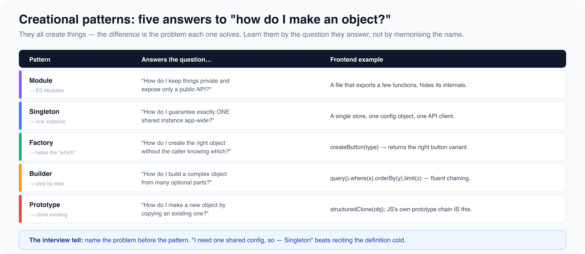

# Creational patterns

*9 min read · Updated 16 Jul 2026 Topic 24 of 77 Bookmark Mark done 9A · Topic 24 of 77*

**Source:** [https://www.geekyfrontend.in/learn/complete-frontend-kit/creational-patterns](https://www.geekyfrontend.in/learn/complete-frontend-kit/creational-patterns)

---

# 9A. Creational Patterns

**Questions:** 6 **Difficulty:** Mid **Companies:** Google, Amazon, Flipkart, Razorpay, Microsoft, Atlassian

---



## Q 9.1 What is the Module pattern? How does it relate to ES Modules?

**Difficulty:** Mid **Asked at:** Amazon, Flipkart, Atlassian

The Module pattern encapsulates code — it exposes a public API while hiding internal implementation. Before ES Modules existed, this was the only way to achieve encapsulation in JavaScript.

**The classic Module pattern (IIFE):**

javascript

```
const Counter = (function() {
  // Private — not accessible outside
  let count = 0;

  // Public API — returned object
  return {
    increment() { count++; },
    decrement() { count--; },
    getCount() { return count; },
  };
})();

Counter.increment();
Counter.increment();
Counter.getCount(); // 2
Counter.count;      // undefined — private
```

The IIFE (Immediately Invoked Function Expression) creates a closure. `count` lives inside that closure — nothing outside can access or modify it directly. Only the returned methods can.

**ES Modules — the modern equivalent:**

javascript

```
// counter.js
let count = 0;  // Module-scoped — private by default

export function increment() { count++; }
export function decrement() { count--; }
export function getCount() { return count; }

// Only exported members are accessible from outside
```

javascript

```
// app.js
import { increment, getCount } from './counter.js';
increment();
getCount(); // 1
// count is not accessible — it's not exported
```

ES Modules give you the same encapsulation without the IIFE boilerplate. Each file is a module with its own scope. Only `export`-ed members are visible to importers.

**When this pattern shows up in interviews:** Any time you're asked about encapsulation, data privacy, or "how would you prevent external code from modifying internal state." In React, custom hooks are essentially modules — they expose a public API (return values) while hiding internal state and logic.

**Follow-up:** "What's the difference between named exports and a default export?"

Named exports (`export function increment()`) force consumers to use the exact name (or alias with `as`). Default exports (`export default Counter`) let consumers name the import anything. Named exports are generally preferred because they're more explicit, better for tree-shaking, and auto-complete works better with them.

---

## Q 9.2 What is the Singleton pattern? When is it useful and when is it an anti-pattern?

**Difficulty:** Mid **Asked at:** Google, Amazon, Flipkart, Razorpay

Singleton ensures a class or module has exactly one instance throughout the application. Every reference points to the same object.

javascript

```
class Logger {
  static instance = null;

  constructor() {
    if (Logger.instance) {
      return Logger.instance;
    }

    this.logs = [];
    Logger.instance = this;
  }

  log(message) {
    const entry = { timestamp: Date.now(), message };
    this.logs.push(entry);
    console.log(`[${new Date(entry.timestamp).toISOString()}] ${message}`);
  }

  getLogs() {
    return [...this.logs];
  }
}

const logger1 = new Logger();
const logger2 = new Logger();
console.log(logger1 === logger2); // true — same instance
```

**The simpler approach — ES Modules are natural singletons:**

javascript

```
// logger.js — this module is only executed once
// Every file that imports it gets the same instance
const logs = [];

export function log(message) {
  logs.push({ timestamp: Date.now(), message });
}

export function getLogs() {
  return [...logs];
}
```

When multiple files `import { log } from './logger'`, they all share the same `logs` array. ES Modules are evaluated once and cached — the module body runs on the first import and subsequent imports return the cached exports. This is a singleton without any pattern code.

**When Singleton makes sense:**

- Global configuration/settings manager
- Logger that aggregates from the entire app
- Database connection pool
- Cache that's shared across services
- WebSocket connection manager (one connection, many consumers)

**When Singleton is an anti-pattern:**

- When it creates hidden global state that makes testing difficult — you can't isolate tests if they all share a singleton
- When it tightly couples modules to the singleton — hard to swap implementations
- When used purely for convenience ("I don't want to pass this as a prop") instead of genuine single-instance requirement

**Follow-up:** "How do you test code that uses a Singleton?"

Reset the instance between tests, or better — use dependency injection. Instead of importing the singleton directly, accept it as a parameter. In tests, pass a mock. In production, pass the real instance.

---

## Q 9.3 What is the Factory pattern? Where do you use it in frontend development?

**Difficulty:** Mid **Asked at:** Amazon, Flipkart, Google, Atlassian

Factory creates objects without exposing the creation logic. The caller says "give me an X" without knowing the exact class or constructor details.

javascript

```
// Without Factory — caller must know every class
function createNotification(type, message) {
  if (type === 'success') return new SuccessNotification(message);
  if (type === 'error') return new ErrorNotification(message);
  if (type === 'warning') return new WarningNotification(message);
  // Adding a new type means changing this function AND the caller
}

// With Factory — caller just specifies what it wants
class NotificationFactory {
  static types = {
    success: SuccessNotification,
    error: ErrorNotification,
    warning: WarningNotification,
  };

  static create(type, message) {
    const NotificationClass = this.types[type];
    if (!NotificationClass) throw new Error(`Unknown type: ${type}`);
    return new NotificationClass(message);
  }

  static register(type, NotificationClass) {
    this.types[type] = NotificationClass;
  }
}

// Usage
const notification = NotificationFactory.create('success', 'Order placed!');

// Extending — no existing code changes
NotificationFactory.register('info', InfoNotification);
```

**React's** `createElement` **is a Factory:**

javascript

```
// You write JSX:
<Button variant="primary">Click me</Button>

// Babel transforms it to a factory call:
React.createElement(Button, { variant: "primary" }, "Click me");

// createElement decides how to create the element based on the type
```

**Practical frontend use cases:**

javascript

```
// API client factory — create clients for different services
function createApiClient(service) {
  const configs = {
    users: { baseURL: '/api/users', timeout: 5000 },
    orders: { baseURL: '/api/orders', timeout: 10000 },
    payments: { baseURL: '/api/payments', timeout: 30000 },
  };

  const config = configs[service];
  return {
    get: (path) => fetch(`${config.baseURL}${path}`),
    post: (path, data) => fetch(`${config.baseURL}${path}`, {
      method: 'POST',
      body: JSON.stringify(data),
      signal: AbortSignal.timeout(config.timeout),
    }),
  };
}

const usersApi = createApiClient('users');
const ordersApi = createApiClient('orders');
```

**Follow-up:** "What's the difference between Factory and Abstract Factory?"

Factory creates one type of object with different configurations. Abstract Factory creates families of related objects — for example, a UI theme factory that creates a Button, Input, and Card that all match a "dark" or "light" theme. You'd use Abstract Factory when you need to ensure consistency across a set of related objects.

---

## Q 9.4 What is the Abstract Factory pattern?

**Difficulty:** Senior **Asked at:** Google, Microsoft

Abstract Factory creates families of related objects without specifying their concrete classes. In frontend, this maps to creating UI component sets that share a theme or design language.

javascript

```
// Abstract Factory — creates consistent component families
const LightThemeFactory = {
  createButton: (props) => ({ ...props, bg: '#3b82f6', color: '#fff', border: 'none' }),
  createInput: (props) => ({ ...props, bg: '#fff', border: '1px solid #e2e8f0' }),
  createCard: (props) => ({ ...props, bg: '#fff', shadow: '0 1px 3px rgba(0,0,0,0.1)' }),
};

const DarkThemeFactory = {
  createButton: (props) => ({ ...props, bg: '#6366f1', color: '#fff', border: 'none' }),
  createInput: (props) => ({ ...props, bg: '#1e293b', border: '1px solid #334155' }),
  createCard: (props) => ({ ...props, bg: '#0f172a', shadow: '0 1px 3px rgba(0,0,0,0.3)' }),
};

// Usage — swap the entire theme by swapping the factory
function renderPage(factory) {
  const button = factory.createButton({ label: 'Submit' });
  const input = factory.createInput({ placeholder: 'Email' });
  const card = factory.createCard({ children: [input, button] });
  return card;
}

renderPage(isDarkMode ? DarkThemeFactory : LightThemeFactory);
```

In practice, React's context-based theming (CSS custom properties or a ThemeProvider) solves this more elegantly. But the concept matters — when you build a design system that supports multiple brands or themes, you're implementing Abstract Factory whether you call it that or not.

---

## Q 9.5 What is the Builder pattern?

**Difficulty:** Mid **Asked at:** Amazon, Microsoft, Atlassian

Builder constructs complex objects step by step. Instead of a constructor with 15 parameters, each step is a chained method call that sets one aspect.

javascript

```
class QueryBuilder {
  constructor(table) {
    this.table = table;
    this.conditions = [];
    this.orderByField = null;
    this.orderDir = 'ASC';
    this.limitCount = null;
    this.offsetCount = null;
    this.selectedFields = ['*'];
  }

  select(...fields) {
    this.selectedFields = fields;
    return this;  // Return this for chaining
  }

  where(condition) {
    this.conditions.push(condition);
    return this;
  }

  orderBy(field, direction = 'ASC') {
    this.orderByField = field;
    this.orderDir = direction;
    return this;
  }

  limit(count) {
    this.limitCount = count;
    return this;
  }

  offset(count) {
    this.offsetCount = count;
    return this;
  }

  build() {
    let query = `SELECT ${this.selectedFields.join(', ')} FROM ${this.table}`;
    if (this.conditions.length) query += ` WHERE ${this.conditions.join(' AND ')}`;
    if (this.orderByField) query += ` ORDER BY ${this.orderByField} ${this.orderDir}`;
    if (this.limitCount) query += ` LIMIT ${this.limitCount}`;
    if (this.offsetCount) query += ` OFFSET ${this.offsetCount}`;
    return query;
  }
}

// Clean, readable, order-independent
const query = new QueryBuilder('products')
  .select('id', 'name', 'price')
  .where('category = "shoes"')
  .where('price < 5000')
  .orderBy('price', 'DESC')
  .limit(20)
  .offset(40)
  .build();
```

**Frontend examples of Builder pattern:**

Test setup builders, complex form configuration, animation sequence builders, and URL/query string builders. Any time you'd otherwise pass an object with 10+ optional fields, Builder makes the construction readable and self-documenting.

---

## Q 9.6 What is the Prototype pattern? How does it relate to JavaScript's prototype chain?

**Difficulty:** Mid **Asked at:** Google, Amazon, Flipkart

Prototype creates new objects by cloning existing ones rather than constructing from scratch. JavaScript has this baked into the language — every object has a prototype, and `Object.create()` is the native implementation.

javascript

```
const baseComponent = {
  render() { console.log(`Rendering ${this.type}`); },
  mount() { console.log(`Mounted ${this.type}`); },
  unmount() { console.log(`Unmounted ${this.type}`); },
};

// Create new components by cloning the prototype
const button = Object.create(baseComponent);
button.type = 'button';
button.onClick = function() { console.log('Clicked'); };

const input = Object.create(baseComponent);
input.type = 'input';
input.value = '';
input.onChange = function(v) { this.value = v; };

button.render();  // "Rendering button" — inherited from baseComponent
input.mount();    // "Mounted input" — inherited from baseComponent
```

`Object.create(baseComponent)` creates a new object whose prototype is `baseComponent`. The new object inherits `render`, `mount`, and `unmount` without copying them — they're accessed through the prototype chain. Only properties unique to each instance (`type`, `onClick`, `value`) are stored on the instance itself.

**When to use Prototype:**

- Cloning expensive objects (deep configuration objects, pre-processed data) instead of recreating them
- Creating many similar objects that share behavior (entity systems in games, DOM element pools)
- `structuredClone()` is the modern way to deep-clone data objects in JavaScript

**Follow-up:** "How is this different from class inheritance?"

Classes are syntactic sugar over prototypes. `class Button extends Component` creates a prototype chain just like `Object.create()`. The Prototype pattern focuses on cloning instances, while class inheritance focuses on defining blueprints. In practice, both use the same underlying mechanism in JavaScript.

---

## Learn More

- [Creational patterns (Refactoring.Guru) refactoring.guru](https://refactoring.guru/design-patterns/creational-patterns)
- [All creational design patterns YouTube](https://www.youtube.com/watch?v=OuNOyFg942M)
- [Creational patterns for interviews (LLD) YouTube](https://www.youtube.com/watch?v=7X7rdmJGtY8)
- [Factory, builder, singleton YouTube](https://www.youtube.com/watch?v=VCxNt2K7aVY)
