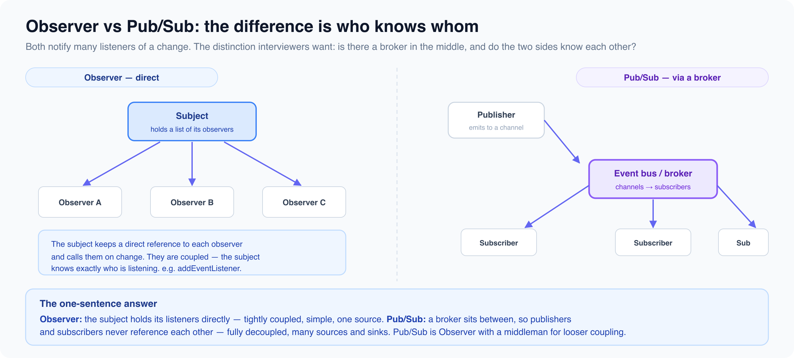

# Behavioral patterns

*12 min read · Updated 16 Jul 2026 Topic 25 of 77 Bookmark Mark done 9B · Topic 25 of 77*

**Source:** [https://www.geekyfrontend.in/learn/complete-frontend-kit/behavioral-patterns](https://www.geekyfrontend.in/learn/complete-frontend-kit/behavioral-patterns)

---

# 9B. Behavioral Patterns

**Questions:** 9 **Difficulty:** Mid to Senior **Companies:** Google, Amazon, Flipkart, Razorpay, Microsoft, Atlassian, Swiggy

These are the most interview-relevant patterns. Observer, Pub/Sub, Strategy, and Command map directly to problems you'll be asked to solve.

---



## Q 9.7 What is the Observer pattern? How does it relate to DOM events?

**Difficulty:** Mid **Asked at:** Every company

Observer defines a one-to-many dependency — when one object (the subject) changes state, all its dependents (observers) are notified automatically.

javascript

```
class EventEmitter {
  constructor() {
    this.listeners = new Map();
  }

  on(event, callback) {
    if (!this.listeners.has(event)) {
      this.listeners.set(event, new Set());
    }
    this.listeners.get(event).add(callback);
    return () => this.off(event, callback);  // Return unsubscribe function
  }

  off(event, callback) {
    this.listeners.get(event)?.delete(callback);
  }

  emit(event, data) {
    this.listeners.get(event)?.forEach(cb => cb(data));
  }

  once(event, callback) {
    const wrapper = (data) => {
      callback(data);
      this.off(event, wrapper);
    };
    this.on(event, wrapper);
  }
}

// Usage
const store = new EventEmitter();

const unsubscribe = store.on('cart:updated', (cart) => {
  renderCartBadge(cart.items.length);
});

store.emit('cart:updated', { items: ['shoes', 'shirt'] });
unsubscribe();  // Clean up
```

**DOM events ARE the Observer pattern.** `addEventListener` registers an observer, the browser is the subject, and when a user clicks, all registered observers are notified.

javascript

```
// This is Observer pattern — button is the subject, handler is the observer
button.addEventListener('click', handleClick);
```

React's `useState` + re-rendering is also Observer — when state changes, all components that use that state are notified (re-rendered).

**Follow-up:** "What's the difference between Observer and Pub/Sub?"

In Observer, the subject knows about its observers directly. In Pub/Sub, there's a message broker in between — publishers and subscribers don't know about each other. See Q9.8.

---

## Q 9.8 What is the Pub/Sub pattern? How is it different from Observer?

**Difficulty:** Mid **Asked at:** Google, Amazon, Flipkart, Razorpay

Pub/Sub adds a message broker between publishers and subscribers. Publishers emit events to the broker, subscribers listen on the broker. Neither knows about the other.

javascript

```
// Simple Pub/Sub message bus
const EventBus = {
  channels: new Map(),

  subscribe(channel, callback) {
    if (!this.channels.has(channel)) {
      this.channels.set(channel, new Set());
    }
    this.channels.get(channel).add(callback);
    return () => this.channels.get(channel)?.delete(callback);
  },

  publish(channel, data) {
    this.channels.get(channel)?.forEach(cb => cb(data));
  },
};

// Header component — publishes
function addToCart(item) {
  cart.push(item);
  EventBus.publish('cart:changed', { items: cart, count: cart.length });
}

// Badge component — subscribes (doesn't know about Header)
const unsub = EventBus.subscribe('cart:changed', ({ count }) => {
  badge.textContent = count;
});

// Sidebar component — also subscribes (doesn't know about Header)
EventBus.subscribe('cart:changed', ({ items }) => {
  renderCartPreview(items);
});
```

**Observer vs Pub/Sub:**

In Observer, the cart object would directly hold references to the badge and sidebar components. In Pub/Sub, the cart just publishes to `'cart:changed'` — it has no idea who's listening. This decoupling makes Pub/Sub better for large applications where components shouldn't have direct dependencies on each other.

**Where Pub/Sub appears in frontend:**

- Custom event buses for cross-component communication
- `BroadcastChannel` for cross-tab messaging
- Redux (actions are published, reducers subscribe)
- WebSocket message routing (messages arrive on one channel, dispatched to multiple handlers)
- Analytics event systems

**When Pub/Sub causes problems:** Over-using it creates "event spaghetti" — data flows through invisible channels, making it hard to trace where a change originates. For most React applications, lifting state up or using context is more explicit and debuggable than a global event bus.

---

## Q 9.9 What is the Mediator pattern?

**Difficulty:** Mid **Asked at:** Google, Microsoft

Mediator centralizes communication between components. Instead of components talking directly to each other (N×N connections), they all talk through one mediator (N connections).

javascript

```
class ChatRoom {
  constructor() {
    this.users = new Map();
  }

  register(user) {
    this.users.set(user.name, user);
    user.chatRoom = this;
  }

  send(message, from, to) {
    if (to) {
      // Direct message
      this.users.get(to)?.receive(message, from);
    } else {
      // Broadcast to all except sender
      this.users.forEach((user, name) => {
        if (name !== from) user.receive(message, from);
      });
    }
  }
}

class User {
  constructor(name) {
    this.name = name;
    this.chatRoom = null;
  }

  send(message, to) {
    this.chatRoom.send(message, this.name, to);
  }

  receive(message, from) {
    console.log(`${this.name} received from ${from}: ${message}`);
  }
}

const room = new ChatRoom();
const alice = new User('Alice');
const bob = new User('Bob');

room.register(alice);
room.register(bob);

alice.send('Hey Bob!', 'Bob');    // Direct message
alice.send('Hello everyone!');     // Broadcast
```

Alice doesn't have a reference to Bob. She sends through the room (mediator), which handles routing. Adding a new user doesn't require changing any existing user's code.

**Frontend examples:** Form coordinators (when field A changes, fields B and C update), dialog managers (opening dialog X closes dialog Y), and state management libraries (the store mediates between actions and UI updates).

---

## Q 9.10 What is the Strategy pattern? Give a frontend example.

**Difficulty:** Mid **Asked at:** Amazon, Flipkart, Razorpay, Swiggy

Strategy lets you swap algorithms or behaviors at runtime without changing the code that uses them. Instead of if/else chains, you define each strategy as a separate function and pick the right one dynamically.

javascript

```
// Without Strategy — growing if/else chain
function validateField(value, type) {
  if (type === 'email') {
    return /^[^\s@]+@[^\s@]+\.[^\s@]+$/.test(value);
  } else if (type === 'phone') {
    return /^\+?[\d\s-]{10,}$/.test(value);
  } else if (type === 'password') {
    return value.length >= 8 && /[A-Z]/.test(value) && /\d/.test(value);
  } else if (type === 'url') {
    // ... more branches
  }
}

// With Strategy — each validator is independent
const validators = {
  email: (value) => /^[^\s@]+@[^\s@]+\.[^\s@]+$/.test(value),
  phone: (value) => /^\+?[\d\s-]{10,}$/.test(value),
  password: (value) => value.length >= 8 && /[A-Z]/.test(value) && /\d/.test(value),
  url: (value) => { try { new URL(value); return true; } catch { return false; } },
};

function validateField(value, type) {
  const validate = validators[type];
  if (!validate) throw new Error(`Unknown validator: ${type}`);
  return validate(value);
}

// Adding a new type doesn't touch existing code
validators.creditCard = (value) => /^\d{16}$/.test(value.replace(/\s/g, ''));
```

**Sorting strategies:**

javascript

```
const sortStrategies = {
  'price-asc': (a, b) => a.price - b.price,
  'price-desc': (a, b) => b.price - a.price,
  'name': (a, b) => a.name.localeCompare(b.name),
  'rating': (a, b) => b.rating - a.rating,
  'newest': (a, b) => new Date(b.createdAt) - new Date(a.createdAt),
};

function sortProducts(products, strategy) {
  return [...products].sort(sortStrategies[strategy]);
}

// In React
function ProductList({ products, sortBy }) {
  const sorted = useMemo(
    () => sortProducts(products, sortBy),
    [products, sortBy]
  );
  return sorted.map(p => <ProductCard key={p.id} product={p} />);
}
```

**When to recognize Strategy:** Any time you have a switch/case or if/else that selects between different algorithms — sorting, validation, formatting, pricing rules, authentication methods, rendering modes.

---

## Q 9.11 What is the Command pattern? How do you implement undo/redo?

**Difficulty:** Senior **Asked at:** Google, Amazon, Microsoft, Atlassian

Command encapsulates an action as an object with `execute` and `undo` methods. This makes actions reversible, queueable, and loggable.

javascript

```
class CommandManager {
  constructor() {
    this.history = [];
    this.undoneCommands = [];
  }

  execute(command) {
    command.execute();
    this.history.push(command);
    this.undoneCommands = [];  // Clear redo stack on new action
  }

  undo() {
    const command = this.history.pop();
    if (command) {
      command.undo();
      this.undoneCommands.push(command);
    }
  }

  redo() {
    const command = this.undoneCommands.pop();
    if (command) {
      command.execute();
      this.history.push(command);
    }
  }
}

// Text editor commands
class InsertTextCommand {
  constructor(editor, text, position) {
    this.editor = editor;
    this.text = text;
    this.position = position;
  }

  execute() {
    this.editor.insertAt(this.position, this.text);
  }

  undo() {
    this.editor.deleteAt(this.position, this.text.length);
  }
}

class DeleteTextCommand {
  constructor(editor, position, length) {
    this.editor = editor;
    this.position = position;
    this.length = length;
    this.deletedText = null;
  }

  execute() {
    this.deletedText = this.editor.getTextAt(this.position, this.length);
    this.editor.deleteAt(this.position, this.length);
  }

  undo() {
    this.editor.insertAt(this.position, this.deletedText);
  }
}

// Usage
const manager = new CommandManager();
const editor = new TextEditor();

manager.execute(new InsertTextCommand(editor, 'Hello', 0));
manager.execute(new InsertTextCommand(editor, ' World', 5));
// Editor content: "Hello World"

manager.undo();
// Editor content: "Hello"

manager.redo();
// Editor content: "Hello World"
```

**Where Command pattern appears in frontend:**

- Text/image editors (undo/redo)
- Drawing applications (Figma, Excalidraw)
- Spreadsheets (undoable cell edits)
- Form wizards (go back to previous step with preserved state)
- Keyboard shortcut systems (Ctrl+Z maps to undo command)

**Follow-up:** "How would you limit the undo history to prevent memory issues?"

Set a maximum history size. When the history exceeds the limit, drop the oldest commands. For memory-intensive commands (like large image manipulations), store only the diff or compressed version instead of the full state.

---

## Q 9.12 What is the Iterator pattern?

**Difficulty:** Mid **Asked at:** Google, Amazon

Iterator provides a way to access elements of a collection sequentially without exposing its internal structure. JavaScript has this built into the language with `Symbol.iterator` and the `for...of` loop.

javascript

```
// Custom iterable — paginated API results
class PaginatedResults {
  constructor(fetchPage) {
    this.fetchPage = fetchPage;
  }

  async *[Symbol.asyncIterator]() {
    let page = 1;
    let hasMore = true;

    while (hasMore) {
      const response = await this.fetchPage(page);
      yield* response.items;   // Yield each item individually
      hasMore = response.hasNextPage;
      page++;
    }
  }
}

// Usage — iterate through all pages transparently
const products = new PaginatedResults(
  (page) => fetch(`/api/products?page=${page}`).then(r => r.json())
);

for await (const product of products) {
  renderProduct(product);
  // Automatically fetches next page when current page's items are exhausted
}
```

Generators (`function*`) and async generators (`async function*`) are the modern way to implement iterators in JavaScript. They're lazy — values are produced on demand, not all at once.

---

## Q 9.13 What is the State pattern? How does it relate to state machines?

**Difficulty:** Senior **Asked at:** Google, Razorpay, Amazon

State pattern lets an object change its behavior when its internal state changes. Instead of large switch statements checking `this.state`, each state is a separate object with its own behavior.

javascript

```
// Without State pattern — growing switch statement
class Order {
  handleAction(action) {
    switch (this.status) {
      case 'draft':
        if (action === 'submit') this.status = 'pending';
        if (action === 'delete') this.status = 'deleted';
        break;
      case 'pending':
        if (action === 'approve') this.status = 'approved';
        if (action === 'reject') this.status = 'draft';
        break;
      case 'approved':
        if (action === 'ship') this.status = 'shipped';
        if (action === 'cancel') this.status = 'cancelled';
        break;
      // ... more cases as states grow
    }
  }
}

// With State pattern — each state handles its own transitions
const orderStates = {
  draft: {
    submit: () => 'pending',
    delete: () => 'deleted',
  },
  pending: {
    approve: () => 'approved',
    reject: () => 'draft',
  },
  approved: {
    ship: () => 'shipped',
    cancel: () => 'cancelled',
  },
  shipped: {
    deliver: () => 'delivered',
  },
  delivered: {},   // Terminal state — no transitions
  cancelled: {},
  deleted: {},
};

function transition(currentState, action) {
  const handler = orderStates[currentState]?.[action];
  if (!handler) throw new Error(`Invalid action '${action}' in state '${currentState}'`);
  return handler();
}
```

This is a finite state machine — a defined set of states with defined transitions. Invalid transitions are impossible (you can't ship a draft order). The state machine makes impossible states impossible.

**XState — production-grade state machines for React:**

javascript

```
import { createMachine } from 'xstate';

const orderMachine = createMachine({
  id: 'order',
  initial: 'draft',
  states: {
    draft: { on: { SUBMIT: 'pending', DELETE: 'deleted' } },
    pending: { on: { APPROVE: 'approved', REJECT: 'draft' } },
    approved: { on: { SHIP: 'shipped', CANCEL: 'cancelled' } },
    shipped: { on: { DELIVER: 'delivered' } },
    delivered: { type: 'final' },
    cancelled: { type: 'final' },
    deleted: { type: 'final' },
  },
});
```

**Where State pattern shines in frontend:** Multi-step forms, checkout flows, media players (playing/paused/stopped/buffering), authentication flows (logged-out/logging-in/authenticated/expired), and any UI with complex conditional logic that depends on the current state.

---

## Q 9.14 What is the Template Method pattern?

**Difficulty:** Mid **Asked at:** Amazon, Microsoft

Template Method defines the skeleton of an algorithm, letting subclasses override specific steps without changing the structure.

javascript

```
// Base data fetcher with a defined workflow
class DataFetcher {
  async fetch(url) {
    const rawData = await this.makeRequest(url);     // Step 1: Fetch
    const parsed = this.parseResponse(rawData);       // Step 2: Parse
    const validated = this.validate(parsed);           // Step 3: Validate
    return this.transform(validated);                  // Step 4: Transform
  }

  async makeRequest(url) { return fetch(url).then(r => r.json()); }
  parseResponse(data) { return data; }  // Override in subclass
  validate(data) { return data; }       // Override in subclass
  transform(data) { return data; }      // Override in subclass
}

// JSON API fetcher
class JsonApiFetcher extends DataFetcher {
  parseResponse(data) { return data.results; }
  validate(data) { return data.filter(item => item.id && item.name); }
  transform(data) { return data.map(item => ({ ...item, source: 'api' })); }
}

// CSV fetcher
class CsvFetcher extends DataFetcher {
  async makeRequest(url) { return fetch(url).then(r => r.text()); }
  parseResponse(text) { return text.split('
').map(row => row.split(',')); }
  validate(rows) { return rows.filter(row => row.length === 3); }
}
```

The algorithm structure (`fetch → parse → validate → transform`) is fixed. Each fetcher customizes individual steps. In modern JavaScript, you'd often use composition (passing functions) instead of inheritance, but the concept — a fixed workflow with customizable steps — remains relevant.

---

## Q 9.15 What is the Chain of Responsibility pattern?

**Difficulty:** Senior **Asked at:** Amazon, Google, Microsoft

Chain of Responsibility passes a request through a chain of handlers. Each handler decides whether to process the request or pass it to the next handler. Express.js middleware is the classic frontend-adjacent example.

javascript

```
// Middleware pipeline (Express-style)
class Pipeline {
  constructor() {
    this.middlewares = [];
  }

  use(fn) {
    this.middlewares.push(fn);
    return this;
  }

  async execute(context) {
    let index = 0;

    const next = async () => {
      if (index < this.middlewares.length) {
        const middleware = this.middlewares[index++];
        await middleware(context, next);
      }
    };

    await next();
    return context;
  }
}

// Usage — request processing pipeline
const api = new Pipeline();

api.use(async (ctx, next) => {
  ctx.startTime = Date.now();
  await next();
  console.log(`Request took ${Date.now() - ctx.startTime}ms`);
});

api.use(async (ctx, next) => {
  if (!ctx.headers.authorization) {
    ctx.status = 401;
    return;  // Don't call next — stop the chain
  }
  ctx.user = await verifyToken(ctx.headers.authorization);
  await next();
});

api.use(async (ctx, next) => {
  ctx.body = await fetchData(ctx.user.id);
  await next();
});

api.execute({ headers: { authorization: 'Bearer token123' } });
```

Each middleware can modify the context, stop the chain (by not calling `next()`), or pass to the next handler. The order matters — logging wraps everything, auth checks happen before data fetching.

**Frontend examples:** Form validation chains (check required → check format → check server-side), error handling pipelines, and request/response interceptors in API clients like Axios.

---

## Learn More

- [Behavioral patterns (Refactoring.Guru) refactoring.guru](https://refactoring.guru/design-patterns/behavioral-patterns)
- [All behavioral design patterns YouTube](https://www.youtube.com/watch?v=DBDnUkTobaE)
- [Behavioral patterns (LLD) YouTube](https://www.youtube.com/watch?v=TChPONDK51U)
- [The observer pattern explained YouTube](https://www.youtube.com/watch?v=-oLDJ2dbadA)
