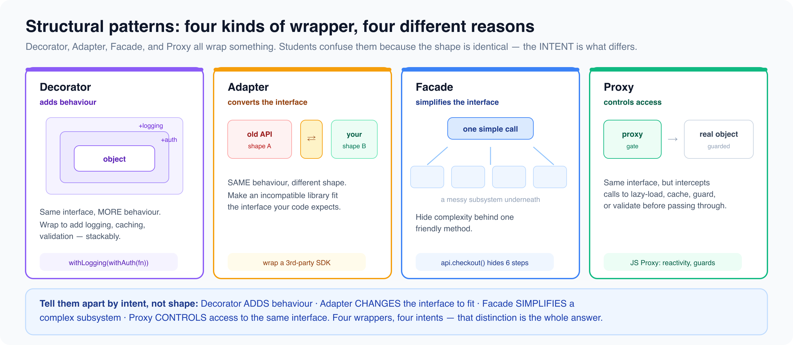

# Structural patterns

*8 min read · Updated 16 Jul 2026 Topic 26 of 77 Bookmark Mark done 9C · Topic 26 of 77*

**Source:** [https://www.geekyfrontend.in/learn/complete-frontend-kit/structural-patterns](https://www.geekyfrontend.in/learn/complete-frontend-kit/structural-patterns)

---

# 9C. Structural Patterns

**Questions:** 6 **Difficulty:** Mid to Senior **Companies:** Google, Amazon, Flipkart, Microsoft, Atlassian

---



## Q 9.16 What is the Decorator pattern? How does it work in JavaScript?

**Difficulty:** Mid **Asked at:** Google, Amazon, Atlassian

Decorator wraps an object to add new behavior without modifying the original. In JavaScript, higher-order functions are the natural implementation.

javascript

```
// Base function
function fetchData(url) {
  return fetch(url).then(r => r.json());
}

// Decorator: add logging
function withLogging(fn) {
  return async function(...args) {
    console.log(`Calling ${fn.name} with`, args);
    const start = Date.now();
    const result = await fn(...args);
    console.log(`${fn.name} completed in ${Date.now() - start}ms`);
    return result;
  };
}

// Decorator: add retry logic
function withRetry(fn, maxRetries = 3) {
  return async function(...args) {
    for (let attempt = 1; attempt <= maxRetries; attempt++) {
      try {
        return await fn(...args);
      } catch (err) {
        if (attempt === maxRetries) throw err;
        await new Promise(r => setTimeout(r, 1000 * attempt));
      }
    }
  };
}

// Decorator: add caching
function withCache(fn, ttl = 60000) {
  const cache = new Map();
  return async function(...args) {
    const key = JSON.stringify(args);
    const cached = cache.get(key);
    if (cached && Date.now() - cached.time < ttl) return cached.value;
    const result = await fn(...args);
    cache.set(key, { value: result, time: Date.now() });
    return result;
  };
}

// Stack decorators — each adds a layer of behavior
const enhancedFetch = withLogging(withRetry(withCache(fetchData)));
const data = await enhancedFetch('/api/products');
// Cached → Retried on failure → Logged
```

**In React — HOCs are Decorators:**

jsx

```
// withAuth decorator — adds authentication check
function withAuth(WrappedComponent) {
  return function AuthenticatedComponent(props) {
    const { user, loading } = useAuth();
    if (loading) return <Spinner />;
    if (!user) return <Navigate to="/login" />;
    return <WrappedComponent {...props} user={user} />;
  };
}

const ProtectedDashboard = withAuth(Dashboard);
```

In modern React, custom hooks have largely replaced HOCs for adding behavior. But the concept is identical — wrapping functionality to extend it without modification.

---

## Q 9.17 What is the Adapter pattern?

**Difficulty:** Mid **Asked at:** Amazon, Flipkart, Razorpay

Adapter converts one interface to another. When two pieces of code expect different data shapes, an adapter translates between them.

javascript

```
// Your app expects this format
interface AppUser {
  id: string;
  fullName: string;
  email: string;
  avatarUrl: string;
}

// Google OAuth returns this format
interface GoogleUser {
  sub: string;
  name: string;
  email: string;
  picture: string;
}

// GitHub OAuth returns this format
interface GitHubUser {
  id: number;
  login: string;
  email: string | null;
  avatar_url: string;
}

// Adapters normalize external data to your app's format
function adaptGoogleUser(google: GoogleUser): AppUser {
  return {
    id: `google_${google.sub}`,
    fullName: google.name,
    email: google.email,
    avatarUrl: google.picture,
  };
}

function adaptGitHubUser(github: GitHubUser): AppUser {
  return {
    id: `github_${github.id}`,
    fullName: github.login,
    email: github.email ?? '',
    avatarUrl: github.avatar_url,
  };
}

// Your app code works with AppUser everywhere — doesn't care about the source
function ProfileCard({ user }: { user: AppUser }) {
  return (
    <div>
      
      <h2>{user.fullName}</h2>
    </div>
  );
}
```

**Where adapters show up:** API response normalization (different APIs → one app format), third-party library integration (their data shape → your data shape), migration between libraries (old API → new API wrapper), and legacy system integration.

---

## Q 9.18 What is the Facade pattern?

**Difficulty:** Mid **Asked at:** Amazon, Microsoft

Facade provides a simplified interface to a complex subsystem. The caller uses one clean function instead of orchestrating multiple complex operations.

javascript

```
// Complex subsystem — multiple steps for a checkout
class InventoryService {
  async checkStock(productId) { /* ... */ }
  async reserveStock(productId, qty) { /* ... */ }
}

class PaymentService {
  async createPaymentIntent(amount) { /* ... */ }
  async confirmPayment(intentId) { /* ... */ }
}

class OrderService {
  async createOrder(items, paymentId) { /* ... */ }
  async sendConfirmation(orderId) { /* ... */ }
}

// Facade — one simple function hides the complexity
class CheckoutFacade {
  constructor() {
    this.inventory = new InventoryService();
    this.payment = new PaymentService();
    this.orders = new OrderService();
  }

  async checkout(cart, paymentMethod) {
    // 1. Check stock for all items
    for (const item of cart.items) {
      const inStock = await this.inventory.checkStock(item.productId);
      if (!inStock) throw new Error(`${item.name} is out of stock`);
    }

    // 2. Reserve stock
    for (const item of cart.items) {
      await this.inventory.reserveStock(item.productId, item.quantity);
    }

    // 3. Process payment
    const intent = await this.payment.createPaymentIntent(cart.total);
    await this.payment.confirmPayment(intent.id);

    // 4. Create order and send confirmation
    const order = await this.orders.createOrder(cart.items, intent.id);
    await this.orders.sendConfirmation(order.id);

    return order;
  }
}

// Caller doesn't need to know about inventory, payment, or order services
const checkout = new CheckoutFacade();
const order = await checkout.checkout(myCart, myPaymentMethod);
```

**Frontend examples:** API client wrappers that simplify complex REST calls, analytics facades that abstract over multiple tracking providers, and browser API wrappers (a `storage` facade that handles localStorage, fallback to cookies, and serialization).

---

## Q 9.19 What is the Proxy pattern? How does JavaScript's `Proxy` object implement it?

**Difficulty:** Senior **Asked at:** Google, Amazon, Razorpay

Proxy wraps an object and intercepts operations on it — property access, assignment, function calls, and more. JavaScript has a built-in `Proxy` object for this.

javascript

```
// Validation proxy — prevents invalid data from being set
function createValidatedUser(user) {
  return new Proxy(user, {
    set(target, property, value) {
      if (property === 'age' && (typeof value !== 'number' || value < 0)) {
        throw new Error('Age must be a positive number');
      }
      if (property === 'email' && !value.includes('@')) {
        throw new Error('Invalid email format');
      }
      target[property] = value;
      return true;
    },

    get(target, property) {
      if (property in target) return target[property];
      throw new Error(`Property '${property}' does not exist`);
    },
  });
}

const user = createValidatedUser({ name: 'Ankit', age: 28, email: 'a@b.com' });
user.age = -5;        // Throws: Age must be a positive number
user.email = 'bad';   // Throws: Invalid email format
user.phone;           // Throws: Property 'phone' does not exist
```

**Reactive state with Proxy — how Vue 3 reactivity works:**

javascript

```
function reactive(obj, onChange) {
  return new Proxy(obj, {
    set(target, key, value) {
      const oldValue = target[key];
      target[key] = value;
      if (oldValue !== value) {
        onChange(key, value, oldValue);  // Trigger re-render
      }
      return true;
    },
  });
}

const state = reactive({ count: 0, name: 'Ankit' }, (key, newVal) => {
  console.log(`${key} changed to ${newVal}`);
  renderUI();  // Auto re-render when state changes
});

state.count++;  // Logs: "count changed to 1" → triggers render
```

**Other Proxy use cases:** lazy loading (load data only when a property is accessed), logging/debugging (track every property access), access control (restrict certain operations based on permissions), and caching (memoize computed properties).

---

## Q 9.20 What is the Flyweight pattern?

**Difficulty:** Senior **Asked at:** Google, Microsoft

Flyweight minimizes memory by sharing as much data as possible between similar objects. Instead of each object holding its own copy of shared data, they reference a shared instance.

javascript

```
// Without Flyweight — each marker stores full icon data
class MapMarker {
  constructor(lat, lng, type) {
    this.lat = lat;
    this.lng = lng;
    this.type = type;
    this.icon = loadIcon(type);   // 50KB icon loaded per marker
    this.color = getColor(type);
    this.size = getSize(type);
  }
}
// 10,000 markers × 50KB = 500MB of icon data (most is duplicate)

// With Flyweight — shared icon data
class MarkerType {
  constructor(type) {
    this.icon = loadIcon(type);
    this.color = getColor(type);
    this.size = getSize(type);
  }
}

const markerTypes = new Map();  // Shared flyweight pool
function getMarkerType(type) {
  if (!markerTypes.has(type)) {
    markerTypes.set(type, new MarkerType(type));
  }
  return markerTypes.get(type);
}

class MapMarker {
  constructor(lat, lng, type) {
    this.lat = lat;       // Unique per marker (extrinsic)
    this.lng = lng;       // Unique per marker (extrinsic)
    this.type = getMarkerType(type);  // Shared (intrinsic)
  }
}
// 10,000 markers, but only 5 MarkerType instances (restaurant, hotel, gas, etc.)
```

**Frontend relevance:** DOM virtualization is Flyweight — a list of 100,000 items only creates ~20 DOM elements, reusing them as the user scrolls. Object pooling in animations (reusing particle objects instead of creating new ones).

---

## Q 9.21 What is the Composite pattern?

**Difficulty:** Mid **Asked at:** Amazon, Atlassian, Microsoft

Composite treats individual objects and groups of objects uniformly. A tree structure where each node can be either a leaf or a container of other nodes, and both have the same interface.

javascript

```
// File system — files and folders share the same interface
class File {
  constructor(name, size) {
    this.name = name;
    this.size = size;
  }

  getSize() { return this.size; }

  display(indent = 0) {
    console.log(`${'  '.repeat(indent)}📄 ${this.name} (${this.size}KB)`);
  }
}

class Folder {
  constructor(name) {
    this.name = name;
    this.children = [];
  }

  add(child) { this.children.push(child); return this; }

  getSize() {
    return this.children.reduce((total, child) => total + child.getSize(), 0);
  }

  display(indent = 0) {
    console.log(`${'  '.repeat(indent)}📁 ${this.name} (${this.getSize()}KB)`);
    this.children.forEach(child => child.display(indent + 1));
  }
}

// Both File and Folder have getSize() and display()
const src = new Folder('src')
  .add(new File('index.js', 5))
  .add(new File('App.jsx', 12))
  .add(new Folder('components')
    .add(new File('Header.jsx', 8))
    .add(new File('Footer.jsx', 6)));

src.getSize();  // 31 — recursively sums all files
src.display();  // Renders the full tree
```

**React's component tree IS the Composite pattern.** Every component can be a leaf (``) or a container (`<div>` with children). `React.Children` utilities operate on both uniformly. The virtual DOM is a composite tree where each node is either an element or a text node.

---

## Learn More

- [Structural patterns (Refactoring.Guru) refactoring.guru](https://refactoring.guru/design-patterns/structural-patterns)
- [All structural design patterns YouTube](https://www.youtube.com/watch?v=WxGtmIBZszk)
- [The facade pattern explained YouTube](https://www.youtube.com/watch?v=xWk6jvqyhAQ)
- [Decorator, bridge & adapter YouTube](https://www.youtube.com/watch?v=5Va1fslNKEo)
