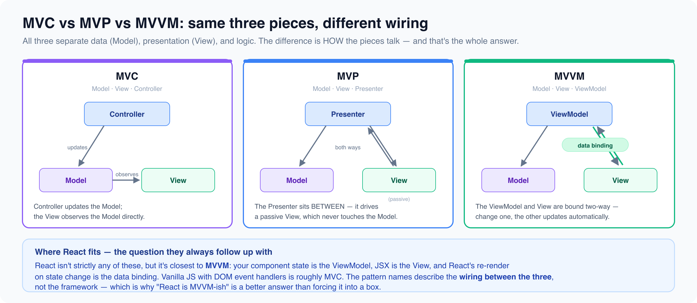

# Architectural patterns

*5 min read · Updated 16 Jul 2026 Topic 27 of 77 Bookmark Mark done 9D · Topic 27 of 77*

**Source:** [https://www.geekyfrontend.in/learn/complete-frontend-kit/architectural-patterns](https://www.geekyfrontend.in/learn/complete-frontend-kit/architectural-patterns)

---

# 9D. Architectural Patterns

**Questions:** 2 **Difficulty:** Mid to Senior **Companies:** Google, Amazon, Microsoft, Flipkart

---



## Q 9.22 Compare MVC, MVP, and MVVM. How do they apply to frontend development?

**Difficulty:** Mid **Asked at:** Google, Amazon, Microsoft, Flipkart

These three patterns all solve the same problem — separating data (Model), presentation (View), and logic (Controller/Presenter/ViewModel) — but they differ in how the pieces communicate.

**MVC (Model-View-Controller):**

The original pattern. The Controller receives user input, updates the Model, and the View observes the Model for changes.

javascript

```
User ──→ Controller ──→ Model
                            │
                            └──→ View (observes Model directly)
```

In frontend context, vanilla JavaScript with DOM manipulation is roughly MVC. The Model is your data, the View is the DOM, and the Controller is your event handlers. React's class components with setState were MVC-adjacent — the component was both Controller and View.

**MVP (Model-View-Presenter):**

The Presenter sits between Model and View. The View is passive — it doesn't know about the Model. The Presenter fetches data from the Model and explicitly updates the View.

javascript

```
User ──→ View ──→ Presenter ──→ Model
                        │
                        └──→ View (Presenter pushes updates)
```

The View exposes an interface (`setUserName()`, `showError()`), and the Presenter calls those methods. This makes the View easily testable (mock the interface) and swappable (different Views, same Presenter). Android development heavily uses MVP.

**MVVM (Model-View-ViewModel):**

The ViewModel exposes reactive data that the View binds to. When the ViewModel's data changes, the View updates automatically. No manual DOM manipulation.

javascript

```
User ──→ View ←──binds──→ ViewModel ──→ Model
                 (two-way data binding)
```

This is exactly what Vue.js, Angular, and Svelte do. You declare bindings in the template, and the framework handles synchronization.

html

```
<!-- Vue — MVVM in action -->
<template>
  <!-- View: bound to ViewModel -->
  <input v-model="searchQuery" />
  <ul>
    <li v-for="item in filteredItems">{{ item.name }}</li>
  </ul>
</template>

<script>
// ViewModel
export default {
  data() { return { searchQuery: '', items: [] }; },
  computed: {
    filteredItems() {
      return this.items.filter(i => i.name.includes(this.searchQuery));
    }
  }
};
</script>
```

**Where does React fit?**

React doesn't cleanly fit any of the three. It's closest to a one-way data flow architecture (inspired by Flux). State flows down through props, events flow up through callbacks. There's no two-way binding (unlike MVVM) and no passive view (unlike MVP). React components combine View and ViewModel into one — the component renders the view AND manages the reactive state that drives it.

**What interviewers want to hear:** Don't just define the three patterns. Explain which you've worked with, how modern frameworks implement them, and why one-way data flow (React/Redux) was a reaction to the complexity of two-way binding (Angular 1.x's MVVM had performance and debugging issues with large forms).

---

## Q 9.23 How do you choose which design pattern to use? Give a decision guide.

**Difficulty:** Senior **Asked at:** Google, Amazon, Razorpay, Atlassian

This is the question that ties the entire chapter together. Interviewers don't want you to memorize 23 patterns — they want you to recognize problems and reach for the right pattern.

**The decision guide — match the problem to the pattern:**

**"I need to create objects without specifying exact classes"** → **Factory** (one type with variants) or **Abstract Factory** (families of related objects)

Example: creating different notification types, creating API clients for different services.

**"I need exactly one instance shared across the app"** → **Singleton** (or just use ES Module — modules are natural singletons)

Example: logger, configuration manager, WebSocket connection.

**"I need to build complex objects step by step"** → **Builder** (fluent API with chained methods)

Example: query builders, form configuration, test data setup.

**"I need to notify multiple parts of the app when something changes"** → **Observer** (direct notification) or **Pub/Sub** (decoupled via message bus)

Example: state management, event systems, real-time updates.

**"I need to swap algorithms or behaviors at runtime"** → **Strategy** (each algorithm is a separate function/object)

Example: sorting strategies, validation rules, authentication methods, rendering modes.

**"I need undo/redo or action queuing"** → **Command** (encapsulate actions as objects with execute/undo)

Example: text editors, drawing tools, form wizards.

**"I need to manage complex state transitions"** → **State** (finite state machine)

Example: checkout flows, media players, authentication states, multi-step forms.

**"I need to add behavior to objects without modifying them"** → **Decorator** (wrap with additional functionality)

Example: adding logging, caching, retry, authentication to API calls.

**"I need to adapt incompatible interfaces"** → **Adapter** (translate one interface to another)

Example: normalizing API responses from different providers, migrating between library versions.

**"I need to simplify a complex subsystem"** → **Facade** (one clean function wrapping multiple complex operations)

Example: checkout process, initialization sequences, third-party library wrappers.

**"I need to intercept and control access to an object"** → **Proxy** (intercept property access, validation, lazy loading)

Example: form validation, reactive state (Vue.js), access control.

**"I need to process a request through multiple handlers"** → **Chain of Responsibility** (middleware pipeline)

Example: Express middleware, request interceptors, validation chains.

**"I need to represent a tree structure where leaves and branches have the same interface"** → **Composite** (recursive tree with uniform interface)

Example: component trees, file systems, menu structures with nested submenus.

**"I need to optimize memory for many similar objects"** → **Flyweight** (share common data between instances)

Example: map markers, virtual scrolling, text rendering with shared font data.

**The meta-principle:** Don't apply patterns preemptively. Write straightforward code first. When you notice a specific problem emerging (growing switch statements → Strategy, complex state transitions → State, tightly coupled components → Pub/Sub), then reach for the pattern. Patterns are solutions to identified problems, not architectural decorations.

**Follow-up:** "What's the most common mistake you see with design patterns?"

Over-engineering. Using a Factory when a simple function call would do. Implementing a full Observer system when React's built-in state management handles it. Adding a Mediator when two components could just share a parent state. The best code uses patterns invisibly — the structure feels natural, not like someone forced a pattern onto a problem that didn't need one.

---

## Learn More

- [Architectural patterns (overview) wikipedia.org](https://en.wikipedia.org/wiki/Architectural_pattern)
- [MVC vs MVP vs MVVM explained YouTube](https://www.youtube.com/watch?v=yns5gBO7IXU)
- [Architectural patterns 101 YouTube](https://www.youtube.com/watch?v=6_qVQXlq-sA)
- [MVC, MVP & MVVM explained YouTube](https://www.youtube.com/watch?v=izZ858Gbwh0)
