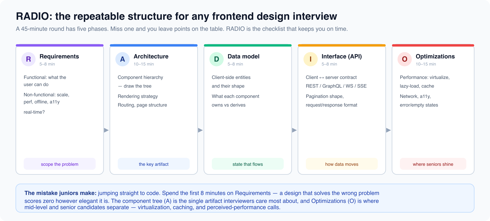

# Foundations

*7 min read · Updated 16 Jul 2026 Topic 29 of 77 Bookmark Mark done 11A · Topic 29 of 77*

**Source:** [https://www.geekyfrontend.in/learn/complete-frontend-kit/foundations](https://www.geekyfrontend.in/learn/complete-frontend-kit/foundations)

---

# 11A. Foundations

**Questions:** 4 **Difficulty:** Mid **Read this section BEFORE attempting any design problem.**

---



## Q 19.1 How do frontend system design interviews work? What are interviewers evaluating?

**Difficulty:** Mid **Asked at:** Every company for 3+ year candidates

**The format (typically 45-60 minutes):**

- 5 min: Interviewer presents the problem ("Design the frontend for Twitter's feed")
- 5-8 min: You clarify requirements (functional and non-functional)
- 10-15 min: High-level architecture (component tree, rendering strategy, data flow)
- 10-15 min: Data model and API design (state shape, endpoints, real-time events)
- 10 min: Optimization (performance, accessibility, error handling, offline)
- 5 min: Trade-offs and follow-up questions

**What interviewers evaluate:**

1. **Requirement gathering** — Do you ask clarifying questions or jump into designing? "How many concurrent users?", "Does it need offline support?", "Is it mobile-first?" show engineering maturity.
2. **Component architecture** — Can you break a complex UI into a logical component hierarchy? Are the boundaries sensible? Is the component tree too flat or too deeply nested?
3. **State management decisions** — Where does state live? Local vs global vs server? Do you default to Redux for everything or make intentional choices?
4. **API design awareness** — REST vs GraphQL vs WebSocket? Pagination strategy? Real-time update mechanism?
5. **Performance thinking** — Do you address lazy loading, code splitting, virtualization, and caching without being prompted?
6. **Trade-off articulation** — Can you explain WHY you chose an approach and what you'd lose with a different one?

**What will FAIL you:**

- Jumping straight into code without requirements gathering
- Not drawing any diagrams (component tree, data flow)
- Ignoring non-functional requirements (performance, accessibility, error states)
- Not discussing trade-offs ("I'd use Redux" — why? what's the alternative?)
- Only covering the happy path (what about loading states, errors, empty states, offline?)

---

## Q 19.2 Explain the RADIO framework for frontend system design.

**Difficulty:** Mid

RADIO gives you a repeatable structure for any frontend design problem. Use it as a mental checklist so you never forget a critical section.

**R — Requirements (5-8 min)**

Split into functional and non-functional:

javascript

```
Functional (what the user does):
  - "User can see a feed of posts from people they follow"
  - "User can create a new post with text and images"
  - "User can like, comment, and share posts"
  - "User can search for posts and users"

Non-functional (quality attributes):
  - Scale: 10M DAU, 1000 posts per second
  - Performance: FCP < 1s, LCP < 2.5s, INP < 200ms
  - Offline: show cached feed when offline
  - Accessibility: keyboard navigable, screen reader compatible
  - Real-time: new posts appear without refresh
  - Internationalization: support 12 languages
```

Always ask: "Which features are must-haves for this discussion?" — this prevents designing a 50-feature system in 45 minutes.

**A — Architecture (10-15 min)**

Component hierarchy, page structure, rendering strategy, and routing.

Draw a component tree — this is the most important artifact in the interview:

javascript

```
App
├── Layout
│   ├── Header (nav, search, profile)
│   └── Sidebar (navigation, trending)
├── FeedPage
│   ├── CreatePostBox
│   ├── FeedList (virtualized)
│   │   └── PostCard (×N)
│   │       ├── PostHeader (avatar, name, time)
│   │       ├── PostContent (text, images, video)
│   │       ├── PostActions (like, comment, share)
│   │       └── CommentSection (lazy-loaded)
│   └── FeedLoader (skeleton/spinner)
└── ErrorBoundary
```

Rendering decision: "I'd use SSR for the initial feed (SEO for public profiles, fast FCP) with client-side updates for new posts (WebSocket). Images lazy-load below the fold."

**D — Data Model (10 min)**

State shape and where it lives:

typescript

```
// Server state (TanStack Query)
type Post = {
  id: string;
  author: { id: string; name: string; avatar: string };
  content: string;
  images: string[];
  likeCount: number;
  commentCount: number;
  isLiked: boolean;
  createdAt: string;
};

// Client state (Zustand — minimal)
type FeedUIState = {
  composerOpen: boolean;
  activePostMenu: string | null;
};

// URL state (searchParams)
// ?tab=following&sort=recent
```

API contracts:

javascript

```
GET  /api/feed?cursor=abc&limit=20   → { posts: Post[], nextCursor: string }
POST /api/posts                       → { post: Post }
POST /api/posts/:id/like             → { likeCount: number }
WS   /ws/feed                        → { type: "new_post", post: Post }
```

**I — Interface / API (5 min)**

Component props API (how components communicate):

typescript

```
interface PostCardProps {
  post: Post;
  onLike: (postId: string) => void;
  onComment: (postId: string) => void;
  onShare: (postId: string) => void;
}

interface FeedListProps {
  posts: Post[];
  hasMore: boolean;
  onLoadMore: () => void;
  isLoading: boolean;
}
```

**O — Optimization (10 min)**

Performance, accessibility, error handling, and edge cases:

- **Virtualization:** Feed can have hundreds of posts — use `@tanstack/react-virtual` to render only visible posts
- **Image optimization:** Serve WebP/AVIF, responsive sizes, lazy load below fold, blur placeholder
- **Code splitting:** Comment section lazy-loaded on expand (not part of initial post render)
- **Caching:** Feed cached by TanStack Query with stale-while-revalidate
- **Optimistic updates:** Like count increments immediately, rolls back on API failure
- **Loading states:** Skeleton posts during initial load, spinner for pagination
- **Error states:** "Something went wrong" with retry button, never a blank page
- **Empty states:** "No posts yet — follow someone to see their posts"
- **Accessibility:** Posts are semantic `<article>` elements, like button has aria-pressed, focus management on comment open

**End with trade-offs:** "I chose cursor pagination over offset because the feed changes in real-time — new posts would shift offsets and cause duplicates. The trade-off is you can't jump to page 50, but feeds don't need that."

---

## Q 19.3 How do you estimate frontend-specific numbers?

**Difficulty:** Mid

Frontend estimations aren't about database throughput — they're about payload sizes, rendering performance, and client-side memory.

**Payload size estimation:**

javascript

```
A single post object: ~500 bytes (JSON)
  - id (36B), author (100B), content (280B), metadata (84B)

Initial feed load (20 posts): ~10KB JSON
Feed page with images: 20 posts × 1 image × 100KB = 2MB images
  (with lazy loading, only 5 visible = 500KB initially)

Full page bundle (JS): 150-300KB gzipped
CSS: 30-50KB gzipped
Fonts: 50-100KB (2 weights, woff2)

Total initial load: ~400-600KB (without below-fold images)
```

**Rendering performance:**

javascript

```
DOM nodes: Keep under 1,500 for smooth interaction
  A complex card component: ~50 nodes
  Feed of 30 visible cards: ~1,500 nodes ← at the limit
  Solution: virtualize to render only visible cards

Re-render time:
  Simple component: <1ms
  Complex component (50+ elements): 5-15ms
  List of 100 components: 50-200ms ← needs virtualization or pagination

Target frame budget: 16.6ms (60fps)
  JavaScript: <10ms per frame
  Style + Layout + Paint: remaining 6.6ms
```

**Concurrent connection estimates:**

javascript

```
A chat app with 10K concurrent users:
  10K WebSocket connections to the server
  Each connection: ~2KB memory on server
  Messages per second: 10K users × 1 msg/10sec = 1K msgs/sec throughput

A feed with real-time updates:
  SSE connection per user
  New posts: ~100/min for a popular feed
  Client processes: 100 DOM updates per minute = trivial
```

---

## Q 19.4 How do you choose between REST, GraphQL, WebSocket, and SSE?

**Difficulty:** Mid

javascript

```
Pattern     │ Direction      │ Best For                    │ Complexity
  ────────────┼────────────────┼─────────────────────────────┼───────────
  REST        │ Request →      │ CRUD operations, simple     │ Low
              │ Response       │ data fetching, cacheable    │
  ────────────┼────────────────┼─────────────────────────────┼───────────
  GraphQL     │ Request →      │ Complex nested data,        │ Medium
              │ Response       │ multiple clients needing    │
              │                │ different shapes            │
  ────────────┼────────────────┼─────────────────────────────┼───────────
  WebSocket   │ Bidirectional  │ Chat, collaborative editing,│ High
              │                │ gaming, anything where      │
              │                │ client AND server push      │
  ────────────┼────────────────┼─────────────────────────────┼───────────
  SSE         │ Server →       │ Notifications, live scores, │ Low
              │ Client         │ feed updates, AI streaming  │
  ────────────┼────────────────┼─────────────────────────────┼───────────
  Polling     │ Request →      │ Simple updates where        │ Very low
              │ Response       │ real-time isn't critical    │
              │ (repeated)     │ (check every 30 seconds)    │
```

**Decision for common system design problems:**

- **Chat app:** WebSocket (bidirectional messaging) + REST (fetch history, send files)
- **News feed:** REST (fetch feed) + SSE (new posts notification) OR polling (simpler)
- **Collaborative editor:** WebSocket (cursor positions, real-time edits) + REST (save, load)
- **E-commerce:** REST (products, cart, orders) + SSE (order status updates)
- **Dashboard:** REST (initial data) + SSE (live metrics) OR polling (if 30-sec delay is OK)
- **Search:** REST (search queries) — real-time not needed for search results
- **Notification system:** SSE (push notifications to client) + REST (fetch history, mark read)

Always state the trade-off: "I chose SSE over WebSocket for notifications because it's one-directional — we only push from server to client. SSE auto-reconnects, works through HTTP proxies, and is simpler to scale. If we later need the client to send read receipts in real-time, we'd upgrade to WebSocket."

---

## Learn More

- [Front-End System Design Playbook greatfrontend.com](https://www.greatfrontend.com/front-end-system-design-playbook)
- [Front-end system design fundamentals YouTube](https://www.youtube.com/watch?v=NEzu4FD25KM)
- [What is front-end system design? YouTube](https://www.youtube.com/watch?v=XPNMiWyHBAU)
- [How to prepare for the FE system design interview YouTube](https://www.youtube.com/watch?v=JhcW0fuR_ig)
