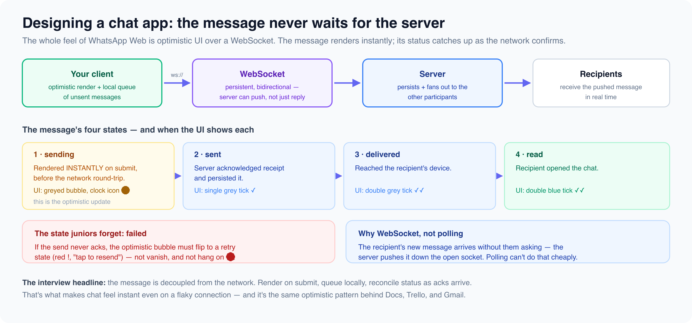

# Communication and realtime

*8 min read · Updated 16 Jul 2026 Topic 30 of 77 Bookmark Mark done 11B · Topic 30 of 77*

**Source:** [https://www.geekyfrontend.in/learn/complete-frontend-kit/communication-and-realtime](https://www.geekyfrontend.in/learn/complete-frontend-kit/communication-and-realtime)

---

# 11B. Communication & Real-time

**Questions:** 6 **Difficulty:** Senior

Each design follows the RADIO framework. For brevity, these walkthroughs focus on the architecture and data model sections — the distinguishing parts. Apply Requirements and Optimization from 19A.2 to every problem.

---



## Q 19.5 Design WhatsApp Web / Chat Application

**Asked at:** Google, Amazon, Flipkart, Razorpay, Swiggy — the most asked system design question

**Key Requirements:**

- One-on-one and group messaging
- Real-time message delivery
- Typing indicators, read receipts
- Media (images, files) sharing
- Message search
- Offline message queue

**Architecture:**

javascript

```
App
├── Sidebar
│   ├── SearchBar
│   ├── ChatList
│   │   └── ChatListItem (×N) — avatar, name, last message, unread count
│   └── NewChatButton
├── ChatWindow
│   ├── ChatHeader (name, avatar, online status)
│   ├── MessageList (virtualized, infinite scroll upward for history)
│   │   └── MessageBubble (×N)
│   │       ├── TextMessage / ImageMessage / FileMessage
│   │       ├── Timestamp
│   │       └── ReadReceipt (✓✓)
│   ├── TypingIndicator
│   └── MessageInput
│       ├── TextArea (auto-resize)
│       ├── AttachmentButton
│       └── SendButton
└── WebSocketManager (singleton, handles connection lifecycle)
```

**Data Flow:**

javascript

```
Sending: User types → MessageInput → optimistic add to MessageList
  → WebSocket send → Server → WebSocket to recipient
  → Acknowledge back → update message status (sent → delivered → read)

Receiving: WebSocket message → update message store → MessageList re-renders
  → send delivery receipt → scroll to bottom (if already at bottom)

Typing: User types → debounce 300ms → WebSocket "typing" event
  → Recipient sees typing indicator → auto-hide after 3 seconds
```

**State Architecture:**

typescript

```
// Server state (TanStack Query) — cached, refetchable
type Chat = { id: string; participants: User[]; lastMessage: Message; unreadCount: number };
type Message = { id: string; chatId: string; sender: string; content: string;
  type: 'text' | 'image' | 'file'; status: 'sending' | 'sent' | 'delivered' | 'read';
  timestamp: string };

// Client state (Zustand)
type ChatUIState = { activeChatId: string | null; typingUsers: Map<string, string[]> };

// WebSocket events
type WSEvent =
  | { type: 'message'; message: Message }
  | { type: 'typing'; chatId: string; userId: string }
  | { type: 'read'; chatId: string; messageId: string; userId: string }
  | { type: 'status'; userId: string; online: boolean };
```

**Critical Design Decisions:**

- **Virtualized message list** — chats can have thousands of messages. Only render visible ones + buffer.
- **Infinite scroll upward** — older messages load when scrolling up. Preserve scroll position when new messages load above.
- **Optimistic sending** — message appears instantly with "sending" status, updates to "sent" on server ACK.
- **Offline queue** — messages entered offline are stored in IndexedDB, sent when connection resumes.
- **Media handling** — images upload to CDN first, message contains URL. Show thumbnail immediately, full image on click.

**Trade-off:** "I chose WebSocket over SSE because chat is bidirectional — both users send and receive. SSE would require a separate REST endpoint for sending messages, adding complexity. The trade-off is WebSocket connections are stateful and harder to scale — we'd need sticky sessions or a Redis pub/sub layer across servers."

---

## Q 19.6 Design a Collaborative Text Editor (Google Docs)

**Asked at:** Google, Amazon, Microsoft

**Key Requirements:**

- Multiple users editing the same document simultaneously
- Real-time cursor positions and selections of other users
- Conflict resolution (two users editing the same paragraph)
- Document versioning and history
- Rich text formatting (bold, headings, lists)

**Architecture:**

javascript

```
App
├── DocumentHeader (title, share button, user avatars)
├── Toolbar (formatting: bold, italic, heading, list, etc.)
├── EditorCanvas
│   ├── ContentEditable area (or ProseMirror/TipTap/Slate)
│   ├── RemoteCursors overlay (colored cursors for each collaborator)
│   └── SelectionHighlights (colored selection ranges)
├── Sidebar (comments, version history)
└── CollaborationProvider (WebSocket + CRDT sync)
```

**The core challenge — conflict resolution:**

Two users type at the same position simultaneously. Three approaches:

**Operational Transform (OT):** Server transforms operations against each other. Google Docs uses this. Complex to implement correctly but well-understood.

**CRDTs (Conflict-free Replicated Data Types):** Each user's operations are designed to be automatically mergeable. No central server needed for conflict resolution. Libraries: Yjs, Automerge. Better for offline-first, but higher memory usage.

**Last-Write-Wins:** Simplest but loses data. Not suitable for collaborative editing.

typescript

```
// Using Yjs for CRDT-based collaboration
import * as Y from 'yjs';
import { WebsocketProvider } from 'y-websocket';

const ydoc = new Y.Doc();
const provider = new WebsocketProvider('wss://collab.example.com', 'doc-123', ydoc);
const ytext = ydoc.getText('content');

// Local edit → automatically synced to all connected clients
ytext.insert(0, 'Hello');

// Remote edits arrive automatically → update the editor view
ytext.observe(event => {
  updateEditorView(ytext.toString());
});

// Awareness (cursors, selections)
const awareness = provider.awareness;
awareness.setLocalState({ cursor: { index: 5, length: 0 }, user: { name: 'Ankit', color: '#3b82f6' } });
```

**Optimization:** Batch operations (don't send every keystroke — batch into 50-100ms windows), compress document state for initial load, lazy-load comments and version history.

---

## Q 19.7 Design a Video Conferencing UI (Google Meet / Zoom)

**Asked at:** Google, Microsoft, Amazon

**Key Requirements:** Video grid layout (1 to 49 participants), screen sharing, chat sidebar, mute/unmute controls, speaker detection, responsive layout.

**Architecture:**

javascript

```
App
├── MeetingRoom
│   ├── VideoGrid (responsive layout: 1×1, 2×2, 3×3, gallery view)
│   │   └── VideoTile (×N)
│   │       ├── VideoStream (<video> element)
│   │       ├── ParticipantName
│   │       ├── MuteIndicator
│   │       └── PinButton
│   ├── ScreenShareOverlay (when someone shares)
│   └── ActiveSpeakerHighlight
├── ControlBar
│   ├── MicToggle, CameraToggle, ScreenShareToggle
│   ├── ParticipantsList, ChatToggle
│   └── LeaveButton
├── ChatSidebar (reuse chat component pattern from 19.5)
└── MediaManager (WebRTC peer connections)
```

**Layout challenge — dynamic grid:** With 1 person: full screen. With 2: side by side. With 4: 2×2. With 9: 3×3. With 20+: paginated gallery with scrolling. The active speaker gets a larger tile (spotlight mode).

css

```
.video-grid {
  display: grid;
  gap: 8px;
  grid-template-columns: repeat(var(--cols), 1fr);
  /* --cols computed by JS based on participant count */
}
```

**Protocol:** WebRTC for peer-to-peer video/audio. Signaling server (WebSocket) for exchanging SDP offers/answers and ICE candidates. For large meetings (20+ participants), use an SFU (Selective Forwarding Unit) — each participant sends one stream to the server, server forwards to all others (instead of N×N peer connections).

---

## Q 19.8 Design a Notification System

**Asked at:** Amazon, Flipkart, Razorpay, Swiggy

**Key Requirements:** In-app notification bell with count, notification list with read/unread, push notifications (browser), notification preferences, real-time delivery.

**Architecture:**

javascript

```
// NotificationBell sits in the global Header
Header
└── NotificationBell
    ├── BellIcon + UnreadBadge (count)
    └── NotificationDropdown (on click)
        ├── NotificationList
        │   └── NotificationItem (×N) — icon, message, time, read/unread
        ├── MarkAllRead button
        └── ViewAll link → full notification page

// Full notification page
NotificationPage
├── FilterTabs (All, Unread, Mentions, Orders)
├── NotificationList (paginated)
└── NotificationSettings (per-category toggle)
```

**Real-time delivery:** SSE connection from the header component. When a notification arrives, increment the badge count and prepend to the dropdown list if open.

typescript

```
// NotificationProvider — wraps the app
function NotificationProvider({ children }) {
  const queryClient = useQueryClient();

  useEffect(() => {
    const eventSource = new EventSource('/api/notifications/stream');

    eventSource.addEventListener('notification', (event) => {
      const notification = JSON.parse(event.data);

      // Update the cached notification list
      queryClient.setQueryData(['notifications'], (old) => ({
        ...old,
        items: [notification, ...old.items],
        unreadCount: old.unreadCount + 1,
      }));

      // Show browser push notification if permitted
      if (Notification.permission === 'granted') {
        new Notification(notification.title, { body: notification.message });
      }
    });

    return () => eventSource.close();
  }, []);

  return children;
}
```

**Notification grouping:** "Ankit and 4 others liked your post" instead of 5 separate notifications. Group by action type + target within a time window.

---

## Q 19.9 Design a Real-time Commenting System

**Asked at:** Flipkart, Swiggy, Amazon

**Key Requirements:** Nested/threaded comments, real-time new comments, like/reply, sort by newest/popular, lazy-load deep threads.

**Architecture:**

javascript

```
CommentSection
├── CommentCount
├── SortDropdown (newest, popular, oldest)
├── CommentInput (for top-level comments)
├── CommentList
│   └── Comment (recursive)
│       ├── CommentHeader (avatar, name, time)
│       ├── CommentBody (text, maybe markdown)
│       ├── CommentActions (like, reply, report)
│       ├── ReplyInput (shown on "Reply" click)
│       └── ChildComments (recursive, lazy-loaded)
│           └── Comment (same structure, indented)
└── LoadMoreButton
```

**Data model for nested comments:**

typescript

```
type Comment = {
  id: string;
  parentId: string | null;  // null = top-level
  authorId: string;
  content: string;
  likeCount: number;
  replyCount: number;
  createdAt: string;
  children?: Comment[];  // Loaded on demand for deep threads
};

// API: GET /api/posts/:id/comments?parentId=null&sort=newest&cursor=abc
// Returns top-level comments. Client fetches children on expand.
```

**Depth limiting:** Reddit shows 3-4 levels inline, then "Continue this thread →" link. This prevents infinitely nested DOM and keeps performance manageable. Load deeper replies on click.

---

## Q 19.10 Design a Live Streaming Chat (Twitch)

**Asked at:** Google, Amazon, Flipkart

**Key Requirements:** Thousands of messages per second during popular streams, auto-scrolling chat, emotes, moderation (ban, timeout, slow mode), message throttling on the client.

**The unique challenge:** A popular stream can have 10,000+ messages per minute. You can't render them all — the DOM would explode and the user can't read that fast.

**Solution — message batching + virtualization:**

typescript

```
function useChatMessages(channelId) {
  const [messages, setMessages] = useState([]);
  const bufferRef = useRef([]);
  const MAX_VISIBLE = 200;

  useEffect(() => {
    const ws = new WebSocket(`wss://chat.example.com/${channelId}`);

    ws.onmessage = (event) => {
      bufferRef.current.push(JSON.parse(event.data));
    };

    // Flush buffer every 100ms — batch DOM updates
    const interval = setInterval(() => {
      if (bufferRef.current.length === 0) return;

      setMessages(prev => {
        const updated = [...prev, ...bufferRef.current];
        bufferRef.current = [];
        // Keep only last 200 messages in DOM
        return updated.slice(-MAX_VISIBLE);
      });
    }, 100);

    return () => { ws.close(); clearInterval(interval); };
  }, [channelId]);

  return messages;
}
```

**Auto-scroll behavior:** If the user is at the bottom, auto-scroll on new messages. If they've scrolled up to read older messages, stop auto-scrolling and show a "New messages ↓" badge. Resume auto-scroll when they click the badge or scroll to bottom.

**Moderation:** Messages pass through a filter before rendering — banned words replaced, banned users' messages hidden, slow mode enforces minimum interval between messages from the same user.

---

## Learn More

- [WebSockets API (MDN) MDN](https://developer.mozilla.org/en-US/docs/Web/API/WebSockets_API)
- [Chat application — front-end system design YouTube](https://www.youtube.com/watch?v=LEaiGjffLEs)
- [WhatsApp front-end system design YouTube](https://www.youtube.com/watch?v=3mi-Cah2PtM)
- [Realtime communication with WebSockets YouTube](https://www.youtube.com/watch?v=aobAcg2lmHo)
