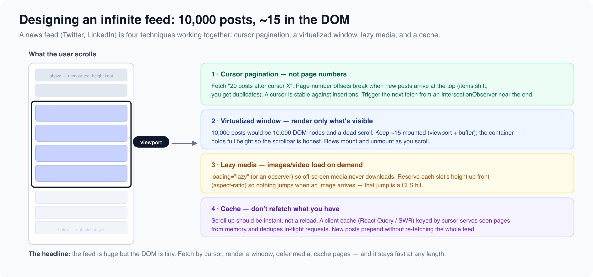

# Content and media

*6 min read · Updated 16 Jul 2026 Topic 31 of 77 Bookmark Mark done 11C · Topic 31 of 77*

**Source:** [https://www.geekyfrontend.in/learn/complete-frontend-kit/content-and-media](https://www.geekyfrontend.in/learn/complete-frontend-kit/content-and-media)

---

# 11C. Content & Media

**Questions:** 7 **Difficulty:** Senior

---



## Q 19.11 Design a News Feed (Facebook / LinkedIn / Twitter)

**Asked at:** Every company — second most asked system design question

**Key Requirements:** Personalized feed, infinite scroll, create posts (text, image, video), like/comment/share, real-time updates for new posts.

**Architecture:** Similar to the example in Q19.2 (RADIO framework walkthrough). Key additions:

**Feed rendering strategy:** SSR for the initial page (SEO for public profiles, fast FCP), then client-side updates. Each post is a `<article>` element for semantics.

**Infinite scroll with cursor pagination:**

typescript

```
function useFeed() {
  return useInfiniteQuery({
    queryKey: ['feed'],
    queryFn: ({ pageParam }) => fetchFeed({ cursor: pageParam, limit: 20 }),
    getNextPageParam: (lastPage) => lastPage.nextCursor,
    staleTime: 2 * 60 * 1000,
  });
}

// In the component — trigger next page when sentinel is visible
const sentinelRef = useRef(null);
useEffect(() => {
  const observer = new IntersectionObserver(([entry]) => {
    if (entry.isIntersecting && hasNextPage) fetchNextPage();
  });
  if (sentinelRef.current) observer.observe(sentinelRef.current);
  return () => observer.disconnect();
}, [hasNextPage]);
```

**New post indicator:** "3 new posts" banner at top. Don't auto-insert (causes layout shift and the user loses their scroll position). User clicks the banner to load new posts.

**Media handling:** Images lazy-loaded with blur placeholder. Videos show thumbnail until clicked (don't autoplay — saves bandwidth, respects user preference). Video player lazy-loaded on interaction.

---

## Q 19.12 Design a Video Streaming Platform (YouTube)

**Asked at:** Google, Amazon, Flipkart

**Key Requirements:** Video player with controls, quality selection, recommendations sidebar, comments, search, channel pages.

**Architecture:**

javascript

```
VideoPage
├── VideoPlayer
│   ├── VideoElement (<video> with HLS/DASH)
│   ├── ControlBar (play, progress, volume, quality, fullscreen, captions)
│   ├── QualitySelector (auto, 1080p, 720p, 480p, 360p)
│   └── BufferingIndicator
├── VideoInfo (title, views, likes, channel, subscribe)
├── RecommendationsSidebar
│   └── VideoCard (×N) — thumbnail, title, channel, views
├── CommentSection (lazy-loaded, reuse Q19.9 pattern)
└── DescriptionCollapsible
```

**Adaptive bitrate streaming (ABR):** The video is encoded at multiple qualities. The player (using hls.js or dash.js) monitors bandwidth and switches quality automatically. The `<video>` element natively handles HLS on Safari; other browsers need hls.js.

javascript

```
import Hls from 'hls.js';

if (Hls.isSupported()) {
  const hls = new Hls();
  hls.loadSource('https://cdn.example.com/video/master.m3u8');
  hls.attachMedia(videoElement);
} else if (videoElement.canPlayType('application/vnd.apple.mpegurl')) {
  videoElement.src = 'https://cdn.example.com/video/master.m3u8';
}
```

**Performance:** Lazy-load comments and recommendations below the fold. Preload the next video's thumbnail when the current video is 80% complete. Use `loading="lazy"` on all thumbnails in the sidebar.

---

## Q 19.13 Design a Photo Sharing App (Instagram)

**Asked at:** Google, Amazon, Flipkart

**Key Requirements:** Photo feed (grid + individual post view), stories bar, upload with filters, explore/discover, like/comment, user profiles with photo grid.

**Key design decisions:**

**Image grid layout:** Use CSS Grid with `auto-fit` for the profile grid. For the explore page, use a masonry layout (CSS `columns` or a masonry library). Images are `` with `srcset` for responsive sizes.

**Image upload flow:**

1. User selects image → show preview immediately (URL.createObjectURL)
2. Client-side resize if >2000px wide (Canvas API)
3. Upload to CDN via pre-signed URL (direct upload, not through your API server)
4. On success, create post with the CDN URL

**Stories:** Horizontal scrollable bar at top. Each story is a timed carousel (auto-advance after 5 seconds). Use `requestAnimationFrame` for the progress bar animation. Preload the next story's media while the current one is playing.

---

## Q 19.14 Design an Image/Video Carousel at Scale

**Asked at:** Flipkart, Amazon, Swiggy

**Key Requirements:** Swipeable carousel, lazy loading, responsive, accessible, performant with 50+ slides, touch + keyboard + mouse support.

**Implementation approach:**

typescript

```
function Carousel({ items }) {
  const [currentIndex, setCurrentIndex] = useState(0);
  const trackRef = useRef(null);

  // Only render current + adjacent slides (lazy rendering)
  const visibleRange = [
    Math.max(0, currentIndex - 1),
    Math.min(items.length - 1, currentIndex + 1),
  ];

  function goTo(index) {
    const clamped = Math.max(0, Math.min(items.length - 1, index));
    setCurrentIndex(clamped);
    // Use transform for GPU-composited animation
    trackRef.current.style.transform = `translateX(-${clamped * 100}%)`;
  }

  // Keyboard navigation
  useEffect(() => {
    function handleKey(e) {
      if (e.key === 'ArrowLeft') goTo(currentIndex - 1);
      if (e.key === 'ArrowRight') goTo(currentIndex + 1);
    }
    window.addEventListener('keydown', handleKey);
    return () => window.removeEventListener('keydown', handleKey);
  }, [currentIndex]);

  return (
    <div role="region" aria-label="Image carousel" aria-roledescription="carousel">
      <div ref={trackRef} style={{ display: 'flex', transition: 'transform 0.3s ease' }}>
        {items.map((item, i) => (
          <div key={item.id} role="group" aria-roledescription="slide"
               aria-label={`Slide ${i + 1} of ${items.length}`}
               style={{ flexShrink: 0, width: '100%' }}>
            {i >= visibleRange[0] && i <= visibleRange[1] ? (
              
            ) : (
              <div style={{ aspectRatio: '16/9', background: '#f0f0f0' }} />
            )}
          </div>
        ))}
      </div>
      <button onClick={() => goTo(currentIndex - 1)} aria-label="Previous slide">←</button>
      <button onClick={() => goTo(currentIndex + 1)} aria-label="Next slide">→</button>
    </div>
  );
}
```

**Touch/swipe:** Track `touchstart` and `touchend` positions. If horizontal distance > 50px, navigate. Use `touch-action: pan-y` on the carousel so vertical scroll still works.

---

## Q 19.15 Design a Stories Feature (Instagram/WhatsApp)

**Asked at:** Flipkart, Swiggy

**Key decisions:** Horizontal tray at top (scroll snap for alignment), each story is a full-screen overlay with auto-advancing slides (5s per image, 15s per video), progress bars at top, tap left/right to navigate, long-press to pause.

**Preloading strategy:** When viewing story N, preload story N+1's first slide. When a story auto-advances to the next slide, preload the slide after that. This ensures seamless transitions.

**State:** Track which stories the user has viewed (Set in localStorage). Viewed stories move to the end of the tray with a gray ring. Unviewed stories have a colorful ring.

---

## Q 19.16 Design a Music Player (Spotify)

**Asked at:** Google, Amazon

**Key Requirements:** Persistent player bar (plays across page navigations), playlist queue, search, album/artist pages, audio visualization.

**The persistent player challenge:** The player must continue playing when the user navigates between pages. This means the `<audio>` element and playback state live outside the route tree — in a global context or store.

javascript

```
App
├── Layout
│   ├── Sidebar (navigation, playlists)
│   └── MainContent (route-based: home, search, album, artist)
└── PlayerBar (persistent, always mounted)
    ├── NowPlaying (album art, track name, artist)
    ├── PlaybackControls (prev, play/pause, next, shuffle, repeat)
    ├── ProgressBar (seekable)
    ├── VolumeControl
    └── QueueButton → QueueDrawer
```

**Audio element management:**

typescript

```
// Singleton audio manager — lives outside React
const audio = new Audio();

const usePlayerStore = create((set, get) => ({
  currentTrack: null,
  isPlaying: false,
  progress: 0,
  queue: [],

  play: (track) => {
    audio.src = track.streamUrl;
    audio.play();
    set({ currentTrack: track, isPlaying: true });
  },
  pause: () => { audio.pause(); set({ isPlaying: false }); },
  seek: (time) => { audio.currentTime = time; },
}));

// Progress tracking
audio.addEventListener('timeupdate', () => {
  usePlayerStore.setState({ progress: audio.currentTime / audio.duration });
});
```

**Gapless playback:** Preload the next track's audio while the current one is playing. When the current track ends, the next one starts immediately without a gap. Use two `<audio>` elements — one playing, one preloading.

---

## Q 19.17 Design a Podcast Platform

**Asked at:** Flipkart, Swiggy

Similar to the music player (Q19.16) with key differences: episodes are much longer (30-90 minutes), playback speed control (0.5x, 1x, 1.5x, 2x), resume position tracking (remember where the user stopped), chapter markers, show notes with timestamps (click to jump), and download for offline listening (Service Worker + IndexedDB for large audio files).

---

## Learn More

- [Lazy loading (MDN) MDN](https://developer.mozilla.org/en-US/docs/Web/Performance/Lazy_loading)
- [Facebook news feed — FE system design YouTube](https://www.youtube.com/watch?v=5vyKhm2NTfw)
- [How social feeds scroll infinitely YouTube](https://www.youtube.com/watch?v=QQp4VLav72s)
- [Design infinite scroll (interview) YouTube](https://www.youtube.com/watch?v=IOJOUaKuj6M)
