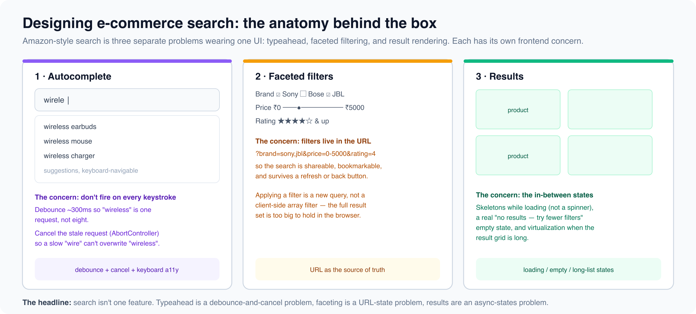

# Ecommerce

*7 min read · Updated 16 Jul 2026 Topic 32 of 77 Bookmark Mark done 11D · Topic 32 of 77*

**Source:** [https://www.geekyfrontend.in/learn/complete-frontend-kit/ecommerce](https://www.geekyfrontend.in/learn/complete-frontend-kit/ecommerce)

---

# 11D. E-commerce

**Questions:** 6 **Difficulty:** Senior

---



## Q 19.18 Design an E-commerce Product Page (Amazon / Flipkart)

**Asked at:** Every company — the most asked e-commerce design question

**Key Requirements:** Product images (zoom, gallery), variant selection (size, color), pricing (discounts, EMI), add to cart, reviews summary, related products, delivery estimation.

**Architecture:**

javascript

```
ProductPage (SSR — SEO critical)
├── Breadcrumb
├── ProductGallery
│   ├── ThumbnailStrip (vertical)
│   └── MainImage (zoom on hover, pinch on mobile)
├── ProductInfo
│   ├── Title, Rating summary (stars + count)
│   ├── PriceBlock (MRP strikethrough, discount %, sale price, EMI)
│   ├── VariantSelector (size grid, color swatches)
│   ├── DeliveryEstimation (pincode input → delivery date)
│   ├── AddToCartButton + BuyNowButton
│   └── WishlistButton
├── ProductTabs (lazy-loaded below fold)
│   ├── Description
│   ├── Specifications (table)
│   └── Reviews (paginated, sortable — reuse Q19.9 pattern)
├── RelatedProducts (horizontal scroll, lazy-loaded)
└── RecentlyViewed (from localStorage)
```

**Rendering strategy:** SSR for the above-fold content (SEO for product discovery, fast FCP). Reviews, related products, and recently viewed lazy-load on scroll.

**Variant selection state:**

typescript

```
type ProductState = {
  selectedSize: string | null;
  selectedColor: string | null;
  quantity: number;
  pincode: string;
  deliveryEstimate: string | null;
};

// When variant changes, check inventory and update price
function handleVariantChange(size, color) {
  const variant = product.variants.find(v => v.size === size && v.color === color);
  if (!variant) { setOutOfStock(true); return; }
  setPrice(variant.price);
  setInStock(variant.inventory > 0);
  // Update the main image to show the selected color
  setActiveImage(variant.images[0]);
}
```

**Image zoom:** On desktop, show a magnified version on hover (CSS `background-position` tracking mouse coordinates). On mobile, use pinch-to-zoom with touch events.

**Add to cart — optimistic update:** Cart badge increments immediately. If the API fails (race condition: item went out of stock between page load and click), show a toast error and rollback.

---

## Q 19.19 Design a Search Experience (Autocomplete + Filters + Faceted Search)

**Asked at:** Google, Amazon, Flipkart, Swiggy

**Key Requirements:** Search box with autocomplete suggestions, search results with filters (category, price range, brand, rating), faceted counts update as filters change, sort options, pagination.

**Architecture:**

javascript

```
SearchPage
├── SearchBar (persistent in header)
│   ├── SearchInput (debounced, 300ms)
│   ├── AutocompleteDropdown
│   │   ├── RecentSearches
│   │   ├── SuggestionList (from API, highlighted match text)
│   │   └── TrendingSearches (fallback when input is empty)
│   └── SearchButton
├── SearchResults
│   ├── FilterSidebar
│   │   ├── CategoryFilter (tree, expandable)
│   │   ├── PriceRangeFilter (slider or predefined ranges)
│   │   ├── BrandFilter (checkbox list with counts)
│   │   ├── RatingFilter (stars)
│   │   └── ClearAllFilters
│   ├── ResultsHeader (count, sort dropdown, view toggle grid/list)
│   ├── ProductGrid / ProductList
│   │   └── ProductCard (×N)
│   └── Pagination or InfiniteScroll
└── NoResults (search suggestions, popular categories)
```

**URL-driven state (critical for search):**

javascript

```
/search?q=wireless+headphones&category=electronics&brand=Sony,JBL&price=1000-5000&sort=price_asc&page=2
```

All filter state lives in the URL — not in React state. This enables: shareable search links, browser back/forward navigation through filter changes, and SSR for SEO on search result pages.

typescript

```
function useSearchParams() {
  const [searchParams, setSearchParams] = useSearchParams();

  return {
    query: searchParams.get('q') || '',
    category: searchParams.get('category') || '',
    brands: searchParams.get('brand')?.split(',') || [],
    priceRange: {
      min: Number(searchParams.get('price_min')) || 0,
      max: Number(searchParams.get('price_max')) || Infinity,
    },
    sort: searchParams.get('sort') || 'relevance',
    page: Number(searchParams.get('page')) || 1,
  };
}
```

**Autocomplete performance:** Debounce input by 300ms. Cancel previous request with AbortController when new input arrives. Cache recent queries in a Map (in-memory — don't refetch "wireless" if the user backspaces and retypes it). Show cached results instantly while the new request loads.

**Faceted counts:** Each filter shows how many results match. "Sony (42)", "JBL (28)". These counts update when other filters change. The API returns facet counts alongside results:

json

```
{
  "results": [...],
  "facets": {
    "brand": [{ "value": "Sony", "count": 42 }, { "value": "JBL", "count": 28 }],
    "price_range": [{ "value": "0-1000", "count": 15 }, { "value": "1000-5000", "count": 67 }]
  },
  "total": 234,
  "page": 1
}
```

---

## Q 19.20 Design a Payment Checkout Flow

**Asked at:** Razorpay, Flipkart, Amazon, PhonePe

**Key Requirements:** Multi-step form (address → payment → confirmation), multiple payment methods, coupon/discount application, order summary, address management, saved payment methods.

**Architecture:**

javascript

```
CheckoutPage
├── ProgressBar (Address → Payment → Review → Confirmation)
├── CheckoutSteps
│   ├── AddressStep
│   │   ├── SavedAddressList (radio select)
│   │   ├── AddNewAddressForm
│   │   └── ContinueButton
│   ├── PaymentStep
│   │   ├── PaymentMethodSelector
│   │   │   ├── SavedCards
│   │   │   ├── UPI
│   │   │   ├── NetBanking
│   │   │   ├── COD
│   │   │   └── EMI options
│   │   ├── CouponInput
│   │   └── PayButton
│   └── ConfirmationStep
│       ├── OrderSummary
│       ├── EstimatedDelivery
│       └── OrderNumber
├── OrderSummary (sticky sidebar on desktop)
│   ├── ItemList (thumbnail, name, qty, price)
│   ├── PriceBreakdown (subtotal, discount, shipping, tax, total)
│   └── CouponApplied
└── SecurityBadges (SSL, payment partner logos)
```

**Critical design decisions:**

**Form state persistence:** If the user navigates away and returns, their entered address and selected payment method should persist. Use `sessionStorage` (clears on tab close — appropriate for checkout data).

**Payment security:** Never handle raw card numbers on your frontend. Use a payment gateway's embedded iframe or SDK (Razorpay, Stripe Elements). The card number never touches your DOM — it's entered in the gateway's iframe, and you receive a token.

**Error handling is critical here:** Payment failures need clear, specific messages. "Payment declined" is not enough — "Your bank declined the transaction. Try a different card or contact your bank." Retry mechanisms with idempotency keys prevent double charges.

**Optimistic vs confirmed:** Never show "Order placed!" until the server confirms. Unlike a like button, payment is irreversible. Show a loading state during payment processing. The confirmation step only renders after the server returns a success response with an order ID.

---

## Q 19.21 Design a Multi-vendor Marketplace Listing

**Asked at:** Flipkart, Amazon

Similar to product page (Q19.18) but with multiple sellers for the same product. Key additions: seller comparison (price, rating, delivery time), "Buy Box" logic (one default seller highlighted), seller profile page, return policy differences per seller.

The component tree adds a `SellerSelector` between product info and add-to-cart, showing a comparison table of sellers with their prices, ratings, and delivery estimates.

---

## Q 19.22 Design a Price Comparison Widget

**Asked at:** Flipkart, Razorpay

**Key concept:** Fetch prices from multiple sources (APIs or scraping results cached on backend), normalize into a consistent format, display a comparison table sorted by price. Show price history chart (is this a good deal?). Alert system for price drops.

State: `useQuery` with `refetchInterval` for periodic price updates. Cache previous prices in localStorage for the history chart.

---

## Q 19.23 Design a Reviews & Ratings System

**Asked at:** Amazon, Flipkart, Swiggy

**Architecture:**

javascript

```
ReviewSection
├── RatingSummary
│   ├── AverageRating (large number + stars)
│   ├── RatingDistribution (5 bars: 5-star to 1-star with percentages)
│   └── TotalReviewCount
├── ReviewFilters (star rating, verified purchase, with photos)
├── SortOptions (most helpful, newest, highest, lowest)
├── ReviewList (paginated)
│   └── ReviewCard
│       ├── StarRating + ReviewerName + Date + VerifiedBadge
│       ├── ReviewTitle
│       ├── ReviewBody (expandable for long reviews)
│       ├── ReviewImages (thumbnail grid, lightbox on click)
│       └── HelpfulButton ("Was this helpful? Yes (42) / No (3)")
├── WriteReviewButton → ReviewForm
│   ├── StarInput (clickable/hoverable)
│   ├── TitleInput
│   ├── BodyTextarea
│   ├── ImageUpload (drag-drop)
│   └── SubmitButton
└── LoadMoreButton
```

**Key patterns:** Star input uses `aria-label` for accessibility ("Rate 4 out of 5 stars"). Rating distribution bars use CSS width percentages for visual representation. Review images open in a lightbox with keyboard navigation. Helpful vote is an optimistic update (increment immediately, rollback on failure).

---

## Learn More

- [Front-End System Design Playbook greatfrontend.com](https://www.greatfrontend.com/front-end-system-design-playbook)
- [E-commerce with React — mock interview YouTube](https://www.youtube.com/watch?v=ID4puHX8YKA)
- [Complete front-end e-commerce build YouTube](https://www.youtube.com/watch?v=5r6lnqP4V2s)
- [Build an e-commerce store (front-end) YouTube](https://www.youtube.com/watch?v=DsUY7ZbVkgY)
