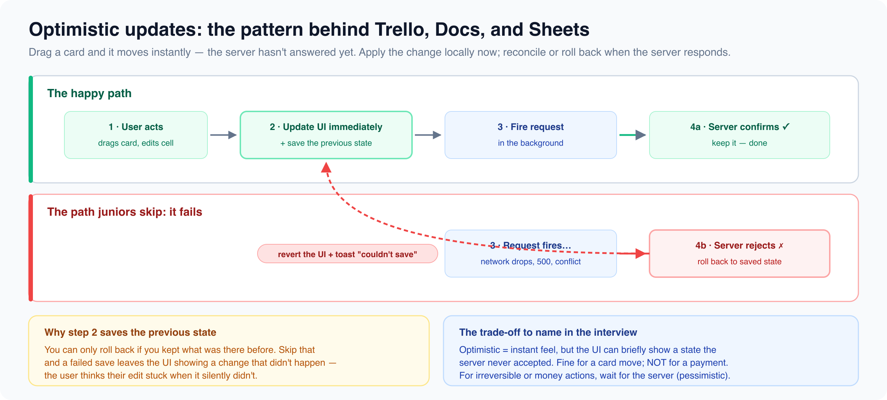

# Productivity and saas

*9 min read · Updated 16 Jul 2026 Topic 33 of 77 Bookmark Mark done 11E · Topic 33 of 77*

**Source:** [https://www.geekyfrontend.in/learn/complete-frontend-kit/productivity-and-saas](https://www.geekyfrontend.in/learn/complete-frontend-kit/productivity-and-saas)

---

# 11E. Productivity & SaaS

**Questions:** 9 **Difficulty:** Senior

---



## Q 19.24 Design a Spreadsheet (Google Sheets)

**Asked at:** Google, Microsoft, Amazon

**The hardest frontend system design problem.** Tests: virtualization, formula parsing, cell dependency graph, collaborative editing, and performance with millions of cells.

**Architecture:**

javascript

```
SpreadsheetApp
├── Toolbar (bold, italic, font size, cell format, formulas)
├── FormulaBar (shows formula for selected cell)
├── SheetGrid
│   ├── ColumnHeaders (A, B, C... — frozen, horizontally scrollable)
│   ├── RowNumbers (1, 2, 3... — frozen, vertically scrollable)
│   └── CellGrid (virtualized — only render visible cells)
│       └── Cell (×visible only, ~50 columns × 30 rows = 1500 cells)
├── SheetTabs (Sheet1, Sheet2, +)
└── StatusBar (SUM, AVERAGE of selection)
```

**Virtualization is non-negotiable:** A sheet has 26 columns × 1000 rows = 26,000 cells minimum. Rendering all of them creates 100,000+ DOM nodes. Virtualize to render only the visible viewport + buffer. Use `position: absolute` with calculated `top`/`left` for each visible cell.

**Cell data model:**

typescript

```
type CellData = {
  value: string | number | null;     // Display value
  formula: string | null;             // "=SUM(A1:A10)" or null
  format: CellFormat;                 // Bold, color, number format
  dependencies: string[];             // Cells this formula depends on
  dependents: string[];               // Cells that depend on this cell
};

// Storage: sparse representation (only store non-empty cells)
type SheetData = Map<string, CellData>;  // "A1" → CellData
```

**Formula engine:** Parse `=SUM(A1:A10)` → identify dependencies (A1 through A10) → compute value → update dependents. Use a **dependency graph** (DAG) to determine recalculation order. When A1 changes, find all cells that depend on A1 (directly or transitively) and recalculate in topological order.

**Cycle detection:** If A1 = B1 + 1 and B1 = A1 + 1, that's a circular dependency. Detect cycles during formula entry using DFS on the dependency graph. Show an error in the cell.

**Performance:** Batch recalculations (don't recompute on every keystroke — wait for blur or Enter). Use Web Workers for heavy formula computation. Cache computed values — only recompute cells whose dependencies changed.

---

## Q 19.25 Design a Kanban Board (Trello / Jira)

**Asked at:** Google, Amazon, Flipkart, Atlassian

**Key Requirements:** Multiple columns (To Do, In Progress, Done), drag-and-drop cards between columns, card creation/editing, column reordering, assignees, labels, due dates.

**Architecture:**

javascript

```
KanbanBoard
├── BoardHeader (board name, filters, members)
├── ColumnList (horizontal scroll)
│   └── Column (×N, droppable)
│       ├── ColumnHeader (title, card count, add card, column menu)
│       ├── CardList (droppable, vertically scrollable)
│       │   └── Card (×N, draggable)
│       │       ├── Labels (colored tags)
│       │       ├── Title
│       │       ├── DueDate, Assignee avatar
│       │       └── CommentCount, AttachmentCount
│       └── AddCardButton
└── CardDetailModal (full card view on click)
```

**Drag and drop:** Use `@dnd-kit` or `react-beautiful-dnd`. Track: which card is being dragged, which column it came from, which column it's hovering over, and the insertion index. On drop, optimistically update the local state (move the card), then POST to the API. If the API fails, rollback to the previous position.

typescript

```
// Optimistic reorder
function handleDragEnd(event) {
  const { active, over } = event;
  if (!over) return;

  const fromColumn = findColumnOfCard(active.id);
  const toColumn = findColumnByDroppableId(over.id);

  // Optimistic: update UI immediately
  moveCard(active.id, fromColumn, toColumn, overIndex);

  // Persist to server
  updateCardPosition(active.id, toColumn.id, overIndex)
    .catch(() => {
      // Rollback on failure
      moveCard(active.id, toColumn, fromColumn, originalIndex);
      showError('Failed to move card. Please try again.');
    });
}
```

**Column reordering:** Same drag-and-drop pattern but for columns. The entire column (header + cards) is draggable horizontally.

---

## Q 19.26 Design a Calendar Application (Google Calendar)

**Asked at:** Google, Microsoft, Amazon

**Key Requirements:** Day, week, month views. Event creation (click + drag on time slots). Recurring events. Multi-calendar support (personal, work). Event editing modal.

**Architecture:**

javascript

```
CalendarApp
├── CalendarHeader (navigation: today, back, forward, view toggle)
├── CalendarSidebar
│   ├── MiniCalendar (month picker)
│   └── CalendarList (toggle visibility of each calendar)
├── CalendarView (switches based on selected view)
│   ├── MonthView — grid of day cells, events as colored bars
│   ├── WeekView — 7-column time grid, events as positioned blocks
│   └── DayView — single-column time grid
└── EventModal (create/edit)
    ├── TitleInput, DateTimePicker, LocationInput
    ├── RecurrenceSelector, ReminderSelector
    └── CalendarSelector, ColorPicker
```

**Event positioning in week/day view:**

Events are absolutely positioned within their time column. The top offset corresponds to the start time, the height corresponds to duration. Overlapping events must not occlude each other — use a column-packing algorithm:

typescript

```
function layoutEvents(events) {
  // Sort by start time, then by duration (longer first)
  events.sort((a, b) => a.start - b.start || b.duration - a.duration);

  // Assign columns to prevent overlap
  const columns = [];
  for (const event of events) {
    let placed = false;
    for (let col = 0; col < columns.length; col++) {
      const lastInCol = columns[col][columns[col].length - 1];
      if (event.start >= lastInCol.end) {
        columns[col].push(event);
        event.column = col;
        placed = true;
        break;
      }
    }
    if (!placed) {
      event.column = columns.length;
      columns.push([event]);
    }
  }

  // Each event's width = 1/totalColumns, left = column × width
  const totalColumns = columns.length;
  events.forEach(e => {
    e.width = 1 / totalColumns;
    e.left = e.column / totalColumns;
  });
}
```

**Drag to create:** User clicks on a time slot and drags downward. The selection grows as the mouse moves. On release, open the event creation modal with the selected time range pre-filled.

---

## Q 19.27 Design an Email Client (Gmail)

**Asked at:** Google, Microsoft

**Key Requirements:** Inbox list with threads, read/unread, labels/folders, compose, reply/forward, search, keyboard shortcuts, offline support.

**Architecture:**

javascript

```
EmailApp
├── Sidebar (Inbox, Sent, Drafts, Labels, Compose button)
├── ThreadList
│   ├── SearchBar
│   ├── BulkActions (select all, archive, delete, mark read)
│   └── ThreadRow (×N)
│       ├── Checkbox, StarToggle
│       ├── SenderName, Subject, Preview, Date
│       └── Labels
├── ThreadView (right panel or full page)
│   ├── Subject, Labels
│   ├── MessageList
│   │   └── Message (×N in thread)
│   │       ├── SenderInfo, Timestamp, CollapseToggle
│   │       ├── MessageBody (HTML rendered safely — sanitized)
│   │       └── Attachments
│   └── ReplyBox
└── ComposeModal (floating, draggable)
    ├── To/Cc/Bcc (autocomplete)
    ├── Subject
    ├── RichTextEditor
    ├── AttachmentBar
    └── Send/Discard/Schedule
```

**Keyboard shortcuts:** Gmail-like shortcuts (j/k = next/prev thread, x = select, e = archive, r = reply). Implement with a global keydown listener that checks `document.activeElement` — don't fire shortcuts when the user is typing in an input.

**HTML email rendering:** Incoming emails contain arbitrary HTML. Render in a sandboxed iframe or sanitize with DOMPurify (stripping scripts, external resources, and tracking pixels).

**Offline:** Cache the last 100 threads in IndexedDB via Service Worker. Compose offline → queue in IndexedDB → send when online.

---

## Q 19.28 Design a Code Editor in the Browser (VS Code Web / CodeSandbox)

**Asked at:** Google, Microsoft

**Key Requirements:** Syntax highlighting, multi-file support, file tree, auto-completion, terminal, live preview.

**Core decision:** Don't build the editor from scratch. Use **Monaco Editor** (the editor that powers VS Code) or **CodeMirror 6**. Both handle syntax highlighting, key bindings, multi-cursor, and language services.

typescript

```
import * as monaco from 'monaco-editor';

const editor = monaco.editor.create(containerElement, {
  value: initialCode,
  language: 'typescript',
  theme: 'vs-dark',
  minimap: { enabled: true },
  automaticLayout: true,
});

editor.onDidChangeModelContent(() => {
  const code = editor.getValue();
  debouncedCompile(code);  // Send to preview iframe
});
```

**Live preview:** The edited code compiles (via esbuild in a Web Worker or on a server) and the output loads in an `<iframe>`. Use `srcdoc` for HTML or `blob:` URLs for JS bundles. The iframe sandboxes the user's code from the editor.

**File system:** Virtual file system in memory (Map of path → content). Use a tree component for the file explorer sidebar. Tabs at the top for open files.

---

## Q 19.29 Design a Form Builder (Typeform)

**Asked at:** Razorpay, Flipkart

**Key Requirements:** Drag-and-drop field placement, field types (text, choice, rating, file upload), conditional logic (show field B if field A = "yes"), preview mode, response collection.

**Two modes:** Builder mode (drag fields, configure properties) and Preview mode (fill out the form as a respondent). The builder stores a form schema (JSON), and the preview renders it dynamically.

typescript

```
type FormSchema = {
  id: string;
  title: string;
  fields: FormField[];
};

type FormField = {
  id: string;
  type: 'text' | 'email' | 'choice' | 'rating' | 'file' | 'number';
  label: string;
  required: boolean;
  options?: string[];           // For choice fields
  conditionalOn?: {             // Show this field only if...
    fieldId: string;
    value: string;
  };
};
```

The builder is a visual schema editor. Dragging a "Text Input" from the sidebar creates a new entry in the `fields` array. The properties panel on the right edits the selected field's configuration. Preview mode maps over the schema and renders the appropriate component for each field type (Strategy pattern — Chapter 9).

---

## Q 19.30 Design a Dashboard with Configurable Widgets

**Asked at:** Google, Amazon, Razorpay

**Key concept:** Users can add, remove, resize, and rearrange widgets (charts, metrics, tables) on a grid. Persist layout in the database per user.

Use `react-grid-layout` for the draggable/resizable grid. Each widget is a self-contained component that fetches its own data. Dashboard layout (widget positions and sizes) is saved as JSON and loaded on page load.

typescript

```
type DashboardLayout = {
  widgets: Array<{
    id: string;
    type: 'chart' | 'metric' | 'table' | 'list';
    config: Record<string, unknown>;  // Widget-specific config
    position: { x: number; y: number; w: number; h: number };
  }>;
};
```

---

## Q 19.31 Design a File Manager (Google Drive)

**Asked at:** Google, Microsoft

**Key Requirements:** File/folder tree, grid and list views, upload (drag-drop), download, share, rename, delete, search, breadcrumb navigation.

**Architecture similar to email (Q19.27):** Sidebar with folder tree, main area with file grid/list, context menu on right-click, detail panel on selection. Drag-and-drop for moving files between folders and for upload.

**Upload flow:** Drag files onto the page → show upload progress for each file → upload to CDN via chunked upload (for large files, upload in 5MB chunks with resume on failure) → create file record in backend.

---

## Q 19.32 Design a Polling / Survey Application

**Asked at:** Flipkart, Swiggy

**Key decisions:** Real-time vote count updates (SSE), animated bar charts showing results, one-vote-per-user enforcement (track by user ID or cookie), time-limited polls, multiple question types (single choice, multiple choice, ranking, free text).

Results visualization: animated bars that grow/shrink as votes come in. Use CSS transitions on the bar width, throttled to update at most every 500ms to prevent jitter from rapid vote bursts.

---

## Learn More

- [Operational transformation (overview) wikipedia.org](https://en.wikipedia.org/wiki/Operational_transformation)
- [Google Docs — operational transformation YouTube](https://www.youtube.com/watch?v=YiZh9Gj75HI)
- [Design a real-time collaborative editor YouTube](https://www.youtube.com/watch?v=nH8Hl3PyouE)
- [Mock design: Google Docs YouTube](https://www.youtube.com/watch?v=Fp-Wd1BH3hc)
