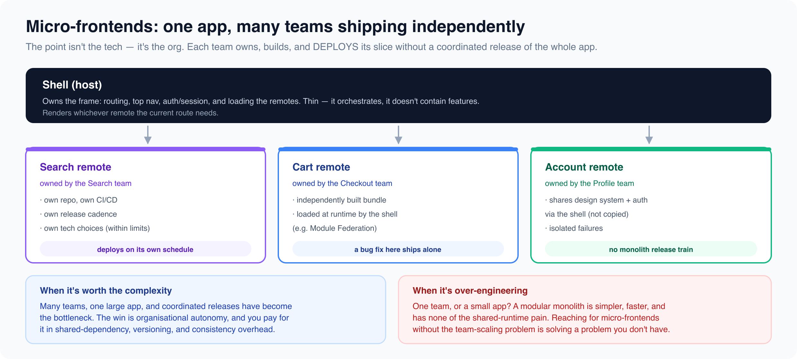

# Platform and infrastructure

*9 min read · Updated 16 Jul 2026 Topic 34 of 77 Bookmark Mark done 11F · Topic 34 of 77*

**Source:** [https://www.geekyfrontend.in/learn/complete-frontend-kit/platform-and-infrastructure](https://www.geekyfrontend.in/learn/complete-frontend-kit/platform-and-infrastructure)

---

# 11F. Platform & Infrastructure

**Questions:** 10 **Difficulty:** Senior

These problems test architectural thinking — not just building a feature but designing systems that other engineers build on top of.

---



## Q 11.33 Design a Design System / Component Library

**Asked at:** Google, Amazon, Flipkart, Razorpay — the most asked platform question

**Key Requirements:** Reusable components (Button, Input, Modal, Select, Table), theming, documentation, versioning, accessibility baked in, consumed by multiple apps.

**Architecture decisions:**

**Component API design — the hardest part:**

typescript

```
// A well-designed Button API
interface ButtonProps {
  variant: 'primary' | 'secondary' | 'danger' | 'ghost';
  size: 'sm' | 'md' | 'lg';
  disabled?: boolean;
  loading?: boolean;
  leftIcon?: React.ReactNode;
  rightIcon?: React.ReactNode;
  as?: React.ElementType;  // Render as <a> or <button>
  children: React.ReactNode;
  onClick?: () => void;
}

// Composable — not prop-bloated
// BAD: <Button iconLeft="save" iconRight="arrow" badge="3" tooltip="Save" />
// GOOD: <Button leftIcon={<SaveIcon />}>Save <Badge>3</Badge></Button>
```

**Theming with tokens:**

typescript

```
// Design tokens (consumed by all components)
const tokens = {
  colors: { primary: '#3b82f6', danger: '#ef4444', /* ... */ },
  spacing: { xs: '4px', sm: '8px', md: '16px', lg: '24px' },
  radii: { sm: '4px', md: '8px', lg: '12px' },
  typography: {
    body: { fontSize: '16px', lineHeight: '1.5' },
    heading: { fontSize: '24px', fontWeight: '600' },
  },
};

// Exposed as CSS custom properties for flexibility
// Apps can override: --ds-color-primary: #8b5cf6;
```

**Documentation:** Use Storybook. Every component has stories showing all variants, states (default, hover, focus, disabled, loading, error), and accessibility notes. Interactive playground where developers can tweak props.

**Versioning:** Semantic versioning. Breaking API changes = major version. New features = minor. Bug fixes = patch. Publish to internal npm registry or consume via monorepo workspace.

**Accessibility:** Every component must be keyboard navigable, have proper ARIA attributes, support screen readers, and respect `prefers-reduced-motion`. This is not optional — it's the entire point of a design system. Components should make it harder to build inaccessible UIs than accessible ones.

---

## Q 11.34 Design a Micro-Frontend Architecture

**Asked at:** Google, Amazon, Flipkart

**Key Requirements:** Multiple teams own different sections of the UI, independent deploy, shared shell (header, nav), consistent design system, shared authentication.

**Approaches:**

**Build-time composition (monorepo):** Each team owns a package in the monorepo. The shell app imports from each team's package. Deploy together. Simplest, but coupled deployments.

**Runtime composition (Module Federation):** Each team builds and deploys independently. The shell loads team packages at runtime via Module Federation (see Ch 12, Q12.5). Independent deploy, but version compatibility is a challenge.

**Route-based composition:** Different routes are entirely different apps. `/products` loads Team A's app, `/checkout` loads Team B's app. A reverse proxy (nginx) routes to the correct app. Simplest to implement, but cross-route navigation causes full page loads unless you use a single-SPA orchestrator.

**Shared concerns:**

javascript

```
Concern              │ Solution
  ─────────────────────┼──────────────────────────────────────
  Design consistency   │ Shared design system (npm package or MF shared)
  Authentication       │ Auth handled by shell, token passed to micro-apps
  Global state         │ Custom events / BroadcastChannel between apps
  Routing              │ Shell owns top-level routing, micro-apps own sub-routes
  CSS isolation        │ CSS Modules or Shadow DOM per micro-app
  Shared dependencies  │ Module Federation shared config (one React, one React DOM)
```

**When micro-frontends are the wrong answer:** Teams < 5 engineers (overhead exceeds benefit), tightly coupled features (shared state across teams defeats the purpose), and when a monorepo with good boundaries achieves the same outcome more simply.

---

## Q 11.35 Design an Analytics Dashboard (Mixpanel / Amplitude)

**Asked at:** Google, Amazon, Razorpay

**Key Requirements:** Custom chart builder (select metric, dimension, time range), multiple visualization types (line, bar, pie, funnel, table), date range selector, segmentation, real-time data updates, exportable reports.

**Architecture:** Configurable widget grid (reuse Q11.30 pattern). Each widget has: a query configuration (metric + filters + groupBy + time range), a chart type, and cached data. Use React Query with `staleTime` for data caching — the same query from two widgets only fires one API call.

**Chart rendering:** Use a charting library (Recharts for React, Chart.js for lightweight). For complex visualizations (funnels, cohort tables, retention curves), custom SVG components.

**Large dataset handling:** API returns aggregated data, not raw events. For a chart showing daily active users over 12 months, the API returns 365 data points — not 10 million events. The aggregation happens on the backend.

---

## Q 11.36 Design an Authentication & Authorization System

**Asked at:** Google, Amazon, Razorpay, PhonePe

**Covered extensively in Chapter 6 (Q6.5-6.6).** The system design angle adds: login/signup pages with validation, OAuth social login buttons, "forgot password" flow (email → reset link → new password form), session management across tabs (BroadcastChannel for logout sync), protected route wrapper, role-based UI rendering (admin sees different nav than viewer).

typescript

```
// Protected route pattern
function ProtectedRoute({ children, requiredRole }) {
  const { user, isLoading } = useAuth();

  if (isLoading) return <PageSkeleton />;
  if (!user) return <Navigate to="/login" replace />;
  if (requiredRole && user.role !== requiredRole) return <AccessDenied />;

  return children;
}
```

---

## Q 11.37 Design an A/B Testing Platform (Frontend Side)

**Asked at:** Google, Amazon, Flipkart

**Key concept:** Assign users to test buckets deterministically (same user always sees same variant), render the correct variant, track events per variant, and prevent layout shift during variant assignment.

typescript

```
// Deterministic bucketing (hash user ID → consistent bucket)
function getBucket(userId: string, experimentId: string, variants: string[]): string {
  const hash = hashCode(`${userId}:${experimentId}`);
  const index = Math.abs(hash) % variants.length;
  return variants[index];
}

// Usage
const variant = getBucket(userId, 'new-checkout', ['control', 'variant-a', 'variant-b']);

// Render
function CheckoutPage() {
  const variant = useExperiment('new-checkout');

  if (variant === 'variant-a') return <NewCheckoutA />;
  if (variant === 'variant-b') return <NewCheckoutB />;
  return <OldCheckout />;  // control
}
```

**Preventing flicker:** Assign the variant in middleware or SSR (see Ch 14, Q14.5) so the HTML arrives with the correct variant already rendered. If assignment happens client-side, show a skeleton until the variant is determined.

---

## Q 11.38 Design a CMS-driven Website (Headless CMS)

**Asked at:** Flipkart, Razorpay, Swiggy

**Key concept:** Content editors manage content in a CMS (Contentful, Sanity, Strapi). The frontend fetches content via API and renders it. Content changes don't require code deployments.

**Rendering:** SSG with ISR (Ch 7, Q7.4). Pages are statically generated at build time from CMS content. When content changes, the CMS sends a webhook that triggers on-demand revalidation. The page regenerates in the background — next visitor sees updated content.

**Dynamic components:** The CMS defines a page as a list of "blocks" (Hero, FeatureGrid, Testimonials, CTA). The frontend maps each block type to a React component. Content editors can rearrange blocks without developer involvement.

typescript

```
const blockComponents = {
  hero: HeroBlock,
  feature_grid: FeatureGridBlock,
  testimonials: TestimonialsBlock,
  cta: CTABlock,
};

function CMSPage({ blocks }) {
  return blocks.map((block) => {
    const Component = blockComponents[block.type];
    if (!Component) return null;
    return <Component key={block.id} {...block.data} />;
  });
}
```

---

## Q 11.39 Design a Multi-language / i18n System

**Asked at:** Flipkart, Amazon, Google

**Key Requirements:** Multiple languages, RTL support (Arabic, Hebrew, Urdu), locale-specific formatting (dates, numbers, currency), language switching without page reload, translation management.

**Architecture:** Use `react-i18next` or `next-intl`. Translations stored as JSON per locale. Load only the current locale's translations (code splitting per language).

typescript

```
// Namespace-based translation loading
const resources = {
  en: { common: () => import('./locales/en/common.json') },
  hi: { common: () => import('./locales/hi/common.json') },
  ar: { common: () => import('./locales/ar/common.json') },
};
```

**RTL support:** Use CSS logical properties (`margin-inline-start` instead of `margin-left`). Set `dir="rtl"` on `<html>`. Test with pseudo-RTL (mirror your LTR layout) before implementing actual Arabic/Hebrew translations.

**Formatting:** Use `Intl` APIs — `Intl.NumberFormat` for numbers/currency, `Intl.DateTimeFormat` for dates, `Intl.RelativeTimeFormat` for "3 hours ago". These adapt to any locale automatically.

---

## Q 11.40 Design a Feature Flag System (Frontend)

**Asked at:** Amazon, Flipkart, Razorpay

Covered partially in Ch 13 (Q13.2). The system design angle: flags fetched from a server at app startup, cached in memory, evaluated on every render. For SSR, flags are fetched in middleware (no client-side flicker). Targeting rules: percentage rollout (10% of users), user segment (beta users, internal employees), geography (India-only), and device type (mobile-only).

typescript

```
const flags = await fetch('/api/flags', {
  headers: { 'X-User-Id': userId, 'X-Country': country },
}).then(r => r.json());

// { "new-checkout": true, "ai-search": false, "dark-mode": true }

function useFeatureFlag(flagName: string): boolean {
  const flags = useContext(FeatureFlagContext);
  return flags[flagName] ?? false;
}
```

---

## Q 11.41 Design an Error Monitoring & Logging System (Sentry)

**Asked at:** Google, Amazon, Razorpay

**Key Requirements:** Capture JavaScript errors automatically, capture breadcrumbs (user actions leading to error), source map support, error grouping (don't create 10,000 separate issues for the same bug), performance monitoring (slow API calls, long tasks), user context (which user hit the error).

**Frontend integration:**

typescript

```
// Global error handler
window.addEventListener('error', (event) => {
  reportError({
    message: event.message,
    stack: event.error?.stack,
    url: window.location.href,
    userAgent: navigator.userAgent,
    userId: getCurrentUserId(),
    breadcrumbs: getBreadcrumbs(),
    timestamp: Date.now(),
  });
});

window.addEventListener('unhandledrejection', (event) => {
  reportError({ message: `Unhandled rejection: ${event.reason}`, /* ... */ });
});

// React error boundary for component errors
class ErrorBoundary extends React.Component {
  componentDidCatch(error, errorInfo) {
    reportError({ message: error.message, stack: error.stack, componentStack: errorInfo.componentStack });
  }
  render() { return this.state.hasError ? <ErrorFallback /> : this.props.children; }
}
```

**Breadcrumbs:** Track the last 20 user actions (clicks, navigations, API calls, console errors) before the error occurred. This context makes debugging much faster than a stack trace alone.

**Error grouping:** Group by normalized stack trace (strip dynamic parts like line numbers in minified code, query parameters, user IDs). Use fingerprinting to merge duplicate errors into one issue.

---

## Q 11.42 Design a Progressive Web App Architecture

**Asked at:** Google, Flipkart, Amazon

**Key Requirements:** Installable (Add to Home Screen), offline support, push notifications, background sync, app-like experience.

**The three pillars:**

1. **Web App Manifest** — `manifest.json` defines app name, icons, theme color, display mode (standalone = no browser chrome).
2. **Service Worker** — caching strategy (Ch 5, Q5.10). Cache static assets (cache-first), API data (stale-while-revalidate), and provide an offline fallback page.
3. **HTTPS** — required for Service Workers and push notifications.

**Offline-first architecture:**

javascript

```
Online:  App → fetch → API → render → cache response in Service Worker
Offline: App → fetch → Service Worker intercepts → return cached response
         If no cache → show offline fallback page
         Queue mutations → sync when online (Background Sync API)
```

**Push notifications:** Service Worker receives push events even when the app is closed. Register with a push service (Firebase Cloud Messaging), store the subscription on your server, and send push messages from the backend.

**When PWA makes sense:** Markets where users have limited storage (won't install a 100MB native app but will add a 2MB PWA), mobile-first audiences on spotty networks, and when you need app-like features (push notifications, offline) without the App Store submission process.

---

## Learn More

- [HTTP caching (MDN) MDN](https://developer.mozilla.org/en-US/docs/Web/HTTP/Caching)
- [CDNs explained in 6 minutes YouTube](https://www.youtube.com/watch?v=PMQdGWt3_L4)
- [CDN architecture explained YouTube](https://www.youtube.com/watch?v=OtMVyKirvDg)
- [The ultimate guide to caching YouTube](https://www.youtube.com/watch?v=YgDRv0mcLIc)
