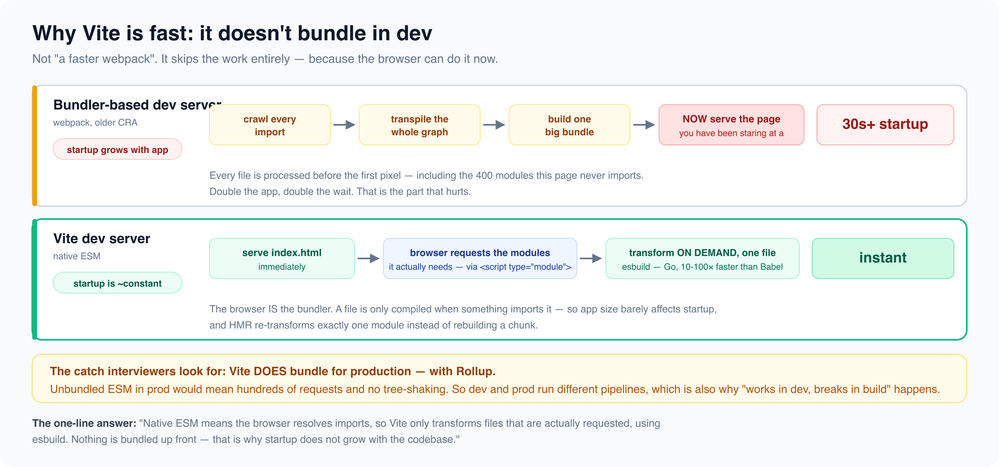

# Modules and bundlers

*12 min read · Updated 16 Jul 2026 Topic 35 of 77 Bookmark Mark done 12A · Topic 35 of 77*

**Source:** [https://www.geekyfrontend.in/learn/complete-frontend-kit/modules-and-bundlers](https://www.geekyfrontend.in/learn/complete-frontend-kit/modules-and-bundlers)

---

# 12A. Modules & Bundlers

**Questions:** 5 **Difficulty:** Mid to Senior **Companies:** Google, Amazon, Flipkart, Razorpay, Microsoft, Swiggy

---

## Q 12.1 What's the difference between CommonJS and ES Modules? What is `import.meta`?

**Difficulty:** Mid **Asked at:** Amazon, Flipkart, Razorpay, Google

JavaScript has two module systems, and understanding the difference matters for bundler configuration, tree shaking, and Node.js compatibility.

**CommonJS (CJS) — Node.js original, synchronous:**

javascript

```
// Exporting
module.exports = { add, subtract };
// or
exports.add = function(a, b) { return a + b; };

// Importing
const { add } = require('./math');
const lodash = require('lodash');
```

CJS is dynamic — `require()` can be called conditionally, inside functions, or with computed paths. This flexibility means the module graph can't be determined at build time.

javascript

```
// This is valid CJS — bundler can't know which module is loaded until runtime
const moduleName = condition ? './moduleA' : './moduleB';
const mod = require(moduleName);
```

**ES Modules (ESM) — the standard, static:**

javascript

```
// Exporting
export function add(a, b) { return a + b; }
export default function subtract(a, b) { return a - b; }

// Importing
import { add } from './math.js';
import subtract from './math.js';
import * as math from './math.js';
```

ESM imports and exports are static — they must be at the top level, not inside conditionals or functions. This is the key design choice that enables tree shaking. The bundler can analyze the entire module graph at build time and remove unused exports.

**Dynamic imports (ESM):**

javascript

```
// Dynamic import — returns a Promise, works for code splitting
const module = await import('./heavyModule.js');
module.doSomething();

// Commonly used for route-based code splitting
const Dashboard = lazy(() => import('./pages/Dashboard'));
```

Dynamic `import()` is the ESM way to load modules on demand. Unlike `require()`, it returns a Promise and is always async.

`import.meta` **— module-level metadata:**

javascript

```
// Get the current module's URL
console.log(import.meta.url);
// "file:///home/user/project/src/utils.js" (Node.js)
// "https://example.com/src/utils.js" (browser)

// Vite-specific: environment variables
console.log(import.meta.env.VITE_API_URL);
console.log(import.meta.env.MODE); // 'development' or 'production'
console.log(import.meta.env.DEV);  // true in development
console.log(import.meta.env.PROD); // true in production

// Create a Web Worker relative to the current file
const worker = new Worker(new URL('./worker.js', import.meta.url));
```

**Which to use:**

All new frontend code should use ESM. It's the standard, it enables tree shaking, and it's what every modern bundler expects. CJS is still found in Node.js server code, build configs (older `webpack.config.js` files), and legacy packages.

**Follow-up:** "What happens if you import a CJS module from ESM?"

Bundlers (Vite, webpack) handle interop automatically — they convert CJS to ESM at build time. In Node.js, you can import CJS from ESM (`import pkg from 'cjs-package'` works) but you can't `require()` ESM from CJS without using dynamic `import()`. The `esModuleInterop` TypeScript flag smooths this out by generating interop code.

---

## Q 12.2 Compare the major bundlers — Webpack vs Vite vs Rspack vs Turbopack. When would you choose each?

**Difficulty:** Mid **Asked at:** Google, Razorpay, Flipkart, Swiggy

**What a bundler does:** Takes your many source files (JS, CSS, images, fonts) with their import graph, resolves dependencies, transforms code (JSX → JS, TS → JS, SCSS → CSS), and outputs optimized bundles for the browser.

**Webpack** — the veteran (2014):

Bundles everything in both development and production. Development uses an in-memory filesystem and Hot Module Replacement (HMR). Configuration-heavy but extremely flexible — loaders and plugins for everything. Slow startup on large projects (needs to build the entire module graph before serving the first page).

When to use: existing projects already on webpack, projects needing very specific plugin behavior, when the team has deep webpack expertise.

**Vite** — the modern default (2020):

Fundamentally different development approach — doesn't bundle in development at all. Serves source files as native ES Modules directly to the browser. The browser requests a module, Vite transforms it on-the-fly (esbuild for JS, native for CSS), and serves it. Only the files you actually navigate to are processed.

Production builds use Rollup (or Rolldown in future versions) for optimized output.

When to use: new projects (it's the default recommendation in 2026), any project where development speed matters, React/Vue/Svelte projects.

**Rspack** — webpack-compatible but fast (2023):

Written in Rust, API-compatible with webpack. Drop-in replacement for most webpack configurations. 5-10x faster than webpack. Supports webpack loaders and plugins.

When to use: large existing webpack projects that need speed but can't rewrite their build config for Vite. Migration path: change the bundler, keep the config.

**Turbopack** — Next.js bundler (2022):

Also written in Rust. Deeply integrated with Next.js. Not usable outside Next.js (yet). Incremental computation — only recomputes what changed, not the entire bundle.

When to use: Next.js projects. It's being integrated as the default Next.js bundler, replacing webpack.

javascript

```
Bundler    │ Dev Speed    │ Production    │ Config      │ Ecosystem
  ───────────┼──────────────┼───────────────┼─────────────┼────────────
  Webpack    │ Slow (large  │ Mature,       │ Complex,    │ Largest —
             │ projects)    │ optimized     │ verbose     │ any plugin
  ───────────┼──────────────┼───────────────┼─────────────┼────────────
  Vite       │ Instant      │ Good (Rollup) │ Minimal     │ Growing,
             │ (no bundling)│               │             │ most needs met
  ───────────┼──────────────┼───────────────┼─────────────┼────────────
  Rspack     │ Fast (Rust)  │ Good          │ Webpack-    │ Webpack-
             │              │               │ compatible  │ compatible
  ───────────┼──────────────┼───────────────┼─────────────┼────────────
  Turbopack  │ Fast (Rust,  │ Developing    │ Next.js     │ Next.js
             │ incremental) │               │ integrated  │ only
```

**Follow-up:** "If you're starting a new project today, which bundler do you pick?"

Vite for standalone React/Vue/Svelte projects. Next.js (with Turbopack) for full-stack React with SSR. Rspack only if migrating a large webpack project.

---



## Q 12.3 Why is Vite fast? Explain how it works in development vs production.

**Difficulty:** Senior **Asked at:** Google, Razorpay, Flipkart, Swiggy

**Development — no bundling, native ESM:**

Traditional bundlers (webpack) must build the entire dependency graph before serving the first page. If you have 5,000 modules, webpack processes all 5,000 at startup — even if the page you're looking at only needs 200.

Vite doesn't bundle in development. It serves source files as native ES Modules. The browser's own module system handles the import graph:

javascript

```
Webpack dev:
  Start dev server → Bundle ALL 5,000 modules → Serve bundle → Page loads
  (10-30 seconds for large projects)

  Vite dev:
  Start dev server → Serve index.html → Browser requests main.tsx
  → Vite transforms main.tsx on-the-fly (esbuild, <5ms)
  → Browser requests imported modules → Vite transforms each on demand
  (sub-second startup regardless of project size)
```

When you navigate to a new route, the browser requests new modules, and Vite transforms them on demand. Modules that haven't been requested are never processed. This is why Vite's startup time doesn't grow with project size.

**Pre-bundling with esbuild:** Vite does one upfront step — it pre-bundles `node_modules` dependencies with esbuild (10-100x faster than webpack). Libraries like React, lodash, and date-fns have hundreds of internal modules. Pre-bundling converts them into single ESM files so the browser doesn't make hundreds of requests for one library.

**HMR (Hot Module Replacement):** When you edit a file, Vite only sends the changed module to the browser — not the entire bundle. The browser re-evaluates just that module. In a large app, this means instant updates regardless of total app size.

**Production — Rollup for optimized bundles:**

In production, native ESM with thousands of modules would create too many HTTP requests. Vite uses Rollup (a production-optimized bundler) to create traditional bundles with code splitting, tree shaking, and minification. The output is similar to what webpack produces — the development experience is different, the production output is comparable.

**Follow-up:** "What's Rolldown and why is the Vite team building it?"

Rolldown is a Rust port of Rollup being built by the Vite team. It will eventually replace both esbuild (for pre-bundling) and Rollup (for production builds) with a single tool that's faster than both. This unifies Vite's development and production pipelines, eliminating subtle behavior differences between the esbuild and Rollup transforms.

---

## Q 12.4 What's the difference between Babel, SWC, and esbuild?

**Difficulty:** Mid **Asked at:** Amazon, Flipkart, Razorpay

All three are transpilers — they transform modern JavaScript/TypeScript into code browsers can run. The difference is speed and feature set.

**Babel** — the original (2014, JavaScript):

Converts modern JS (ES2024) to older JS (ES5), transforms JSX to `React.createElement`, handles TypeScript (strips types only), and supports a massive plugin ecosystem. Slow because it's written in JavaScript and processes files through a multi-stage pipeline.

**SWC** — the fast successor (2020, Rust):

20-70x faster than Babel. Drop-in replacement for most Babel configurations. Handles JS/TS/JSX transformation, minification, and bundling. Used by Next.js, Deno, and Parcel.

**esbuild** — the speed demon (2020, Go):

100x faster than Babel for simple transformations. Used by Vite for pre-bundling and development transforms. More limited than Babel/SWC — doesn't support custom plugins or older browser targets as thoroughly.

javascript

```
Tool    │ Language │ Speed vs Babel │ Plugin System │ Used By
  ────────┼──────────┼────────────────┼───────────────┼────────────
  Babel   │ JS       │ 1x (baseline)  │ Massive       │ Legacy projects
  SWC     │ Rust     │ 20-70x         │ Growing       │ Next.js, Deno
  esbuild │ Go       │ 10-100x        │ Limited       │ Vite (dev)
```

**When you still need Babel:** Custom syntax transforms (decorators, pipeline operator), very specific polyfill requirements, or projects with deeply customized Babel plugin chains that haven't been ported to SWC.

**When to use SWC:** New Next.js projects (default), replacing Babel for a speed boost in existing projects, when you need Babel-level features with Rust-level speed.

**When to use esbuild:** Vite development (automatic), build scripts, quick CLI tools, any context where transform speed is critical and you don't need advanced plugins.

---

## Q 12.5 What is Module Federation? How does it enable micro-frontends?

**Difficulty:** Senior **Asked at:** Google, Amazon, Flipkart, Microsoft

Module Federation allows separate builds (different apps, built by different teams, deployed independently) to share code at runtime. App A can import a component from App B without App B being part of App A's build.

**The problem it solves:**

In a micro-frontend architecture, different teams own different parts of the UI. Team A builds the header, Team B builds the product listing, Team C builds the checkout. Without Module Federation, you'd either build a monolith (defeating the purpose) or use iframes (terrible UX and performance).

Module Federation lets each team build and deploy independently. At runtime, when the shell app needs Team B's product listing component, it downloads it from Team B's deployed bundle.

javascript

```
// Shell app — vite.config.js (using @originjs/vite-plugin-federation)
import federation from '@originjs/vite-plugin-federation';

export default {
  plugins: [
    federation({
      name: 'shell',
      remotes: {
        productApp: 'http://products.cdn.example.com/remoteEntry.js',
        checkoutApp: 'http://checkout.cdn.example.com/remoteEntry.js',
      },
      shared: ['react', 'react-dom'],  // Shared dependencies — loaded once
    }),
  ],
};
```

jsx

```
// Shell app — uses components from remote apps
const ProductList = lazy(() => import('productApp/ProductList'));
const CartDrawer = lazy(() => import('checkoutApp/CartDrawer'));

function App() {
  return (
    <Layout>
      <Suspense fallback={<Skeleton />}>
        <ProductList />
      </Suspense>
      <Suspense fallback={<Skeleton />}>
        <CartDrawer />
      </Suspense>
    </Layout>
  );
}
```

**Shared dependencies:** React, React DOM, and other common libraries are declared as `shared`. Module Federation ensures only one copy is loaded — if both the shell and the product app use React 18, it's downloaded once.

**When Module Federation makes sense:**

- Large organizations where multiple teams own different features
- Features that need independent deployment schedules (checkout team ships daily, product team ships weekly)
- Gradual migration from a monolith (strangler fig pattern — replace one section at a time)

**When it's overkill:**

- Small teams (1-5 developers) — the overhead of multiple builds, deployments, and shared dependency management isn't worth it
- When a monorepo with code splitting achieves the same result more simply
- When the "micro-frontends" are tightly coupled anyway (shared state, shared routing, frequent cross-boundary communication)

**Follow-up:** "What are the challenges of Module Federation in production?"

Version compatibility (what if App A uses React 18 and App B upgrades to React 19?), shared state management across boundaries, CSS isolation (styles from one remote shouldn't leak into another), and debugging across remote boundaries (error traces span multiple builds). These challenges are solvable but add operational complexity.

---

## Q 12.6 What's the difference between npm, yarn, and pnpm? What are phantom dependencies?

**Difficulty:** Mid **Asked at:** Amazon, Flipkart, Razorpay, Swiggy

All three are package managers — they install dependencies, resolve version conflicts, and manage lockfiles. The differences are in how they handle the `node_modules` directory and what problems they solve.

**npm** — the default:

Ships with Node.js. Uses a flat `node_modules` structure — all dependencies (and their dependencies) are hoisted to the top level. This creates **phantom dependencies**: your code can import packages you didn't explicitly install, because a dependency's dependency was hoisted to the top level.

javascript

```
node_modules/
    react/           ← you installed this
    scheduler/       ← react's dependency, hoisted to top level
    loose-envify/    ← scheduler's dependency, also hoisted
```

Your code can `import 'scheduler'` even though you never added it to `package.json`. If React ever switches away from scheduler, your code breaks silently.

**pnpm** — strict and efficient:

Uses a content-addressed store — each package version is stored once on disk, and projects use symlinks. If 10 projects use React 18.3.1, there's only one copy on disk.

pnpm creates a strict `node_modules` layout — you can only import packages listed in your own `package.json`. Phantom dependencies cause an error immediately. This strictness catches bugs that npm and yarn hide.

javascript

```
node_modules/
    .pnpm/           ← actual packages stored here
    react -> .pnpm/react@18.3.1/    ← symlink to your explicit dependency
    // scheduler is NOT here — you can't import it accidentally
```

**yarn (v4/Berry)** — Plug'n'Play:

Yarn PnP eliminates `node_modules` entirely. Dependencies are stored as zip files in `.yarn/cache`. Resolution uses a generated `.pnp.cjs` file that tells Node.js where each package lives. Faster installs, no `node_modules` to crawl.

javascript

```
When to use:
  npm   → Default choice, widest compatibility, smallest learning curve
  pnpm  → Monorepos (best workspace support), strict dependency resolution,
           disk space savings (content-addressed store)
  yarn  → Teams already on yarn, projects wanting PnP's speed benefits
```

**Lockfiles — why they matter:**

javascript

```
package.json:   "react": "^18.0.0"     ← Range: accepts 18.0.0 to 18.x.x
  lockfile:       "react": "18.3.1"       ← Exact: everyone gets this version
```

Without a lockfile, `npm install` on your machine might install React 18.3.1, while your colleague gets 18.3.2 (just released). With a lockfile committed to git, both get 18.3.1. Always commit your lockfile.

**Follow-up:** "What's `--frozen-lockfile` and when do you use it?"

`npm ci` (or `pnpm install --frozen-lockfile`) installs exactly what's in the lockfile without updating it. If the lockfile doesn't match `package.json`, it fails instead of resolving. Use this in CI to ensure builds are reproducible — no surprise dependency changes during deployment.

---

## Learn More

- [Vite — guide vitejs.dev](https://vitejs.dev/guide/)
- [JavaScript modules (MDN) MDN](https://developer.mozilla.org/en-US/docs/Web/JavaScript/Guide/Modules)
- [5 module bundlers compared YouTube](https://www.youtube.com/watch?v=EBTbwjAgBAw)
- [Vite vs Webpack YouTube](https://www.youtube.com/watch?v=YYGY5rqU7dc)
- [Webpack vs Vite vs Parcel vs esbuild YouTube](https://www.youtube.com/watch?v=i9Xq8aExZr4)
