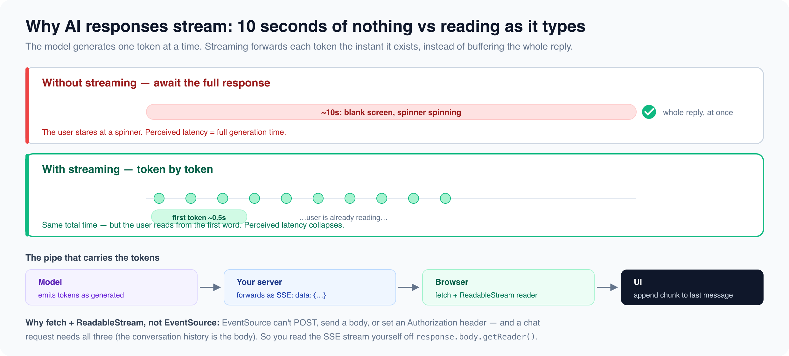

# AI Integration

*14 min read · Updated 16 Jul 2026 Topic 40 of 77 Bookmark Mark done AI Integration for Frontend · Topic 40 of 77*

**Source:** [https://www.geekyfrontend.in/learn/complete-frontend-kit/ai-integration](https://www.geekyfrontend.in/learn/complete-frontend-kit/ai-integration)

---

# AI Integration for Frontend — Interview Questions

**Questions:** 6 **Difficulty:** Mid to Senior **Companies:** Google, Amazon, Flipkart, Razorpay, Microsoft, Swiggy, Cred — any company building AI features

---

## Q 15.1 How do you build an AI-powered chat interface? What are the key frontend challenges?

**Difficulty:** Mid **Asked at:** Google, Amazon, Razorpay, Microsoft

An AI chat interface looks simple — a message list and an input. But the engineering challenges are specific to AI: responses take 5-30 seconds, they arrive token by token, they contain markdown/code/tables that need rendering, and conversation history must be managed for context.

**Core component structure:**

jsx

```
function ChatInterface() {
  const [messages, setMessages] = useState([]);
  const [input, setInput] = useState('');
  const [isStreaming, setIsStreaming] = useState(false);
  const messagesEndRef = useRef(null);

  async function handleSubmit(e) {
    e.preventDefault();
    if (!input.trim() || isStreaming) return;

    const userMessage = { role: 'user', content: input };
    setMessages(prev => [...prev, userMessage]);
    setInput('');
    setIsStreaming(true);

    // Add an empty assistant message that will be filled by streaming
    setMessages(prev => [...prev, { role: 'assistant', content: '' }]);

    try {
      await streamResponse([...messages, userMessage], (chunk) => {
        // Update the last message (assistant) with each chunk
        setMessages(prev => {
          const updated = [...prev];
          updated[updated.length - 1] = {
            ...updated[updated.length - 1],
            content: updated[updated.length - 1].content + chunk,
          };
          return updated;
        });
      });
    } catch (error) {
      setMessages(prev => {
        const updated = [...prev];
        updated[updated.length - 1] = {
          ...updated[updated.length - 1],
          content: 'Something went wrong. Please try again.',
          error: true,
        };
        return updated;
      });
    } finally {
      setIsStreaming(false);
    }
  }

  // Auto-scroll to bottom as new tokens arrive
  useEffect(() => {
    messagesEndRef.current?.scrollIntoView({ behavior: 'smooth' });
  }, [messages]);

  return (
    <div className="chat-container">
      <div className="messages">
        {messages.map((msg, i) => (
          <MessageBubble key={i} message={msg} isStreaming={isStreaming && i === messages.length - 1} />
        ))}
        <div ref={messagesEndRef} />
      </div>

      <form onSubmit={handleSubmit}>
        <textarea
          value={input}
          onChange={(e) => setInput(e.target.value)}
          onKeyDown={(e) => {
            if (e.key === 'Enter' && !e.shiftKey) {
              e.preventDefault();
              handleSubmit(e);
            }
          }}
          placeholder="Ask something..."
          disabled={isStreaming}
        />
        <button type="submit" disabled={isStreaming || !input.trim()}>
          {isStreaming ? 'Generating...' : 'Send'}
        </button>
      </form>
    </div>
  );
}
```

**Key frontend challenges:**

1. **Auto-scrolling during streaming** — scroll to bottom as tokens arrive, but stop auto-scrolling if the user scrolls up to read earlier messages.
2. **Markdown rendering in real-time** — the response streams in as raw markdown. You need to render it progressively (bold, headings, code blocks, tables) as tokens arrive, not after the full response is complete.
3. **Code block handling** — syntax highlighting, copy button, language detection. Libraries like `react-markdown` with `rehype-highlight` handle this.
4. **Stop generation** — the user should be able to cancel a streaming response mid-generation using `AbortController`.
5. **Conversation context management** — the full conversation history must be sent with each request for the AI to have context. Long conversations exceed token limits and need truncation strategies.

**Follow-up:** "How do you handle very long conversations that exceed the AI's context window?"

Truncation strategies: keep the system prompt + the last N messages, summarize older messages into a condensed context, or use a sliding window. Some implementations store the full history but only send a relevant subset based on the current question.

---

## Q 15.2 How does streaming work for AI responses? Explain `ReadableStream` and `EventSource`.

**Difficulty:** Mid **Asked at:** Google, Amazon, Razorpay

AI models generate tokens one at a time. Instead of waiting 10 seconds for the complete response, streaming delivers each token as it's generated. The user sees the response building word by word — the same experience as ChatGPT.



**Two approaches to consuming streams:**

**Approach 1: Server-Sent Events (EventSource) — simpler, limited:**

javascript

```
const eventSource = new EventSource('/api/chat?message=explain+closures');

let fullResponse = '';
eventSource.addEventListener('message', (event) => {
  if (event.data === '[DONE]') {
    eventSource.close();
    return;
  }
  const chunk = JSON.parse(event.data);
  fullResponse += chunk.text;
  updateUI(fullResponse);
});
```

Limitation: `EventSource` doesn't support POST requests, custom headers, or request bodies. For a chat API where you need to send conversation history, this is restrictive.

**Approach 2: Fetch with ReadableStream — flexible, recommended:**

javascript

```
// The caller owns the AbortController and passes in its signal, so the
// abort handle exists BEFORE streaming starts — see the Stop button below.
async function streamResponse(messages, onChunk, signal) {
  const response = await fetch('/api/chat', {
    method: 'POST',
    headers: {
      'Content-Type': 'application/json',
      'Authorization': `Bearer ${token}`,
    },
    body: JSON.stringify({ messages, stream: true }),
    signal,
  });

  const reader = response.body.getReader();
  const decoder = new TextDecoder();

  while (true) {
    const { done, value } = await reader.read();
    if (done) break;

    const text = decoder.decode(value, { stream: true });

    // Anthropic streams Server-Sent Events. The text tokens live in
    // content_block_delta events; each carries delta.text. (This is the
    // Anthropic shape — OpenAI's Chat Completions API uses a different
    // envelope, choices[0].delta.content, so a parser is provider-specific.)
    const lines = text.split('
').filter(line => line.startsWith('data: '));
    for (const line of lines) {
      const data = line.slice(6); // Remove "data: " prefix
      const event = JSON.parse(data);
      if (event.type === 'content_block_delta' && event.delta.type === 'text_delta') {
        onChunk(event.delta.text);
      }
      // Other event types — message_start, content_block_start,
      // message_delta (carries stop_reason + usage), message_stop — can be
      // handled here too; for plain text rendering, the text_delta is enough.
    }
  }
}
```

**Stop generation with AbortController:**

The controller must be created BEFORE the request and stored where the Stop handler can reach it. A common bug is to have the streaming function create the controller and return its abort handle at the end — but the function only returns after the whole stream finishes, so the Stop button is wired up too late to ever fire. Store the controller in a ref instead:

jsx

```
const controllerRef = useRef(null);

async function handleSubmit() {
  const controller = new AbortController();
  controllerRef.current = controller;   // available immediately, before streaming
  setIsStreaming(true);
  try {
    await streamResponse(messages, onChunk, controller.signal);
  } catch (err) {
    // A user-initiated abort throws an AbortError — that is expected, not a failure.
    if (err.name !== 'AbortError') showError(err);
  } finally {
    setIsStreaming(false);
    controllerRef.current = null;
  }
}

function handleStop() {
  controllerRef.current?.abort();   // fires mid-stream, because it was set up first
}

// In JSX
{isStreaming && <button onClick={handleStop}>Stop generating</button>}
```

Why a ref and not state: the Stop handler needs the current controller synchronously, and updating it must not trigger a re-render. A ref is exactly that — a mutable handle that survives renders without causing them.

**Follow-up:** "How do you handle errors mid-stream?"

Wrap the reader loop in try/catch. If the connection drops, show the partial response with a "Response interrupted — click to retry" indicator. If the server returns an error chunk, display it inline. Always set `isStreaming` to false in the `finally` block so the UI doesn't get stuck.

---

## Q 15.3 What is prompt engineering for UI? How do structured outputs and function calling work?

**Difficulty:** Senior **Asked at:** Google, Amazon, Microsoft

When you integrate AI into a product, the response needs to be predictable enough to render in a structured UI — not just freeform text.

**Structured outputs — the wrong way and the right way:**

The old approach was to beg in the prompt: "Return ONLY valid JSON, no markdown, no explanation." It mostly works, but "mostly" is the problem — the model still occasionally wraps the JSON in a code fence, adds a preamble, or omits a field, and your `JSON.parse` throws in production. Modern APIs solve this properly with **schema enforcement**: you hand the API a JSON Schema and the response is *guaranteed* to match it.

javascript

```
// Server route — never call the model from the browser (your API key would leak).
// output_config.format constrains the response to your schema; no prompt-begging.
const schema = {
  type: 'object',
  properties: {
    sentiment: { type: 'string', enum: ['positive', 'negative', 'neutral'] },
    rating: { type: 'integer' },
    pros: { type: 'array', items: { type: 'string' } },
    cons: { type: 'array', items: { type: 'string' } },
    summary: { type: 'string' },
  },
  required: ['sentiment', 'rating', 'pros', 'cons', 'summary'],
  additionalProperties: false,
};

const message = await anthropic.messages.create({
  model: 'claude-sonnet-5',
  max_tokens: 1024,
  messages: [{ role: 'user', content: `Extract details from this review: "${reviewText}"` }],
  output_config: { format: { type: 'json_schema', schema } },
});

// The response text is valid JSON matching the schema — parse with confidence.
const { sentiment, rating, pros, cons, summary } = JSON.parse(message.content[0].text);
// (The SDK also offers anthropic.messages.parse() which validates and returns
//  the object for you, so you skip the manual JSON.parse entirely.)
```

The difference the interviewer is listening for: the old way makes the model's *cooperation* your reliability boundary; schema enforcement moves that boundary into the API, so malformed output stops being a class of bug you handle on the client.

**Function calling / Tool use — AI triggers actions:**

Instead of the AI returning text that says "I've booked your flight," it returns a structured function call that your code executes:

javascript

```
const response = await anthropic.messages.create({
  model: 'claude-sonnet-5',
  messages: [{ role: 'user', content: 'What's the weather in Mumbai?' }],
  tools: [{
    name: 'get_weather',
    description: 'Get current weather for a city',
    input_schema: {
      type: 'object',
      properties: {
        city: { type: 'string' },
        units: { type: 'string', enum: ['celsius', 'fahrenheit'] },
      },
      required: ['city'],
    },
  }],
});

// AI returns: { type: "tool_use", name: "get_weather", input: { city: "Mumbai" } }
// Your code executes the actual API call and sends the result back to the AI
```

**Why this matters for frontend:** Function calling lets you build AI assistants that interact with your app — "show me my recent orders," "add this to my cart," "schedule a meeting for tomorrow." The AI decides which function to call, your frontend executes it and renders the result.

**Follow-up:** "How do you validate AI outputs before rendering?"

Never trust AI output directly. Parse with try/catch (JSON can be malformed), validate with Zod/schema (fields might be missing or wrong type), sanitize HTML outputs with DOMPurify (prevent XSS if the AI returns HTML), and have fallback UI for when parsing fails.

---

## Q 15.4 What are AI SDKs like Vercel AI SDK? How do they simplify integration?

**Difficulty:** Mid **Asked at:** Razorpay, Swiggy, Flipkart

AI SDKs abstract away the streaming, parsing, and state management boilerplate. Instead of manually handling ReadableStream, SSE parsing, and message state, you get React hooks that handle it all.

**Vercel AI SDK example:**

tsx

```
// app/api/chat/route.ts (server)
import { anthropic } from '@ai-sdk/anthropic';
import { streamText } from 'ai';

export async function POST(req) {
  const { messages } = await req.json();

  const result = streamText({
    model: anthropic('claude-sonnet-5'),
    messages,
    system: 'You are a helpful frontend development assistant.',
  });

  return result.toDataStreamResponse();
}
```

tsx

```
// components/Chat.tsx (client)
'use client';
import { useChat } from 'ai/react';

export function Chat() {
  const { messages, input, handleInputChange, handleSubmit, isLoading, stop } = useChat();

  return (
    <div>
      {messages.map(m => (
        <div key={m.id} className={m.role === 'user' ? 'user-msg' : 'ai-msg'}>
          {m.content}
        </div>
      ))}

      <form onSubmit={handleSubmit}>
        <input value={input} onChange={handleInputChange} />
        {isLoading ? (
          <button type="button" onClick={stop}>Stop</button>
        ) : (
          <button type="submit">Send</button>
        )}
      </form>
    </div>
  );
}
```

That's a complete streaming chat interface — streaming, message history, loading state, stop button — in about 30 lines of code. Without the SDK, this would be 150+ lines managing ReadableStream, state updates, abort controllers, and error handling manually.

**What the SDK handles:** Stream parsing, message state management, automatic retry, abort/stop, loading states, error handling, token counting, and tool call execution.

**When to use an SDK vs build your own:** SDK for standard chat interfaces and content generation. Build your own when you need non-standard streaming behavior (parallel streams, custom chunk processing, streaming to non-React targets).

---

## Q 15.5 What UX patterns work for AI features? How do you handle loading, errors, and trust?

**Difficulty:** Mid **Asked at:** Google, Amazon, Razorpay, Microsoft

AI features have UX challenges that traditional features don't: responses take 5-30 seconds (not 200ms), outputs are non-deterministic (same input → different output), and users need to judge whether the AI's answer is correct.

**Loading states — the streaming cursor:**

Traditional loading: spinner → content appears. AI loading: streaming text with a blinking cursor, showing tokens as they arrive. The "thinking" indicator (dots or animation) appears before the first token, then transitions to streaming text. This reduces perceived wait time dramatically — users start reading immediately.

**Grounding indicators — and the trap of a fake "confidence score":**

A common interview mistake is to invent a numeric confidence field. **LLM APIs do not return a calibrated confidence score** — there is no `response.confidence`. Asking the model to rate its own confidence is unreliable: models are frequently confidently wrong, and the number they produce is itself a generated token, not a measurement. Do not build UI on it.

What you CAN show is *grounding* — sources the answer is based on. When you use retrieval (RAG) or the provider's citations feature, each claim can be tied to a document. Surface those:

jsx

```
function AIResponse({ text, citations }) {
  return (
    <div>
      <p>{text}</p>

      {/* Real signal: sources the answer was grounded in (from RAG or the
          provider's citations feature — each carries the quoted span). */}
      {citations?.length > 0 && (
        <div className="sources">
          <span>Sources:</span>
          {citations.map((c, i) => (
            <a key={i} href={c.url} title={c.cited_text}>{c.document_title}</a>
          ))}
        </div>
      )}

      {/* Honest, static disclaimer — not a fabricated per-response score. */}
      <p className="disclaimer">AI-generated. Verify important facts.</p>
    </div>
  );
}
```

Grounding an answer in citable sources builds real trust: the user can click through and check. A blanket "AI-generated, verify important facts" note sets expectations honestly. A fake confidence percentage does the opposite — it invents precision the system does not have.

**Regenerate and edit:**

jsx

```
function MessageActions({ message, onRegenerate, onEdit }) {
  return (
    <div className="message-actions">
      <button onClick={onRegenerate}>🔄 Regenerate</button>
      <button onClick={() => navigator.clipboard.writeText(message.content)}>📋 Copy</button>
      <button onClick={onEdit}>✏️ Edit prompt</button>
      <ThumbsUpDown messageId={message.id} />
    </div>
  );
}
```

Regenerate gives users control — if the first response isn't good, they can try again. Edit lets them refine their prompt. Thumbs up/down collects feedback for improving the model.

**Error handling specific to AI:**

- **Rate limiting:** "You've reached the limit. Try again in 30 seconds." Show a countdown.
- **Content filtering:** "I can't help with that request." Don't show a generic error — explain why.
- **Timeout:** "The response is taking longer than usual. You can wait or try a simpler question."
- **Partial failure:** If streaming fails mid-response, show what was generated with a "Response interrupted — retry?" option.

**Follow-up:** "How do you prevent the AI from showing harmful content in the UI?"

Content filtering on the server side (the AI provider handles this), output sanitization on the frontend (DOMPurify for any HTML rendering), and a feedback mechanism (report button) for edge cases. Never render raw AI output as HTML without sanitization.

---

## Q 15.6 How should you talk about AI-assisted development tools in interviews?

**Difficulty:** Mid **Asked at:** Every company in 2026

Interviewers increasingly ask: "Do you use AI tools for coding? How?" This isn't a trick question — they want to understand your workflow and whether you use these tools thoughtfully.

**What to say:**

"I use Copilot/Cursor for boilerplate generation, repetitive patterns, and exploring unfamiliar APIs. I review every suggestion before accepting — AI tools are great at generating code that looks right but has subtle bugs, especially around edge cases, security, and error handling. I think of them as a fast first draft that I review and refine."

**Specific examples that show maturity:**

- "I use AI to generate test boilerplate — the describe/it structure and basic assertions — then I add the edge cases and meaningful assertions myself."
- "For unfamiliar libraries, I ask the AI to generate a usage example, then I verify it against the official docs. The AI often hallucinates API methods that don't exist."
- "I use it for regex, date formatting, and other patterns I'd otherwise look up on Stack Overflow."
- "I don't use it for architecture decisions — those require understanding trade-offs that the AI doesn't have context for."

**What NOT to say:**

- "I paste my entire codebase and ask it to fix everything" — shows no engineering judgment
- "I don't use AI tools at all" — signals resistance to productivity improvements
- "AI writes all my code, I just review it" — suggests you can't code independently

**The honest framing:** AI tools make you faster at tasks you already know how to do. They don't replace understanding. An engineer who understands closures and uses Copilot to write them faster is valuable. An engineer who can't explain what Copilot generated is a liability.

**Follow-up:** "What are the risks of AI-generated code?"

License contamination (Copilot trained on GPL code), security vulnerabilities (AI suggests patterns without security context), subtle bugs (off-by-one errors, missing null checks), outdated APIs (trained on old data), and over-reliance (engineers who can't debug without AI assistance). Always review, always test, always understand what you're shipping.

---

## Learn More

- [Vercel AI SDK — docs sdk.vercel.ai](https://sdk.vercel.ai/docs)
- [Anthropic API docs anthropic.com](https://docs.anthropic.com)
- [Integrating LLM APIs in the frontend YouTube](https://www.youtube.com/watch?v=umTLp7OvRTs)
- [AI-powered apps with Next.js YouTube](https://www.youtube.com/watch?v=gTsnsfKB-XM)
- [Integrating LLMs using APIs YouTube](https://www.youtube.com/watch?v=r6cLANbds_I)
