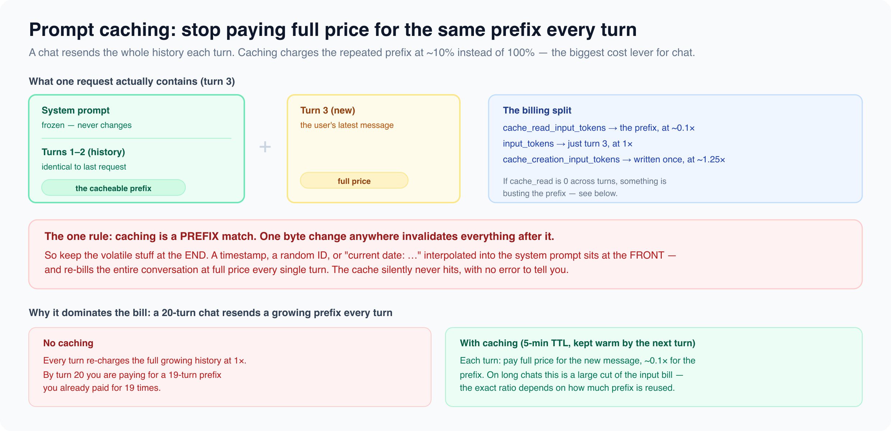
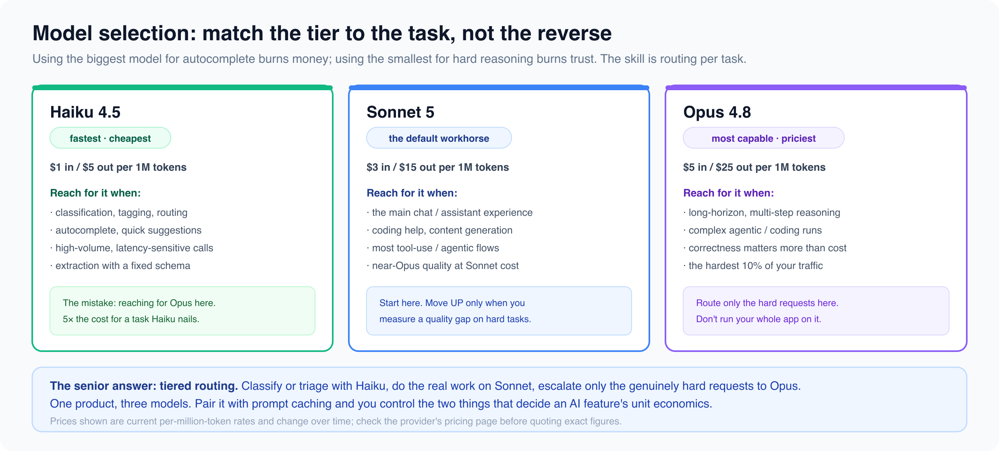

# Cost, Tokens & Model Selection

*7 min read · Updated 16 Jul 2026 Topic 41 of 77 Bookmark Mark done 15B · Topic 41 of 77*

**Source:** [https://www.geekyfrontend.in/learn/complete-frontend-kit/ai-cost-tokens-models](https://www.geekyfrontend.in/learn/complete-frontend-kit/ai-cost-tokens-models)

---

# 15B. Cost, Tokens & Model Selection

**Questions:** 4 **Difficulty:** Mid to Senior **Companies:** Razorpay, Swiggy, Flipkart, Cred, Google, Amazon — any company shipping AI features to real users

Building an AI feature that works is the easy part. Building one that doesn't quietly cost thousands of rupees a day is the interview-worthy part. Every question here is really "do you understand the unit economics of what you shipped?"

---

## Q 15.7 How is an AI feature priced? What is a token, and how do you estimate cost?

**Difficulty:** Mid **Asked at:** Razorpay, Swiggy, Amazon

You are billed per **token**, not per request. A token is a chunk of text — roughly ¾ of a word in English, so "internationalization" is several tokens and "cat" is one. A useful rule of thumb: **~4 characters per token**, or ~750 words per 1,000 tokens.

Every request has two token counts, priced differently:

- **Input tokens** — everything you send: the system prompt, the full conversation history, and the user's new message.
- **Output tokens** — what the model generates back. Output is typically **3–5× more expensive** than input.

Illustrative per-million-token rates for one provider's tiers (these change — always check the current pricing page):

text

```
Model         Input $/1M    Output $/1M
Haiku 4.5     $1            $5           ← cheapest, fastest
Sonnet 5      $3            $15          ← the default workhorse
Opus 4.8      $5            $25          ← most capable, priciest
```

**Worked estimate.** Suppose a support chat sends a 500-token system prompt, accumulates ~2,000 tokens of history, and the model replies with ~400 tokens, on Sonnet 5:

text

```
input:  2,500 tokens × $3 / 1,000,000  = $0.0075
output:   400 tokens × $15 / 1,000,000 = $0.0060
per message ≈ $0.0135  →  ~₹1.1
```

That looks trivial — until you multiply by 100,000 messages a day. Now it's ₹110,000/day, and most of that input cost is the *same history resent every turn*. That resend is exactly what caching (next question) attacks.

**Estimating before you ship:** don't guess token counts with a generic word-count library — use the provider's token-counting endpoint, which tokenizes exactly the way billing does. Counting client-side with an approximation (or worse, a different provider's tokenizer) can be off by 15–30%, especially on code and non-English text.

**Follow-up:** "Why is output so much more expensive than input?"

Input is processed in parallel in a single forward pass; output is generated one token at a time, each depending on all previous tokens — it's inherently more compute per token. This is also why a verbose model that pads answers costs you real money: every extra sentence is output tokens.

---

## Q 15.8 How do you stop an AI chat from costing a fortune? Explain prompt caching.

**Difficulty:** Senior **Asked at:** Razorpay, Swiggy, Cred

The single biggest cost lever for chat is **prompt caching**. The problem it solves: a conversation is stateless, so every turn resends the entire history — the system prompt and all prior messages — as input tokens. By turn 20 you are paying full price for a 19-turn prefix you have already paid for 19 times.



Caching lets you mark a stable prefix (system prompt + history) so the provider stores it. On the next request, that prefix is billed at roughly **one-tenth** the normal input rate (a cache *read*) instead of full price. There is a small one-time premium to *write* the cache (~1.25× for a 5-minute window), so it pays off after just a couple of reuses.

javascript

```
const message = await anthropic.messages.create({
  model: 'claude-sonnet-5',
  max_tokens: 1024,
  system: [
    {
      type: 'text',
      text: LARGE_SYSTEM_PROMPT,          // frozen instructions + context
      cache_control: { type: 'ephemeral' }, // ← cache everything up to here
    },
  ],
  messages: conversationHistory,           // grows each turn
});

// Check it actually cached:
console.log(message.usage.cache_read_input_tokens);     // served at ~0.1×
console.log(message.usage.cache_creation_input_tokens); // written this turn
console.log(message.usage.input_tokens);                // full-price remainder
```

**The one rule that makes or breaks it: caching is a PREFIX match.** A single byte change anywhere in the prefix invalidates everything after it. The classic bug is interpolating a timestamp or "current date: …" into the *front* of the system prompt — that changes the prefix every request, so the cache silently never hits and you re-bill the whole conversation at full price, with no error to warn you.

**How to verify:** log `usage.cache_read_input_tokens`. If it's zero across repeated requests with a shared prefix, something is busting the cache — hunt for a per-request value (timestamp, UUID, non-deterministic JSON key order) that leaked into the prefix. Keep all volatile content at the *end*, after the cached breakpoint.

**Follow-up:** "What else reduces cost besides caching?"

Cap `max_tokens` so a runaway answer can't balloon your output bill. Trim history you don't need (summarize old turns instead of resending them verbatim). Route cheap tasks to a cheaper model (next question). And for non-interactive bulk work — nightly summarization, backfills — use the batch API, which runs asynchronously at roughly half price.

---

## Q 15.9 How do you choose which model to use?

**Difficulty:** Mid to Senior **Asked at:** Flipkart, Google, Amazon

The wrong instinct is to pick the most capable model and use it everywhere. That's how you pay 5× for autocomplete. The skill is matching the tier to the task.



Providers offer a small, fast, cheap tier; a balanced mid tier; and a top-capability, expensive tier. The pattern most production systems land on is **tiered routing within one product**:

- **Small/fast model** — classification, routing, tagging, autocomplete, extraction against a fixed schema. High volume, latency-sensitive, cheap.
- **Mid model** — the default. The actual chat experience, coding help, content generation, most tool-use flows. Start here.
- **Top model** — reserve for the genuinely hard requests: long multi-step reasoning, complex agentic runs, cases where a wrong answer is expensive. Route *only* those here, not your whole app.

A concrete example: a support bot could use the fast model to *classify* the incoming message ("billing", "technical", "refund"), answer the routine 80% with the mid model, and escalate only the gnarly edge cases to the top model. One product, three models, each doing what it's cost-effective at.

**Follow-up:** "How do you decide when to escalate to a bigger model?"

Measure, don't guess. Ship on the mid tier, then look at where it actually fails — user thumbs-down, hand-offs to a human, tasks it gets wrong. Escalate *those* categories. Escalating on a hunch means paying top-tier prices for requests the mid tier handled fine.

---

## Q 15.10 What's your overall strategy for controlling AI feature cost in production?

**Difficulty:** Senior **Asked at:** Razorpay, Cred, Amazon

This is the synthesis question. A strong answer names the levers and the guardrails, not just one trick.

**The cost levers:**

1. **Prompt caching** for the repeated prefix — the biggest single win on chat.
2. **Tiered model routing** — cheap model for cheap tasks, expensive only for hard ones.
3. **Cap output** with `max_tokens`, and prompt for concise answers — output is the expensive side.
4. **Trim context** — summarize or window old history instead of resending it forever.
5. **Batch API** for anything not latency-sensitive (~50% off).

**The guardrails — cost is also a reliability and abuse problem:**

- **Per-user rate limits and quotas** — one abusive user (or a runaway client-side retry loop) should not be able to run up an unbounded bill.
- **A hard monthly spend cap / alerting** — so a bug or attack surfaces as a page, not a surprise invoice.
- **Never call the model directly from the browser.** Your API key would be exposed in network requests, and anyone could spend your budget. All model calls go through your own backend, which authenticates the user, enforces quotas, and holds the key.

**Follow-up:** "A user reports the AI feature is slow AND your costs spiked. What do you check?"

Likely the same root cause: prompts got longer. Check whether history is being trimmed (an ever-growing context is both slower and more expensive), whether caching is still hitting (a cache miss re-bills and re-processes the whole prefix), and whether something is retrying failed requests without backoff (duplicate spend + added load). Slow and expensive usually travel together — the shared cause is almost always token volume.

---

## Learn More

- [Anthropic — model pricing anthropic.com](https://www.anthropic.com/pricing)
- [Anthropic API docs anthropic.com](https://docs.anthropic.com)
- [Understanding tokens & what they cost YouTube](https://www.youtube.com/watch?v=ZUCVRppXPSc)
- [Tokens, context windows & API costs YouTube](https://www.youtube.com/watch?v=SWE0LV0xnZ4)
- [LLM pricing explained YouTube](https://www.youtube.com/watch?v=ooNRL9FJSuk)
