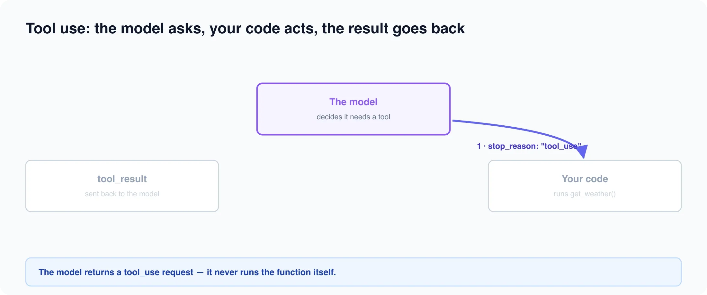

# Tool Use & Agentic UIs

*8 min read · Updated 16 Jul 2026 Topic 42 of 77 Bookmark Mark done 15C · Topic 42 of 77*

**Source:** [https://www.geekyfrontend.in/learn/complete-frontend-kit/ai-tool-use-agents](https://www.geekyfrontend.in/learn/complete-frontend-kit/ai-tool-use-agents)

---

# 15C. Tool Use & Agentic UIs

**Questions:** 4 **Difficulty:** Mid to Senior **Companies:** Google, Amazon, Microsoft, Razorpay, Cred — anyone building AI that *does* things, not just chats

The leap from "AI that answers" to "AI that acts" is tool use. It's the most-asked senior AI topic because it's where the interesting frontend problems live: rendering an action mid-flight, deciding what the AI is allowed to do on its own, and keeping a human in the loop for anything that matters.

---

## Q 15.11 What is tool use (function calling), and how does the loop work?

**Difficulty:** Mid to Senior **Asked at:** Google, Amazon, Microsoft

Tool use lets the model call functions *you* define. Instead of replying with text that says "I've added it to your cart," it returns a structured request to run your `add_to_cart` function, and your code executes the real action.

The critical mental model: **the model never runs your code.** It emits a request naming the tool and its arguments; your backend runs the function and hands the result back. That round trip — and the fact that it's a loop, not a single call — is the whole pattern.



You give the model tool definitions (name, description, and a JSON schema for the inputs):

javascript

```
const tools = [{
  name: 'get_order_status',
  description: 'Look up the status of a customer order by its ID',
  input_schema: {
    type: 'object',
    properties: { orderId: { type: 'string' } },
    required: ['orderId'],
  },
}];
```

Then you run the loop:

javascript

```
let messages = [{ role: 'user', content: 'Where is order A-1024?' }];

while (true) {
  const response = await anthropic.messages.create({
    model: 'claude-sonnet-5',
    max_tokens: 1024,
    tools,
    messages,
  });

  // The model finished talking — we have our answer.
  if (response.stop_reason === 'end_turn') break;

  if (response.stop_reason === 'tool_use') {
    // Keep the assistant's turn (it contains the tool_use block).
    messages.push({ role: 'assistant', content: response.content });

    // Run every tool the model asked for, collect the results.
    const toolResults = [];
    for (const block of response.content) {
      if (block.type === 'tool_use') {
        const result = await runTool(block.name, block.input); // YOUR code
        toolResults.push({
          type: 'tool_result',
          tool_use_id: block.id,   // must match the request
          content: JSON.stringify(result),
        });
      }
    }

    // Send results back as a user turn; the loop calls the model again.
    messages.push({ role: 'user', content: toolResults });
  }
}
```

The model may ask for several tools in one turn (run them, return all results together), and it may loop multiple times — call a tool, see the result, decide it needs another. You keep looping until `stop_reason` is `end_turn`.

**Follow-up:** "Why send the result back instead of just showing it?"

Because the model needs the data to write a natural answer. `get_order_status` returns `{ status: 'shipped', eta: 'tomorrow' }`; only after seeing that can the model say "Order A-1024 shipped and arrives tomorrow." The tool provides facts; the model provides language. Skipping the return leaves the model guessing.

---

## Q 15.12 How do you render tool calls in the UI?

**Difficulty:** Mid **Asked at:** Google, Razorpay, Cred

Tool use introduces a UI state that plain chat doesn't have: the moment between "the AI decided to do something" and "the something finished." If you show nothing, the interface looks frozen while your `get_order_status` call hits the network.

The pattern is to render the tool call as its own message-like element with a live status:

jsx

```
function ToolCall({ call }) {
  return (
    <div className="tool-call">
      {call.status === 'running' && (
        <span>🔧 Looking up order {call.input.orderId}…</span>
      )}
      {call.status === 'done' && (
        <span>✓ Found order {call.input.orderId}</span>
      )}
      {call.status === 'error' && (
        <span className="error">⚠ Couldn't reach the order service</span>
      )}
    </div>
  );
}
```

**Three principles that separate a good agentic UI from a confusing one:**

- **Make the action legible.** "Looking up order A-1024" tells the user what the AI is doing and why the pause exists. A blank spinner tells them nothing.
- **Show tool calls inline, in order.** An agent may search, then read, then compute. Rendering each step as it happens turns an opaque wait into visible progress — and builds trust, because the user can see the reasoning play out.
- **Render the result, not the raw payload.** The model gets JSON; the user should get a formatted card, a map, an order-status pill — whatever fits. Never dump the tool's raw output into the chat.

**Follow-up:** "How does this interact with streaming?"

The tool's *arguments* can stream in token by token just like text, so you can show "Looking up order A‑10…" filling in live. But you can't execute the tool until the arguments are complete — you need the full `orderId` before you call your API. So: stream the intent for feedback, execute on completion.

---

## Q 15.13 How do you handle side-effectful tools safely? What is a human-in-the-loop gate?

**Difficulty:** Senior **Asked at:** Amazon, Microsoft, Cred

This is the question that separates people who've shipped agents from people who've read about them. There's a category difference between a tool that *reads* and a tool that *acts*:

- **Read-only tools** (look up an order, search docs, check inventory) — safe to run automatically. Worst case, the model looks something up it didn't need.
- **Side-effectful tools** (send an email, charge a card, delete a record, submit a form) — these change the world, and some are irreversible. The model *requesting* the action is not the same as a human *authorising* it.

For anything destructive or irreversible, insert a **human-in-the-loop approval gate**: when the model asks for that tool, pause and require an explicit user confirmation before your code runs it.

jsx

```
function ApprovalGate({ call, onApprove, onDeny }) {
  return (
    <div className="approval">
      <p>The assistant wants to <strong>{call.name}</strong>:</p>
      <pre>{JSON.stringify(call.input, null, 2)}</pre>
      <button onClick={onApprove}>Approve</button>
      <button onClick={onDeny}>Cancel</button>
    </div>
  );
}
// Only after onApprove does your backend actually run the tool
// and send the tool_result back into the loop.
```

**The two hard rules:**

1. **Never let a client-side "approval" be the only guard.** The frontend gate is UX. The real enforcement is on the server — your backend must independently verify the user is allowed to perform the action before executing it. A determined user can bypass any client-side check.
2. **Scope tools to the minimum they need.** A tool that can delete any record is a bigger blast radius than one that can delete only the current user's own draft. Give the AI the narrowest capability that does the job.

**Follow-up:** "Where do you draw the line on what needs approval?"

Reversibility is the useful criterion. If the action is easily undone (open a page, add a tentative item) let it run. If it's hard or impossible to reverse (money moves, a message is sent, data is deleted) gate it. When unsure, gate it — a needless confirmation is a minor annoyance; an un-gated irreversible action is an incident.

---

## Q 15.14 What's the difference between a chatbot and an agent?

**Difficulty:** Mid to Senior **Asked at:** Google, Amazon, Microsoft

Interviewers ask this to check you're not just using "agent" as a buzzword. The distinction is concrete:

- A **chatbot** takes a message and returns a message. One turn in, one turn out. It can be very capable, but it doesn't *do* anything beyond producing text.
- An **agent** pursues a goal across multiple steps, using tools and reacting to their results. Given "reschedule my Tuesday meetings," it looks up the calendar, finds conflicts, checks availability, and moves events — deciding each next step based on what the last one returned.

The mechanism underneath is the tool-use loop from Q15.11, run open-endedly: the model calls a tool, sees the result, decides whether it's done or needs another action, and repeats. A chatbot is that loop with zero tools; an agent is that loop with tools and a goal.

**Should you always build an agent? No.** Agents are more capable but also slower, more expensive (many model calls per task), and harder to keep predictable. Reach for one only when the task is genuinely multi-step and hard to specify up front. For "summarize this" or "answer this question," a single call is the right tool — an agent is over-engineering.

**Follow-up:** "What makes agents harder to build than chatbots, from a frontend perspective?"

State and trust. A chatbot's UI is a message list; an agent's UI must represent an evolving plan — pending tool calls, partial results, approval prompts, and the ability to interrupt a run that's going wrong. You're no longer rendering a conversation, you're rendering a process, and the user needs enough visibility to trust it and enough control to stop it.

---

## Learn More

- [Tool use (Anthropic) anthropic.com](https://docs.anthropic.com/en/docs/build-with-claude/tool-use)
- [Function calling (OpenAI) openai.com](https://platform.openai.com/docs/guides/function-calling)
- [LLM tool calling explained YouTube](https://www.youtube.com/watch?v=vdUxBDulv1M)
- [How LLM tool calling works YouTube](https://www.youtube.com/watch?v=QiRdYCNXAxk)
- [Turn your LLM into an AI agent YouTube](https://www.youtube.com/watch?v=KJf7SqPCRXg)
