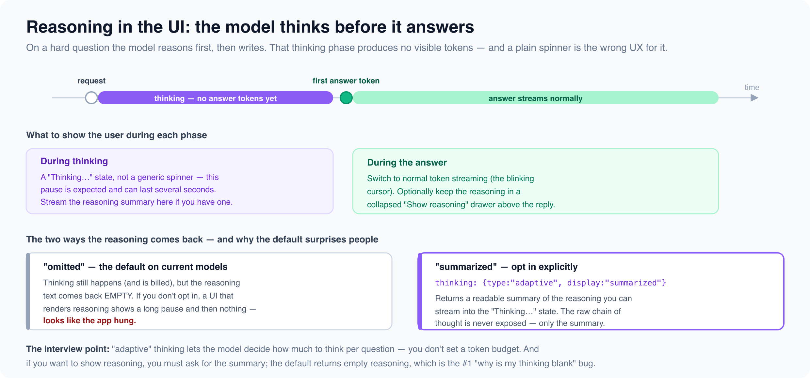

# Reasoning in the UI

*6 min read · Updated 16 Jul 2026 Topic 43 of 77 Bookmark Mark done 15D · Topic 43 of 77*

**Source:** [https://www.geekyfrontend.in/learn/complete-frontend-kit/ai-reasoning-ui](https://www.geekyfrontend.in/learn/complete-frontend-kit/ai-reasoning-ui)

---

# 15D. Reasoning in the UI

**Questions:** 3 **Difficulty:** Mid to Senior **Companies:** Google, Amazon, Microsoft, Cred — companies shipping reasoning-model features

Modern models can "think" before answering — spend time reasoning through a hard problem, then write the response. That thinking phase changes the frontend, because it produces a pause with no visible output, and a plain spinner is the wrong way to represent it. This topic is about the UX and the API of showing a model's reasoning.

---

## Q 15.15 What is model reasoning (extended thinking), and how does it change the UX?

**Difficulty:** Mid to Senior **Asked at:** Google, Amazon, Microsoft

On a hard question, a reasoning model works through the problem internally before it produces the answer — the equivalent of thinking before speaking. This measurably improves quality on multi-step tasks (math, code, planning), but it introduces a UX wrinkle: **the thinking phase generates no answer tokens.** The user asks a question and, for several seconds, nothing streams.



The API-level control is **adaptive thinking**: you enable it and the model decides *how much* to think per question — a quick lookup gets little thinking, a hard proof gets a lot. You don't set a fixed token budget for thinking; that older "budget\_tokens" approach is deprecated in favour of letting the model calibrate.

javascript

```
const message = await anthropic.messages.create({
  model: 'claude-opus-4-8',
  max_tokens: 4096,
  thinking: { type: 'adaptive' },   // model decides how deep to think
  messages: [{ role: 'user', content: hardQuestion }],
});
```

You can also nudge overall effort with a separate `effort` setting (low → max) when you want to trade thoroughness against latency and cost — higher effort for a correctness-critical task, lower for a quick one.

**What this means for the UI:** the "loading" state before the first answer token can now be meaningfully long, and it's *expected*, not a bug. Treat it as a distinct "Thinking…" phase rather than reusing the same spinner you'd show for a 200ms API call. The next two questions cover exactly what to render.

**Follow-up:** "Does every request need thinking?"

No — and turning it on everywhere wastes money and latency. Thinking earns its cost on genuinely hard, multi-step problems. For classification, simple lookups, or short chat replies, a fast non-thinking response is better. Adaptive thinking helps here because the model itself scales the thinking down when the question is easy.

---

## Q 15.16 How do you display a model's reasoning to users?

**Difficulty:** Senior **Asked at:** Google, Microsoft, Cred

There's a subtlety that trips people up, and it's a favourite interview "gotcha": **by default, the reasoning text comes back empty.** On current models the thinking still happens (and is still billed), but the reasoning field is blank unless you explicitly ask for it. A UI built to render reasoning then shows a long pause followed by nothing — which looks exactly like the app hung.

You opt in to a readable summary of the reasoning:

javascript

```
const message = await anthropic.messages.create({
  model: 'claude-opus-4-8',
  max_tokens: 4096,
  thinking: {
    type: 'adaptive',
    display: 'summarized',   // ← without this, reasoning text is empty
  },
  messages: [{ role: 'user', content: hardQuestion }],
});
```

Note you get a *summary* of the reasoning, not the raw internal chain of thought — that's never exposed. The summary is what you stream into the UI.

**The display pattern that works:**

1. **During thinking** — show a distinct "Thinking…" state, not a generic spinner. If you requested the summary, stream it into that state so the user watches the reasoning form. This makes a multi-second pause feel like progress rather than a hang.
2. **During the answer** — switch to normal token streaming (the blinking cursor). Optionally collapse the reasoning into a "Show reasoning" drawer above the answer, so a curious user can expand it but the default view stays clean.

jsx

```
function Response({ phase, reasoning, answer }) {
  return (
    <div>
      {phase === 'thinking' && (
        <div className="thinking">
          <Spinner label="Thinking…" />
          {reasoning && <p className="reasoning-summary">{reasoning}</p>}
        </div>
      )}
      {answer && (
        <>
          {reasoning && (
            <details><summary>Show reasoning</summary>{reasoning}</details>
          )}
          <p>{answer}</p>
        </>
      )}
    </div>
  );
}
```

**Follow-up:** "Should you always show the reasoning?"

It depends on the audience. For a developer tool or a task where trust matters (a medical or legal summary), showing the reasoning lets the user check the model's work — valuable. For a casual consumer chat, it's clutter; a collapsed drawer or nothing at all is better. The default should be clean, with reasoning available on demand, not shoved in the user's face.

---

## Q 15.17 When should you use a reasoning model versus a fast one?

**Difficulty:** Mid to Senior **Asked at:** Amazon, Google

This ties reasoning back to cost and latency — the trade-off is real and interviewers want to see you weigh it.

Thinking buys accuracy on hard problems at the price of **latency** (the user waits through the thinking phase) and **cost** (thinking tokens are billed). So the decision is per-task:

- **Use thinking** when the task is genuinely hard and correctness matters more than speed — debugging a tricky failure, multi-step planning, math, complex code generation, anything where a wrong-but-fast answer is worse than a right-but-slower one.
- **Skip thinking** when speed matters and the task is straightforward — autocomplete, classification, short factual replies, high-volume calls. A user typing in a search box will not tolerate a five-second thinking pause.

Adaptive thinking softens this into a spectrum rather than a hard switch: enable it and the model spends little effort on easy questions and more on hard ones, so a single endpoint can serve both without you routing manually. When you need a firmer lever, the `effort` setting lets you bias toward speed or thoroughness explicitly.

**The UX consequence:** if a surface uses a reasoning model, design for the pause up front — the "Thinking…" state, an honest expectation that hard questions take longer, and ideally a streamed summary so the wait feels productive. Retrofitting reasoning onto a UI built for instant replies is where the "why does it just hang?" complaints come from.

**Follow-up:** "A product wants AI everywhere but complains it's too slow. What do you propose?"

Tier it. Most surfaces don't need a reasoning model — put the fast model on autocomplete, search, and quick chat, where latency is the whole experience. Reserve the reasoning model for the few surfaces where users are asking hard questions and expect to wait a moment (a "deep analysis" mode, a coding assistant). Blanket-applying a slow model to instant-feedback surfaces is the actual bug; the fix is matching the model to the interaction, the same tiering logic as cost.

---

## Learn More

- [Vercel AI SDK — docs sdk.vercel.ai](https://sdk.vercel.ai/docs)
- [10 UX patterns every AI chat needs YouTube](https://www.youtube.com/watch?v=bppkpufBJsI)
- [Stream API responses (like an AI chat) YouTube](https://www.youtube.com/watch?v=XVCU4WkIwiY)
- [The UX of conversational AI YouTube](https://www.youtube.com/watch?v=L8uGT1px9IU)
