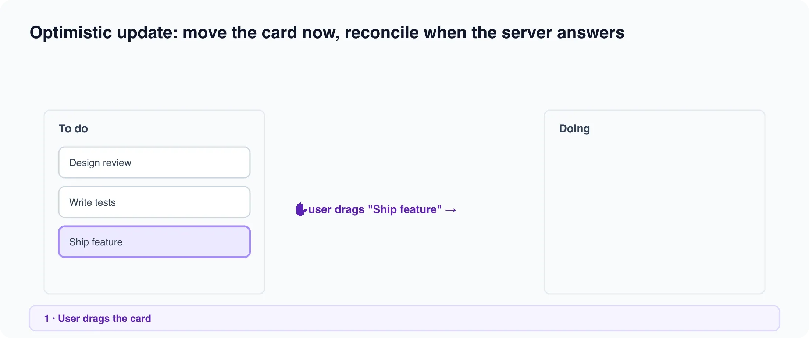

# React 19 hooks

*5 min read · Updated 16 Jul 2026 Topic 46 of 77 Bookmark Mark done 16C · Topic 46 of 77*

**Source:** [https://www.geekyfrontend.in/learn/complete-frontend-kit/react-19-hooks](https://www.geekyfrontend.in/learn/complete-frontend-kit/react-19-hooks)

---

# 16C. React 19 Hooks

**Questions:** 4 **Difficulty:** Senior **Companies:** Google, Amazon, Flipkart, Razorpay, Swiggy

---



## Q 16.15 What is useOptimistic? How does it simplify optimistic updates?

**Difficulty:** Senior **Asked at:** Google, Flipkart, Razorpay

`useOptimistic` provides a temporary optimistic state that automatically reverts when the underlying state updates. It replaces the manual optimistic update + rollback pattern.

jsx

```
function TodoList({ todos, addTodoAction }) {
  const [optimisticTodos, addOptimisticTodo] = useOptimistic(
    todos,
    (currentTodos, newTodo) => [...currentTodos, { ...newTodo, pending: true }]
  );

  async function handleSubmit(formData) {
    const title = formData.get('title');
    addOptimisticTodo({ id: crypto.randomUUID(), title });  // Show immediately
    await addTodoAction(title);  // Server action — when it resoletes, 'todos' prop
                                  // updates, and optimistic state auto-reverts
  }

  return (
    <div>
      <form action={handleSubmit}>
        <input name="title" />
        <button type="submit">Add</button>
      </form>
      <ul>
        {optimisticTodos.map(todo => (
          <li key={todo.id} style={{ opacity: todo.pending ? 0.6 : 1 }}>
            {todo.title} {todo.pending && '(saving...)'}
          </li>
        ))}
      </ul>
    </div>
  );
}
```

The optimistic todo appears immediately at reduced opacity. When the server action completes and the parent re-renders with updated `todos`, the optimistic state is automatically replaced with the real data. No manual rollback logic needed.

---

## Q 16.16 What is useFormStatus?

**Difficulty:** Mid **Asked at:** Flipkart, Razorpay

`useFormStatus` gives child components access to the pending state of their parent form. This lets you build submit buttons that show loading state without lifting state up.

jsx

```
// SubmitButton doesn't need any props — it reads the form's state automatically
function SubmitButton() {
  const { pending, data, method, action } = useFormStatus();

  return (
    <button type="submit" disabled={pending}>
      {pending ? 'Submitting...' : 'Submit'}
    </button>
  );
}

// Usage — SubmitButton detects it's inside a form with a server action
function ContactForm() {
  return (
    <form action={submitContactForm}>
      <input name="email" type="email" required />
      <textarea name="message" required />
      <SubmitButton />  {/* Automatically shows loading during submission */}
    </form>
  );
}
```

**Important:** `useFormStatus` reads the status of the parent `<form>`, not the form the component is rendered in. The component using `useFormStatus` must be a child of the `<form>` element — it can't be the same component that renders the form.

---

## Q 16.17 What is useActionState?

**Difficulty:** Senior **Asked at:** Google, Flipkart, Amazon

`useActionState` (previously `useFormState`) wraps a server action and tracks its return value, pending state, and form data. It's the full-featured hook for forms that need to display server-returned data (validation errors, success messages).

jsx

```
'use client';
import { useActionState } from 'react';
import { createAccount } from './actions';

function SignupForm() {
  const [state, formAction, isPending] = useActionState(createAccount, null);
  // state = whatever the server action returns
  // formAction = wrapped action to pass to <form>
  // isPending = true while the action is running

  return (
    <form action={formAction}>
      <input name="email" type="email" required />
      {state?.errors?.email && (
        <p className="error">{state.errors.email}</p>
      )}

      <input name="password" type="password" required />
      {state?.errors?.password && (
        <p className="error">{state.errors.password}</p>
      )}

      <button type="submit" disabled={isPending}>
        {isPending ? 'Creating account...' : 'Sign up'}
      </button>

      {state?.success && <p className="success">Account created!</p>}
    </form>
  );
}
```

javascript

```
// actions.ts
'use server';

export async function createAccount(prevState, formData) {
  const email = formData.get('email');
  const password = formData.get('password');

  const errors = {};
  if (!email.includes('@')) errors.email = 'Invalid email';
  if (password.length < 8) errors.password = 'Must be at least 8 characters';

  if (Object.keys(errors).length > 0) {
    return { errors, success: false };
  }

  await db.user.create({ data: { email, password: hash(password) } });
  return { success: true, errors: null };
}
```

The server action returns validation errors → `state.errors` is set → the form displays them inline. No manual state management for error display.

---

## Q 16.18 What is the `use()` hook? How does it read promises and context in render?

**Difficulty:** Senior **Asked at:** Google, Amazon

`use()` is unlike other hooks — it can be called conditionally and inside loops. It reads the value of a Promise or a Context during render.

**Reading a Promise:**

jsx

```
// In a Server Component — fetch returns a Promise
async function ProductPage({ params }) {
  const productPromise = fetchProduct(params.slug);  // Don't await here
  return (
    <Suspense fallback={<ProductSkeleton />}>
      <ProductDetails productPromise={productPromise} />
    </Suspense>
  );
}

// In a Client Component — use() unwraps the Promise
function ProductDetails({ productPromise }) {
  const product = use(productPromise);
  // Suspends until the Promise resolves, then renders with the data
  return (
    <div>
      <h1>{product.name}</h1>
      <p>₹{product.price}</p>
    </div>
  );
}
```

`use()` suspends the component while the Promise is pending (showing the nearest `<Suspense>` fallback). When it resolves, the component renders with the data. If it rejects, the nearest error boundary catches it.

**Reading Context conditionally:**

jsx

```
function Navigation({ showAdmin }) {
  // use() can be called conditionally — regular useContext can't
  if (showAdmin) {
    const adminSettings = use(AdminContext);
    return <AdminNav settings={adminSettings} />;
  }
  return <PublicNav />;
}
```

This breaks the rules of hooks (no conditional calls) — but `use()` is specifically designed to work this way. It's the exception.

**Why** `use()` **exists:** It unifies data fetching and context reading with Suspense. Instead of `useEffect` + `useState` for async data, you pass a Promise and `use()` handles the suspension. This pattern aligns with React Server Components where data fetching happens at the component level.

---

## Learn More

- [React 19 (release blog) react.dev](https://react.dev/blog/2024/12/05/react-19)
- [React 19 hooks in 20 minutes YouTube](https://www.youtube.com/watch?v=iNQbsdhOqGI)
- [React 19: useActionState, useOptimistic & more YouTube](https://www.youtube.com/watch?v=6emXK4uW0VI)
- [useOptimistic — everything you need YouTube](https://www.youtube.com/watch?v=QWVr7uDyBXE)
