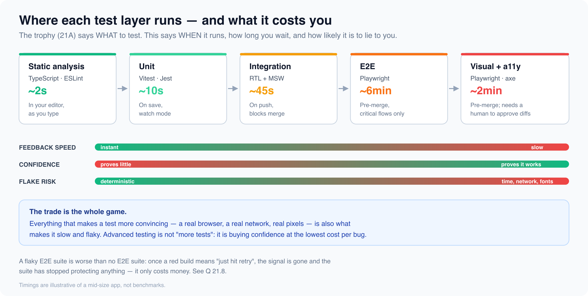

# Advanced testing

*11 min read · Updated 16 Jul 2026 Topic 53 of 77 Bookmark Mark done 21B · Topic 53 of 77*

**Source:** [https://www.geekyfrontend.in/learn/complete-frontend-kit/advanced-testing](https://www.geekyfrontend.in/learn/complete-frontend-kit/advanced-testing)

---

# 21B. Advanced Testing

**Questions:** 4 **Difficulty:** Mid to Senior **Companies:** Google, Amazon, Flipkart, Razorpay, Swiggy, Microsoft, Atlassian, Uber

21A covered what to test and how to test components. This covers the outer layers of the trophy — the ones that run in a real browser, cost real minutes, and are the ones interviewers use to separate people who have *run* a suite in CI from people who have only written tests.



---

## Q 21.5 How do you decide what belongs in E2E, and how do you structure a Playwright suite?

**Difficulty:** Mid to Senior **Asked at:** Google, Amazon, Flipkart, Uber

The trap in this question is enthusiasm. The wrong answer is "we E2E the main flows and add more over time" — that is how you get a 40-minute suite that everyone ignores. The right answer starts with a budget.

**The rule: E2E tests earn their place by covering what nothing else can.** An integration test with MSW already proves your component renders the list, handles the error, and calls the right endpoint. What it cannot prove is that the pieces are wired together in a real browser: real routing, real cookies, real redirects, a real payment iframe, a real page reload.

So the E2E list is short and it is about *money and lockout*:

- **Signup / login** — if this breaks, nobody gets in
- **Checkout / payment** — if this breaks, you stop earning
- One flow per critical integration you do not control (OAuth, Razorpay, S3 upload)

Everything else belongs one layer down, where it runs in 45 seconds instead of 6 minutes.

**Structure: the Page Object, and its limits**

javascript

```
// e2e/pages/CheckoutPage.js
class CheckoutPage {
  constructor(page) {
    this.page = page;
    // Locators are lazy — resolved when used, not when constructed.
    this.email = page.getByLabel('Email');
    this.card = page.frameLocator('iframe[name="card"]').getByPlaceholder('Card number');
    this.pay = page.getByRole('button', { name: /pay now/i });
    this.receipt = page.getByRole('heading', { name: /order confirmed/i });
  }

  async goto(cartId) {
    await this.page.goto(`/checkout/${cartId}`);
  }

  async payWith({ email, card }) {
    await this.email.fill(email);
    await this.card.fill(card);
    await this.pay.click();
  }
}

module.exports = { CheckoutPage };
```

javascript

```
// e2e/checkout.spec.js
const { test, expect } = require('@playwright/test');
const { CheckoutPage } = require('./pages/CheckoutPage');

test('a signed-in user can pay for a kit', async ({ page }) => {
  const checkout = new CheckoutPage(page);
  await checkout.goto('cart_123');
  await checkout.payWith({ email: 'ankit@example.com', card: '4111111111111111' });

  // Assert on what the USER sees, not on the URL or a network call.
  await expect(checkout.receipt).toBeVisible();
});
```

Page Objects keep selectors in one file, so a redesign breaks one file instead of thirty. The limit: do not let them grow assertions. A Page Object that contains `expect()` hides what a test is actually checking — the spec should read like the user story.

**Auth: log in once, not once per test.** Logging in through the UI in every test is the single biggest waste of minutes in most suites.

javascript

```
// e2e/auth.setup.js — runs ONCE, saves the cookie jar
const { test: setup } = require('@playwright/test');

setup('authenticate', async ({ page }) => {
  await page.goto('/login');
  await page.getByLabel('Email').fill(process.env.E2E_USER);
  await page.getByLabel('Password').fill(process.env.E2E_PASS);
  await page.getByRole('button', { name: /sign in/i }).click();
  await page.waitForURL('/dashboard');
  await page.context().storageState({ path: 'e2e/.auth/user.json' });
});
```

javascript

```
// playwright.config.js
module.exports = {
  projects: [
    { name: 'setup', testMatch: /auth\.setup\.js/ },
    {
      name: 'chromium',
      dependencies: ['setup'],
      use: { storageState: 'e2e/.auth/user.json' },  // every test starts logged in
    },
  ],
};
```

**Follow-up:** "Playwright or Cypress?"

Playwright, for new work. It runs real cross-browser (Chromium, Firefox, WebKit), runs tests in parallel out of the box, and its auto-waiting locators remove most `waitFor` noise. Cypress has a lovely debug UI and a large install base, but it runs in-browser (which makes multi-tab, multi-origin and file-download cases awkward) and parallelisation is a paid feature. The honest interview answer: either is fine, and the tool is not what makes suites good — test selection is.

---

## Q 21.6 What is visual regression testing, and how do you stop it crying wolf?

**Difficulty:** Mid to Senior **Asked at:** Flipkart, Razorpay, Swiggy, Atlassian

21A said "don't assert exact CSS — use visual regression instead". This is that.

**The idea:** screenshot the UI, store it as a baseline, and on every run compare the new screenshot to the baseline pixel by pixel. Any difference fails the test and produces a diff image a human approves or rejects. It catches the entire class of bugs assertions cannot express: a z-index war, a broken grid at 375px, a font that failed to load, a dark-mode token with no contrast, a button that moved 4px and now overlaps.

javascript

```
// e2e/visual.spec.js
const { test, expect } = require('@playwright/test');

test.describe('pricing page', () => {
  for (const width of [375, 768, 1280]) {
    test(`renders at ${width}px`, async ({ page }) => {
      await page.setViewportSize({ width, height: 900 });
      await page.goto('/pricing');

      // Kill every source of nondeterminism BEFORE the shot.
      await page.addStyleTag({ content: `*, *::before, *::after {
        animation: none !important; transition: none !important; caret-color: transparent !important;
      }` });
      await page.evaluate(() => document.fonts.ready);            // fonts settled
      await page.getByTestId('live-user-count').evaluate(el => el.textContent = '1,234');  // freeze dynamic text

      await expect(page).toHaveScreenshot(`pricing-${width}.png`, {
        maxDiffPixelRatio: 0.01,   // tolerate sub-pixel AA noise, not layout shifts
        mask: [page.getByTestId('rotating-testimonial')],  // exclude what legitimately changes
        fullPage: true,
      });
    });
  }
});
```

**Why most teams abandon visual testing: it cries wolf.** Every one of these produces a red build that is not a bug:

- **Animations mid-flight** — the shot lands at a random frame. Disable them globally.
- **Fonts not loaded** — the first shot is a fallback font, the next is the real one. Await `document.fonts.ready`.
- **Dynamic content** — dates, counters, "2 minutes ago", carousels. Freeze it or `mask` it.
- **Anti-aliasing across machines** — your Mac and CI's Linux render text differently. **This is the big one**: baselines must be generated in the same environment that runs them, which in practice means a Docker image, not a laptop.

**The workflow that survives contact with a team:** baselines live in the repo, a diff blocks the PR, and updating a baseline is an explicit, reviewed commit (`--update-snapshots`) — never automatic. The moment baselines auto-update, the test proves nothing: it asserts that today's UI matches today's UI.

**Follow-up:** "Where do you run it — component level or page level?"

Component level, via Storybook, catches more with less flake: one story per state, no routing, no data. Page level catches integration issues (layout collisions between components) but is far noisier. A common split: Storybook snapshots for the design system, a handful of full-page shots for the marketing and checkout pages that actually get looked at.

---

## Q 21.7 How do you test accessibility automatically, and what can't automation catch?

**Difficulty:** Mid to Senior **Asked at:** Google, Microsoft, Atlassian

21A listed accessibility under "what TO test". Here is the mechanism — and its ceiling.

javascript

```
// Component level — axe inside your existing RTL tests
import { render } from '@testing-library/react';
import { axe } from 'jest-axe';
import CheckoutForm from './CheckoutForm';

it('has no detectable a11y violations', async () => {
  const { container } = render(<CheckoutForm />);
  const results = await axe(container);
  expect(results).toHaveNoViolations();
});
```

javascript

```
// Page level — axe against the real rendered page in Playwright
const { test, expect } = require('@playwright/test');
const AxeBuilder = require('@axe-core/playwright').default;

test('pricing page has no WCAG A/AA violations', async ({ page }) => {
  await page.goto('/pricing');
  const results = await new AxeBuilder({ page })
    .withTags(['wcag2a', 'wcag2aa'])
    .analyze();

  expect(results.violations).toEqual([]);
});
```

**The number every senior candidate should know: automated tooling catches roughly 30-40% of accessibility issues.** Saying "we run axe in CI, so we're accessible" is the wrong answer, and interviewers at Microsoft and Atlassian are listening for it.

**What axe reliably catches** — the mechanical, checkable rules: missing `alt`, colour contrast below 4.5:1, form inputs with no label, invalid ARIA, duplicate IDs, missing document language, non-nested headings.

**What no tool can catch**, because they require judgement:

- `alt="image"` passes the alt-text rule and tells a blind user nothing. Presence is checkable; *usefulness* is not.
- **Focus order that is technically valid but nonsensical** — tabbing jumps from the header to the footer and back.
- **A keyboard trap in a modal** — you can tab in and never out. Every element is labelled; the experience is broken.
- **A screen reader announcing the wrong thing** — a live region that fires on every keystroke, or never.

So the honest answer is a layered one: axe in CI as a regression net for the mechanical 30-40%, keyboard-only testing in the definition of done (unplug the mouse and complete the flow), and a real screen reader (VoiceOver / NVDA) on critical flows before release.

**Follow-up:** "How do you stop a11y regressing once you've fixed it?"

Fail the build on new violations, not on all of them. A codebase with 200 existing violations cannot go green tomorrow, and a permanently-red gate gets disabled within a week. Snapshot the current violation count as a baseline, block anything that increases it, and burn the backlog down deliberately.

---

## Q 21.8 A test fails on CI and passes locally. Walk me through it.

**Difficulty:** Senior **Asked at:** Google, Amazon, Uber, Razorpay

This is the most revealing testing question there is, because flakiness is where testing stops being about syntax and starts being about engineering judgement.

**Start with the cost, not the cause.** A flaky suite is worse than no suite. Once a red build means "just hit retry", the suite has stopped carrying information — every future real failure gets retried away too. So the first answer is: **a flaky test is a broken test, and it gets quarantined or deleted, not retried.**

**The causes, in the order they actually occur:**

- **Waiting on time instead of state.** `waitForTimeout(500)` passes on your laptop and fails on a loaded CI runner. Wait for the *condition*: `await expect(el).toBeVisible()`.
- **Test order dependence.** Test B passes only because test A seeded a row. Run in parallel or shuffled, B fails. Each test must create and destroy its own data.
- **Shared state across tests** — a module-level cache, `localStorage`, a logged-in session leaking between specs.
- **Real time and real randomness.** A test that passes until it runs at 23:59 UTC, or on the 1st of the month, or in a different timezone from your laptop.
- **Animations and network** — asserting during a transition, or on a response that is usually fast.

javascript

```
// Flaky: three different ways
test('shows the welcome toast', async () => {
  render(<Dashboard />);
  await new Promise(r => setTimeout(r, 500));           // 1. hopes 500ms is enough
  expect(screen.getByText('Welcome back')).toBeVisible();
  expect(screen.getByText('Last login: 16 Jul 2026')).toBeVisible();  // 2. real clock
});

// Deterministic
test('shows the welcome toast', async () => {
  vi.setSystemTime(new Date('2026-07-16T10:00:00Z'));    // freeze the clock
  render(<Dashboard />);
  await screen.findByText('Welcome back');               // wait for the STATE
  expect(screen.getByText('Last login: 16 Jul 2026')).toBeVisible();
});
```

**The debugging routine**, which is what the interviewer is really asking for:

1. **Reproduce it.** Run the test 50 times locally (`--repeat-each=50`). If it never fails, the difference is the environment: timezone, viewport, CPU count, fonts.
2. **Read the artefact, don't guess.** Playwright's trace viewer gives you a DOM snapshot at the moment of failure, the network log, and a video. Most flakes are obvious in the trace and invisible in the stack trace.
3. **Match CI's environment.** Run in CI's Docker image, with `--workers=4` to reproduce the resource contention.
4. **Fix the cause, then remove the retry.** A retry left in place after the fix hides the next flake.

**On** `retries`**:** allow retries in CI to keep the pipeline moving, but **report them**. A test that passes on retry is not passing — it is a bug with a countdown. Track the flake rate per test and quarantine anything above a threshold, so the number is visible instead of absorbed.

**Follow-up:** "Your E2E suite takes 40 minutes. What do you do?"

Do not start by parallelising — that buys speed and keeps the bloat. Start by deleting: most 40-minute suites are 80% tests that duplicate an integration test in a slower browser. Cut E2E back to the money-and-lockout flows (Q21.5), move the rest down a layer, and only then sharded across workers. The order matters, and interviewers notice which one you reach for first.

---

## Learn More

- [Playwright playwright.dev](https://playwright.dev)
- [Cypress cypress.io](https://www.cypress.io)
- [Cypress or Playwright? YouTube](https://www.youtube.com/watch?v=fGUzedrUyxA)
- [Get started with Playwright YouTube](https://www.youtube.com/watch?v=4-LwodVujTg)
- [Cypress vs Playwright for e2e YouTube](https://www.youtube.com/watch?v=DoGV8G0Gr_I)
