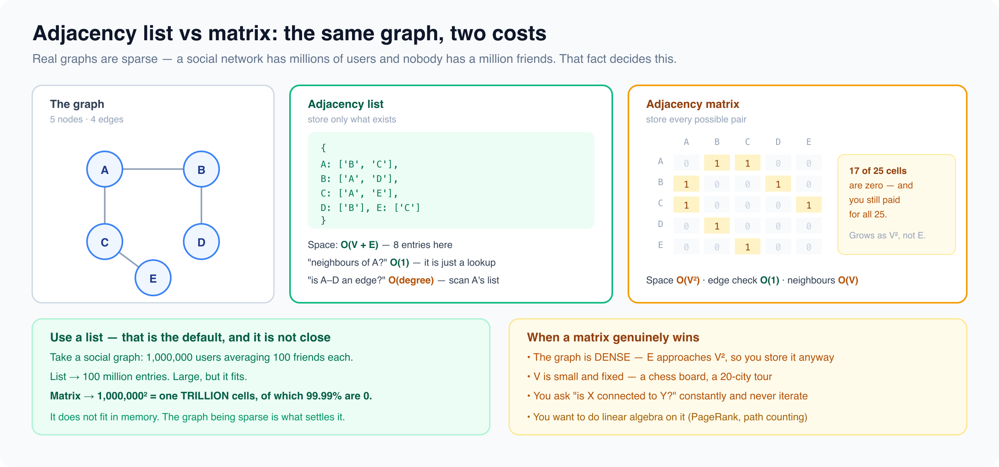

# Tree and graph structures

*9 min read · Updated 16 Jul 2026 Topic 57 of 77 Bookmark Mark done 22C · Topic 57 of 77*

**Source:** [https://www.geekyfrontend.in/learn/complete-frontend-kit/tree-and-graph-structures](https://www.geekyfrontend.in/learn/complete-frontend-kit/tree-and-graph-structures)

---

# 22C. Tree & Graph Structures

**Questions:** 9 **Difficulty:** Mid to Senior

---

## Q 22.11 Trees — how does the DOM relate to tree data structures?

**Difficulty:** Mid **Asked at:** Google, Amazon, Flipkart

A tree is a hierarchical structure with a root node, where each node has zero or more children. The DOM is literally a tree — `document` is the root, `<html>` is its child, `<head>` and `<body>` are `<html>`'s children, and so on.

**Tree traversal — the foundation of DOM manipulation:**

javascript

```
// Depth-First Search (DFS) — go deep before going wide
function dfs(node, callback) {
  callback(node);
  for (const child of node.children) {
    dfs(child, callback);
  }
}
dfs(document.body, (el) => console.log(el.tagName));
// body → div → h1 → p → footer (goes deep into first branch)

// Breadth-First Search (BFS) — level by level
function bfs(root, callback) {
  const queue = [root];
  while (queue.length > 0) {
    const node = queue.shift();
    callback(node);
    for (const child of node.children) {
      queue.push(child);
    }
  }
}
bfs(document.body, (el) => console.log(el.tagName));
// body → div → footer → h1 → p (processes each level before going deeper)
```

**When to use DFS vs BFS:** DFS when you need to find something deep in the tree (querySelector), process leaves before parents, or when memory is constrained (DFS uses O(height) memory, BFS uses O(width)). BFS when you need level-order processing, finding the shortest path, or processing closest nodes first.

**Frontend tree patterns:** DOM traversal, component tree rendering (React reconciliation), file explorer UIs, nested comment threads, menu/submenu structures, and organizational charts.

---

## Q 22.12 Binary Search Trees — when would a frontend use one?

**Difficulty:** Mid **Asked at:** Google, Amazon

A BST maintains sorted order — left child < parent < right child. This gives O(log n) search, insert, and delete (when balanced).

javascript

```
class BSTNode {
  constructor(value) {
    this.value = value;
    this.left = null;
    this.right = null;
  }
}

class BST {
  constructor() { this.root = null; }

  insert(value) {
    const node = new BSTNode(value);
    if (!this.root) { this.root = node; return; }

    let current = this.root;
    while (true) {
      if (value < current.value) {
        if (!current.left) { current.left = node; return; }
        current = current.left;
      } else {
        if (!current.right) { current.right = node; return; }
        current = current.right;
      }
    }
  }

  // Inorder traversal gives sorted output
  inorder(node = this.root, result = []) {
    if (!node) return result;
    this.inorder(node.left, result);
    result.push(node.value);
    this.inorder(node.right, result);
    return result;
  }
}
```

**Frontend relevance:** BSTs are rarely used directly in frontend code (sorted arrays + binary search are simpler). But BST concepts appear in interview problems: validate BST, find kth smallest element, and LCA (lowest common ancestor). Understanding BST helps with database indexing concepts discussed in system design.

---

## Q 22.13 Heaps / Priority Queues — what problems do they solve?

**Difficulty:** Mid **Asked at:** Google, Amazon

A heap is a complete binary tree where the parent is always smaller (min-heap) or larger (max-heap) than its children. It gives O(1) access to the min/max element and O(log n) insertion and deletion.

javascript

```
class MinHeap {
  #items = [];

  insert(value) {
    this.#items.push(value);
    this.#bubbleUp(this.#items.length - 1);
  }

  extractMin() {
    const min = this.#items[0];
    const last = this.#items.pop();
    if (this.#items.length > 0) {
      this.#items[0] = last;
      this.#sinkDown(0);
    }
    return min;
  }

  #bubbleUp(i) {
    while (i > 0) {
      const parent = Math.floor((i - 1) / 2);
      if (this.#items[i] >= this.#items[parent]) break;
      [this.#items[i], this.#items[parent]] = [this.#items[parent], this.#items[i]];
      i = parent;
    }
  }

  #sinkDown(i) {
    while (true) {
      let smallest = i;
      const left = 2 * i + 1, right = 2 * i + 2;
      if (left < this.#items.length && this.#items[left] < this.#items[smallest]) smallest = left;
      if (right < this.#items.length && this.#items[right] < this.#items[smallest]) smallest = right;
      if (smallest === i) break;
      [this.#items[i], this.#items[smallest]] = [this.#items[smallest], this.#items[i]];
      i = smallest;
    }
  }
}
```

**Use cases:** Top-K problems (show the 10 highest-rated products out of 100,000), task scheduling (process highest priority tasks first), merge K sorted lists (used in database merge operations), and median finding in streaming data.

---

## Q 22.14 Tries — how do they power autocomplete?

**Difficulty:** Senior **Asked at:** Google, Amazon, Microsoft

A trie (prefix tree) stores strings character by character. Each path from root to a node represents a prefix. This makes prefix search O(m) where m is the length of the prefix, regardless of how many strings are stored.

javascript

```
class TrieNode {
  constructor() {
    this.children = new Map();
    this.isEnd = false;
    this.frequency = 0;
  }
}

class Trie {
  constructor() { this.root = new TrieNode(); }

  insert(word, freq = 1) {
    let node = this.root;
    for (const char of word) {
      if (!node.children.has(char)) {
        node.children.set(char, new TrieNode());
      }
      node = node.children.get(char);
    }
    node.isEnd = true;
    node.frequency += freq;
  }

  autocomplete(prefix, limit = 10) {
    let node = this.root;
    for (const char of prefix) {
      if (!node.children.has(char)) return [];
      node = node.children.get(char);
    }

    const results = [];
    this.#collectWords(node, prefix, results);
    return results
      .sort((a, b) => b.frequency - a.frequency)
      .slice(0, limit)
      .map(r => r.word);
  }

  #collectWords(node, prefix, results) {
    if (node.isEnd) results.push({ word: prefix, frequency: node.frequency });
    for (const [char, child] of node.children) {
      this.#collectWords(child, prefix + char, results);
    }
  }
}

// Usage
const trie = new Trie();
trie.insert('react', 100);
trie.insert('react native', 40);
trie.insert('redux', 60);
trie.insert('remix', 30);
trie.insert('responsive', 20);

trie.autocomplete('re');
// ['react', 'redux', 'react native', 'remix', 'responsive']
```

**Frontend relevance:** Search autocomplete, command palettes (Cmd+K), tag input suggestions, dictionary/spell checking, and IP routing tables.

---

## Q 22.15 Graphs — where do they show up in frontend?

**Difficulty:** Mid **Asked at:** Google, Amazon, Flipkart

A graph is nodes (vertices) connected by edges. Unlike trees, graphs can have cycles, disconnected components, and edges in both directions.

**Adjacency list representation (most common):**

javascript

```
class Graph {
  constructor() {
    this.adjacencyList = new Map();
  }

  addVertex(vertex) {
    if (!this.adjacencyList.has(vertex)) {
      this.adjacencyList.set(vertex, []);
    }
  }

  addEdge(v1, v2) {
    this.adjacencyList.get(v1)?.push(v2);
    this.adjacencyList.get(v2)?.push(v1);  // Remove for directed graph
  }
}
```

**Frontend relevance:**

- **Dependency graphs** — bundlers (webpack, Vite) build a graph of module imports to determine build order, detect circular dependencies, and tree-shake unused code
- **Route planning** — mapping applications use graph algorithms (Dijkstra) for shortest path
- **Social networks** — friend connections, followers, recommendations
- **Task dependencies** — "task B depends on task A" → topological sort determines execution order
- **Component dependency trees** — analyzing which components import which others

---



## Q 22.16 Adjacency List vs Adjacency Matrix — when to use which?

**Difficulty:** Mid **Asked at:** Google, Amazon

javascript

```
Adjacency List: { A: [B, C], B: [A, D], C: [A], D: [B] }
  Space: O(V + E) — stores only actual edges

  Adjacency Matrix:
       A  B  C  D
    A [0, 1, 1, 0]
    B [1, 0, 0, 1]
    C [1, 0, 0, 0]
    D [0, 1, 0, 0]
  Space: O(V²) — stores every possible edge, including non-existent ones
```

**List** when: graph is sparse (few edges relative to vertices), you need to iterate a node's neighbors, memory matters. This is 90% of frontend use cases.

**Matrix** when: graph is dense (most nodes connected), you need O(1) "is there an edge between A and B?" lookup, or the algorithm requires matrix operations.

---

## Q 22.17 Disjoint Sets (Union-Find) — what problem do they solve?

**Difficulty:** Senior **Asked at:** Google, Amazon

Union-Find tracks which elements belong to the same group. Two operations: `union(a, b)` merges two groups, `find(a)` returns which group an element belongs to. Both are nearly O(1) with path compression and union by rank.

javascript

```
class UnionFind {
  constructor(size) {
    this.parent = Array.from({ length: size }, (_, i) => i);
    this.rank = new Array(size).fill(0);
  }

  find(x) {
    if (this.parent[x] !== x) {
      this.parent[x] = this.find(this.parent[x]);  // Path compression
    }
    return this.parent[x];
  }

  union(x, y) {
    const rootX = this.find(x), rootY = this.find(y);
    if (rootX === rootY) return false;
    if (this.rank[rootX] < this.rank[rootY]) this.parent[rootX] = rootY;
    else if (this.rank[rootX] > this.rank[rootY]) this.parent[rootY] = rootX;
    else { this.parent[rootY] = rootX; this.rank[rootX]++; }
    return true;
  }

  connected(x, y) { return this.find(x) === this.find(y); }
}
```

**Use cases:** "Number of Islands" (grid problems), detecting connected components, Kruskal's MST algorithm, and social network grouping (find friend clusters).

---

## Q 22.18 Segment Trees — when would they come up?

**Difficulty:** Senior **Asked at:** Google

Segment trees answer range queries (sum of elements from index 2 to 7, minimum value from index 3 to 10) in O(log n) time, with O(log n) updates. They're rarely used directly in frontend code but appear in competitive programming and interview DSA rounds at top companies.

**Simplified use case:** A dashboard showing sum/average/min/max over any date range, with frequent data updates. Without a segment tree, each query recalculates from scratch (O(n)). With one, queries and updates are both O(log n).

You're unlikely to be asked to implement a segment tree in a frontend interview. But knowing it exists as a solution for "range query + point update" problems shows algorithmic breadth.

---

## Q 22.19 Data Structure Selection Guide — which structure for which problem?

**Difficulty:** Mid **Asked at:** Every company (implicitly, in every coding problem)

javascript

```
Problem Pattern                           │ Data Structure
  ──────────────────────────────────────────┼──────────────────────────
  Store ordered collection, access by index │ Array
  Fast lookup by key                        │ Map / Object
  Check membership ("is X in the set?")     │ Set
  Process in FIFO order                     │ Queue
  Undo/redo, back/forward                   │ Stack
  Fast insert/delete at known position      │ Linked List
  Fast min/max access                       │ Heap (Priority Queue)
  Sorted data with fast search              │ BST / sorted array + binary search
  Prefix search / autocomplete              │ Trie
  Relationships between entities            │ Graph (adjacency list)
  Hierarchical data (DOM, file system)      │ Tree
  LRU Cache (evict least recently used)     │ Doubly Linked List + Map
  "Is X possibly in a huge set?" (space-    │ Bloom Filter
  efficient, tolerates false positives)     │
  Track connected groups                    │ Union-Find
  Range queries with updates                │ Segment Tree
  Fixed-size rolling data (last N items)    │ Circular Buffer
  Unique items in insertion order            │ Set (preserves insertion order)
```

**The interview meta-skill:** When given a problem, identify the core operation (lookup? ordering? membership? hierarchy?) and match it to the right structure. "I need fast lookup by user ID" → Map. "I need to process tasks in priority order" → Heap. "I need undo/redo" → Stack. This mapping is more valuable than memorizing implementations.

---

## Learn More

- [Binary search tree (VisuAlgo) visualgo.net](https://visualgo.net/en/bst)
- [Introduction to graphs YouTube](https://www.youtube.com/watch?v=4IZ80K72OXo)
- [Trees & graphs explained YouTube](https://www.youtube.com/watch?v=VOsvNDtOHz8)
- [Data structures: trees & graphs YouTube](https://www.youtube.com/watch?v=BwCnIuM81Iw)
