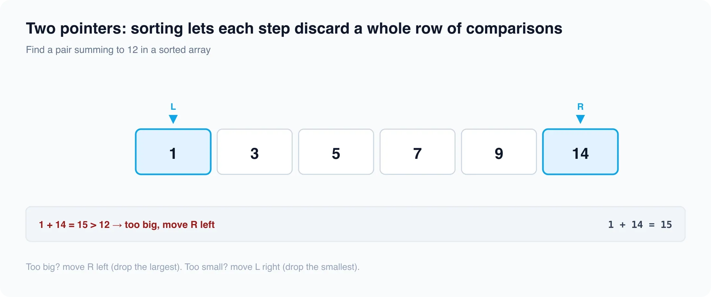

# Two pointer

*4 min read · Updated 16 Jul 2026 Topic 60 of 77 Bookmark Mark done 23C · Topic 60 of 77*

**Source:** [https://www.geekyfrontend.in/learn/complete-frontend-kit/two-pointer](https://www.geekyfrontend.in/learn/complete-frontend-kit/two-pointer)

---

# 23C. Two Pointer (10 problems)

**Pattern recognition:** "Sorted array", "Find pair/triplet", "Container/area problems", "Remove duplicates in-place"

---



## 23.21 Two Sum (Sorted Array)

javascript

```
function twoSum(arr, target) {
  let lo = 0, hi = arr.length - 1;
  while (lo < hi) {
    const sum = arr[lo] + arr[hi];
    if (sum === target) return [lo, hi];
    if (sum < target) lo++;
    else hi--;
  }
  return [-1, -1];
}
```

---

## 23.22 Three Sum

javascript

```
function threeSum(nums) {
  nums.sort((a, b) => a - b);
  const result = [];
  for (let i = 0; i < nums.length - 2; i++) {
    if (i > 0 && nums[i] === nums[i - 1]) continue;
    let lo = i + 1, hi = nums.length - 1;
    while (lo < hi) {
      const sum = nums[i] + nums[lo] + nums[hi];
      if (sum === 0) {
        result.push([nums[i], nums[lo], nums[hi]]);
        while (lo < hi && nums[lo] === nums[lo + 1]) lo++;
        while (lo < hi && nums[hi] === nums[hi - 1]) hi--;
        lo++; hi--;
      } else if (sum < 0) lo++;
      else hi--;
    }
  }
  return result;
}
```

**Time:** O(n²). **Space:** O(1) excluding output.

---

## 23.23 Container With Most Water

javascript

```
function maxArea(heights) {
  let lo = 0, hi = heights.length - 1, max = 0;
  while (lo < hi) {
    const area = Math.min(heights[lo], heights[hi]) * (hi - lo);
    max = Math.max(max, area);
    if (heights[lo] < heights[hi]) lo++;
    else hi--;
  }
  return max;
}
```

---

## 23.24 Remove Duplicates from Sorted Array

javascript

```
function removeDuplicates(nums) {
  if (nums.length === 0) return 0;
  let slow = 0;
  for (let fast = 1; fast < nums.length; fast++) {
    if (nums[fast] !== nums[slow]) { slow++; nums[slow] = nums[fast]; }
  }
  return slow + 1;
}
```

---

## 23.25 Trapping Rain Water

javascript

```
function trap(height) {
  let lo = 0, hi = height.length - 1;
  let leftMax = 0, rightMax = 0, water = 0;
  while (lo < hi) {
    if (height[lo] < height[hi]) {
      leftMax = Math.max(leftMax, height[lo]);
      water += leftMax - height[lo];
      lo++;
    } else {
      rightMax = Math.max(rightMax, height[hi]);
      water += rightMax - height[hi];
      hi--;
    }
  }
  return water;
}
```

**Time:** O(n). **Space:** O(1).

---

## 23.26 Valid Palindrome

**Approach:** Strip non-alphanumerics and lowercase, then converge two pointers from both ends comparing characters.

javascript

```
function isPalindrome(s) {
  const clean = s.toLowerCase().replace(/[^a-z0-9]/g, '');
  let left = 0, right = clean.length - 1;
  while (left < right) {
    if (clean[left] !== clean[right]) return false;
    left++;
    right--;
  }
  return true;
}
```

Two pointers from both ends, skip non-alphanumeric, compare case-insensitive.

---

## 23.27 Merge Two Sorted Arrays

**Approach:** Walk one pointer per array, always taking the smaller front element, then drain whichever array remains.

javascript

```
function mergeSortedArrays(a, b) {
  const result = [];
  let i = 0, j = 0;
  while (i < a.length && j < b.length) {
    if (a[i] <= b[j]) result.push(a[i++]);
    else result.push(b[j++]);
  }
  while (i < a.length) result.push(a[i++]);
  while (j < b.length) result.push(b[j++]);
  return result;
}
```

Two pointers, one per array, compare and push smaller.

---

## 23.28 Partition Array

**Approach:** Advance a left pointer past elements below the pivot and a right pointer past elements at or above it, swapping the out-of-place pair when both stall.

javascript

```
function partition(nums, pivot) {
  let left = 0, right = nums.length - 1;
  while (left <= right) {
    if (nums[left] < pivot) {
      left++;
    } else if (nums[right] >= pivot) {
      right--;
    } else {
      [nums[left], nums[right]] = [nums[right], nums[left]];
      left++;
      right--;
    }
  }
  return nums;
}
```

`slow` tracks boundary, `fast` scans. Elements satisfying condition go before `slow`.

---

## 23.29 Dutch National Flag (Sort Colors)

**Approach:** Three pointers (low, mid, high) sweep once: send 0s to the front, 2s to the back, and leave 1s in the middle.

javascript

```
function sortColors(nums) {
  let low = 0, mid = 0, high = nums.length - 1;
  while (mid <= high) {
    if (nums[mid] === 0) {
      [nums[low], nums[mid]] = [nums[mid], nums[low]];
      low++;
      mid++;
    } else if (nums[mid] === 1) {
      mid++;
    } else {
      [nums[mid], nums[high]] = [nums[high], nums[mid]];
      high--;
    }
  }
  return nums;
}
```

Three pointers (lo, mid, hi). 0s go to lo, 2s go to hi, 1s stay in middle. Single pass O(n).

---

## 23.30 Pair with Given Difference

**Approach:** Sort the array, then slide two pointers to grow or shrink the difference until it equals the target (or the pointers cross).

javascript

```
function hasPairWithDifference(nums, diff) {
  const arr = [...nums].sort((a, b) => a - b);
  const d = Math.abs(diff);
  let i = 0, j = 1;
  while (j < arr.length) {
    const cur = arr[j] - arr[i];
    if (i !== j && cur === d) return true;
    if (cur < d) j++;
    else i++;
    if (i === j) j++;
  }
  return false;
}
```

Sort + two pointers. If `arr[j] - arr[i] < target` advance j, if greater advance i.

---

## Learn More

- [Two-pointers technique (GfG) geeksforgeeks.org](https://www.geeksforgeeks.org/two-pointers-technique/)
- [Two pointers in 7 minutes YouTube](https://www.youtube.com/watch?v=QzZ7nmouLTI)
- [Master two pointers & fast/slow YouTube](https://www.youtube.com/watch?v=G5cC3WbUQ7E)
- [Visual intro to two pointers YouTube](https://www.youtube.com/watch?v=On03HWe2tZM)
