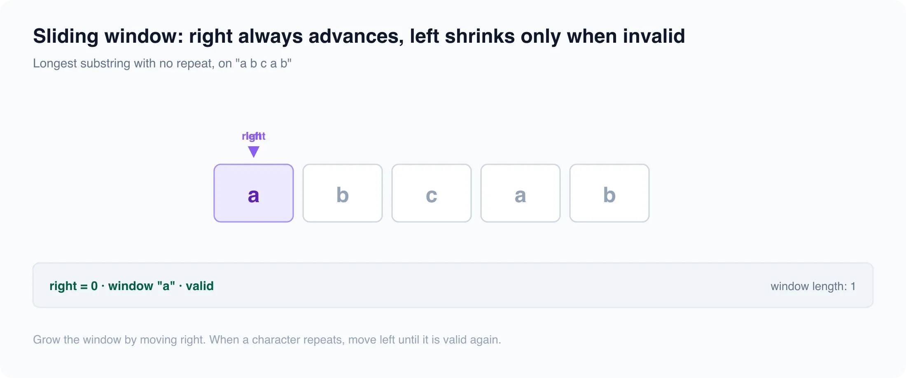

# Sliding window

*6 min read · Updated 16 Jul 2026 Topic 61 of 77 Bookmark Mark done 23D · Topic 61 of 77*

**Source:** [https://www.geekyfrontend.in/learn/complete-frontend-kit/sliding-window](https://www.geekyfrontend.in/learn/complete-frontend-kit/sliding-window)

---

# 23D. Sliding Window (10 problems)

**Pattern recognition:** "Contiguous subarray/substring", "Maximum/minimum in window of size K", "Longest substring with condition"

---



## 23.31 Maximum Sum Subarray of Size K

javascript

```
function maxSumSubarray(arr, k) {
  let windowSum = arr.slice(0, k).reduce((a, b) => a + b, 0);
  let maxSum = windowSum;
  for (let i = k; i < arr.length; i++) {
    windowSum += arr[i] - arr[i - k];
    maxSum = Math.max(maxSum, windowSum);
  }
  return maxSum;
}
```

**Time:** O(n). **Space:** O(1).

---

## 23.32 Longest Substring Without Repeating Characters

javascript

```
function lengthOfLongestSubstring(s) {
  const seen = new Map();
  let maxLen = 0, start = 0;
  for (let end = 0; end < s.length; end++) {
    if (seen.has(s[end]) && seen.get(s[end]) >= start) {
      start = seen.get(s[end]) + 1;
    }
    seen.set(s[end], end);
    maxLen = Math.max(maxLen, end - start + 1);
  }
  return maxLen;
}
```

---

## 23.33 Minimum Window Substring

javascript

```
function minWindow(s, t) {
  const need = new Map();
  for (const c of t) need.set(c, (need.get(c) || 0) + 1);
  let have = 0, required = need.size;
  let left = 0, minLen = Infinity, result = '';
  const window = new Map();

  for (let right = 0; right < s.length; right++) {
    const c = s[right];
    window.set(c, (window.get(c) || 0) + 1);
    if (need.has(c) && window.get(c) === need.get(c)) have++;

    while (have === required) {
      if (right - left + 1 < minLen) {
        minLen = right - left + 1;
        result = s.substring(left, right + 1);
      }
      const leftChar = s[left];
      window.set(leftChar, window.get(leftChar) - 1);
      if (need.has(leftChar) && window.get(leftChar) < need.get(leftChar)) have--;
      left++;
    }
  }
  return result;
}
```

**Time:** O(n). **Space:** O(k).

---

## 23.34 Longest Repeating Character Replacement

**Approach:** Grow a window and shrink it whenever (window length - count of the most frequent char) exceeds k, since that difference is the number of replacements needed.

javascript

```
function characterReplacement(s, k) {
  const count = {};
  let left = 0, maxFreq = 0, res = 0;
  for (let right = 0; right < s.length; right++) {
    const c = s[right];
    count[c] = (count[c] || 0) + 1;
    maxFreq = Math.max(maxFreq, count[c]);
    while (right - left + 1 - maxFreq > k) {
      count[s[left]]--;
      left++;
    }
    res = Math.max(res, right - left + 1);
  }
  return res;
}
```

Sliding window + frequency count. Shrink when `windowSize - maxFrequency > k`.

---

## 23.35 Permutation in String / Anagram Detection

**Approach:** Slide a fixed-size window equal to s1's length over s2, keeping frequency arrays in sync and reporting a match when the window's counts equal s1's counts.

javascript

```
function checkInclusion(s1, s2) {
  if (s1.length > s2.length) return false;
  const need = new Array(26).fill(0);
  const win = new Array(26).fill(0);
  const a = 'a'.charCodeAt(0);
  for (let i = 0; i < s1.length; i++) {
    need[s1.charCodeAt(i) - a]++;
    win[s2.charCodeAt(i) - a]++;
  }
  const match = () => need.every((v, i) => v === win[i]);
  if (match()) return true;
  for (let i = s1.length; i < s2.length; i++) {
    win[s2.charCodeAt(i) - a]++;
    win[s2.charCodeAt(i - s1.length) - a]--;
    if (match()) return true;
  }
  return false;
}
```

Fixed-size window matching a frequency map. Slide and compare.

---

## 23.36 Sliding Window Maximum

**Approach:** Maintain a monotonic decreasing deque of indices so its front always holds the current window's maximum, evicting out-of-range and smaller elements as the window advances.

javascript

```
function maxSlidingWindow(nums, k) {
  const res = [];
  const deque = []; // indices, values decreasing
  for (let i = 0; i < nums.length; i++) {
    while (deque.length && deque[0] <= i - k) deque.shift();
    while (deque.length && nums[deque[deque.length - 1]] <= nums[i]) deque.pop();
    deque.push(i);
    if (i >= k - 1) res.push(nums[deque[0]]);
  }
  return res;
}
```

Monotonic deque. Front = max. Remove smaller from back, out-of-window from front. **Time:** O(n).

---

## 23.37 Count Subarrays with Sum = K

**Approach:** Walk a running prefix sum and, using a hashmap of prefix-sum frequencies, add the count of earlier prefixes equal to sum - k (a true window fails on negatives, so prefix sums are required).

javascript

```
function subarraySum(nums, k) {
  const map = new Map();
  map.set(0, 1);
  let sum = 0, count = 0;
  for (const n of nums) {
    sum += n;
    count += map.get(sum - k) || 0;
    map.set(sum, (map.get(sum) || 0) + 1);
  }
  return count;
}
```

Prefix sum + hash map. `count += map.get(prefixSum - k)`. Not a pure sliding window — prefix sum technique.

---

## 23.38 Fruit Into Baskets

**Approach:** This is the longest subarray with at most two distinct values, so grow the window and shrink from the left whenever a third fruit type appears.

javascript

```
function totalFruit(fruits) {
  const count = new Map();
  let left = 0, res = 0;
  for (let right = 0; right < fruits.length; right++) {
    count.set(fruits[right], (count.get(fruits[right]) || 0) + 1);
    while (count.size > 2) {
      const f = fruits[left];
      count.set(f, count.get(f) - 1);
      if (count.get(f) === 0) count.delete(f);
      left++;
    }
    res = Math.max(res, right - left + 1);
  }
  return res;
}
```

Longest subarray with at most 2 distinct elements. Sliding window + Map tracking counts.

---

## 23.39 Smallest Subarray with Sum &gt;= Target

**Approach:** Expand the window to accumulate the sum, then shrink from the left while the sum still meets the target, tracking the minimum window length (valid for non-negative numbers).

javascript

```
function minSubArrayLen(target, nums) {
  let left = 0, sum = 0, res = Infinity;
  for (let right = 0; right < nums.length; right++) {
    sum += nums[right];
    while (sum >= target) {
      res = Math.min(res, right - left + 1);
      sum -= nums[left];
      left++;
    }
  }
  return res === Infinity ? 0 : res;
}
```

Expand right until sum >= target, then shrink left to find minimum length.

---

## 23.40 Maximum Points from Cards

**Approach:** Start by taking the first k cards, then slide the window by swapping one front card for one back card at a time, keeping the best total (equivalently maximizing over the split of k picks between the two ends).

javascript

```
function maxScore(cardPoints, k) {
  const n = cardPoints.length;
  let sum = 0;
  for (let i = 0; i < k; i++) sum += cardPoints[i];
  let best = sum;
  for (let i = 1; i <= k; i++) {
    sum += cardPoints[n - i] - cardPoints[k - i];
    best = Math.max(best, sum);
  }
  return best;
}
```

Take k cards from either end. Equivalent to: find minimum sum subarray of size (n-k) in the middle.

---

## Learn More

- [Sliding window technique (GfG) geeksforgeeks.org](https://www.geeksforgeeks.org/window-sliding-technique/)
- [Sliding window in 7 minutes YouTube](https://www.youtube.com/watch?v=y2d0VHdvfdc)
- [Sliding window — full course YouTube](https://www.youtube.com/watch?v=tLsoelNl3To)
- [Sliding window for beginners YouTube](https://www.youtube.com/watch?v=a8GvJ2Ckttk)
