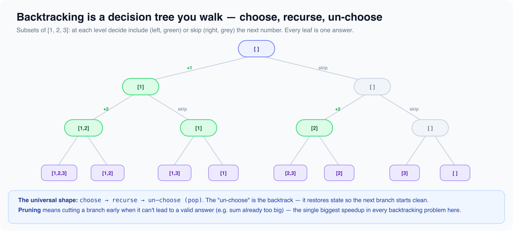

# Recursion backtracking

*9 min read · Updated 16 Jul 2026 Topic 62 of 77 Bookmark Mark done 23E · Topic 62 of 77*

**Source:** [https://www.geekyfrontend.in/learn/complete-frontend-kit/recursion-backtracking](https://www.geekyfrontend.in/learn/complete-frontend-kit/recursion-backtracking)

---

# 23E. Recursion & Backtracking (15 problems)

**Pattern recognition:** "Generate all combinations/permutations", "Find all paths", "Place N items with constraints"

**The backtracking template:**

javascript

```
function backtrack(result, current, choices, start) {
  if (isComplete(current)) { result.push([...current]); return; }
  for (let i = start; i < choices.length; i++) {
    if (!isValid(current, choices[i])) continue;
    current.push(choices[i]);           // Choose
    backtrack(result, current, choices, i + 1);  // Explore
    current.pop();                       // Unchoose
  }
}
```

---



## 23.41 Subsets (Power Set)

javascript

```
function subsets(nums) {
  const result = [];
  function backtrack(start, current) {
    result.push([...current]);
    for (let i = start; i < nums.length; i++) {
      current.push(nums[i]);
      backtrack(i + 1, current);
      current.pop();
    }
  }
  backtrack(0, []);
  return result;
}
```

**Time:** O(n × 2ⁿ). **Space:** O(n).

---

## 23.42 Subsets II (with duplicates)

**Approach:** Sort so equal values are adjacent, then backtrack recording every path, skipping any candidate equal to its predecessor at the same recursion depth to avoid duplicate subsets.

javascript

```
function subsetsWithDup(nums) {
  nums.sort((a, b) => a - b);
  const res = [];
  const path = [];
  function backtrack(start) {
    res.push([...path]);
    for (let i = start; i < nums.length; i++) {
      if (i > start && nums[i] === nums[i - 1]) continue; // skip duplicate at same depth
      path.push(nums[i]);
      backtrack(i + 1);
      path.pop();
    }
  }
  backtrack(0);
  return res;
}
```

Sort first, skip `if (i > start && nums[i] === nums[i-1]) continue`.

---

## 23.43 Permutations

javascript

```
function permute(nums) {
  const result = [];
  function backtrack(current, remaining) {
    if (remaining.length === 0) { result.push([...current]); return; }
    for (let i = 0; i < remaining.length; i++) {
      current.push(remaining[i]);
      backtrack(current, [...remaining.slice(0, i), ...remaining.slice(i + 1)]);
      current.pop();
    }
  }
  backtrack([], nums);
  return result;
}
```

---

## 23.44 Permutations II (with duplicates)

**Approach:** Sort the input and build permutations with a used[] flag, skipping a duplicate value whenever its identical predecessor has not been used at this branch so each distinct ordering is produced once.

javascript

```
function permuteUnique(nums) {
  nums.sort((a, b) => a - b);
  const res = [];
  const path = [];
  const used = new Array(nums.length).fill(false);
  function backtrack() {
    if (path.length === nums.length) {
      res.push([...path]);
      return;
    }
    for (let i = 0; i < nums.length; i++) {
      if (used[i]) continue;
      if (i > 0 && nums[i] === nums[i - 1] && !used[i - 1]) continue; // skip duplicate permutations
      used[i] = true;
      path.push(nums[i]);
      backtrack();
      path.pop();
      used[i] = false;
    }
  }
  backtrack();
  return res;
}
```

Sort first. Skip `if (i > 0 && remaining[i] === remaining[i-1]) continue`.

---

## 23.45 Combination Sum (reuse allowed)

javascript

```
function combinationSum(candidates, target) {
  const result = [];
  function backtrack(start, current, remaining) {
    if (remaining === 0) { result.push([...current]); return; }
    if (remaining < 0) return;
    for (let i = start; i < candidates.length; i++) {
      current.push(candidates[i]);
      backtrack(i, current, remaining - candidates[i]);
      current.pop();
    }
  }
  backtrack(0, [], target);
  return result;
}
```

---

## 23.46 Combination Sum II (no reuse)

**Approach:** Sort candidates, then backtrack advancing the start index by one each pick (no reuse), skipping duplicates at the same depth and breaking once a candidate exceeds the remaining target.

javascript

```
function combinationSum2(candidates, target) {
  candidates.sort((a, b) => a - b);
  const res = [];
  const path = [];
  function backtrack(start, remain) {
    if (remain === 0) {
      res.push([...path]);
      return;
    }
    for (let i = start; i < candidates.length; i++) {
      if (i > start && candidates[i] === candidates[i - 1]) continue; // skip duplicate
      if (candidates[i] > remain) break; // sorted: nothing further fits
      path.push(candidates[i]);
      backtrack(i + 1, remain - candidates[i]); // i+1: use each element once
      path.pop();
    }
  }
  backtrack(0, target);
  return res;
}
```

`backtrack(i + 1, ...)`. Sort and skip duplicates.

---

## 23.47 Letter Combinations of Phone Number

javascript

```
const digitMap = { '2':'abc','3':'def','4':'ghi','5':'jkl','6':'mno','7':'pqrs','8':'tuv','9':'wxyz' };
function letterCombinations(digits) {
  if (!digits) return [];
  const result = [];
  function backtrack(index, current) {
    if (index === digits.length) { result.push(current); return; }
    for (const char of digitMap[digits[index]]) backtrack(index + 1, current + char);
  }
  backtrack(0, '');
  return result;
}
```

---

## 23.48 Generate Parentheses

javascript

```
function generateParenthesis(n) {
  const result = [];
  function backtrack(current, open, close) {
    if (current.length === 2 * n) { result.push(current); return; }
    if (open < n) backtrack(current + '(', open + 1, close);
    if (close < open) backtrack(current + ')', open, close + 1);
  }
  backtrack('', 0, 0);
  return result;
}
```

---

## 23.49 N-Queens

javascript

```
function solveNQueens(n) {
  const result = [], board = Array.from({ length: n }, () => Array(n).fill('.'));
  function isValid(row, col) {
    for (let r = 0; r < row; r++) {
      if (board[r][col] === 'Q') return false;
      if (col-(row-r) >= 0 && board[r][col-(row-r)] === 'Q') return false;
      if (col+(row-r) < n && board[r][col+(row-r)] === 'Q') return false;
    }
    return true;
  }
  function backtrack(row) {
    if (row === n) { result.push(board.map(r => r.join(''))); return; }
    for (let col = 0; col < n; col++) {
      if (!isValid(row, col)) continue;
      board[row][col] = 'Q'; backtrack(row + 1); board[row][col] = '.';
    }
  }
  backtrack(0);
  return result;
}
```

---

## 23.50 Sudoku Solver

**Approach:** Scan for the first empty cell and try digits 1-9, validating each against its row, column, and 3x3 box, recursing on success and backtracking on failure until the board is fully and legally filled.

javascript

```
function solveSudoku(board) {
  function isValid(r, c, ch) {
    for (let i = 0; i < 9; i++) {
      if (board[r][i] === ch) return false;
      if (board[i][c] === ch) return false;
      const br = 3 * Math.floor(r / 3) + Math.floor(i / 3);
      const bc = 3 * Math.floor(c / 3) + (i % 3);
      if (board[br][bc] === ch) return false;
    }
    return true;
  }
  function solve() {
    for (let r = 0; r < 9; r++) {
      for (let c = 0; c < 9; c++) {
        if (board[r][c] === '.') {
          for (let d = 1; d <= 9; d++) {
            const ch = String(d);
            if (isValid(r, c, ch)) {
              board[r][c] = ch;
              if (solve()) return true;
              board[r][c] = '.'; // backtrack
            }
          }
          return false; // no digit fits
        }
      }
    }
    return true; // board complete
  }
  solve();
  return board;
}
```

Backtrack through empty cells, try 1-9, validate row/column/3×3 box.

---

## 23.51 Word Search

javascript

```
function exist(board, word) {
  const rows = board.length, cols = board[0].length;
  function dfs(r, c, i) {
    if (i === word.length) return true;
    if (r<0||r>=rows||c<0||c>=cols||board[r][c]!==word[i]) return false;
    const temp = board[r][c]; board[r][c] = '#';
    const found = dfs(r+1,c,i+1)||dfs(r-1,c,i+1)||dfs(r,c+1,i+1)||dfs(r,c-1,i+1);
    board[r][c] = temp;
    return found;
  }
  for (let r = 0; r < rows; r++)
    for (let c = 0; c < cols; c++)
      if (dfs(r, c, 0)) return true;
  return false;
}
```

---

## 23.52 Palindrome Partitioning

**Approach:** Backtrack over cut points, and for each prefix that is a palindrome add it to the current path and recurse on the rest, collecting a partition whenever the whole string is consumed.

javascript

```
function partition(s) {
  const res = [];
  const path = [];
  function isPal(l, r) {
    while (l < r) {
      if (s[l] !== s[r]) return false;
      l++; r--;
    }
    return true;
  }
  function backtrack(start) {
    if (start === s.length) {
      res.push([...path]);
      return;
    }
    for (let end = start; end < s.length; end++) {
      if (isPal(start, end)) {
        path.push(s.slice(start, end + 1));
        backtrack(end + 1);
        path.pop();
      }
    }
  }
  backtrack(0);
  return res;
}
```

Partition string so every substring is a palindrome. Backtrack trying every cut.

---

## 23.53 Combination Sum III

**Approach:** Backtrack choosing strictly increasing digits from 1-9 (each used at most once), pruning when a digit exceeds the remaining sum, and record a combination when exactly k digits sum to n.

javascript

```
function combinationSum3(k, n) {
  const res = [];
  const path = [];
  function backtrack(start, remain) {
    if (path.length === k) {
      if (remain === 0) res.push([...path]);
      return;
    }
    for (let d = start; d <= 9; d++) {
      if (d > remain) break; // ascending digits: prune
      path.push(d);
      backtrack(d + 1, remain - d);
      path.pop();
    }
  }
  backtrack(1, n);
  return res;
}
```

Find k numbers from 1-9 that sum to n.

---

## 23.54 Restore IP Addresses

**Approach:** Backtrack building four segments of 1-3 digits each, rejecting segments with leading zeros or a value above 255, and emit the dotted address only when all four parts exactly consume the string.

javascript

```
function restoreIpAddresses(s) {
  const res = [];
  const parts = [];
  function backtrack(start) {
    if (parts.length === 4) {
      if (start === s.length) res.push(parts.join('.'));
      return;
    }
    for (let len = 1; len <= 3 && start + len <= s.length; len++) {
      const seg = s.slice(start, start + len);
      if (seg.length > 1 && seg[0] === '0') break; // no leading zeros
      if (Number(seg) > 255) break; // out of range
      parts.push(seg);
      backtrack(start + len);
      parts.pop();
    }
  }
  backtrack(0);
  return res;
}
```

Place dots in digit string. Try 1-3 digit segments, validate 0-255, no leading zeros.

---

## 23.55 Unique Paths III

**Approach:** Locate the start and count empty cells, then DFS in four directions marking cells visited, counting a path only when reaching the end square after having stepped on every non-obstacle cell.

javascript

```
function uniquePathsIII(grid) {
  const rows = grid.length, cols = grid[0].length;
  let startR = 0, startC = 0, empty = 0;
  for (let r = 0; r < rows; r++) {
    for (let c = 0; c < cols; c++) {
      if (grid[r][c] === 0) empty++;
      else if (grid[r][c] === 1) { startR = r; startC = c; }
    }
  }
  let paths = 0;
  const dirs = [[1, 0], [-1, 0], [0, 1], [0, -1]];
  function dfs(r, c, remaining) {
    if (r < 0 || r >= rows || c < 0 || c >= cols || grid[r][c] === -1) return;
    if (grid[r][c] === 2) {
      if (remaining === 0) paths++; // every empty cell was visited
      return;
    }
    grid[r][c] = -1; // mark visited
    for (const [dr, dc] of dirs) dfs(r + dr, c + dc, remaining - 1);
    grid[r][c] = 0; // unmark on backtrack
  }
  dfs(startR, startC, empty + 1); // +1 counts the start cell itself
  return paths;
}
```

DFS + backtracking, walk through every non-obstacle cell exactly once.

---

## Learn More

- [Backtracking (GeeksforGeeks) geeksforgeeks.org](https://www.geeksforgeeks.org/backtracking-algorithms/)
- [Recursion & backtracking — beginner to pro YouTube](https://www.youtube.com/watch?v=B_duInxhEQk)
- [What is backtracking? YouTube](https://www.youtube.com/watch?v=Peo7k2osVVs)
- [Intro to backtracking YouTube](https://www.youtube.com/watch?v=vqnZ9RhhkmY)
