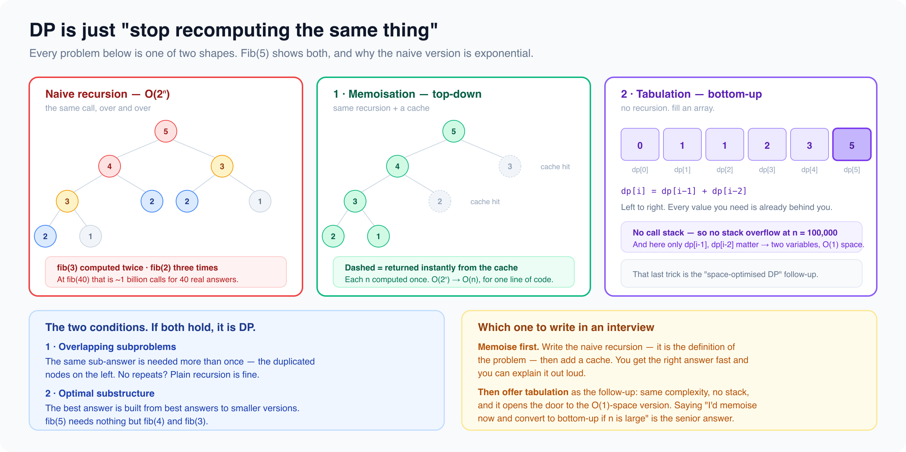
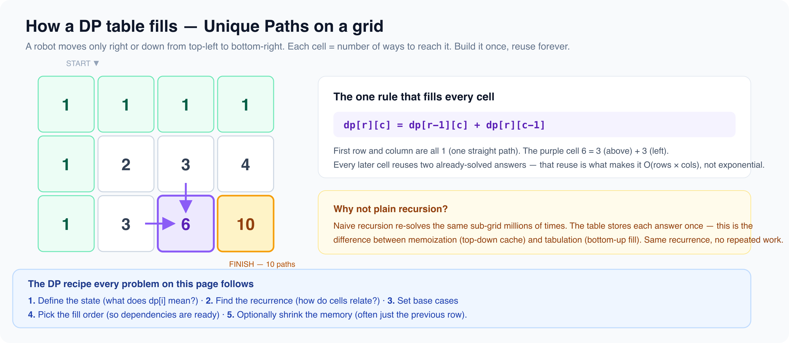

# Dynamic programming

*11 min read · Updated 16 Jul 2026 Topic 63 of 77 Bookmark Mark done 23F · Topic 63 of 77*

**Source:** [https://www.geekyfrontend.in/learn/complete-frontend-kit/dynamic-programming](https://www.geekyfrontend.in/learn/complete-frontend-kit/dynamic-programming)

---

# 23F. Dynamic Programming (25 problems)

**Pattern recognition:** "How many ways...", "Minimum/maximum cost...", "Can you reach...", overlapping subproblems + optimal substructure.

**DP approach:** 1. Define state 2. Find recurrence 3. Base case 4. Iteration order 5. Optimize space

---



## 23.56 Fibonacci

**Approach:** Bottom-up with two rolling variables where fib(i) = fib(i-1) + fib(i-2).

javascript

```
function fib(n) {
  if (n < 2) return n;
  let prev2 = 0, prev1 = 1;
  for (let i = 2; i <= n; i++) {
    [prev2, prev1] = [prev1, prev2 + prev1];
  }
  return prev1;
}
```

## 23.57 Climbing Stairs

**Approach:** Count ways to reach step i where dp[i] = dp[i-1] + dp[i-2], rolled into two variables.

javascript

```
function climbStairs(n) {
  if (n <= 2) return n;
  let prev2 = 1, prev1 = 2;
  for (let i = 3; i <= n; i++) {
    [prev2, prev1] = [prev1, prev1 + prev2];
  }
  return prev1;
}
```

## 23.58 Coin Change (Min coins)

javascript

```
function coinChange(coins, amount) {
  const dp = Array(amount + 1).fill(Infinity);
  dp[0] = 0;
  for (let i = 1; i <= amount; i++)
    for (const coin of coins)
      if (coin <= i) dp[i] = Math.min(dp[i], dp[i - coin] + 1);
  return dp[amount] === Infinity ? -1 : dp[amount];
}
```

## 23.59 Coin Change II (Count combinations)

javascript

```
function change(amount, coins) {
  const dp = Array(amount + 1).fill(0);
  dp[0] = 1;
  for (const coin of coins)
    for (let i = coin; i <= amount; i++) dp[i] += dp[i - coin];
  return dp[amount];
}
```

## 23.60 Longest Common Subsequence

javascript

```
function lcs(text1, text2) {
  const m = text1.length, n = text2.length;
  const dp = Array.from({ length: m + 1 }, () => Array(n + 1).fill(0));
  for (let i = 1; i <= m; i++)
    for (let j = 1; j <= n; j++)
      dp[i][j] = text1[i-1] === text2[j-1] ? dp[i-1][j-1] + 1 : Math.max(dp[i-1][j], dp[i][j-1]);
  return dp[m][n];
}
```

## 23.61 Longest Increasing Subsequence — O(n log n) with binary search on tails.

javascript

```
function lengthOfLIS(nums) {
  const tails = [];
  for (const num of nums) {
    let lo = 0, hi = tails.length;
    while (lo < hi) { const mid = (lo + hi) >> 1; if (tails[mid] < num) lo = mid + 1; else hi = mid; }
    tails[lo] = num;
  }
  return tails.length;
}
```

## 23.62 0/1 Knapsack

javascript

```
function knapsack(weights, values, capacity) {
  const dp = Array(capacity + 1).fill(0);
  for (let i = 0; i < weights.length; i++)
    for (let w = capacity; w >= weights[i]; w--)
      dp[w] = Math.max(dp[w], dp[w - weights[i]] + values[i]);
  return dp[capacity];
}
```

## 23.63 Unbounded Knapsack

**Approach:** dp[c] = best value for capacity c, iterating capacity forward so each item can be reused: dp[c] = max(dp[c], dp[c-w[i]] + v[i]).

javascript

```
function unboundedKnapsack(capacity, weights, values) {
  const dp = new Array(capacity + 1).fill(0);
  for (let c = 1; c <= capacity; c++) {
    for (let i = 0; i < weights.length; i++) {
      if (weights[i] <= c) {
        dp[c] = Math.max(dp[c], dp[c - weights[i]] + values[i]);
      }
    }
  }
  return dp[capacity];
}
```

## 23.64 Edit Distance

javascript

```
function minDistance(word1, word2) {
  const m = word1.length, n = word2.length;
  const dp = Array.from({ length: m + 1 }, (_, i) => Array.from({ length: n + 1 }, (_, j) => i === 0 ? j : j === 0 ? i : 0));
  for (let i = 1; i <= m; i++)
    for (let j = 1; j <= n; j++)
      dp[i][j] = word1[i-1] === word2[j-1] ? dp[i-1][j-1] : 1 + Math.min(dp[i-1][j], dp[i][j-1], dp[i-1][j-1]);
  return dp[m][n];
}
```

**Frontend connection:** Powers fuzzy search / "did you mean?" suggestions.

## 23.65 Word Break

javascript

```
function wordBreak(s, wordDict) {
  const set = new Set(wordDict), dp = Array(s.length + 1).fill(false);
  dp[0] = true;
  for (let i = 1; i <= s.length; i++)
    for (let j = 0; j < i; j++)
      if (dp[j] && set.has(s.substring(j, i))) { dp[i] = true; break; }
  return dp[s.length];
}
```

## 23.66 House Robber

**Approach:** dp[i] = max loot up to house i = max(dp[i-1], dp[i-2] + nums[i]), rolled into two variables.

javascript

```
function rob(nums) {
  let prev2 = 0, prev1 = 0;
  for (const n of nums) {
    [prev2, prev1] = [prev1, Math.max(prev1, prev2 + n)];
  }
  return prev1;
}
```

## 23.67 House Robber II (circular)

**Approach:** Houses are circular, so run the linear House Robber twice — once excluding the first house, once excluding the last — and take the max.

javascript

```
function rob(nums) {
  if (nums.length === 1) return nums[0];
  const robLine = (arr) => {
    let prev2 = 0, prev1 = 0;
    for (const n of arr) {
      [prev2, prev1] = [prev1, Math.max(prev1, prev2 + n)];
    }
    return prev1;
  };
  return Math.max(robLine(nums.slice(1)), robLine(nums.slice(0, -1)));
}
```

## 23.68 Decode Ways

**Approach:** dp[i] = number of decodings of s[0..i], adding dp[i-1] if the single digit is 1-9 and dp[i-2] if the two-digit number is 10-26.

javascript

```
function numDecodings(s) {
  if (s[0] === '0') return 0;
  let prev2 = 1, prev1 = 1;
  for (let i = 1; i < s.length; i++) {
    let cur = 0;
    if (s[i] !== '0') cur += prev1;
    const two = Number(s.slice(i - 1, i + 1));
    if (two >= 10 && two <= 26) cur += prev2;
    [prev2, prev1] = [prev1, cur];
  }
  return prev1;
}
```

## 23.69 Unique Paths

**Approach:** dp[c] = number of paths to reach column c in the current row = dp[c] (from above) + dp[c-1] (from left), using a single rolling row.

javascript

```
function uniquePaths(m, n) {
  const dp = new Array(n).fill(1);
  for (let r = 1; r < m; r++) {
    for (let c = 1; c < n; c++) {
      dp[c] += dp[c - 1];
    }
  }
  return dp[n - 1];
}
```

## 23.70 Unique Paths II (obstacles)

**Approach:** Same rolling-row path count as Unique Paths, but dp[c] is forced to 0 wherever the grid cell is an obstacle.

javascript

```
function uniquePathsWithObstacles(grid) {
  const n = grid[0].length;
  const dp = new Array(n).fill(0);
  dp[0] = 1;
  for (let r = 0; r < grid.length; r++) {
    for (let c = 0; c < n; c++) {
      if (grid[r][c] === 1) dp[c] = 0;
      else if (c > 0) dp[c] += dp[c - 1];
    }
  }
  return dp[n - 1];
}
```

## 23.71 Minimum Path Sum

**Approach:** dp[c] = cheapest cost to reach cell (r,c) = grid[r][c] + min(dp[c] from above, dp[c-1] from left), using a single rolling row.

javascript

```
function minPathSum(grid) {
  const m = grid.length, n = grid[0].length;
  const dp = new Array(n).fill(Infinity);
  dp[0] = 0;
  for (let r = 0; r < m; r++) {
    for (let c = 0; c < n; c++) {
      const left = c > 0 ? dp[c - 1] : Infinity;
      dp[c] = grid[r][c] + Math.min(dp[c], left);
    }
  }
  return dp[n - 1];
}
```

## 23.72 Longest Palindromic Substring

javascript

```
function longestPalindrome(s) {
  let start = 0, maxLen = 1;
  function expand(l, r) {
    while (l >= 0 && r < s.length && s[l] === s[r]) { l--; r++; }
    if (r - l - 1 > maxLen) { start = l + 1; maxLen = r - l - 1; }
  }
  for (let i = 0; i < s.length; i++) { expand(i, i); expand(i, i + 1); }
  return s.substring(start, start + maxLen);
}
```

## 23.73 Palindromic Substrings (Count)

**Approach:** Expand around each of the 2n-1 centers (odd and even), counting every palindrome found as the window stays symmetric.

javascript

```
function countSubstrings(s) {
  let count = 0;
  const expand = (l, r) => {
    while (l >= 0 && r < s.length && s[l] === s[r]) { count++; l--; r++; }
  };
  for (let i = 0; i < s.length; i++) {
    expand(i, i);
    expand(i, i + 1);
  }
  return count;
}
```

## 23.74 Partition Equal Subset Sum

**Approach:** 0/1 subset-sum knapsack: dp[s] = can we form sum s, iterating capacity backward, answering whether target = totalSum/2 is reachable.

javascript

```
function canPartition(nums) {
  const sum = nums.reduce((a, b) => a + b, 0);
  if (sum % 2 !== 0) return false;
  const target = sum / 2;
  const dp = new Array(target + 1).fill(false);
  dp[0] = true;
  for (const n of nums) {
    for (let s = target; s >= n; s--) {
      dp[s] = dp[s] || dp[s - n];
    }
  }
  return dp[target];
}
```

## 23.75 Target Sum

**Approach:** Transform +/- assignment into a subset-sum: find subsets summing to (total+target)/2, with dp[j] = number of ways to reach sum j via 0/1 knapsack counting.

javascript

```
function findTargetSumWays(nums, target) {
  const sum = nums.reduce((a, b) => a + b, 0);
  if (Math.abs(target) > sum || (sum + target) % 2 !== 0) return 0;
  const s = (sum + target) / 2;
  const dp = new Array(s + 1).fill(0);
  dp[0] = 1;
  for (const n of nums) {
    for (let j = s; j >= n; j--) {
      dp[j] += dp[j - n];
    }
  }
  return dp[s];
}
```

## 23.76 Maximal Square

**Approach:** dp[i][j] = side of the largest all-1 square ending at (i,j) = min(left, above, diagonal) + 1 when the cell is '1'; answer is max side squared.

javascript

```
function maximalSquare(matrix) {
  const m = matrix.length, n = matrix[0].length;
  const dp = new Array(n + 1).fill(0);
  let best = 0, prevDiag = 0;
  for (let r = 1; r <= m; r++) {
    prevDiag = 0;
    for (let c = 1; c <= n; c++) {
      const temp = dp[c];
      if (matrix[r - 1][c - 1] === '1') {
        dp[c] = Math.min(dp[c], dp[c - 1], prevDiag) + 1;
        best = Math.max(best, dp[c]);
      } else {
        dp[c] = 0;
      }
      prevDiag = temp;
    }
  }
  return best * best;
}
```

## 23.77 Best Buy/Sell Stock — track minPrice, maxProfit = current - min.

javascript

```
function maxProfit(prices) {
  let minPrice = Infinity, maxProfit = 0;
  for (const p of prices) { minPrice = Math.min(minPrice, p); maxProfit = Math.max(maxProfit, p - minPrice); }
  return maxProfit;
}
```

## 23.78 Stock with Cooldown

**Approach:** Three rolling states — hold (own a share), sold (just sold, must cooldown), rest (idle) — transitioning each day: sold=hold+p, hold=max(hold, rest-p), rest=max(rest, prevSold).

javascript

```
function maxProfit(prices) {
  let hold = -Infinity, sold = 0, rest = 0;
  for (const p of prices) {
    const prevSold = sold;
    sold = hold + p;
    hold = Math.max(hold, rest - p);
    rest = Math.max(rest, prevSold);
  }
  return Math.max(sold, rest);
}
```

## 23.79 Interleaving String

**Approach:** dp[i][j] = whether s1[0..i] and s2[0..j] interleave to form s3[0..i+j], reachable from the left (s2 char) or above (s1 char); collapsed to a rolling 1D row.

javascript

```
function isInterleave(s1, s2, s3) {
  const m = s1.length, n = s2.length;
  if (m + n !== s3.length) return false;
  const dp = new Array(n + 1).fill(false);
  dp[0] = true;
  for (let j = 1; j <= n; j++) dp[j] = dp[j - 1] && s2[j - 1] === s3[j - 1];
  for (let i = 1; i <= m; i++) {
    dp[0] = dp[0] && s1[i - 1] === s3[i - 1];
    for (let j = 1; j <= n; j++) {
      dp[j] = (dp[j] && s1[i - 1] === s3[i + j - 1]) ||
              (dp[j - 1] && s2[j - 1] === s3[i + j - 1]);
    }
  }
  return dp[n];
}
```

## 23.80 Regular Expression Matching

**Approach:** dp[i][j] = whether s[0..i] matches p[0..j]; '.' matches any char, and '\*' either drops the pair (dp[i][j-2]) or consumes a matching char (dp[i-1][j]).

javascript

```
function isMatch(s, p) {
  const m = s.length, n = p.length;
  const dp = Array.from({ length: m + 1 }, () => new Array(n + 1).fill(false));
  dp[0][0] = true;
  for (let j = 1; j <= n; j++) {
    if (p[j - 1] === '*') dp[0][j] = dp[0][j - 2];
  }
  for (let i = 1; i <= m; i++) {
    for (let j = 1; j <= n; j++) {
      if (p[j - 1] === '*') {
        dp[i][j] = dp[i][j - 2];
        if (p[j - 2] === '.' || p[j - 2] === s[i - 1]) {
          dp[i][j] = dp[i][j] || dp[i - 1][j];
        }
      } else if (p[j - 1] === '.' || p[j - 1] === s[i - 1]) {
        dp[i][j] = dp[i - 1][j - 1];
      }
    }
  }
  return dp[m][n];
}
```

**Pattern recognition:** "How many ways...", "Minimum/maximum cost...", "Can you reach...", overlapping subproblems + optimal substructure.

**DP approach:** 1. Define state 2. Find recurrence 3. Base case 4. Iteration order 5. Optimize space

---

## Learn More

- [Dynamic programming (GeeksforGeeks) geeksforgeeks.org](https://www.geeksforgeeks.org/dynamic-programming/)
- [Dynamic programming — freeCodeCamp YouTube](https://www.youtube.com/watch?v=oBt53YbR9Kk)
- [DP with animations — full course YouTube](https://www.youtube.com/watch?v=66hDgWottdA)
- [Dynamic programming — introduction YouTube](https://www.youtube.com/watch?v=nqowUJzG-iM)
