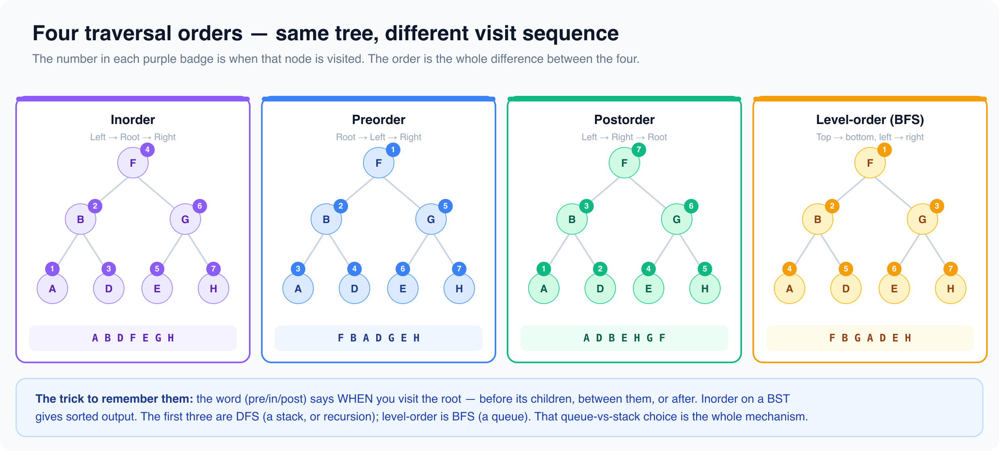

# Trees

*5 min read · Updated 16 Jul 2026 Topic 65 of 77 Bookmark Mark done 23H · Topic 65 of 77*

**Source:** [https://www.geekyfrontend.in/learn/complete-frontend-kit/trees](https://www.geekyfrontend.in/learn/complete-frontend-kit/trees)

---

# 23H. Tree Algorithms (20 problems)

**Pattern recognition:** Hierarchical data, parent-child, DOM-like structures.

---



## 23.91 Inorder Traversal (Iterative)

javascript

```
function inorderTraversal(root) {
  const result = [], stack = [];
  let current = root;
  while (current || stack.length) {
    while (current) { stack.push(current); current = current.left; }
    current = stack.pop();
    result.push(current.val);
    current = current.right;
  }
  return result;
}
```

## 23.92 Preorder Traversal

**Approach:** Iterative traversal using an explicit stack: pop a node, record it, then push its right child before its left so the left is processed first.

javascript

```
function preorderTraversal(root){
  const res=[], stack=[]; if(root) stack.push(root);
  while(stack.length){
    const node=stack.pop(); res.push(node.val);
    if(node.right) stack.push(node.right);
    if(node.left) stack.push(node.left);
  }
  return res;
}
```

## 23.93 Postorder Traversal

**Approach:** Run a modified preorder (root, right, left) with a stack and unshift each value to the front, producing left-right-root order in reverse.

javascript

```
function postorderTraversal(root){
  const res=[], stack=[]; if(root) stack.push(root);
  while(stack.length){
    const node=stack.pop(); res.unshift(node.val);
    if(node.left) stack.push(node.left);
    if(node.right) stack.push(node.right);
  }
  return res;
}
```

## 23.94 Level-Order (BFS)

javascript

```
function levelOrder(root) {
  if (!root) return [];
  const result = [], queue = [root];
  while (queue.length) {
    const level = [], size = queue.length;
    for (let i = 0; i < size; i++) {
      const node = queue.shift();
      level.push(node.val);
      if (node.left) queue.push(node.left);
      if (node.right) queue.push(node.right);
    }
    result.push(level);
  }
  return result;
}
```

## 23.95 Maximum Depth

javascript

```
function maxDepth(root) {
  if (!root) return 0;
  return 1 + Math.max(maxDepth(root.left), maxDepth(root.right));
}
```

## 23.96 Same Tree

**Approach:** Recursively compare nodes: both null is equal, one null or differing values is unequal, otherwise recurse on matching left and right subtrees.

javascript

```
function isSameTree(p,q){
  if(!p&&!q) return true;
  if(!p||!q||p.val!==q.val) return false;
  return isSameTree(p.left,q.left)&&isSameTree(p.right,q.right);
}
```

## 23.97 Symmetric Tree

**Approach:** Mirror-compare the two subtrees, pairing each left child against the opposite right child, so a node is symmetric when its outer and inner reflections match.

javascript

```
function isSymmetric(root){
  const mirror=(a,b)=>{
    if(!a&&!b) return true;
    if(!a||!b||a.val!==b.val) return false;
    return mirror(a.left,b.right)&&mirror(a.right,b.left);
  };
  return !root||mirror(root.left,root.right);
}
```

## 23.98 Invert Binary Tree

javascript

```
function invertTree(root) {
  if (!root) return null;
  [root.left, root.right] = [invertTree(root.right), invertTree(root.left)];
  return root;
}
```

## 23.99 Lowest Common Ancestor

javascript

```
function lowestCommonAncestor(root, p, q) {
  if (!root || root === p || root === q) return root;
  const left = lowestCommonAncestor(root.left, p, q);
  const right = lowestCommonAncestor(root.right, p, q);
  if (left && right) return root;
  return left || right;
}
```

## 23.100 Validate BST

javascript

```
function isValidBST(root, min = -Infinity, max = Infinity) {
  if (!root) return true;
  if (root.val <= min || root.val >= max) return false;
  return isValidBST(root.left, min, root.val) && isValidBST(root.right, root.val, max);
}
```

## 23.101 Kth Smallest in BST

**Approach:** Iterative inorder traversal with a stack visits nodes in ascending order; return the value on the kth pop.

javascript

```
function kthSmallest(root,k){
  const stack=[]; let node=root;
  while(node||stack.length){
    while(node){ stack.push(node); node=node.left; }
    node=stack.pop();
    if(--k===0) return node.val;
    node=node.right;
  }
  return -1;
}
```

## 23.102 Binary Tree Right Side View

**Approach:** Level-order BFS by full levels, recording the last node of each level as the value visible from the right.

javascript

```
function rightSideView(root){
  const res=[]; if(!root) return res;
  let queue=[root];
  while(queue.length){
    res.push(queue[queue.length-1].val);
    const next=[];
    for(const n of queue){ if(n.left) next.push(n.left); if(n.right) next.push(n.right); }
    queue=next;
  }
  return res;
}
```

## 23.103 Path Sum

**Approach:** Recurse down subtracting each node's value from the target; succeed when a leaf is reached with the remaining amount exactly equal to that leaf's value.

javascript

```
function hasPathSum(root,target){
  if(!root) return false;
  if(!root.left&&!root.right) return target===root.val;
  return hasPathSum(root.left,target-root.val)||hasPathSum(root.right,target-root.val);
}
```

## 23.104 Path Sum II

**Approach:** DFS while maintaining the current root-to-node path and running remainder, recording a copy of the path whenever a leaf reduces the remainder to zero, then backtrack.

javascript

```
function pathSum(root,target){
  const res=[], path=[];
  const dfs=(node,rem)=>{
    if(!node) return;
    path.push(node.val); rem-=node.val;
    if(!node.left&&!node.right&&rem===0) res.push([...path]);
    else { dfs(node.left,rem); dfs(node.right,rem); }
    path.pop();
  };
  dfs(root,target);
  return res;
}
```

## 23.105 Diameter of Binary Tree

**Approach:** Compute each node's height recursively while tracking the global maximum of left height plus right height, which is the longest path in edges through any node.

javascript

```
function diameterOfBinaryTree(root){
  let best=0;
  const height=node=>{
    if(!node) return 0;
    const l=height(node.left), r=height(node.right);
    best=Math.max(best,l+r);
    return 1+Math.max(l,r);
  };
  height(root);
  return best;
}
```

## 23.106 Flatten Binary Tree to Linked List

**Approach:** Morris-style in-place rewiring: for each node with a left subtree, splice that subtree between the node and its right child by attaching the old right to the left subtree's rightmost node.

javascript

```
function flatten(root){
  let curr=root;
  while(curr){
    if(curr.left){
      let prev=curr.left;
      while(prev.right) prev=prev.right;
      prev.right=curr.right;
      curr.right=curr.left;
      curr.left=null;
    }
    curr=curr.right;
  }
}
```

## 23.107 Construct from Preorder and Inorder

**Approach:** Consume preorder left-to-right for roots and use an index map of inorder positions to split each range into left and right subtrees in O(n).

javascript

```
function buildTree(preorder,inorder){
  const idx=new Map();
  inorder.forEach((v,i)=>idx.set(v,i));
  let pre=0;
  const build=(lo,hi)=>{
    if(lo>hi) return null;
    const val=preorder[pre++];
    const node={val,left:null,right:null};
    const mid=idx.get(val);
    node.left=build(lo,mid-1);
    node.right=build(mid+1,hi);
    return node;
  };
  return build(0,inorder.length-1);
}
```

## 23.108 Serialize and Deserialize

javascript

```
function serialize(root) {
  if (!root) return 'null';
  return `${root.val},${serialize(root.left)},${serialize(root.right)}`;
}
function deserialize(data) {
  const vals = data.split(',');
  let i = 0;
  function build() {
    if (vals[i] === 'null') { i++; return null; }
    const node = new TreeNode(Number(vals[i++]));
    node.left = build(); node.right = build();
    return node;
  }
  return build();
}
```

## 23.109 Binary Tree Maximum Path Sum

**Approach:** For each node compute the best downward gain from each child (clamped at zero) and update a global max with node value plus both gains, while returning value plus the single larger gain to the parent.

javascript

```
function maxPathSum(root){
  let best=-Infinity;
  const gain=node=>{
    if(!node) return 0;
    const l=Math.max(0,gain(node.left));
    const r=Math.max(0,gain(node.right));
    best=Math.max(best,node.val+l+r);
    return node.val+Math.max(l,r);
  };
  gain(root);
  return best;
}
```

## 23.110 Count Complete Tree Nodes

**Approach:** Measure leftmost and rightmost spine depths; if equal the subtree is perfect so return 2^h - 1, otherwise recurse on both children, giving O(log^2 n).

javascript

```
function countNodes(root){
  if(!root) return 0;
  const leftH=n=>{ let h=0; while(n){h++;n=n.left;} return h; };
  const rightH=n=>{ let h=0; while(n){h++;n=n.right;} return h; };
  const l=leftH(root), r=rightH(root);
  if(l===r) return (1<<l)-1;
  return 1+countNodes(root.left)+countNodes(root.right);
}
```

---

## Learn More

- [Binary search tree (VisuAlgo) visualgo.net](https://visualgo.net/en/bst)
- [Binary tree traversals YouTube](https://www.youtube.com/watch?v=-b2lciNd2L4)
- [Intro to binary trees & traversal YouTube](https://www.youtube.com/watch?v=sLbklMIQYKw)
- [Tree traversal algorithms YouTube](https://www.youtube.com/watch?v=A7XEINOLEdM)
