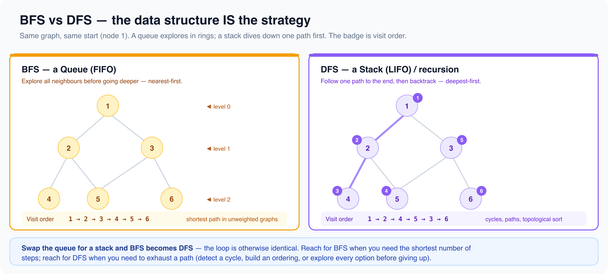

# Graphs

*12 min read · Updated 16 Jul 2026 Topic 66 of 77 Bookmark Mark done 23I · Topic 66 of 77*

**Source:** [https://www.geekyfrontend.in/learn/complete-frontend-kit/graphs](https://www.geekyfrontend.in/learn/complete-frontend-kit/graphs)

---

# 23I. Graph Algorithms (20 problems)

**Pattern recognition:** Connections, dependencies, paths, islands, shortest route.

---



## 23.111 BFS on Grid (Rotten Oranges)

javascript

```
function orangesRotting(grid) {
  const rows = grid.length, cols = grid[0].length;
  const queue = [];
  let fresh = 0;
  for (let r = 0; r < rows; r++)
    for (let c = 0; c < cols; c++) {
      if (grid[r][c] === 2) queue.push([r, c]);
      if (grid[r][c] === 1) fresh++;
    }
  let minutes = 0;
  const dirs = [[1,0],[-1,0],[0,1],[0,-1]];
  while (queue.length && fresh > 0) {
    const size = queue.length;
    for (let i = 0; i < size; i++) {
      const [r, c] = queue.shift();
      for (const [dr, dc] of dirs) {
        const nr = r+dr, nc = c+dc;
        if (nr>=0 && nr<rows && nc>=0 && nc<cols && grid[nr][nc]===1) {
          grid[nr][nc] = 2; fresh--; queue.push([nr, nc]);
        }
      }
    }
    minutes++;
  }
  return fresh === 0 ? minutes : -1;
}
```

## 23.112 Number of Islands

javascript

```
function numIslands(grid) {
  let count = 0;
  for (let r = 0; r < grid.length; r++)
    for (let c = 0; c < grid[0].length; c++)
      if (grid[r][c] === '1') { count++; dfs(grid, r, c); }
  return count;
}
function dfs(grid, r, c) {
  if (r<0||r>=grid.length||c<0||c>=grid[0].length||grid[r][c]!=='1') return;
  grid[r][c] = '0';
  dfs(grid,r+1,c); dfs(grid,r-1,c); dfs(grid,r,c+1); dfs(grid,r,c-1);
}
```

## 23.113 Clone Graph

**Approach:** DFS with a Map from each original node to its clone so shared nodes and cycles are copied once.

javascript

```
function cloneGraph(node) {
  if (!node) return null;
  const map = new Map();
  const dfs = (n) => {
    if (map.has(n)) return map.get(n);
    const copy = { val: n.val, neighbors: [] };
    map.set(n, copy);
    for (const nb of n.neighbors) copy.neighbors.push(dfs(nb));
    return copy;
  };
  return dfs(node);
}
```

## 23.114 Topological Sort (Course Schedule)

javascript

```
function canFinish(numCourses, prerequisites) {
  const graph = Array.from({ length: numCourses }, () => []);
  const inDegree = Array(numCourses).fill(0);
  for (const [c, p] of prerequisites) { graph[p].push(c); inDegree[c]++; }
  const queue = [];
  for (let i = 0; i < numCourses; i++) if (inDegree[i] === 0) queue.push(i);
  let processed = 0;
  while (queue.length) {
    const node = queue.shift(); processed++;
    for (const nb of graph[node]) { inDegree[nb]--; if (inDegree[nb]===0) queue.push(nb); }
  }
  return processed === numCourses;
}
```

**Frontend connection:** Determines build order in bundlers.

## 23.115 Course Schedule II

**Approach:** Kahn's topological sort: repeatedly take zero in-degree courses; return the order only if all courses are processed.

javascript

```
function findOrder(numCourses, prerequisites) {
  const adj = Array.from({ length: numCourses }, () => []);
  const indeg = new Array(numCourses).fill(0);
  for (const [c, p] of prerequisites) { adj[p].push(c); indeg[c]++; }
  const queue = [];
  for (let i = 0; i < numCourses; i++) if (indeg[i] === 0) queue.push(i);
  const order = [];
  while (queue.length) {
    const cur = queue.shift();
    order.push(cur);
    for (const nx of adj[cur]) if (--indeg[nx] === 0) queue.push(nx);
  }
  return order.length === numCourses ? order : [];
}
```

## 23.116 Dijkstra's Shortest Path

javascript

```
function dijkstra(graph, start) {
  const dist = new Map();
  const pq = [[0, start]];
  while (pq.length) {
    pq.sort((a, b) => a[0] - b[0]);
    const [d, u] = pq.shift();
    if (dist.has(u)) continue;
    dist.set(u, d);
    for (const [v, w] of graph.get(u) || []) {
      if (!dist.has(v)) pq.push([d + w, v]);
    }
  }
  return dist;
}
```

## 23.117 Word Ladder

**Approach:** Level-order BFS from beginWord, mutating one letter at a time and consuming matches from the word set to avoid revisits.

javascript

```
function ladderLength(beginWord, endWord, wordList) {
  const words = new Set(wordList);
  if (!words.has(endWord)) return 0;
  let queue = [beginWord];
  let steps = 1;
  while (queue.length) {
    const next = [];
    for (const word of queue) {
      if (word === endWord) return steps;
      for (let i = 0; i < word.length; i++) {
        for (let c = 97; c <= 122; c++) {
          const cand = word.slice(0, i) + String.fromCharCode(c) + word.slice(i + 1);
          if (words.has(cand)) { words.delete(cand); next.push(cand); }
        }
      }
    }
    queue = next;
    steps++;
  }
  return 0;
}
```

## 23.118 Pacific Atlantic Water Flow

**Approach:** DFS inward from each ocean's border cells (moving only to equal-or-higher neighbours); answer is cells reachable from both.

javascript

```
function pacificAtlantic(heights) {
  if (!heights.length) return [];
  const rows = heights.length, cols = heights[0].length;
  const pac = Array.from({ length: rows }, () => new Array(cols).fill(false));
  const atl = Array.from({ length: rows }, () => new Array(cols).fill(false));
  const dfs = (r, c, seen, prev) => {
    if (r < 0 || c < 0 || r >= rows || c >= cols || seen[r][c] || heights[r][c] < prev) return;
    seen[r][c] = true;
    dfs(r + 1, c, seen, heights[r][c]);
    dfs(r - 1, c, seen, heights[r][c]);
    dfs(r, c + 1, seen, heights[r][c]);
    dfs(r, c - 1, seen, heights[r][c]);
  };
  for (let r = 0; r < rows; r++) { dfs(r, 0, pac, -Infinity); dfs(r, cols - 1, atl, -Infinity); }
  for (let c = 0; c < cols; c++) { dfs(0, c, pac, -Infinity); dfs(rows - 1, c, atl, -Infinity); }
  const res = [];
  for (let r = 0; r < rows; r++)
    for (let c = 0; c < cols; c++)
      if (pac[r][c] && atl[r][c]) res.push([r, c]);
  return res;
}
```

## 23.119 Surrounded Regions

**Approach:** DFS-mark every 'O' connected to a border as safe, then flip unmarked 'O's to 'X' and restore the marked ones.

javascript

```
function solve(board) {
  if (!board.length) return board;
  const rows = board.length, cols = board[0].length;
  const dfs = (r, c) => {
    if (r < 0 || c < 0 || r >= rows || c >= cols || board[r][c] !== 'O') return;
    board[r][c] = '#';
    dfs(r + 1, c); dfs(r - 1, c); dfs(r, c + 1); dfs(r, c - 1);
  };
  for (let r = 0; r < rows; r++) { dfs(r, 0); dfs(r, cols - 1); }
  for (let c = 0; c < cols; c++) { dfs(0, c); dfs(rows - 1, c); }
  for (let r = 0; r < rows; r++)
    for (let c = 0; c < cols; c++)
      board[r][c] = board[r][c] === '#' ? 'O' : 'X';
  return board;
}
```

## 23.120 Graph Valid Tree

**Approach:** A tree needs exactly n-1 edges and no cycle; union-find each edge and reject if two endpoints already share a root.

javascript

```
function validTree(n, edges) {
  if (edges.length !== n - 1) return false;
  const parent = Array.from({ length: n }, (_, i) => i);
  const find = (x) => { while (parent[x] !== x) { parent[x] = parent[parent[x]]; x = parent[x]; } return x; };
  for (const [a, b] of edges) {
    const ra = find(a), rb = find(b);
    if (ra === rb) return false;
    parent[ra] = rb;
  }
  return true;
}
```

## 23.121 Number of Connected Components

**Approach:** Build an adjacency list and run a DFS from each unvisited node, counting one component per launch.

javascript

```
function countComponents(n, edges) {
  const adj = Array.from({ length: n }, () => []);
  for (const [a, b] of edges) { adj[a].push(b); adj[b].push(a); }
  const seen = new Array(n).fill(false);
  let count = 0;
  const dfs = (u) => { seen[u] = true; for (const v of adj[u]) if (!seen[v]) dfs(v); };
  for (let i = 0; i < n; i++) if (!seen[i]) { count++; dfs(i); }
  return count;
}
```

## 23.122 Shortest Path in Binary Matrix

**Approach:** Level-order BFS over 8-directional moves through 0-cells, marking visited in place; return the level when reaching the corner.

javascript

```
function shortestPathBinaryMatrix(grid) {
  const n = grid.length;
  if (grid[0][0] === 1 || grid[n - 1][n - 1] === 1) return -1;
  const dirs = [[1,0],[-1,0],[0,1],[0,-1],[1,1],[1,-1],[-1,1],[-1,-1]];
  let queue = [[0, 0]];
  grid[0][0] = 1;
  let dist = 1;
  while (queue.length) {
    const next = [];
    for (const [r, c] of queue) {
      if (r === n - 1 && c === n - 1) return dist;
      for (const [dr, dc] of dirs) {
        const nr = r + dr, nc = c + dc;
        if (nr >= 0 && nc >= 0 && nr < n && nc < n && grid[nr][nc] === 0) {
          grid[nr][nc] = 1;
          next.push([nr, nc]);
        }
      }
    }
    queue = next;
    dist++;
  }
  return -1;
}
```

## 23.123 Network Delay Time

**Approach:** Dijkstra from source k with a sorted-array priority queue; answer is the largest shortest-distance, or -1 if any node is unreachable.

javascript

```
function networkDelayTime(times, n, k) {
  const adj = Array.from({ length: n + 1 }, () => []);
  for (const [u, v, w] of times) adj[u].push([v, w]);
  const dist = new Array(n + 1).fill(Infinity);
  dist[k] = 0;
  const pq = [[0, k]];
  while (pq.length) {
    pq.sort((a, b) => b[0] - a[0]);
    const [d, u] = pq.pop();
    if (d > dist[u]) continue;
    for (const [v, w] of adj[u]) {
      if (d + w < dist[v]) { dist[v] = d + w; pq.push([dist[v], v]); }
    }
  }
  let max = 0;
  for (let i = 1; i <= n; i++) max = Math.max(max, dist[i]);
  return max === Infinity ? -1 : max;
}
```

## 23.124 Cheapest Flights Within K Stops

**Approach:** Bellman-Ford relaxed exactly k+1 times, reading distances from a snapshot each round so a path can't use more than k stops.

javascript

```
function findCheapestPrice(n, flights, src, dst, k) {
  let dist = new Array(n).fill(Infinity);
  dist[src] = 0;
  for (let i = 0; i <= k; i++) {
    const tmp = dist.slice();
    for (const [u, v, w] of flights) {
      if (dist[u] !== Infinity && dist[u] + w < tmp[v]) tmp[v] = dist[u] + w;
    }
    dist = tmp;
  }
  return dist[dst] === Infinity ? -1 : dist[dst];
}
```

## 23.125 Is Graph Bipartite?

**Approach:** BFS two-coloring from every unvisited node; conflict when a neighbour already carries the same color means not bipartite.

javascript

```
function isBipartite(graph) {
  const n = graph.length;
  const color = new Array(n).fill(0);
  for (let i = 0; i < n; i++) {
    if (color[i] !== 0) continue;
    const queue = [i];
    color[i] = 1;
    while (queue.length) {
      const u = queue.shift();
      for (const v of graph[u]) {
        if (color[v] === 0) { color[v] = -color[u]; queue.push(v); }
        else if (color[v] === color[u]) return false;
      }
    }
  }
  return true;
}
```

## 23.126 Minimum Spanning Tree (Kruskal's)

**Approach:** Sort edges by weight and union-find them greedily, adding an edge only when it joins two separate components.

javascript

```
function minimumSpanningTree(n, edges) {
  const parent = Array.from({ length: n }, (_, i) => i);
  const find = (x) => { while (parent[x] !== x) { parent[x] = parent[parent[x]]; x = parent[x]; } return x; };
  edges.sort((a, b) => a[2] - b[2]);
  let total = 0, used = 0;
  for (const [a, b, w] of edges) {
    const ra = find(a), rb = find(b);
    if (ra !== rb) { parent[ra] = rb; total += w; used++; }
  }
  return used === n - 1 ? total : -1;
}
```

## 23.127 Alien Dictionary

**Approach:** Derive char-ordering edges from the first differing letter of each adjacent word pair, then topologically sort; empty string on any contradiction.

javascript

```
function alienOrder(words) {
  const adj = new Map();
  const indeg = new Map();
  for (const w of words) for (const ch of w) { adj.set(ch, new Set()); indeg.set(ch, 0); }
  for (let i = 0; i < words.length - 1; i++) {
    const a = words[i], b = words[i + 1];
    const len = Math.min(a.length, b.length);
    if (a.length > b.length && a.startsWith(b)) return '';
    for (let j = 0; j < len; j++) {
      if (a[j] !== b[j]) {
        if (!adj.get(a[j]).has(b[j])) { adj.get(a[j]).add(b[j]); indeg.set(b[j], indeg.get(b[j]) + 1); }
        break;
      }
    }
  }
  const queue = [];
  for (const [ch, d] of indeg) if (d === 0) queue.push(ch);
  let res = '';
  while (queue.length) {
    const ch = queue.shift();
    res += ch;
    for (const nx of adj.get(ch)) if (indeg.set(nx, indeg.get(nx) - 1).get(nx) === 0) queue.push(nx);
  }
  return res.length === indeg.size ? res : '';
}
```

## 23.128 Detect Cycle in Directed Graph

**Approach:** DFS with three states (unvisited, in-progress, done); hitting an in-progress node along the current path proves a back edge and cycle.

javascript

```
function hasCycle(n, edges) {
  const adj = Array.from({ length: n }, () => []);
  for (const [u, v] of edges) adj[u].push(v);
  const state = new Array(n).fill(0); // 0 unvisited, 1 in-progress, 2 done
  const dfs = (u) => {
    state[u] = 1;
    for (const v of adj[u]) {
      if (state[v] === 1) return true;
      if (state[v] === 0 && dfs(v)) return true;
    }
    state[u] = 2;
    return false;
  };
  for (let i = 0; i < n; i++) if (state[i] === 0 && dfs(i)) return true;
  return false;
}
```

## 23.129 Flood Fill

**Approach:** DFS from the start pixel recoloring every 4-directionally connected cell that shares the original color.

javascript

```
function floodFill(image, sr, sc, color) {
  const start = image[sr][sc];
  if (start === color) return image;
  const rows = image.length, cols = image[0].length;
  const dfs = (r, c) => {
    if (r < 0 || c < 0 || r >= rows || c >= cols || image[r][c] !== start) return;
    image[r][c] = color;
    dfs(r + 1, c); dfs(r - 1, c); dfs(r, c + 1); dfs(r, c - 1);
  };
  dfs(sr, sc);
  return image;
}
```

## 23.130 Evaluate Division

**Approach:** Model variables as a weighted graph (a/b and its reciprocal), then DFS each query multiplying edge weights along the path.

javascript

```
function calcEquation(equations, values, queries) {
  const adj = new Map();
  const add = (a, b, w) => { if (!adj.has(a)) adj.set(a, []); adj.get(a).push([b, w]); };
  equations.forEach(([a, b], i) => { add(a, b, values[i]); add(b, a, 1 / values[i]); });
  const query = (src, dst) => {
    if (!adj.has(src) || !adj.has(dst)) return -1;
    if (src === dst) return 1;
    const seen = new Set([src]);
    const stack = [[src, 1]];
    while (stack.length) {
      const [node, prod] = stack.pop();
      if (node === dst) return prod;
      for (const [nb, w] of adj.get(node)) {
        if (!seen.has(nb)) { seen.add(nb); stack.push([nb, prod * w]); }
      }
    }
    return -1;
  };
  return queries.map(([a, b]) => query(a, b));
}
```

---

## Learn More

- [Graph data structure (VisuAlgo) visualgo.net](https://visualgo.net/en/graphds)
- [BFS & DFS graph traversal explained YouTube](https://www.youtube.com/watch?v=D8ZS32wGs0s)
- [Graph traversals: BFS & DFS YouTube](https://www.youtube.com/watch?v=pcKY4hjDrxk)
- [Master graphs: representation + BFS/DFS YouTube](https://www.youtube.com/watch?v=yjyyDspl-0w)
