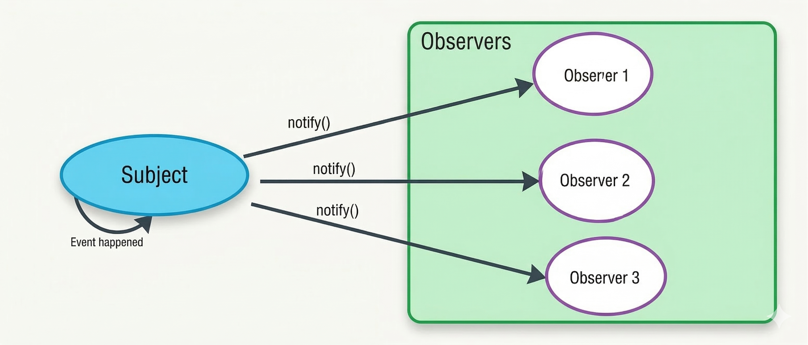
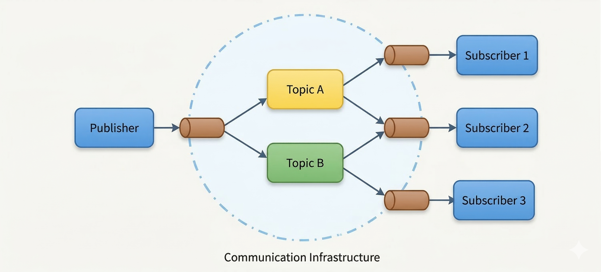

# JS and React Patterns and Solid Principles

*12 min read · Updated 13 Mar 2026 Topic 3 of 23 Bookmark Mark done JS and React Patterns and SOLID Principles The five SOLID principles S · Topic 3 of 23*

**Source:** [https://www.geekyfrontend.in/learn/javascript-interview-kit/js-and-react-patterns-and-solid-principles](https://www.geekyfrontend.in/learn/javascript-interview-kit/js-and-react-patterns-and-solid-principles)

---

# JS and React Patterns and SOLID Principles

The five SOLID principlesS — Single Responsibilityone reason to changeO — Open / Closedopen to extend, closed to modifyL — Liskov Substitutionsubtypes must be swappableI — Interface Segregationsmall, focused interfacesD — Dependency Inversiondepend on abstractions

*Five guidelines for code that stays flexible and testable as it grows.*

You can expect questions like **explain common design patterns and SOLID principles** in interviews.

Resources:

<https://javascriptpatterns.vercel.app/patterns>  
<https://www.patterns.dev/vanilla/observer-pattern>

---

# What are Design Patterns

Design patterns are **templates or solution schemes for solving common software development problems.**

Design patterns are divided into three categories:

1. Creational Patterns
2. Structural Patterns
3. Behavioral Patterns

---

# Creational Design Patterns

Creational patterns focus on **object creation mechanisms**.

They deal with the **process of object instantiation** and provide different ways to create objects.

Advantages:

- Hide the details of object creation
- Make the system independent of how objects are created
- Improve flexibility

Examples:

- Singleton Pattern
- Factory Pattern
- Prototype Pattern

---

# Structural Design Patterns

Structural design patterns focus on **how classes and objects can be composed to form larger structures**.

These patterns promote:

- Flexibility
- Maintainability
- Loose coupling
- Code reusability

Examples:

- Adapter Pattern
- Composite Pattern
- Proxy Pattern

---

# Behavioral Design Patterns

Behavioral patterns focus on **communication between objects** and how responsibilities are distributed.

They define how objects collaborate to complete tasks.

Examples:

- Observer Pattern
- Strategy Pattern
- Command Pattern

---

# Modular Pattern

Type: **Design Principle**

Purpose:

Break complex systems into **smaller self-contained modules**.

Benefits:

- Easier to understand
- Easier to maintain
- Easier to reuse

Usage:

Used across all stages of software development to promote:

- modularity
- encapsulation
- separation of concerns

These patterns play crucial roles in **software design and architecture**, helping developers address common challenges and promote maintainability, scalability, and flexibility in their applications.

---

# Singleton Pattern

Singleton — one shared instancenew Service()new Service()new Service()ONE instance(reused)

*Every request for the object returns the same cached instance — used for things like a config store or a DB connection.*

Type: **Creational Pattern**

Purpose:

Ensures that a class has **only one instance** and provides a **global point of access** to it.

Usage:

Used when exactly one object is needed to coordinate actions across the system.

Examples:

- Managing connection pools
- Logging systems
- Configuration managers

---

## Singleton Example

javascript

```
class CounterSingleton {

  #count = 0; // private property

  constructor() {

    if (!CounterSingleton.instance) {
      CounterSingleton.instance = this;
    }

    return CounterSingleton.instance;
  }

  increment() {
    this.#count++;
  }

  decrement() {
    this.#count--;
  }

  getCount() {
    return this.#count;
  }

  static getInstance() {
    return new CounterSingleton();
  }
}

// Usage

const myCounter = new CounterSingleton();

myCounter.increment();
myCounter.increment();

const myCounter2 = new CounterSingleton();

console.log(myCounter2.getCount()); // 2
console.log(myCounter.getCount()); // 2
```

---

# Proxy Pattern

Type: **Structural Pattern**

Purpose:

Provides a **surrogate or placeholder for another object to control access to it**.

Usage:

Used to add a layer of indirection to support:

- controlled access
- logging
- remote access
- caching

Examples:

- lazy initialization
- access control
- logging for sensitive operations

---

## Proxy Example

javascript

```
const Person = {
  name: "john",
  age: 34,
  email: "srikt@gmail.com"
};

let personProxy = new Proxy(Person, {

  get: (target, prop) => {

    console.log("intercept get", prop);
    return target[prop];

  },

  set: (target, prop, value) => {

    console.log("intercepted in set", value);

    target[prop] = value;

    return true;
  }

});

personProxy.name; 
// intercept get name

personProxy.age = 45; 
// intercepted in set 45
```

# Observer Pattern

Observer patternSubject (state)Observer AObserver BObserver Cnotify() ↓

*When the subject changes, it directly calls update() on every observer that subscribed to it.*

Type: **Behavioral Pattern**

Purpose:

Defines a **one-to-many dependency between objects** so that when one object changes state, all its dependents are notified and updated automatically.

Usage:

Used when objects need to be notified of changes in another object's state **without tightly coupling the two**.

Examples:

- Event handling systems
- UI component updates
- Data synchronization



---

# Observer Pattern Definition

The observer pattern is a software design pattern in which an object, called the **subject**, maintains a list of its dependents, called **observers**, and notifies them automatically of any state changes.

This notification usually happens by **calling one of their methods**.

---

# Observer Pattern Example

javascript

```
class EventObserver {

  constructor() {
    this.observers = [];
  }

  subscribe(fn) {
    this.observers.push(fn);
  }

  unsubscribe(fn) {
    this.observers.filter((subscriber) => subscriber != fn);
  }

  broadCast(data) {
    this.observers.forEach((subscriber) => subscriber(data));
  }

}

let observer = new EventObserver();

function logger(data) {
  console.log(`logger 1 ${Date.now()} ${data}`);
}

function logger2(data) {
  console.log(` logger 2 ${Date.now()} ${data}`);
}

observer.subscribe(logger);
observer.subscribe(logger2);

// observer.broadCast("update 1")
// observer.broadCast("update 2")
```

---

# Observer Pattern Example with DOM

javascript

```
let inputEle = document.getElementById("input");

inputEle.addEventListener("input", (event) => {

  let data = event.target.value;

  observer.broadCast(data);

});
```

HTML:

html

```
<input type="text" id="input" />
```

---

# Benefits of Observer Pattern

**Separation of Concerns**

The observer objects aren't tightly coupled to the observable object and can be **coupled or decoupled at any time**.

Responsibilities:

Observable Object:

- monitors events
- triggers updates

Observer Objects:

- receive data
- process the event

---

# Publish Subscribe Pattern

## PubSub Implementation

javascript

```
class PubSub {

  constructor() {
    this.topics = {};
  }

  subscribe(topic, subscriber) {

    if (!this.topics[topic]) {
      this.topics[topic] = [];
    }

    this.topics[topic].push(subscriber);

  }

  unsubscribe(topic, subscriber) {

    if (this.topics[topic]) {

      this.topics[topic] = this.topics[topic].filter(
        sub => sub !== subscriber
      );

    }

  }

  publish(topic, message) {

    if (this.topics[topic]) {

      this.topics[topic].forEach(
        subscriber => subscriber(message)
      );

    }

  }

}
```

---

# PubSub Example

javascript

```
const pubSub = new PubSub();

const subscriber1 = message => {
  console.log('Subscriber 1 received message:', message);
};

const subscriber2 = message => {
  console.log('Subscriber 2 received message:', message);
};

pubSub.subscribe('news', subscriber1);
pubSub.subscribe('news', subscriber2);

pubSub.publish('news', 'Breaking news: New JavaScript framework released!');
```

---

# Publisher Subscriber Explanation

In the **publisher-subscriber pattern**:

- Senders of messages are called **publishers**
- Receivers are called **subscribers**

Publishers **do not send messages directly to subscribers**.

Instead, a third component exists:

**Broker / Message Broker / Event Bus**



The broker:

- receives messages
- filters them
- distributes them to subscribers

---

# Observer Pattern vs Publish Subscribe Pattern

Observer vs Pub/SubObserverSubject knows its observersDirect, tightly coupledSynchronous notifyPub/SubAn event bus sits in betweenPublisher & subscriber never meetLoosely coupledvs

*Pub/Sub adds a broker so publishers and subscribers stay unaware of each other.*

## Observer Pattern

- Observers **know the Subject**
- Subject maintains a **record of observers**
- Communication is usually **synchronous**
- Works inside **single application address space**

## Publisher Subscriber Pattern

- Publishers and subscribers **do not know each other**
- Uses a **broker or message queue**
- Usually **asynchronous**
- Often used **across multiple applications**

---

# Key Difference

Observer Pattern

javascript

```
Subject → Observer
```

Publisher Subscriber Pattern

javascript

```
Publisher → Broker → Subscriber
```

Observer Pattern:

- tightly coupled relationship

Publisher Subscriber Pattern:

- loosely coupled architecture

# Factory Pattern

Factory patterncreateVehicle(type)CarBikeTruckreturns the right object ↓

*A single factory function decides which concrete object to build — callers never use new directly.*

Type: **Creational Pattern**

Purpose:

Defines an interface for creating objects, but **subclasses decide which class to instantiate**.

It centralizes object creation logic, promoting **flexibility and reusability**.

Usage:

Used when:

- The exact type of objects to create is not known until runtime
- Multiple related objects need to be created

Example:

Creating different types of vehicles in a manufacturing system.

---

# Factory Pattern Definition

The Factory pattern is a **creational design pattern** that provides a **generic interface for creating objects**.

It centralizes object creation logic, promoting **flexibility and reusability**.

---

# Objective

Encapsulate object creation so that:

- object creation becomes concise
- reusable
- maintainable

This is especially useful when objects must be created dynamically.

---

# Implementation Characteristics

Factory pattern usually:

- Uses a **factory function or factory class**
- Centralizes object creation logic
- Eliminates redundant constructor calls
- Supports dynamic creation based on conditions

---

# Advantages of Factory Pattern

- Promotes **loose coupling**
- Separates object creation from implementation
- Enables **dynamic object creation**
- Enhances **code reuse**
- Improves maintainability
- Exposes a clear interface to clients

---

# Disadvantages

- Can introduce complexity
- Testing may become harder due to abstraction
- Overuse may lead to unnecessary indirection

---

# Use Cases

Factory Pattern is useful when:

- Object creation is complex
- Different instances must be created based on conditions
- Class cannot determine which subclass to instantiate
- Small objects share common properties

---

# Factory Pattern vs Constructors

Factory Pattern:

- Dynamic object creation
- Encapsulates creation logic

Constructors:

- Direct instantiation
- Fixed object structure

---

# Factory Pattern vs Singleton Pattern

Factory Pattern:

- Creates **multiple instances**

Singleton Pattern:

- Ensures **only one instance**

---

# Conclusion

Factory pattern is a powerful mechanism for object creation.

Benefits:

- improves modularity
- improves reusability
- improves maintainability

---

# Factory Pattern Example 1 — Factory Function

javascript

```
function createCar(make, model, year) {

    return {
        make: make,
        model: model,
        year: year,

        startEngine: function() {
            console.log('Engine started for', this.make, this.model);
        },

        drive: function() {
            console.log('Driving', this.make, this.model, this.year);
        }
    };

}

const car1 = createCar('Toyota', 'Camry', 2020);
const car2 = createCar('Honda', 'Civic', 2019);

car1.startEngine();
car1.drive();

car2.startEngine();
car2.drive();
```

---

# Factory Pattern Example 2 — Factory Class

javascript

```
class VehicleFactory {

    createVehicle(type) {

        switch (type) {

            case 'car':
                return new Car();

            case 'truck':
                return new Truck();

            case 'bus':
                return new Bus();

            default:
                throw new Error('Invalid vehicle type: ' + type);

        }

    }

}
```

---

# Base Vehicle Class

javascript

```
class Vehicle {

    startEngine() {
        console.log('Engine started for', this.constructor.name);
    }

}
```

---

# Vehicle Subclasses

javascript

```
class Car extends Vehicle {

    drive() {
        console.log('Driving a car');
    }

}

class Truck extends Vehicle {

    drive() {
        console.log('Driving a truck');
    }

}

class Bus extends Vehicle {

    drive() {
        console.log('Driving a bus');
    }

}
```

---

# Using the Factory

javascript

```
const factory = new VehicleFactory();

const car = factory.createVehicle('car');
const truck = factory.createVehicle('truck');
const bus = factory.createVehicle('bus');

car.startEngine();
car.drive();

truck.startEngine();
truck.drive();

bus.startEngine();
bus.drive();
```

---

# React UI Design Patterns

React UI patterns at a glanceContainer / Presentationlogic vs UI splitRender Propsshare logic via a function childProviderContext for global dataCustom Hookreusable stateful logicCompositionbuild UI from children

*Modern React favors hooks and composition, but all five show up in interviews.*

Now let's look at **React-specific patterns** commonly used in UI architecture.

---

# Container-Presentation Pattern

Type: **Structural Pattern (UI Architecture)**

Purpose:

Separates UI components into two categories:

Container Components

- handle state
- manage business logic
- fetch data

Presentation Components

- render UI
- receive props
- remain stateless

---

# Example

In React:

Container:

javascript

```
ProductContainer
```

Presentation:

javascript

```
ProductCard
```

Container fetches the data and passes it to the presentation component.

Benefits:

- better separation of concerns
- easier testing
- improved reusability

---

# Render Props Pattern

Type: **Behavioral Pattern**

Purpose:

Allows components to **share code by passing a render function as a prop**.

This enables flexible rendering behavior based on component logic.

---

# Example

jsx

```
<Mouse
  render={({ x, y }) => (
    <h1>
      Mouse position: {x}, {y}
    </h1>
  )}
/>
```

The component provides state to a **render function**.

---

# Provider Pattern

Type:

- Creational Pattern
- Behavioral Pattern (depending on context)

Purpose:

Provides **shared data or functionality across the component tree** without prop drilling.

Common usage:

- global state
- themes
- authentication

---

# Example

React Context Provider

jsx

```
<ThemeProvider>
  <App />
</ThemeProvider>
```

Components deep in the tree can access shared state.

---

# Hook Pattern

Type: **Behavioral Pattern**

Purpose:

Allows functional components to use **state and lifecycle features without classes**.

Hooks enable reuse of **stateful logic**.

Examples:

- useState
- useEffect
- useContext
- useMemo
- useCallback

---

# Example

javascript

```
const [count, setCount] = useState(0);

useEffect(() => {
  console.log("Component mounted");
}, []);
```

Hooks make functional components powerful and reusable.

---

# Composition Pattern

Type: **Structural Pattern**

Purpose:

Build complex systems by **combining smaller reusable components** instead of inheritance.

Composition promotes:

- flexibility
- scalability
- maintainability

---

# Example

jsx

```
<Card>

  <CardHeader />

  <CardBody />

  <CardFooter />

</Card>
```

Complex UI is created by **nesting components**.

---

# Summary of React UI Patterns

Container-Presentation Pattern  
Render Props Pattern  
Provider Pattern  
Hook Pattern  
Composition Pattern

# Design Pattern Categories Summary

## Creational Patterns

- Singleton Pattern
- Factory Pattern
- Prototype Pattern

These patterns deal with **object creation mechanisms**.

---

## Structural Patterns

- Adapter Pattern
- Composite Pattern
- Proxy Pattern

These patterns deal with **object composition and structure**.

---

## Behavioral Patterns

- Observer Pattern

These patterns deal with **communication between objects**.

---

# UI Design Patterns (React)

The following patterns are commonly used in **React applications**.

- Container-Presentation Pattern
- Render Prop Pattern
- Provider Pattern
- Hook Pattern
- Composition Pattern

These patterns improve:

- code organization
- reusability
- maintainability

---

# SOLID Principles

SOLID is a set of **five design principles** used in object-oriented programming to create maintainable and scalable software systems.

React’s functional component architecture naturally aligns with several SOLID principles.

---

# S — Single Responsibility Principle (SRP)

A component or module should have **only one responsibility**.

In React this means **small focused components**.

Instead of a large component handling everything:

javascript

```
ProductDetails
```

Split responsibilities into smaller components:

javascript

```
ProductInfo
ProductReviews
AddToCart
```

Each component handles **one clear responsibility**.

Benefits:

- easier to maintain
- easier to test
- easier to reuse

---

# O — Open / Closed Principle (OCP)

Software entities should be:

javascript

```
Open for extension
Closed for modification
```

Instead of modifying existing code, extend functionality through **props or composition**.

Example:

jsx

```
<ProductCard
  showDescription={true}
  showAddToCart={false}
/>
```

The component can behave differently **without modifying its implementation**.

---

# L — Liskov Substitution Principle (LSP)

Derived classes or components should be **replaceable with their base type without breaking functionality**.

In React this means **consistent component behavior**.

Example:

A reusable button component.

jsx

```
<Button onClick={handleClick} />
```

Regardless of styling (primary, secondary, icon button), the component should **always behave consistently**.

---

# I — Interface Segregation Principle (ISP)

Components should **not be forced to receive props they don't use**.

Bad example:

jsx

```
<ProductCard
  name
  price
  description
  rating
  reviews
  manufacturer
/>
```

If the component only needs name and price.

Better approach:

jsx

```
<ProductCard
  name
  price
/>
```

Benefits:

- simpler APIs
- easier reuse
- cleaner components

---

# D — Dependency Inversion Principle (DIP)

Components should depend on **abstractions instead of concrete implementations**.

In React this usually means:

- passing dependencies via props
- separating data fetching from UI

Example:

Bad practice:

javascript

```
function ProductList() {
  fetchProducts();
}
```

Better approach:

javascript

```
function ProductList({ products }) {
  return products.map(...)
}
```

The component receives data rather than fetching it directly.

Benefits:

- easier testing
- better decoupling
- reusable components

---

# Additional React Architecture Tips

Use **functional components** whenever possible.

Benefits:

- simpler code
- easier composition
- better testability

---

Use **Higher Order Components (HOCs)** to share logic across components.

Example:

javascript

```
withAuth(Component)
```

Encapsulates authentication logic.

---

Use **React Context API** for application-wide state.

Example:

javascript

```
ThemeContext
AuthContext
LanguageContext
```

This prevents excessive **prop drilling**.

---

For complex applications consider state management libraries:

- Redux
- Zustand
- Recoil

These help manage **large scale application state**.

---

# Conclusion

Design patterns and SOLID principles help developers build systems that are:

- maintainable
- scalable
- flexible
- modular

Understanding these concepts helps in:

- writing better architecture
- improving code quality
- performing well in technical interviews

Patterns should be used **when appropriate**, not blindly applied.

Good architecture balances:

- simplicity
- flexibility
- maintainability

---

## Learn More

- [Patterns.dev patterns.dev](https://www.patterns.dev)
- [SOLID principles (overview) wikipedia.org](https://en.wikipedia.org/wiki/SOLID)
- [JS design patterns for beginners YouTube](https://www.youtube.com/watch?v=kslfZCbr_Fg)
- [20 JavaScript design patterns YouTube](https://www.youtube.com/watch?v=RIkxzDLuT4E)
- [Singleton pattern in 10 minutes YouTube](https://www.youtube.com/watch?v=CWkD2kP6Wug)
