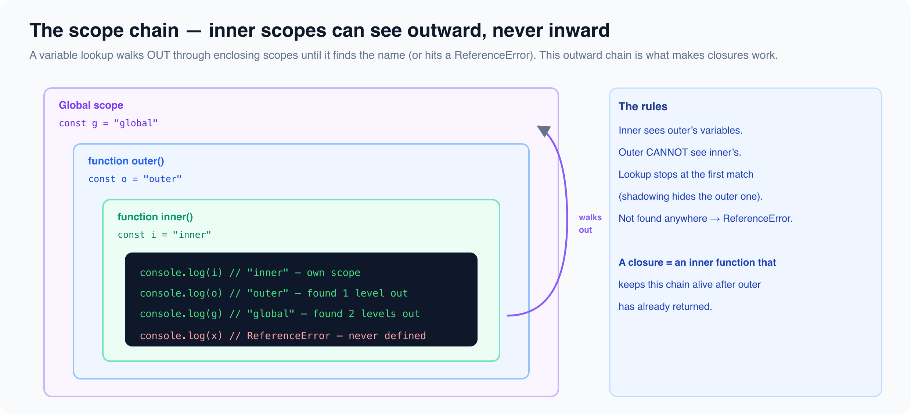

# Scope, Hoisting & the TDZ

*10 min read · Updated 17 Jul 2026 Topic 6 of 23 Bookmark Completed Scope decides where a name is visible · Topic 6 of 23*

**Source:** [https://www.geekyfrontend.in/learn/javascript-interview-kit/scope-hoisting-and-tdz](https://www.geekyfrontend.in/learn/javascript-interview-kit/scope-hoisting-and-tdz)

---

Scope decides where a name is visible; hoisting decides what exists before a line runs; the Temporal Dead Zone (TDZ) is the gap where a `let`/`const` name exists but can't be touched yet. Interviewers lean on this trio because it explains a huge share of "what does this print?" trick questions — loop closures, `undefined`-vs-`ReferenceError`, and why `const` objects are still mutable. Get these three mental models right and most output-prediction questions become mechanical.



## Lexical (static) scope

JavaScript uses **lexical scope** (a.k.a. static scope): a function's accessible variables are determined by *where it is written in the source*, not by where or how it is called. The engine can resolve every identifier by reading the nested structure of the code — it never depends on the runtime call stack. This is why a closure "remembers" the variables of the block it was defined in.

There are three scope kinds: **global** (outside any function/block), **function** (the body of a function), and **block** (anything inside `{ }` — an `if`, `for`, or a bare block), which only exists for `let`/`const`/`class`.

## `var` vs `let`/`const`: function-scoped vs block-scoped

`var` is **function-scoped**: it ignores block boundaries and attaches to the nearest enclosing function (or global). `let` and `const` are **block-scoped**: they live and die inside the `{ }` they were declared in.

js

```
{
  var a = 1;
  let b = 2;
}
console.log(a); // => 1  (var leaked out of the block)
try {
  console.log(b);
} catch (e) {
  console.log(e.name + ": " + e.message);
}
// => ReferenceError: b is not defined
```

That leak is the whole reason `var` causes bugs and `let`/`const` are the modern default. Rule of thumb: use `const` by default, `let` when you must reassign, and `var` essentially never in new code.

## Hoisting: declarations move up, initializations do not

**Hoisting** is the engine allocating every declaration in a scope *before* executing any line of that scope. What gets hoisted is the **declaration**, never the assigned value. A `var` is hoisted and pre-initialized to `undefined`; a **function declaration** is hoisted *whole* (name and body), so you can call it before its line.

js

```
console.log(x); // => undefined  (declaration hoisted, assignment not)
var x = 5;
console.log(x); // => 5
```

js

```
console.log(add(2, 3)); // => 5  (function declaration is fully hoisted)
function add(a, b) {
  return a + b;
}

sub(5, 2); // TypeError: sub is not a function
var sub = function (a, b) {
  return a - b;
}; // only `var sub` is hoisted (as undefined); the function value isn't assigned yet
```

The second half shows the key asymmetry: a **function declaration** is callable before its line, but a **function expression** (or an arrow assigned to a variable) is not — only its variable binding is hoisted, and at call time it still holds `undefined`, so calling it throws `TypeError: sub is not a function`.

If a `var` and a function share a name, the function declaration wins during hoisting, then the later assignment overwrites it during execution:

js

```
console.log(typeof foo); // => "function"  (function decl hoisted over the var)
var foo = "bar";
function foo() {}
console.log(typeof foo); // => "string"  (assignment ran)
```

## The Temporal Dead Zone (TDZ)

`let` and `const` **are** hoisted — but they are *not* initialized. From the top of the block until the declaration line executes, the name exists in an "uninitialized" state and any access throws `ReferenceError`. That window is the **Temporal Dead Zone**.

js

```
try {
  console.log(y); // in the TDZ
  let y = 10;
} catch (e) {
  console.log(e.name + ": " + e.message);
}
// => ReferenceError: Cannot access 'y' before initialization
```

The TDZ is *temporal*, not positional: it ends when execution reaches the declaration, not at a particular character offset. A subtle consequence is that `typeof` — normally safe on names that were never declared — throws inside the TDZ:

js

```
console.log(typeof undeclaredVar); // => "undefined"  (never declared, safe)
try {
  console.log(typeof tdzVar); // declared below, so we're in its TDZ
  let tdzVar = 1;
} catch (e) {
  console.log(e.name); // => "ReferenceError"
}
```

Arrow functions and function expressions bound to `const`/`let` inherit the TDZ, so they can't be called before their line either:

js

```
try {
  greet();
} catch (e) {
  console.log(e.name + ": " + e.message);
}
// => ReferenceError: Cannot access 'greet' before initialization
const greet = () => "hi";
```

## The classic `var` loop-closure bug

This is the single most-asked scope question. With `var`, the loop variable is **one** function-scoped binding shared by every iteration. The closures pushed into the array all capture that *same* `i`; by the time they run, the loop has finished and `i` is `3`.

js

```
var fns = [];
for (var i = 0; i < 3; i++) {
  fns.push(function () {
    return i;
  });
}
console.log(fns[0](), fns[1](), fns[2]()); // => 3 3 3
```

Swapping `var` for `let` fixes it. `let` creates a **fresh binding per iteration** — the spec copies the loop variable into a new binding for each pass — so each closure captures its own `i`:

js

```
let fns = [];
for (let i = 0; i < 3; i++) {
  fns.push(function () {
    return i;
  });
}
console.log(fns[0](), fns[1](), fns[2]()); // => 0 1 2
```

**Why:** it isn't that `let` "remembers the value" — it's that `let` gives each iteration a *distinct variable*, whereas `var` gives all iterations *one* variable. Closures capture variables (bindings), not values, so the number of distinct bindings is what changes the output.

## IIFE: block scoping before ES6

Before `let` existed, the fix was an **IIFE** (Immediately Invoked Function Expression) — wrap the body in a function that runs immediately, passing the current `i` in as an argument so each iteration captures its *own* parameter `j`:

js

```
var fns = [];
for (var i = 0; i < 3; i++) {
  (function (j) {
    fns.push(function () {
      return j;
    });
  })(i);
}
console.log(fns[0](), fns[1](), fns[2]()); // => 0 1 2
```

IIFEs were also the pre-ES6 way to get a private scope in general (module pattern, avoiding global-namespace pollution). Today a block plus `let`/`const`, or an ES module, does the same job.

## `const` is not immutability

`const` prevents **reassignment of the binding**, not **mutation of the value**. For objects and arrays the reference is fixed but the contents are free to change. Interviewers love this because "const means constant" is a common half-truth.

js

```
const user = { name: "Ada" };
user.name = "Grace"; // OK — mutating the object
user.age = 40; // OK — adding a property
console.log(user); // => { name: 'Grace', age: 40 }

user = {}; // TypeError: Assignment to constant variable.
```

If you want the value itself frozen, that's a separate tool — `Object.freeze(user)` (shallow). For "reassignment vs mutation":

| Operation | `var` | `let` | `const` |
| --- | --- | --- | --- |
| Reassign the variable (`x = ...`) | Yes | Yes | **No** (TypeError) |
| Redeclare in the same scope | Yes (silent) | **No** (SyntaxError) | **No** (SyntaxError) |
| Mutate the referenced object/array | Yes | Yes | **Yes** |
| Block-scoped | No (function) | Yes | Yes |
| Hoisted & usable before declaration | Yes (`undefined`) | Hoisted but TDZ | Hoisted but TDZ |

Redeclaration with `let`/`const` is a *compile-time* `SyntaxError` (the whole script fails to run), not a runtime error:

js

```
let p = 1;
let p = 2;
// SyntaxError: Identifier 'p' has already been declared
```

## Scope chain, variable lookup & shadowing

When a name is referenced, the engine looks in the current scope; if it's not there it walks **outward** through each enclosing lexical scope until it finds the name or hits global — that path is the **scope chain**. Lookup only ever goes outward, never into sibling or child scopes.

js

```
const g = "global";
function outer() {
  const o = "outer";
  function inner() {
    console.log(g, o); // found o in outer, g in global
  }
  inner();
}
outer(); // => global outer
```

**Shadowing** is when an inner scope declares a name that already exists outside it; the inner one wins for the duration of that scope, and the outer one is untouched:

js

```
let x = "outer";
function demo() {
  let x = "inner"; // shadows the outer x
  console.log(x); // => inner
}
demo();
console.log(x); // => outer  (unchanged)
```

## Common interview questions

**Q: What is hoisting, and what actually gets hoisted?** The engine registers all declarations in a scope before running any code. `var` declarations are hoisted and initialized to `undefined`; function declarations are hoisted with their full body; `let`/`const`/`class` are hoisted but left uninitialized (TDZ). Assignments/initializations are never hoisted — they run in place.

**Q: Difference between `var`, `let`, and `const`?** `var` is function-scoped, hoisted as `undefined`, and redeclarable. `let` is block-scoped, TDZ-guarded, reassignable but not redeclarable. `const` is like `let` but the binding can't be reassigned — though objects it points to are still mutable.

**Q: What is the Temporal Dead Zone?** The span between a `let`/`const` being hoisted (top of its block) and its declaration line executing. Accessing the variable in that span throws `ReferenceError: Cannot access '…' before initialization`. It's what makes `let`/`const` feel "not hoisted" even though they are.

**Q: Why does `for (var i…)` with closures print `3 3 3`, and how do you fix it?** All iterations share one function-scoped `i`, which ends at `3`; every closure reads that same binding. Fix with `let` (fresh binding per iteration → `0 1 2`) or a per-iteration IIFE that captures `i` as an argument.

**Q: Does `const` make a value immutable?** No. It only forbids reassigning the binding. `const arr = []; arr.push(1)` is fine; `arr = [1]` throws. Use `Object.freeze` for (shallow) immutability of the contents.

**Q: What is lexical scope?** Scope determined by the physical nesting of code at author time, not by the runtime call stack. It's why closures capture the variables of the scope they were *written* in.

## Gotchas / traps

- **`typeof` in the TDZ throws.** `typeof neverDeclared` is a safe `"undefined"`, but `typeof x` where `let x` appears later in the same scope throws `ReferenceError`. Interviewers use this to prove `let` really is hoisted.
- **Function declaration vs expression call site.** Calling a `function foo(){}` before its line works; calling `var foo = function(){}` before its line throws `TypeError: foo is not a function` (the binding is `undefined`, not the function). Arrow functions behave like the expression case — plus a TDZ if declared with `const`/`let`.
- **`var` leaks out of `if`/`for` blocks.** `if (true) { var leaked = 1 } console.log(leaked)` prints `1`, because `var` ignores block scope. Swap to `let` and it's a `ReferenceError`.
- **Redeclaration is a `SyntaxError`, not a runtime error.** `let p = 1; let p = 2;` doesn't run *any* line — the whole script fails to parse. So a `console.log` above it won't fire either.
- **`const` in a `for` loop header fails on `i++`.** `for (const i = 0; i < 3; i++)` throws `TypeError` on the first increment (reassignment). `const` only works in `for…of`/`for…in`, where a new binding is created each iteration and never reassigned.
- **Shadowing can hide a bug.** Redeclaring an outer name with `let` inside a block silently shadows it; a typo'd shadow can make the outer variable look "not updated" when you're really writing to the inner one.

---

## Learn More

- [Hoisting (MDN glossary) MDN](https://developer.mozilla.org/en-US/docs/Glossary/Hoisting)
- [let & the temporal dead zone MDN](https://developer.mozilla.org/en-US/docs/Web/JavaScript/Reference/Statements/let)
- [let, const & the TDZ (Namaste JS) YouTube](https://www.youtube.com/watch?v=BNC6slYCj50)
- [Temporal dead zone, simplified YouTube](https://www.youtube.com/watch?v=Cad46WAHApY)
- [Hoisting & the TDZ explained YouTube](https://www.youtube.com/watch?v=WjM4z0ze3_M)
