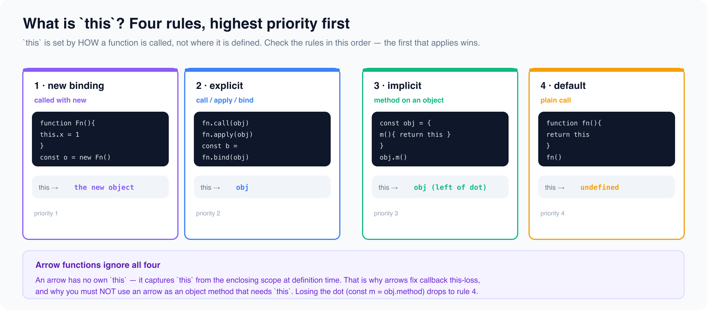

# The this Keyword

*8 min read · Updated 17 Jul 2026 Topic 9 of 23 Bookmark Completed this is the single most common source of · Topic 9 of 23*

**Source:** [https://www.geekyfrontend.in/learn/javascript-interview-kit/the-this-keyword](https://www.geekyfrontend.in/learn/javascript-interview-kit/the-this-keyword)

---

`this` is the single most common source of "why is this `undefined`?" bugs in JavaScript, and interviewers love it because it exposes whether you understand *runtime call sites* versus *lexical scope*. The one rule that unlocks everything: **`this` is determined by HOW a function is called, not where it is defined.** The same function body can see four completely different `this` values depending on the call. This lesson walks the four binding rules in priority order, then arrow functions (which break the rules on purpose), then the `this`-loss traps interviewers actually ask.



## The four binding rules, in priority order

When a regular (non-arrow) function runs, the engine picks `this` by checking these rules **top to bottom** — the first that applies wins.

1. **`new` binding** — called with `new`, `this` is the brand-new object.
2. **Explicit binding** — called via `call` / `apply` / `bind`, `this` is the object you passed.
3. **Implicit binding** — called as `obj.method()`, `this` is the object *left of the dot*.
4. **Default binding** — a plain standalone call `fn()`; `this` is `undefined` in strict mode, or the global object (`globalThis`) in sloppy mode.

js

```
'use strict';
function whoAmI() { return this; }
console.log(whoAmI());               // => undefined  (default, strict)

const user = { name: 'Ada', greet() { return `Hi, ${this.name}`; } };
console.log(user.greet());           // => Hi, Ada    (implicit: left of the dot)

function intro(greeting) { return `${greeting}, ${this.name}`; }
const person = { name: 'Grace' };
console.log(intro.call(person, 'Hello'));   // => Hello, Grace  (explicit)
console.log(intro.bind(person)('Yo'));      // => Yo, Grace     (explicit)

function Animal(kind) { this.kind = kind; }
console.log(new Animal('dog').kind); // => dog          (new binding)
```

The **priority** matters and gets tested directly. `new` beats `bind`, and explicit beats implicit:

js

```
function F(name) { this.name = name; }
const bound = F.bind({ name: 'bound-object' });
console.log(new bound('from-new').name); // => from-new  (new wins over bind)

function show() { return this.label; }
const a = { label: 'A', show };
const b = { label: 'B' };
console.log(a.show());       // => A  (implicit)
console.log(a.show.call(b)); // => B  (explicit wins over implicit)
```

## `this` in each context

- **Object methods** — `this` is the object the method was called *on*, resolved at call time. `obj.method()` gives `this === obj`; the same function pulled off `obj` and called bare does not.
- **Standalone functions** — default binding: `undefined` in strict mode (all ES modules and `class` bodies are strict), `globalThis` in sloppy scripts. This is why detached methods blow up.
- **Event handlers** (brief) — when the DOM invokes a listener added with `addEventListener`, it calls it with `this` set to the element the handler is attached to (the same node as `event.currentTarget`). An **arrow** handler ignores that and keeps the surrounding `this` instead.
- **Classes** — method bodies are strict, so an unbound, detached class method sees `this === undefined`. Class methods are **not** auto-bound (unlike React's old `createClass`), which is the single most common React-class `this` bug.

## Arrow functions have no own `this`

An arrow function does **not** get its own `this` from any of the four rules. It **captures the `this` of the enclosing lexical scope** at definition time, permanently. `call` / `apply` / `bind` cannot change an arrow's `this` — the binding argument is simply ignored.

This is exactly what you want for **callbacks**, where a normal function would fall into default binding and lose the object:

js

```
'use strict';
const counter = {
  count: 0,
  inc() { this.count++; },
};

const fn = counter.inc;      // detached from the object
try { fn(); }                // strict standalone call: this === undefined
catch (e) { console.log(e.name); } // => TypeError

// Fix A — bind the call site:
const boundInc = counter.inc.bind(counter);
boundInc();
console.log(counter.count);  // => 1

// Fix B — arrow wrapper keeps the correct call site:
setTimeout(() => counter.inc(), 0);
```

The arrow wrapper works because *inside* the arrow, `counter.inc()` is still an implicit `obj.method()` call — the arrow just defers it without detaching it.

But because an arrow steals `this` from its surroundings, you must **NOT** use an arrow as an object method that needs `this`:

js

```
const calc = {
  value: 42,
  getValue: () => this.value, // arrow: this is the OUTER scope, not calc
};
console.log(calc.getValue()); // => undefined
```

Here `this` is whatever the module/file scope's `this` was (`undefined` in an ES module, `module.exports` in CommonJS, `window` in a browser script) — never `calc`. Rule of thumb: **methods that use `this` → regular functions; callbacks that need the outer `this` → arrows.**

## Common `this`-loss and how to fix it

`this`-loss happens whenever a method is **separated from its object** before it is called. The function still exists, but the `obj.` on its left — the thing implicit binding reads — is gone.

Three classic ways it happens, and their fixes:

| How `this` is lost | What breaks | Fix |
| --- | --- | --- |
| `const fn = obj.method` then `fn()` | default binding → `undefined` | `obj.method.bind(obj)` |
| `setTimeout(obj.method, 100)` | the timer calls it bare | `setTimeout(() => obj.method(), 100)` or `obj.method.bind(obj)` |
| `const { method } = obj` (destructure) | detached the same way | `bind`, or wrap in an arrow |

js

```
'use strict';
const api = { base: 'https://x', url(p) { return this.base + p; } };
const { url } = api;                 // destructured — now detached
try { url('/a'); }
catch (e) { console.log(e.name); }   // => TypeError

const safe = api.url.bind(api);
console.log(safe('/a'));             // => https://x/a
```

Note `setTimeout(obj.method)` passes the function *value*, so the object reference is dropped exactly like the `const fn = obj.method` case — the timer later invokes it as a bare call.

## Common interview questions

**Q: What does `this` refer to inside a standalone function call?** In strict mode (and inside modules/classes) it is `undefined`; in sloppy mode it is the global object (`globalThis` / `window`). Interviewers want the strict-mode answer plus the caveat.

**Q: Predict the output.**

js

```
'use strict';
const obj = { name: 'obj', who() { return this && this.name; } };
const w = obj.who;
console.log(obj.who()); // => obj        (implicit binding)
console.log(w());       // => undefined  (detached → this is undefined)
```

**Q: `map` callback — arrow vs regular function.**

js

```
'use strict';
const list = {
  items: [1, 2, 3],
  prefix: 'item-',
  build()      { return this.items.map(function (n) { return (this ? this.prefix : 'NO-THIS') + n; }); },
  buildArrow() { return this.items.map((n) => this.prefix + n); },
};
console.log(list.build());      // => [ 'NO-THIS1', 'NO-THIS2', 'NO-THIS3' ]
console.log(list.buildArrow()); // => [ 'item-1', 'item-2', 'item-3' ]
```

The regular callback is invoked by `map` as a bare call, so its `this` is `undefined`; the arrow captures `build`'s `this` (the object). Passing `this` as `map`'s second argument, or using an arrow, both fix it.

**Q: Can you rebind a bound function?** No. `bind` is permanent; a second `bind` (or `call`/`apply`) on an already-bound function is ignored.

js

```
function id() { return this.tag; }
const b1 = id.bind({ tag: 'first' });
console.log(b1.bind({ tag: 'second' })()); // => first
```

**Q: Why do React class components need `this.handleClick = this.handleClick.bind(this)`?** Class methods are not auto-bound. When you pass `this.handleClick` as a prop/callback, it detaches; when React later calls it, `this` is `undefined`. Binding in the constructor (or using an arrow class field) fixes it.

## Gotchas / traps

**Class methods are not auto-bound.** Detaching one and calling it throws in strict class bodies:

js

```
'use strict';
class Button {
  clicks = 0;
  handle() { this.clicks++; return this.clicks; }
}
const btn = new Button();
const handler = btn.handle;           // detached
try { handler(); }
catch (e) { console.log(e.name); }    // => TypeError

// Arrow class field auto-captures the instance — survives detaching:
class Button2 {
  clicks = 0;
  handle = () => { this.clicks++; return this.clicks; };
}
const h = new Button2().handle;
console.log(h(), h());                // => 1 2
```

**Nested `this` is decided by the *whole* left side of the dot.** In `outer.inner.who()`, `this` is `inner`, not `outer` — only the object immediately left of the dot counts.

js

```
const outer = { name: 'outer', inner: { name: 'inner', who() { return this.name; } } };
console.log(outer.inner.who()); // => inner
```

**Arrows ignore `call`/`apply`/`bind`.** `const f = () => this; f.call({x: 1})` returns the *enclosing* `this`, not `{x: 1}` — a favorite trick question.

**Sloppy vs strict changes the default.** The same detached method throws in strict mode but silently mutates `globalThis` in a sloppy `<script>`, creating phantom globals instead of an error — worse than a crash, because it hides the bug.

---

## Learn More

- [this (MDN) MDN](https://developer.mozilla.org/en-US/docs/Web/JavaScript/Reference/Operators/this)
- [The "this" keyword explained YouTube](https://www.youtube.com/watch?v=2mRN8FyjnE4)
- ["this" — JavaScript in depth YouTube](https://www.youtube.com/watch?v=rpSRRB2VZ2A)
- ["this" explained simply YouTube](https://www.youtube.com/watch?v=cwChC4BQF0Q)
