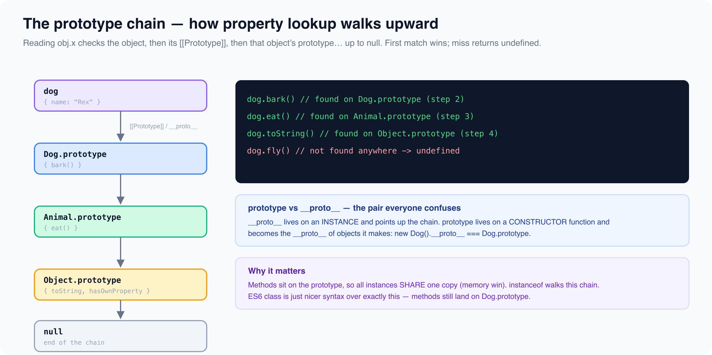

# The Prototype Chain & Inheritance

*9 min read · Updated 17 Jul 2026 Topic 13 of 23 Bookmark Completed Every JavaScript object has a hidden link to another object called its prototype · Topic 13 of 23*

**Source:** [https://www.geekyfrontend.in/learn/javascript-interview-kit/prototype-chain-and-inheritance](https://www.geekyfrontend.in/learn/javascript-interview-kit/prototype-chain-and-inheritance)

---

Every JavaScript object has a hidden link to another object called its **prototype**. When you read a property that the object does not own, the engine follows that link, and the next one, and the next — the **prototype chain** — until it either finds the property or hits `null`. This one mechanism is how JavaScript does inheritance, and it is a favourite interview topic precisely because so many developers use it every day (via `class`, arrays, `Object.create`) without being able to explain what actually happens on lookup.

Interviewers probe this to separate people who memorised `class` syntax from people who understand the object model underneath it. The two questions that come up almost every time are "what is the difference between `prototype` and `__proto__`?" and "implement inheritance without `class`" — both are below.



## Every object has a `[[Prototype]]`, and lookup walks the chain

`[[Prototype]]` is an internal slot on every object. You read it with `Object.getPrototypeOf(obj)` (the modern, correct way) or the legacy accessor `obj.__proto__`. When you access `obj.prop`, the engine checks `obj`'s own properties first; if absent, it jumps to `obj`'s prototype, then that object's prototype, and so on until the value is found or the chain ends at `null`.

js

```
const parent = { greet() { return "hi"; } };
const child = Object.create(parent); // child's [[Prototype]] is parent
child.name = "leaf";

console.log(child.name);                  // "leaf"  (own property)
console.log(child.greet());               // "hi"    (found on parent via the chain)
console.log(child.hasOwnProperty("greet")); // false (greet is inherited, not own)
console.log(Object.getPrototypeOf(child) === parent); // true
```

Reading `child.greet` finds nothing on `child`, steps up to `parent`, finds `greet` there, and calls it — with `this` bound to `child`, not `parent`. Writing is different: assigning `child.greet = ...` would create an **own** property on `child` and shadow the inherited one; it never mutates `parent`.

## `prototype` vs `__proto__` — the pair everyone confuses

These sound the same and are completely different. `__proto__` (better: `Object.getPrototypeOf`) is the actual `[[Prototype]]` link that **every object** has. `prototype` is an ordinary property that exists **only on functions** — it is the object that will become the `[[Prototype]]` of instances created with `new`. In other words, `Foo.prototype` is the blueprint; `instance.__proto__` is the live link an instance points back at.

js

```
function Foo() {}
const f = new Foo();

console.log(f.__proto__ === Foo.prototype);              // true
console.log(Object.getPrototypeOf(f) === Foo.prototype); // true (same thing)
console.log(Foo.prototype.constructor === Foo);          // true
console.log(Foo.__proto__ === Function.prototype);       // true (Foo is itself a function)
```

The relationship to burn in: **`new Foo().__proto__ === Foo.prototype`**. `new` does roughly three things — create a fresh object, set its `[[Prototype]]` to `Foo.prototype`, run `Foo` with `this` as that object — which is why the instance's prototype link *is* the constructor's `prototype` object.

| Term | Lives on | Is | Read via |
| --- | --- | --- | --- |
| `prototype` | functions only | the object future instances will inherit from | `Foo.prototype` |
| `__proto__` / `[[Prototype]]` | every object | the object this one currently inherits from | `Object.getPrototypeOf(obj)` |

## Constructor functions and shared methods (the memory win)

Put per-instance **data** on `this` inside the constructor, and put **methods** on the function's `.prototype`. Every instance then shares the *same single* function object through the chain, instead of each instance carrying its own copy. With a million instances that is one method in memory versus a million.

js

```
function User(name) { this.name = name; } // per-instance data
User.prototype.hello = function () { return "I am " + this.name; }; // shared method

const a = new User("Ada");
const b = new User("Bob");
console.log(a.hello());          // "I am Ada"
console.log(a.hello === b.hello); // true — one function, shared via User.prototype
```

If you instead defined `hello` inside the constructor (`this.hello = function(){}`), `a.hello === b.hello` would be `false` — a distinct closure per instance. That is the memory benefit interviewers want you to name.

## Classic inheritance chain: `Animal` → `Dog`, the pre-`class` way

`class ... extends` is syntactic sugar over exactly this pattern. Doing it by hand is a standard whiteboard question. Three moves: call the parent constructor to initialise parent fields, set the child's `prototype` to an object whose `[[Prototype]]` is the parent's `prototype`, and repair the `constructor` pointer.

js

```
function Animal(name) { this.name = name; }
Animal.prototype.speak = function () { return this.name + " makes a sound"; };

function Dog(name) {
  Animal.call(this, name);          // 1. run parent constructor on our instance
}
Dog.prototype = Object.create(Animal.prototype); // 2. link the chain (NOT `new Animal()`)
Dog.prototype.constructor = Dog;    // 3. repair constructor, which step 2 overwrote
Dog.prototype.speak = function () { return this.name + " barks"; }; // override

const d = new Dog("Rex");
console.log(d.speak());          // "Rex barks"   (Dog's override wins)
console.log(d instanceof Dog);   // true
console.log(d instanceof Animal); // true          (Animal.prototype is on the chain)
console.log(Object.getPrototypeOf(Dog.prototype) === Animal.prototype); // true
```

Use `Object.create(Animal.prototype)` for step 2, **not** `new Animal()` — the latter runs the parent constructor (possibly with side effects and missing arguments) just to build a prototype object. `Object.getPrototypeOf` / `Object.setPrototypeOf` are the standard accessors for reading and (rarely) rewiring these links:

js

```
const proto = { kind: "animal" };
const obj = {};
Object.setPrototypeOf(obj, proto);
console.log(obj.kind);                             // "animal"
console.log(Object.getPrototypeOf(obj) === proto); // true
```

Avoid `setPrototypeOf` on hot objects — mutating an existing object's prototype forces engines to deoptimise it. Prefer creating with the right prototype (`Object.create`) up front.

## `instanceof`, `isPrototypeOf`, and own vs inherited

`a instanceof B` returns `true` if `B.prototype` appears **anywhere** on `a`'s prototype chain — it walks, it does not just check the immediate link. `proto.isPrototypeOf(obj)` asks the same question from the prototype's side. `obj.hasOwnProperty(k)` is the opposite lens: it is `true` only for **own** properties and ignores the chain entirely.

js

```
console.log(Animal.prototype.isPrototypeOf(d)); // true
console.log(d.hasOwnProperty("name"));  // true  — set on the instance by Animal.call
console.log(d.hasOwnProperty("speak")); // false — lives on the prototype, inherited
```

**Why extending built-in prototypes is discouraged.** Adding to `Array.prototype`, `Object.prototype`, etc. affects *every* array/object in the program, including those in libraries you don't control. It breaks `for...in` (your key shows up in everyone's loops), risks colliding with a future standard method of the same name (the infamous `Array.prototype.flatten` → `flat` rename broke sites), and creates spooky action-at-a-distance bugs. Extend your own objects; leave the builtins alone.

## Common interview questions

**Q: What is the difference between `prototype` and `__proto__`?** `prototype` is a property that exists only on constructor functions; it is the object that instances created with `new` will inherit from. `__proto__` (i.e. `[[Prototype]]`, read via `Object.getPrototypeOf`) exists on every object and is the actual link to the object it currently inherits from. The bridge: `new Foo().__proto__ === Foo.prototype`.

**Q: Implement inheritance without `class`.** Call the parent constructor with `Parent.call(this, ...args)`, set `Child.prototype = Object.create(Parent.prototype)`, then restore `Child.prototype.constructor = Child`. (The `Animal`/`Dog` block above is the full answer.)

**Q: What does `new` actually do?** Creates a fresh object, sets its `[[Prototype]]` to the constructor's `.prototype`, runs the constructor with `this` bound to the new object, and returns that object — unless the constructor explicitly returns a different object.

**Q: How does property lookup work?** Own properties first, then up the prototype chain link by link until the property is found or the chain reaches `null`. Assignment, by contrast, sets an own property and shadows any inherited one rather than modifying the prototype.

**Q: How does `instanceof` work?** It checks whether the right-hand side's `.prototype` object is found anywhere on the left-hand side's prototype chain, walking until a match or `null`.

**Q: `Object.create(null)` — why use it?** It makes an object with no prototype at all, so it has no inherited `toString`, `hasOwnProperty`, etc. That is ideal for a pure key–value map/dictionary where you don't want inherited keys or a `"constructor"` key colliding with your data.

## Gotchas / traps

**Forgetting to reset `constructor`.** Overwriting `Child.prototype` with `Object.create(...)` wipes the `constructor` back-pointer, so it resolves up the chain to the parent.

js

```
function Animal() {}
function Dog() {}
Dog.prototype = Object.create(Animal.prototype); // forgot to fix constructor
const d = new Dog();
console.log(d.constructor === Dog);    // false!
console.log(d.constructor === Animal); // true — leaked from Animal.prototype
```

**Mutable reference shared on the prototype.** A non-primitive placed on `.prototype` is shared by *all* instances. Data that should be per-instance belongs in the constructor.

js

```
function Team() {}
Team.prototype.members = []; // one array, shared by everyone
const t1 = new Team(), t2 = new Team();
t1.members.push("Ada");
console.log(t2.members); // ["Ada"] — surprise, they share it
```

**`for...in` walks the chain.** It enumerates inherited enumerable keys too, not just own ones. Use `Object.keys()` for own keys, or guard with `hasOwnProperty`.

js

```
function Base() { this.own = 1; }
Base.prototype.inherited = 2;
const obj = new Base();
const keys = [];
for (const k in obj) keys.push(k);
console.log(keys);            // ['own', 'inherited']
console.log(Object.keys(obj)); // ['own']
```

**Calling `hasOwnProperty` on a null-prototype object throws.** `Object.create(null)` has no `hasOwnProperty` to inherit, so you must borrow it.

js

```
const dict = Object.create(null);
dict.foo = 1;
// dict.hasOwnProperty("foo") -> TypeError: not a function
console.log(Object.prototype.hasOwnProperty.call(dict, "foo")); // true
```

**`instanceof` can be rewired.** Because it just tests the chain, mutating the prototype changes the answer — a reminder that `instanceof` is not a fixed "type", just a chain check.

js

```
function A() {} function B() {}
const x = new A();
console.log(x instanceof A); // true
Object.setPrototypeOf(x, B.prototype);
console.log(x instanceof A); // false
console.log(x instanceof B); // true
```

**Arrow functions have no `prototype`.** They can't be constructors, so `new` on one throws.

js

```
const Arrow = () => {};
console.log(Arrow.prototype); // undefined
// new Arrow(); -> TypeError: Arrow is not a constructor
```

---

## Learn More

- [Inheritance & the prototype chain (MDN) MDN](https://developer.mozilla.org/en-US/docs/Web/JavaScript/Inheritance_and_the_prototype_chain)
- [Prototype chain & inheritance YouTube](https://www.youtube.com/watch?v=KGsQiqLdeuw)
- [Understanding the prototype chain YouTube](https://www.youtube.com/watch?v=GhJTy5-X3kA)
- [Inheritance and the prototype chain YouTube](https://www.youtube.com/watch?v=RFWvIEVZ_j8)
