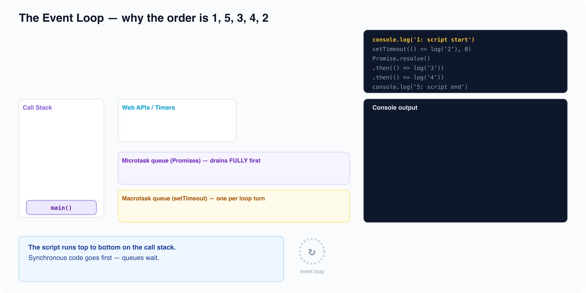

# The Event Loop

*10 min read · Updated 17 Jul 2026 Topic 15 of 23 Bookmark Completed JavaScript runs your code on a single thread · Topic 15 of 23*

**Source:** [https://www.geekyfrontend.in/learn/javascript-interview-kit/the-event-loop](https://www.geekyfrontend.in/learn/javascript-interview-kit/the-event-loop)

---

JavaScript runs your code on a **single thread** — there is exactly one call stack, so only one thing executes at a time. The event loop is the mechanism that lets that single thread juggle timers, network responses, clicks, and promises without blocking, by scheduling callbacks to run *later* on that same thread. Interviewers hammer this topic because it explains almost every "in what order does this print?" question, why `setTimeout(fn, 0)` doesn't run immediately, and why a promise callback beats a timer even when both are "ready". If you can trace the queues precisely, you can answer async questions that trip up most candidates.



## The runtime is more than the engine

The V8 engine (or SpiderMonkey, etc.) only knows how to run JavaScript: it owns the **call stack** and the **heap**. Everything asynchronous — `setTimeout`, `fetch`, DOM events, file I/O — is provided by the *host environment* (the browser or Node.js), not by the language. So the full picture has four moving parts:

- **Call stack** — where synchronous functions are pushed and popped. Only when it is empty can anything async run.
- **Web APIs / Node APIs** — host-provided facilities (timers, network, I/O) that do work off-thread and, when done, hand a callback to a queue.
- **Task queues** — the **macrotask queue** (a.k.a. task queue / callback queue) and the **microtask queue**.
- **The event loop** — the coordinator that moves callbacks from the queues onto the stack when the stack is clear.

## What the event loop actually does

Think of the loop as an endless cycle. One turn ("tick") of the loop is:

1. Take **one** macrotask from the macrotask queue and run it to completion (run the whole synchronous call stack it produces).
2. Then **drain the entire microtask queue** — run microtasks one by one until the queue is empty, including any microtasks that other microtasks schedule along the way.
3. (In a browser) perform rendering / paint if needed.
4. Go back to step 1 for the next macrotask.

The initial execution of your `<script>` (or the top-level module) is itself the first macrotask. So the rule that governs everything is: **after each macrotask, ALL pending microtasks run before the next macrotask (or before the next render) gets a turn.** Microtasks are a queue that must be emptied; macrotasks are taken one at a time.

## Macrotasks vs microtasks

The two queues have different sources and very different priority. Microtasks always win: a microtask scheduled during the current tick runs before the next macrotask, even if that macrotask (like a `setTimeout(…, 0)`) was queued earlier.

| Aspect | Macrotasks (tasks) | Microtasks |
| --- | --- | --- |
| Examples | `setTimeout`, `setInterval`, `setImmediate` (Node), I/O, `MessageChannel`/`postMessage`, UI events | `Promise.prototype.then/catch/finally`, `queueMicrotask`, `MutationObserver`, `await` continuations, `process.nextTick` (Node) |
| How many run per tick | Exactly **one**, then microtasks drain | **All** of them — the queue is emptied |
| Priority | Lower — only after microtasks are empty | Higher — drained before the next macrotask/render |
| Can starve the loop | No (one per tick) | Yes (an endless microtask chain blocks rendering and timers forever) |

A useful mental model: `setTimeout` says "do this in a **future** turn of the loop"; a promise `.then` says "do this at the **end of the current** turn, before anything else."

## The classic ordering question

This is the single most-asked event-loop question. Predict the output:

js

```
console.log('1: script start');

setTimeout(() => {
  console.log('2: setTimeout');
}, 0);

Promise.resolve()
  .then(() => console.log('3: promise 1'))
  .then(() => console.log('4: promise 2'));

console.log('5: script end');
```

The true output (verified in Node) is:

javascript

```
1: script start
5: script end
3: promise 1
4: promise 2
2: setTimeout
```

Trace it step by step:

- The whole script is the first macrotask. `console.log('1: script start')` runs synchronously → prints **1**.
- `setTimeout(…, 0)` hands its callback to the host timer. After the delay it will be placed on the **macrotask** queue — not now, and not this tick.
- `Promise.resolve().then(...)` schedules the first `.then` callback as a **microtask**. (The second `.then` isn't scheduled yet — it only gets queued once the first one resolves.)
- `console.log('5: script end')` runs synchronously → prints **5**.
- The call stack is now empty and the current macrotask (the script) is done. The loop **drains microtasks**: the first `.then` runs → prints **3**, and its completion schedules the second `.then` as a new microtask, which the same drain then runs → prints **4**. The microtask queue is now empty.
- Only now does the loop take the next **macrotask**: the timer callback → prints **2**.

The headline: both promise callbacks — including one that was chained *after* the first ran — finish before the `setTimeout` that was written first. That is the microtask-priority rule in action.

## `setTimeout(fn, 0)` is not "run in 0ms"

`setTimeout` does not promise to run after `delay` milliseconds — it promises to run **no sooner** than `delay`, and only once the stack is clear and its turn as a macrotask arrives. The delay is a *minimum*, not a guarantee. On top of that the HTML spec **clamps** nested timers: once you are 5+ levels of nested `setTimeout` deep, the browser forces a minimum of **4ms**, so `setTimeout(fn, 0)` effectively becomes `~4ms`. Background/inactive tabs clamp much harder (often 1000ms). Node has its own minimum (~1ms). So `setTimeout(fn, 0)` means "as soon as reasonably possible, in a future macrotask" — never "synchronously" and never truly zero.

## Starvation: microtasks can freeze everything

Because the loop must drain the **entire** microtask queue before moving on, a microtask that keeps scheduling more microtasks never lets the loop reach rendering or the next macrotask. This hangs the page:

js

```
function starve() {
  Promise.resolve().then(starve); // schedules another microtask forever
}
starve();
// The tab freezes: paint, timers, and events never get a turn.
```

The equivalent with `setTimeout(starve, 0)` would **not** freeze the UI, because each timer is a separate macrotask and the loop renders between them. This is the practical reason to be careful with recursive promise chains and to break large work into macrotasks (e.g. `setTimeout`/`MessageChannel`) when you need the UI to stay responsive.

## Node specifics (briefly)

Node uses libuv and has the same microtask-drains-after-each-callback rule, with two Node-only wrinkles:

- **`process.nextTick` runs before promises.** Node keeps a separate nextTick queue that is drained *before* the regular promise microtask queue. So within one phase, `nextTick` callbacks beat `.then` callbacks.
- **Phases.** Node's loop is organized into phases that each have their own macrotask queue: **timers** (`setTimeout`/`setInterval`), **poll** (I/O callbacks), and **check** (`setImmediate`), among others. After each individual callback in any phase, Node drains nextTick + promise microtasks before continuing. At a high level: `setImmediate` fires in the check phase, `setTimeout(…,0)` in the timers phase; inside an I/O callback `setImmediate` reliably beats `setTimeout(0)`, but at the top level their order is not guaranteed.

js

```
console.log('start');
setTimeout(() => console.log('timeout'), 0);
Promise.resolve().then(() => console.log('promise'));
process.nextTick(() => console.log('nextTick'));
console.log('end');
// start
// end
// nextTick   <- nextTick queue drains first
// promise    <- then the promise microtask
// timeout    <- macrotask, next tick
```

**Browser vs Node — what's the same and what isn't.** The core model is identical: single thread, one macrotask then a full microtask drain. The differences are real but narrow: the browser paints between macrotasks (Node has no rendering); `process.nextTick` and `setImmediate` are Node-only; and the browser's macrotask sources are DOM events/timers while Node's are libuv phases. Don't claim the browser has "phases" or that `setImmediate` exists in browsers — it doesn't (portably).

## Common interview questions

**Q: In what order do these print, and why?**

js

```
console.log('A');
setTimeout(() => console.log('B'), 0);
Promise.resolve().then(() => {
  console.log('C');
  Promise.resolve().then(() => console.log('D'));
});
queueMicrotask(() => console.log('E'));
console.log('F');
```

Output: `A F C E D B`. `A` and `F` are synchronous. Then microtasks drain in FIFO order: the first `.then` (`C`) and `queueMicrotask` (`E`) were queued in that order, so `C` then `E`; scheduling `D` inside `C` adds it to the *same* drain after `E`, so `D` runs before the drain ends. `B` is a macrotask, so it's last.

**Q: What does `await` do to ordering?**

js

```
async function async1() {
  console.log('async1 start');
  await async2();
  console.log('async1 end');
}
async function async2() { console.log('async2'); }

console.log('script start');
setTimeout(() => console.log('setTimeout'), 0);
async1();
Promise.resolve().then(() => console.log('promise'));
console.log('script end');
```

Output: `script start`, `async1 start`, `async2`, `script end`, `async1 end`, `promise`, `setTimeout`. Everything up to and including `await async2()` runs synchronously (the body of an `async` function runs sync until the first `await`). `await` then suspends and queues the rest (`async1 end`) as a **microtask** — queued before the standalone `.then('promise')`, so `async1 end` prints first. `setTimeout` is a macrotask, last.

**Q: Why is a promise callback guaranteed to run before a `setTimeout(fn, 0)` queued earlier?** Because `.then` schedules a microtask and the timer schedules a macrotask. After the current macrotask finishes, the loop drains **all** microtasks before touching the next macrotask, regardless of which was scheduled first.

**Q: Is JavaScript multi-threaded?** No — the execution of your JS is single-threaded (one call stack). Concurrency comes from the host doing async work (timers, I/O, network) off the main thread and queuing callbacks. True parallelism needs Web Workers / worker threads, which are separate threads with separate memory that communicate by message-passing.

**Q: Difference between `queueMicrotask`, `Promise.then`, and `setTimeout`?** `queueMicrotask` and `.then` both add to the **microtask** queue (run at the end of the current tick); `setTimeout` adds to the **macrotask** queue (a future tick). Use `queueMicrotask` when you want to defer work to after the current stack unwinds but before any rendering or timer.

## Gotchas / traps

**"0ms" never means synchronous.** Code after a `setTimeout(fn, 0)` always runs first — the callback is a future macrotask. Candidates who say "B prints between A and F" above are wrong.

**Microtasks can starve rendering and timers.** An endless `.then` chain locks the UI because the loop cannot leave the microtask drain. The same pattern with `setTimeout` does not, because timers are one-per-tick macrotasks.

**The second `.then` is not queued up front.** In `p.then(a).then(b)`, `b` is only scheduled after `a` runs and resolves. This matters when you interleave chains — a callback in a *separate* chain can slip in between `a` and `b`.

**`async` function bodies are synchronous until the first `await`.** People assume calling an `async` function defers everything. It doesn't: everything before the first `await` runs immediately on the current stack; only the continuation after `await` becomes a microtask.

**`process.nextTick` is not a "next tick" of the loop.** Despite the name, it runs *before* the promise microtasks and before the loop advances — it can itself starve I/O in Node if abused. `setImmediate` is the one that runs on a later phase.

**Don't over-claim browser/Node parity.** `setImmediate` and `process.nextTick` don't exist portably in browsers; browsers paint between macrotasks and Node doesn't. State the shared model (one macrotask → full microtask drain) confidently, and flag the host-specific bits as host-specific.

---

## Learn More

- [The event loop (MDN) MDN](https://developer.mozilla.org/en-US/docs/Web/JavaScript/Event_loop)
- [What the heck is the event loop? (Philip Roberts) YouTube](https://www.youtube.com/watch?v=8aGhZQkoFbQ)
- [The event loop in 5 minutes YouTube](https://www.youtube.com/watch?v=lqLSNG_79lI)
- [What exactly is the event loop? YouTube](https://www.youtube.com/watch?v=XBt1tDunZj4)
