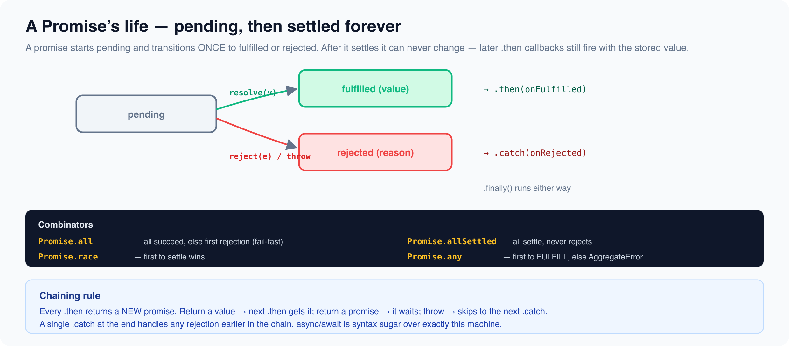

# Promises Deep Dive

*10 min read · Updated 17 Jul 2026 Topic 16 of 23 Bookmark Completed A Promise is an object representing the eventual result of an asynchronous operation · Topic 16 of 23*

**Source:** [https://www.geekyfrontend.in/learn/javascript-interview-kit/promises-deep-dive](https://www.geekyfrontend.in/learn/javascript-interview-kit/promises-deep-dive)

---

A **Promise** is an object representing the eventual result of an asynchronous operation — a placeholder for a value that isn't ready yet. It lets you write async code that reads top-to-bottom instead of drowning in nested callbacks, and it underpins `async/await`, `fetch`, and almost every modern async API. Interviewers lean on Promises because they expose whether you actually understand the event loop, error propagation, and the difference between running things in parallel versus in sequence — mistakes here cause real production bugs.



## What a Promise is: states and settling

A Promise is always in exactly one of three states:

- **pending** — created, not yet resolved or rejected.
- **fulfilled** — completed successfully with a value (via `resolve`).
- **rejected** — failed with a reason, usually an `Error` (via `reject`).

Once a Promise moves from pending to fulfilled or rejected it is **settled**, and settling is **one-way and immutable**: the first `resolve` or `reject` wins, and every later call is silently ignored. You create one with the constructor, passing an *executor* function that runs synchronously and receives `resolve` and `reject`.

js

```
const p = new Promise((resolve, reject) => {
  resolve("first");
  resolve("second"); // ignored — already settled
  reject("nope");    // ignored — already settled
});
console.log(p);      // Promise { 'first' }
p.then(v => console.log("value:", v)); // value: first

const pending = new Promise(() => {}); // never calls resolve/reject
console.log(pending); // Promise { <pending> }
```

The executor runs immediately and synchronously, but the `.then` callback is always scheduled asynchronously (as a microtask), which is why `console.log(p)` prints before `value: first`.

## Chaining: `.then` / `.catch` / `.finally`

Every `.then` returns a **brand-new Promise**, which is what makes chaining work. What that new Promise settles to depends on what your callback does:

- **Return a value** → the next Promise fulfills with that value.
- **Return a Promise** → the chain *waits* for it and adopts its outcome (this "unwrapping" is why you don't get a promise-of-a-promise).
- **Throw** (or return a rejected Promise) → the next Promise rejects, and control jumps to the nearest downstream `.catch`.

`.catch(fn)` is just sugar for `.then(undefined, fn)`; it handles a rejection from anywhere **upstream**. `.finally(fn)` runs on both success and failure for cleanup, receives no argument, and passes the settled value/reason straight through untouched (unless it throws).

js

```
Promise.resolve(1)
  .then(x => x + 1)                    // value -> next fulfills with 2
  .then(x => Promise.resolve(x * 10))  // promise -> chain waits -> 20
  .then(x => { throw new Error("boom at " + x); }) // throw -> rejects
  .then(x => console.log("skipped", x))            // skipped entirely
  .catch(e => console.log("caught:", e.message))   // caught: boom at 20
  .finally(() => console.log("cleanup runs regardless"))
  .then(() => console.log("chain continues after catch"));
```

Output, in order: `caught: boom at 20`, `cleanup runs regardless`, `chain continues after catch`. Note the last line: a `.catch` "absorbs" the error and returns a *fulfilled* Promise, so the chain resumes normally after it.

## Combinators

The four static combinators take an iterable of promises and return a single Promise. The differences are exactly the kind of thing interviewers test:

| Combinator | Fulfills when | Rejects when | Result value | Rejection reason |
| --- | --- | --- | --- | --- |
| `Promise.all` | **all** fulfill | **any** rejects (fail-fast) | array of values (input order) | first rejection reason |
| `Promise.allSettled` | **all settle** (never rejects) | never | array of `{status, value}` / `{status, reason}` | — |
| `Promise.race` | first to **settle** fulfills | first to **settle** rejects | first settled value | first settled reason |
| `Promise.any` | **any** fulfills | **all** reject | first fulfilled value | `AggregateError` (`.errors`) |

js

```
const delay = (ms, val, fail = false) =>
  new Promise((res, rej) => setTimeout(() => fail ? rej(val) : res(val), ms));

// all — waits for everything, order preserved regardless of timing
Promise.all([delay(10, "a"), delay(20, "b"), delay(5, "c")])
  .then(v => console.log("all:", v));            // all: [ 'a', 'b', 'c' ]

// all — fail-fast: one rejection rejects the whole thing
Promise.all([delay(10, "ok"), delay(5, "X", true)])
  .catch(e => console.log("all rejected with:", e)); // all rejected with: X

// allSettled — never short-circuits
Promise.allSettled([delay(5, "ok"), delay(5, "bad", true)])
  .then(r => console.log("allSettled:", JSON.stringify(r)));
  // allSettled: [{"status":"fulfilled","value":"ok"},{"status":"rejected","reason":"bad"}]

// race — first to SETTLE wins, even if it's a rejection
Promise.race([delay(30, "slow"), delay(5, "fastFail", true)])
  .catch(e => console.log("race rejected:", e)); // race rejected: fastFail

// any — first to FULFILL wins; ignores earlier rejections
Promise.any([delay(5, "e1", true), delay(10, "winner"), delay(20, "e2", true)])
  .then(v => console.log("any:", v));            // any: winner

// any — all reject -> AggregateError, individual reasons on .errors
Promise.any([delay(5, "x", true), delay(10, "y", true)])
  .catch(e => console.log(e.constructor.name, e.errors)); // AggregateError [ 'x', 'y' ]
```

Use `all` when you need every result and any failure should abort; `allSettled` when you want *all* outcomes regardless of failures (e.g. hitting N endpoints and reporting per-item success); `race` for timeouts (race real work against a `delay` that rejects); `any` for redundancy (first mirror to respond wins).

## Promisifying a callback API

Legacy Node APIs use the **error-first callback** convention: `fn(...args, (err, result) => ...)`. Wrapping one in a Promise is a classic interview task.

js

```
function readValue(key, cb) {
  setTimeout(() => key === "bad" ? cb(new Error("not found")) : cb(null, "VAL:" + key), 5);
}

function promisify(fn) {
  return (...args) => new Promise((resolve, reject) => {
    fn(...args, (err, result) => err ? reject(err) : resolve(result));
  });
}

const readValueP = promisify(readValue);
readValueP("k1").then(v => console.log("promisified:", v));    // promisified: VAL:k1
readValueP("bad").catch(e => console.log("err:", e.message));  // err: not found
```

## Sequential vs parallel execution

This distinction separates strong candidates. `array.map(asyncFn)` fires every call **immediately** and gives you an array of pending promises — feed that to `Promise.all` for **parallel** execution. To run **sequentially** (each waits for the previous — needed for rate limits or ordered side effects), chain with `reduce` over a resolved seed, awaiting the accumulator each step.

js

```
const work = n => new Promise(res => setTimeout(() => res(n * 2), 10));

(async () => {
  // parallel — all three timers run at once (~10ms total)
  const parallel = await Promise.all([1, 2, 3].map(work));
  console.log("parallel:", parallel); // [ 2, 4, 6 ]

  // sequential — one after another (~30ms total)
  const out = [];
  await [1, 2, 3].reduce(async (prev, n) => {
    await prev;              // wait for the previous step to finish
    out.push(await work(n));
  }, Promise.resolve());
  console.log("sequential:", out);    // [ 2, 4, 6 ]
})();
```

A common trap: `arr.forEach(async ...)` looks sequential but is neither — `forEach` ignores the returned promises, so nothing is awaited and the code moves on before any work finishes.

## Interview classic: implement `Promise.all`

You should be able to build this from scratch. The keys: **preserve input order by index** (not completion order), **count down remaining** to know when you're done, **reject on the first failure** (fail-fast), handle the **empty array**, and wrap each item in `Promise.resolve` so plain non-promise values work too.

js

```
function promiseAll(promises) {
  return new Promise((resolve, reject) => {
    const results = [];
    let remaining = promises.length;
    if (remaining === 0) return resolve(results); // empty -> resolve immediately
    promises.forEach((p, i) => {
      Promise.resolve(p).then(          // normalize non-promises too
        value => {
          results[i] = value;           // store by index, not push
          if (--remaining === 0) resolve(results);
        },
        reject                          // first rejection wins the race
      );
    });
  });
}

const d = (ms, v) => new Promise(r => setTimeout(() => r(v), ms));
promiseAll([d(20, "a"), d(5, "b"), 99, d(10, "c")])
  .then(v => console.log("myAll:", v)); // myAll: [ 'a', 'b', 99, 'c' ]
promiseAll([d(20, "a"), Promise.reject("fail")])
  .catch(e => console.log("myAll rejected:", e)); // myAll rejected: fail
```

## Error handling

An **unhandled rejection** is a rejected Promise that reaches the end of every chain with no `.catch`. In Node it prints `UnhandledPromiseRejection` and (by default) crashes the process; in browsers it fires a `window.onunhandledrejection` event. Always terminate a chain with a `.catch`, or `await` inside `try/catch`.

js

```
process.on("unhandledRejection", reason =>
  console.log("unhandledRejection:", reason.message));

Promise.reject(new Error("nobody catches me")); // no .catch -> fires handler above

// A trailing .catch guards the WHOLE chain above it
Promise.resolve()
  .then(() => { throw new Error("mid-chain"); })
  .then(() => console.log("skipped"))
  .catch(e => console.log("tail catch got:", e.message)); // tail catch got: mid-chain
```

**`.catch` placement matters.** A `.catch` only sees rejections from *upstream* of it — anything that throws *after* the `.catch` is unhandled by it. Putting one `.catch` at the tail is the safe default. **`finally` semantics:** it runs on both paths, takes no arguments, and is transparent — it forwards the existing value or reason — *unless* it throws or returns a rejected promise, in which case that new rejection overrides whatever was flowing through.

## Common interview questions

- **What are the three states, and can a Promise change state twice?** Pending, fulfilled, rejected. No — once settled it's permanently immutable; the first `resolve`/`reject` wins and later calls are ignored.
- **Does `.then`'s callback run synchronously?** No. The executor passed to `new Promise` runs synchronously, but `.then`/`.catch`/`.finally` callbacks are always queued as **microtasks** and run after the current synchronous code finishes.
- **`Promise.all` vs `Promise.allSettled`?** `all` is fail-fast — it rejects the instant any input rejects and discards the rest. `allSettled` never rejects; it waits for everyone and returns a status object per input. Use `allSettled` when partial failure is acceptable and you want every outcome.
- **`Promise.race` vs `Promise.any`?** `race` settles as soon as *any* input settles — fulfilment *or* rejection. `any` waits for the first *fulfilment* and only rejects (with an `AggregateError`) if *all* inputs reject.
- **How do you run async tasks in parallel vs in series?** Parallel: `Promise.all(items.map(fn))`. Series: `reduce` over a resolved seed, `await`-ing the accumulator before each step (or a plain `for...of` with `await` inside an `async` function).
- **What is an unhandled rejection and how do you prevent it?** A rejected Promise with no `.catch` anywhere in its chain. Prevent it by ending every chain in `.catch`, or by `await`-ing inside `try/catch`.

## Gotchas / traps

- **Forgetting to `return` inside `.then`.** `.then(x => { doStuff(x); })` returns `undefined`, so the next `.then` receives `undefined` instead of the value you computed. Arrow bodies with `{}` need an explicit `return`.

js

```
Promise.resolve(1).then(x => { x + 1; }).then(x => console.log(x)); // undefined
Promise.resolve(1).then(x => x + 1).then(x => console.log(x));      // 2
```

- **`.catch` only catches what's upstream.** A `.catch` in the middle of a chain won't see errors thrown by `.then`s that come *after* it. Prefer one `.catch` at the end.
- **`Promise.all` rejects on the *first* failure and gives you nothing else** — the other results are lost even if they succeeded. If you need every outcome, reach for `allSettled`.
- **The executor is synchronous, but resolution is not.** Heavy synchronous work inside `new Promise(...)` blocks the main thread — the Promise doesn't magically move it off-thread.
- **Returning a value from `finally` does nothing;** it's transparent by design. But *throwing* in `finally` **replaces** the outcome flowing through the chain, silently overriding a value or an earlier error.
- **A settled Promise ignores later `resolve`/`reject` calls silently** — no error is thrown, so double-settle bugs hide easily.
- **`async` functions always return a Promise.** `return 5` from an `async` function yields `Promise.resolve(5)`, and a `throw` yields a rejected Promise — never a raw value.

---

## Learn More

- [Using promises (MDN) MDN](https://developer.mozilla.org/en-US/docs/Web/JavaScript/Guide/Using_promises)
- [Promise (MDN) MDN](https://developer.mozilla.org/en-US/docs/Web/JavaScript/Reference/Global_Objects/Promise)
- [Promises explained in depth YouTube](https://www.youtube.com/watch?v=RpxX1QIWlVs)
- [Promise.all, race, any & allSettled YouTube](https://www.youtube.com/watch?v=EHDExNi1Sx8)
- [Promises — JavaScript in depth YouTube](https://www.youtube.com/watch?v=M-gbygLA2PU)
