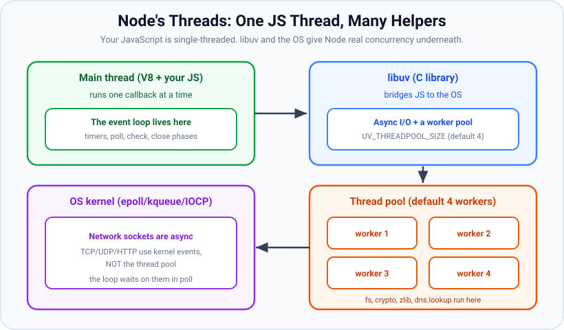

# What Node.js Is: Runtime, Layers and Lifecycle

*14 min read · Updated 7 Oct 2026 · Topic 1 of 74 · added to this kit, not part of the original course*

**Source:** written for this kit — examples verified on Node v24.19.0

---

## Why it matters

Every later topic in this kit (the event loop, the thread pool, streams, `process`, worker threads, memory limits) is a detail of one program: the `node` executable. If you picture Node as "JavaScript on the server" and nothing more, you cannot answer the questions that come up in production and in interviews:

- Why does one slow `JSON.parse` of a 200 MB string freeze every request, while 10,000 slow database queries do not?
- Why does `fs.readFile` use a background thread but an HTTP socket does not?
- Why is `window` undefined, but `fetch` and `setTimeout` exist?
- Which Node version is safe to deploy today, and for how long?
- Why did my `process.on('exit')` handler never send its log line?

All five answers come from what Node is made of (V8, libuv, C++ bindings, a JavaScript core library), how its threads are arranged (one JavaScript thread plus helpers), how its release lines work, and the fixed order in which a Node program starts, runs and stops. This lesson covers those four things.

## The concept, simply

**Node.js is a single executable program (`node`) that embeds Google's V8 JavaScript engine, adds an event loop and asynchronous I/O from the C library libuv, and exposes operating-system features to JavaScript through a C++ layer and a library of built-in JavaScript modules (`node:fs`, `node:http`, `node:crypto`, …).** You give it a file; it compiles and runs that file with V8, then keeps the process alive for as long as there are timers, sockets or pending operations, running your callbacks one at a time as their events arrive.

**Origin and purpose.** Ryan Dahl presented Node in 2009. The idea was not "JavaScript on the server" for its own sake. Servers of the time usually gave each connection its own thread, and each thread spent most of its life blocked, waiting for a disk or a database. Dahl's design used a single thread that never waits: every I/O call returns at once, the operating system reports when the data is ready, and a callback runs then. JavaScript fitted this design because it had no blocking I/O library of its own to unlearn, and browser programmers were already used to callbacks. A 2014 fork (io.js) merged back in 2015 as Node.js 4. The project is run today under the OpenJS Foundation.

**Runtime vs language vs framework.** These three words describe different layers:

| Term | What it is | Examples |
| --- | --- | --- |
| Language | A specification of syntax and semantics. No I/O at all: ECMAScript has no file, socket or timer API. | ECMAScript 2025 (JavaScript) |
| Engine | A program that parses, compiles and runs the language, and manages its memory. | V8, SpiderMonkey, JavaScriptCore |
| Runtime | An engine plus an event loop plus host APIs (files, network, timers, processes), packaged as something you can run. | Node.js, Deno, Bun, a browser tab |
| Framework | A library you load inside a runtime that sets the structure of your app. | Express, Fastify, NestJS |

So `setTimeout`, `fs` and `process` are not JavaScript. They are Node's host APIs. `Array.prototype.map` and `Promise` are JavaScript, provided by V8.

**The four layers inside `node`.**

1. **V8** (C++, from Google's Chromium project): parses and compiles JavaScript to machine code, runs it, and garbage-collects the heap. Topic 2 covers it.
2. **libuv** (C): the event loop, plus non-blocking networking through the kernel (`epoll` on Linux, `kqueue` on macOS, IOCP on Windows), plus a thread pool for operations that have no non-blocking OS version (file system, DNS `lookup`, some crypto and zlib).
3. **C++ bindings** (Node's `src/` directory): glue code that turns a JavaScript call such as `fs.open()` into a libuv request, and turns the libuv completion back into a JavaScript callback. Bundled C/C++ libraries live here too: OpenSSL, llhttp (HTTP parser), zlib, c-ares, ICU, simdjson, sqlite.
4. **The core library** (Node's `lib/` directory): the JavaScript code behind `node:fs`, `node:http`, `node:stream` and so on. It is compiled into the binary, so `require('node:fs')` never touches the disk.

**One JavaScript thread, many helpers.** All of your JavaScript runs on one thread, the main thread, inside one V8 isolate. That thread runs one callback at a time, to completion; nothing preempts it. Concurrency comes from elsewhere. Network sockets are non-blocking in the kernel: libuv asks the OS to watch thousands of them and parks in a single `epoll_wait` call until one is ready, so no extra thread is involved. Operations the OS cannot do without blocking (file reads, `dns.lookup`, `crypto.pbkdf2`, zlib) go to libuv's thread pool, which has 4 worker threads by default (`UV_THREADPOOL_SIZE` changes it). V8 also starts its own background threads for garbage collection and optimizing compilation. When a helper finishes, it queues a completion that the main thread picks up on its next trip around the event loop.


*Figure: one JavaScript thread on top, libuv in the middle, the thread pool and the OS kernel underneath. Look at: the right-hand box, which says network sockets use kernel events and NOT the thread pool.*

## How it works

**Running `node app.js`, step by step:**

1. **Bootstrap (C++).** The `node` binary starts, initialises the V8 platform (which starts V8's worker threads), OpenSSL and ICU, and creates a V8 isolate (one heap) and a context (one set of globals). Node does not build its internal state from scratch: it deserialises it from a startup snapshot compiled into the binary (`process.config.variables.node_use_node_snapshot` is `true` on official builds).
2. **Bootstrap (JavaScript).** Node's internal JavaScript runs: it sets up `process`, `globalThis`, timers, the module loaders and the error handlers. `performance.nodeTiming.bootstrapComplete` records when this finishes.
3. **Preload.** Modules named with `--require` / `--import` (or in `NODE_OPTIONS`) load first.
4. **Run the main module.** Your entry file is resolved, compiled and run from top to bottom. This is synchronous: timers and I/O you start here are only *registered*.
5. **Drain microtasks.** When the main module's synchronous code ends, the `process.nextTick` queue and then the promise microtask queue are emptied (in an ES module entry the order differs; see topic 8).
6. **Event loop.** libuv's `uv_run` starts turning: timers → pending → poll → check → close (topic 6). Each callback that runs is followed by another microtask drain. The loop keeps turning while any *ref'd* handle (an active timer, a listening server, an open socket) or pending request exists.
7. **`beforeExit`.** When the loop has nothing left, Node emits `process.on('beforeExit')`. If a listener schedules new work, the loop starts again and `beforeExit` fires again when that work is done.
8. **`exit`.** When `beforeExit` listeners add nothing, Node emits `process.on('exit', code)`. Listeners must be synchronous: the loop has stopped, so timers or I/O started here never run.
9. **Teardown.** Node releases the environment and the isolate and the OS process ends with `process.exitCode` (0 by default).

text

```
  node app.js
      │
      ▼
  1-2 bootstrap (C++ then internal JS, from the built-in snapshot)
      │
      ▼
  3   preload (--require / --import)
      │
      ▼
  4   main module runs top to bottom ──► 5 drain nextTick + promises
                                              │
                         ┌────────────────────┘
                         ▼
  6   event loop: timers → pending → poll → check → close   (repeats while
                         │                                    ref'd handles
                         │ loop empty                         or requests exist)
                         ▼
  7   'beforeExit' ── listener scheduled work? ── yes ──► back to 6
                         │ no
                         ▼
  8   'exit' (synchronous listeners only)
                         │
                         ▼
  9   teardown, OS exit status = process.exitCode

  process.exit() and an uncaught exception skip 7 but still run 8.
  A signal with no listener (SIGTERM, SIGINT) or SIGKILL skips both 7 and 8.
```

**What Node is good at, and bad at.** The single-thread design decides this:

- **I/O-bound work is cheap.** A request that spends 50 ms waiting on a database costs the main thread almost nothing during those 50 ms; it handles other requests meanwhile. API servers, proxies, gateways, chat and WebSocket servers, file and stream pipelines, and CLI tooling fit well.
- **CPU-bound work on the main thread blocks everything.** While your code computes, no other callback can run, no timer fires and no new connection is accepted. Image resizing, large JSON parsing, encryption of big payloads, machine-learning inference and tight numeric loops belong in `worker_threads`, a child process, a native addon or another service (topics 10, 62, 63).
- **The thread pool is shared and small.** Four slow `crypto.pbkdf2` calls fill all four workers, and the next `fs.readFile` waits behind them (topic 7).

**How Node differs from the browser runtime.** Both use an engine plus an event loop, but the host APIs and the security model differ:

| | Browser tab | Node.js |
| --- | --- | --- |
| Global object | `window` (also `globalThis`) | `globalThis` (also `global`); no `window`, no `document` |
| DOM | Yes | No |
| File system, processes, raw TCP/UDP | No | `node:fs`, `node:child_process`, `node:net`, `node:dgram` |
| Sandbox | Strict (same-origin policy, permissions prompts) | None by default: code has the OS permissions of the user who runs it. The opt-in permission model is `--permission` (added in v20.0.0, stable since v23.5.0 / v22.13.0) |
| Modules | Classic scripts and ES modules; no CommonJS | CommonJS and ES modules |
| Event loop | HTML spec loop (tasks, microtasks, rendering steps) | libuv phases plus `process.nextTick` |
| Who picks the engine version | The user's browser | You, when you choose the Node version |
| Web APIs present in both | `fetch`, `URL`, `TextEncoder`, `AbortController`, `structuredClone`, Web Streams, `navigator` (partial in Node, added in v21.0.0) | |

**Release lines.** Node ships a new major version on a fixed calendar, and each major moves through phases:

- **Current**: the newest major, for its first six months. Gets new features first; breaking changes land only in the next major.
- **Active LTS** (long-term support): an even-numbered major becomes LTS about six months after release, gets a codename (24 is "Krypton"), and stays Active for 12 months. It receives bug fixes, security fixes and back-ported features that the release team audited.
- **Maintenance**: the next 18 months. Critical bug fixes and security fixes only. Together, Active plus Maintenance give about 30 months of LTS.
- **End-of-Life (EOL)**: no more releases, including security fixes.

Up to Node.js 26, odd-numbered majors (23, 25) never become LTS: they stay Current for about six months, get about two months of Maintenance, and then reach EOL (Node 25: released 2025-10-15, Maintenance from 2026-04-01, EOL 2026-06-01). nodejs.org states the plan changes from Node.js 27: "the release cycle will be annual and every major version will move to LTS status after its six-month Current phase (and six additional months of Alpha phase)."

text

```
Schedule from nodejs/Release schedule.json, read on 2026-10-07

line  codename  released     Active LTS   Maintenance  End-of-Life   phase on 2026-10-07
----  --------  ----------   ----------   -----------  -----------   -------------------
v20   Iron      2023-04-18   2023-10-24   2024-10-22   2026-04-30    EOL
v22   Jod       2024-04-24   2024-10-29   2025-10-21   2027-04-30    Maintenance
v24   Krypton   2025-05-06   2025-10-28   2026-10-20   2028-04-30    Active LTS (13 days left)
v25   -         2025-10-15   never        2026-04-01   2026-06-01    EOL
v26   (none)    2026-05-05   2026-10-28   2027-10-20   2029-04-30    Current (LTS in 21 days)
v27   (none)    alpha from 2026-10-28, release 2027-04-22, EOL 2030-04-30   not out yet

One even line, as a timeline:
  release ──6 mo Current──► LTS start ──12 mo Active LTS──► Maintenance ──18 mo──► EOL
  v24:  2025-05-06            2025-10-28                     2026-10-20             2028-04-30
```

**Reading the schedule on 7 Oct 2026.** Node 24 is Active LTS until 2026-10-20, then Maintenance until 2028-04-30. Node 26 is Current and becomes Active LTS on 2026-10-28. Node 22 is in Maintenance until 2027-04-30. Node 20 reached EOL on 2026-04-30. For production, pick the newest Active LTS, or a Maintenance line that still has enough life left for your upgrade cycle. Node 24 is the right default today, and moving to Node 26 after 2026-10-28 keeps you on Active LTS.

> ⚠️ Unverified: `schedule.json` lists Node 27 with `alpha` 2026-10-28, `start` 2027-04-22, `maintenance` 2027-10-20 and `end` 2030-04-30, but no `lts` date. I could not find an official nodejs.org page that gives Node 27's LTS start date or explains the `maintenance` date for the new annual cycle, so read those two fields as provisional.

## Code examples

**Example 1 — the layers, as real version numbers.** `process.versions` lists the components compiled into this binary.

javascript

```
// layers.js: print the versions of the pieces this Node binary is built from
const { node, v8, uv, openssl, llhttp, zlib, undici } = process.versions;
console.log({ node, v8, uv, openssl, llhttp, zlib, undici });
console.log('libuv thread pool size (env):', process.env.UV_THREADPOOL_SIZE ?? '(unset, so libuv uses 4)');
console.log('release line:', process.release.name, process.release.lts ?? '(not an LTS build)');
console.log('built-in modules:', require('node:module').builtinModules.length);

// Real output (Node v24.19.0):
//   {
//     node: '24.19.0',
//     v8: '13.6.233.17-node.51',
//     uv: '1.52.1',
//     openssl: '3.5.7',
//     llhttp: '9.4.3',
//     zlib: '1.3.2.1-motley-3246f1b',
//     undici: '7.29.0'
//   }
//   libuv thread pool size (env): (unset, so libuv uses 4)
//   release line: node Krypton
//   built-in modules: 72
```

`v8` is the engine (layer 1), `uv` is libuv (layer 2), and `openssl`, `llhttp` and `zlib` are C libraries wired in through the C++ bindings (layer 3). `undici` is the JavaScript HTTP client behind global `fetch`, part of the core library (layer 4). `process.release.lts` holds the codename only on LTS builds; on a Current build it is `undefined`. Do not use `process.binding()` to look at the C++ layer: it is internal and deprecated (DEP0111).

**Example 2 — the threads of a real Node process (Linux only).** The thread pool starts lazily, on the first job that needs it.

javascript

```
// threads.js (Linux only): count the OS threads of this Node process
const fs = require('node:fs');
const crypto = require('node:crypto');

const names = () =>
  fs.readdirSync('/proc/self/task').map((tid) =>
    fs.readFileSync(`/proc/self/task/${tid}/comm`, 'utf8').trim());

console.log('at startup:', names().length, 'threads');
console.log(names().join(', '));

// The first thread-pool job makes libuv start its worker threads.
crypto.pbkdf2('pw', 'salt', 1000, 32, 'sha256', () => {
  console.log('after first pool job:', names().length, 'threads');
  console.log(names().join(', '));
});

// Real output (Node v24.19.0):
//   at startup: 7 threads
//   MainThread, DelayedTaskSche, V8Worker, V8Worker, V8Worker, V8Worker, SignalInspector
//   after first pool job: 11 threads
//   MainThread, DelayedTaskSche, V8Worker, V8Worker, V8Worker, V8Worker, SignalInspector, libuv-worker, libuv-worker, libuv-worker, libuv-worker
```

bash

```
$ UV_THREADPOOL_SIZE=8 node threads.js | tail -2
after first pool job: 15 threads
MainThread, DelayedTaskSche, V8Worker, V8Worker, V8Worker, V8Worker, SignalInspector, libuv-worker, libuv-worker, libuv-worker, libuv-worker, libuv-worker, libuv-worker, libuv-worker, libuv-worker
```

Only `MainThread` runs your JavaScript. The four `V8Worker` threads belong to V8's platform (concurrent garbage collection, background compilation), `DelayedTaskSche` schedules V8's delayed tasks, `SignalInspector` waits for the `SIGUSR1` that starts the debugger, and the `libuv-worker` threads are the thread pool. The thread names come from `/proc`, so this example is Linux-only.

> ⚠️ Unverified: the thread names and counts on macOS and Windows; I could only run this on Linux.

**Example 3 — I/O-bound waits overlap; CPU-bound work blocks.**

javascript

```
// cpu-vs-io.js: waiting on I/O overlaps; CPU work on the main thread does not
const { setTimeout: sleep } = require('node:timers/promises');

async function ioBound() {
  const t0 = performance.now();
  // 100 "requests" that each wait 50 ms (a stand-in for a DB or HTTP call)
  await Promise.all(Array.from({ length: 100 }, () => sleep(50)));
  return performance.now() - t0;
}

function cpuBound(ms) {
  const end = performance.now() + ms;
  while (performance.now() < end) {} // keeps the only JS thread busy
}

(async () => {
  console.log(`100 x 50 ms waits took ${(await ioBound()).toFixed(0)} ms`);

  const scheduled = performance.now();
  setTimeout(() => {
    console.log(`10 ms timer fired after ${(performance.now() - scheduled).toFixed(0)} ms`);
  }, 10);
  cpuBound(300);
  console.log('300 ms of CPU work finished');
})();

// Real output (Node v24.19.0), three runs: 52/52/51 ms and 301/301/300 ms
//   100 x 50 ms waits took 52 ms
//   300 ms of CPU work finished
//   10 ms timer fired after 301 ms
```

A hundred waits of 50 ms finish in about 50 ms, not 5,000 ms, because waiting uses no JavaScript thread time. The 10 ms timer fires after 300 ms: its time was up long before, but the timers phase cannot run while the main thread is inside `cpuBound`.

**Example 4 — what this runtime has, compared with a browser tab.**

javascript

```
// globals.js: what this runtime provides, compared with a browser tab
const names = ['window', 'document', 'globalThis', 'process', 'require',
  'Buffer', 'fetch', 'setImmediate', 'navigator', 'localStorage'];
for (const n of names) {
  let t;
  try { t = typeof eval(n); } catch { t = '(ReferenceError)'; }
  console.log(n.padEnd(13), t);
}
console.log('globalThis === global:', globalThis === global);

// Real output (Node v24.19.0):
//   window        (ReferenceError)
//   document      (ReferenceError)
//   globalThis    object
//   process       object
//   require       function
//   Buffer        function
//   fetch         function
//   setImmediate  function
//   navigator     object
//   localStorage  (ReferenceError)
//   globalThis === global: true
```

`require` is found here because a CommonJS module's code is wrapped in a function that receives `require` as a parameter; it is not a property of `globalThis` and does not exist in ES modules. `localStorage` is missing because on Node 24 it needs `--experimental-webstorage` (added in v22.4.0). `fetch` stopped being experimental in v21.0.0.

**Example 5 — Node's own start-up milestones.** `performance.nodeTiming` records when each bootstrap step finished.

javascript

```
// timing.js: Node's own start-up milestones for this process (ms since process start)
const { performance } = require('node:perf_hooks');
const t = performance.nodeTiming;
const ms = (x) => (x < 0 ? '-1 (not yet)' : `${x.toFixed(1)} ms`);

console.log('in the main module: loopStart =', ms(t.loopStart));

setTimeout(() => {
  console.log({
    nodeStart: ms(t.nodeStart),                 // process initialised
    v8Start: ms(t.v8Start),                     // V8 platform initialised
    environment: ms(t.environment),             // Node.js environment initialised
    bootstrapComplete: ms(t.bootstrapComplete), // bootstrapping finished
    loopStart: ms(t.loopStart),                 // event loop started
  });
}, 20);

process.on('exit', () => {
  console.log('in exit: loopExit =', ms(t.loopExit), '| loop iterations:', t.uvMetricsInfo.loopCount);
});

// Real output (Node v24.19.0; the times change by a few ms per run):
//   in the main module: loopStart = -1 (not yet)
//   {
//     nodeStart: '0.7 ms',
//     v8Start: '4.4 ms',
//     environment: '16.8 ms',
//     bootstrapComplete: '21.7 ms',
//     loopStart: '25.8 ms'
//   }
//   in exit: loopExit = 46.4 ms | loop iterations: 1
```

`loopStart` is `-1` while the main module runs, which proves step 4 of the lifecycle happens before the event loop exists. `loopExit` has a value only inside an `exit` listener. `uvMetricsInfo` was added in v22.8.0.

**Example 6 — the whole lifecycle in one file.**

javascript

```
// lifecycle.js: the order in which one Node program runs
let rounds = 0;

process.on('beforeExit', (code) => {
  rounds++;
  console.log(`5. beforeExit #${rounds} (code ${code}): the loop is empty`);
  if (rounds === 1) {
    // Scheduling work here restarts the event loop; beforeExit fires again later.
    setTimeout(() => console.log('6. timer scheduled inside beforeExit'), 10);
  }
});

process.on('exit', (code) => {
  // Only synchronous work runs here: the loop has stopped.
  setTimeout(() => console.log('never printed'), 0);
  console.log(`7. exit (code ${code})`);
});

setTimeout(() => console.log('4. timer (timers phase, 5 ms later)'), 5);
setImmediate(() => console.log('3. setImmediate (check phase, first loop turn)'));
Promise.resolve().then(() => console.log('2. promise (microtask, right after the main module)'));
console.log('1. main module, synchronous code');

// Real output (Node v24.19.0), identical on three runs:
//   1. main module, synchronous code
//   2. promise (microtask, right after the main module)
//   3. setImmediate (check phase, first loop turn)
//   4. timer (timers phase, 5 ms later)
//   5. beforeExit #1 (code 0): the loop is empty
//   6. timer scheduled inside beforeExit
//   5. beforeExit #2 (code 0): the loop is empty
//   7. exit (code 0)
```

Read it against the numbered steps: main module (4), microtasks (5), the loop (6), `beforeExit` (7), which ran **twice** because the first listener call scheduled a timer, then `exit` (8). The timer created inside the `exit` listener never ran. The timer uses 5 ms, not 0 ms, because at the top level a 0 ms timer and `setImmediate` race (topic 6).

**Example 7 — edge case: `process.exit()` and uncaught errors skip `beforeExit`.**

javascript

```
// exit-skip.js: process.exit() and an uncaught error skip beforeExit
process.on('beforeExit', () => console.log('beforeExit (not printed)'));
process.on('exit', (code) => console.log(`exit handler, code ${code}`));

setTimeout(() => console.log('pending timer (not printed)'), 100);

if (process.argv[2] === 'throw') {
  throw new Error('boom');
}
process.exitCode = 3;          // the code the process will end with
process.exit();                // ends now: pending timer dropped, no beforeExit
```

bash

```
$ node exit-skip.js; echo "exit status: $?"
exit handler, code 3
exit status: 3
$ node exit-skip.js throw; echo "exit status: $?"
exit handler, code 1
…/exit-skip.js:8
  throw new Error('boom');
  ^

Error: boom
    at Object.<anonymous> (…/exit-skip.js:8:9)
    …

Node.js v24.19.0
exit status: 1
```

Three things to notice. First, `beforeExit` never fires in either run: the docs state it "is not emitted for conditions causing explicit termination, such as calling `process.exit()` or uncaught exceptions". So `beforeExit` is the wrong place for cleanup that must always happen; use `exit` for synchronous cleanup, and signal handlers plus explicit shutdown code for asynchronous cleanup (topic 66). Second, `process.exit()` drops the pending 100 ms timer without running it. Third, `process.exit()` with no argument uses `process.exitCode`, and an uncaught exception sets the code to 1.

One more exit path skips **both** events: a signal that has no listener. `SIGTERM` is what `kill <pid>`, Docker and Kubernetes send on shutdown.

javascript

```
// sigterm.js: a signal with no listener ends the process before either event
process.on('beforeExit', () => console.log('beforeExit (not printed)'));
process.on('exit', (code) => console.log(`exit, code ${code} (not printed)`));
setTimeout(() => {}, 5000);                                  // keeps the loop alive
setTimeout(() => process.kill(process.pid, 'SIGTERM'), 50);  // what `kill <pid>` sends
```

bash

```
$ node sigterm.js; echo "exit status: $?"
Terminated                 node sigterm.js
exit status: 143
```

Status 143 is 128 + 15 (the number of `SIGTERM`). `Terminated` is printed by the shell, not by Node. Adding `process.on('SIGTERM', handler)` replaces the default action, and from there you decide when to exit; that is the basis of graceful shutdown (topic 66).

**Example 8 — reading the release schedule in code.**

javascript

```
// release-status.mjs: which phase is each Node major in on a given date?
// Usage: node release-status.mjs [YYYY-MM-DD]
const URL = 'https://raw.githubusercontent.com/nodejs/Release/main/schedule.json';
const day = process.argv[2] ?? new Date().toISOString().slice(0, 10);
const schedule = await (await fetch(URL)).json();

function phase(r) {                         // ISO dates compare correctly as strings
  if (day < (r.alpha ?? r.start)) return null;    // not out yet
  if (day >= r.end) return 'End-of-Life';
  if (day < r.start) return 'Alpha';
  if (r.maintenance && day >= r.maintenance) return 'Maintenance';
  if (r.lts && day >= r.lts) return 'Active LTS';
  return 'Current';
}

console.log(`Status on ${day}:`);
for (const [line, r] of Object.entries(schedule)) {
  const p = phase(r);
  if (p && p !== 'End-of-Life') {
    console.log(`  ${line.padEnd(4)} ${p.padEnd(12)} lts ${(r.lts ?? '-').padEnd(10)}  maintenance ${r.maintenance}  end ${r.end}`);
  }
}
```

bash

```
$ node release-status.mjs 2026-10-07
Status on 2026-10-07:
  v22  Maintenance  lts 2024-10-29  maintenance 2025-10-21  end 2027-04-30
  v24  Active LTS   lts 2025-10-28  maintenance 2026-10-20  end 2028-04-30
  v26  Current      lts 2026-10-28  maintenance 2027-10-20  end 2029-04-30
$ node release-status.mjs 2026-10-28
Status on 2026-10-28:
  v22  Maintenance  lts 2024-10-29  maintenance 2025-10-21  end 2027-04-30
  v24  Maintenance  lts 2025-10-28  maintenance 2026-10-20  end 2028-04-30
  v26  Active LTS   lts 2026-10-28  maintenance 2027-10-20  end 2029-04-30
  v27  Alpha        lts -           maintenance 2027-10-20  end 2030-04-30
```

Top-level `await` works because the file is an ES module (`.mjs`). The JSON is the same data the nodejs.org release table is built from, so the script gives you a check you can run in CI ("fail if our Docker base image's major is within 90 days of `end`").

## Common mistakes & gotchas

- **"Node is single-threaded."** Only your JavaScript is. A plain `node` process on Linux has 7 OS threads at startup and 11 after the first thread-pool job (Example 2). The accurate sentence: one JavaScript thread per isolate, plus libuv and V8 helper threads.
- **"Everything async uses the thread pool."** Network I/O (TCP, UDP, HTTP, sockets) uses kernel readiness events (`epoll`/`kqueue`/IOCP), not the pool. The pool runs file system calls, `dns.lookup`, async `crypto.pbkdf2`/`scrypt`/`randomBytes`/`randomFill`/`generateKeyPair`, and zlib.
- **Calling Node a framework or a language.** Node is a runtime. Express is a framework that runs in it; JavaScript is the language it runs.
- **Expecting browser globals.** `window`, `document` and `localStorage` (without a flag) do not exist. Code that must run in both uses `globalThis` and feature checks.
- **Deploying a Current or odd-numbered release to production.** A Current line changes quickly and has not yet been audited for LTS, and odd lines up to 25 reach EOL about seven and a half months after release. Use Active LTS or Maintenance.
- **Doing async work in an `exit` listener.** The loop has stopped; a `setTimeout`, a log write over the network or a database `close()` started there never completes.
- **Using `beforeExit` for cleanup.** It does not fire on `process.exit()`, on an uncaught exception or on a signal (Example 7). An unhandled `SIGTERM` skips `exit` as well.
- **Using `process.binding()`.** It is internal, deprecated (DEP0111), and unavailable under the permission model. Use the public modules.

## Best practices

- **Pin the runtime version.** Put the major in `.nvmrc` / `.node-version` and in your Docker `FROM node:24-slim` tag, and set `"engines"` in `package.json` as documentation (npm only warns on a mismatch unless `engine-strict=true`; see topic 14).
- **Track the schedule.** Upgrade to the next LTS during its Active phase, well before your current line's EOL. Example 8 shows a check you can automate.
- **Keep CPU work off the main thread.** Anything that takes more than a few milliseconds per request goes to `worker_threads`, a child process or another service.
- **Size the thread pool on purpose.** If you do heavy `fs`, `crypto` or `zlib` work, set `UV_THREADPOOL_SIZE` in the environment before Node starts (setting it from inside a running script is unreliable once the pool has started).
- **Put shutdown logic in signal handlers, not `beforeExit`.** Handle `SIGTERM`/`SIGINT`, close servers and pools, then let the loop empty or call `process.exit()` (topic 66).
- **Use `node:` prefixes for built-ins** (`require('node:fs')`). It makes clear the module is part of the core library and cannot be shadowed by a package from npm.

## ⭐ Interview lens

> **Q: “What is Node.js, in one precise sentence?”**  
> A: A JavaScript runtime: one executable that embeds the V8 engine, uses libuv for its event loop, non-blocking network I/O and a thread pool, and exposes the operating system to JavaScript through C++ bindings and a built-in library of modules such as `fs`, `net` and `http`. *Trap:* "a JavaScript framework" or "server-side JavaScript language" are both wrong.

> **Q: “If Node is single-threaded, how does it serve 10,000 connections?”**  
> A: Only the JavaScript is single-threaded. The sockets are non-blocking; libuv registers them all with the kernel (`epoll` on Linux) and the main thread sleeps in one `epoll_wait` call until some are ready, then runs their callbacks one by one. A connection that is waiting costs memory, not a thread. Blocking file and DNS work goes to libuv's 4-thread pool. The limit is CPU time per callback: one slow synchronous callback delays all 10,000.

> **Q: “Which Node version would you deploy today, and why?”**  
> A: On 7 Oct 2026, Node 24 (Krypton): it is Active LTS until 2026-10-20, then Maintenance until 2028-04-30. Node 26 becomes Active LTS on 2026-10-28, so I would plan that upgrade next. I would not deploy a Current line, and I would leave Node 22 (Maintenance, EOL 2027-04-30) soon.

> **Q: “What is the difference between `beforeExit` and `exit`?”**  
> A: `beforeExit` fires when the event loop runs out of work; its listener may schedule more work, and then the loop continues and `beforeExit` fires again later. It is not emitted for `process.exit()` or uncaught exceptions. `exit` fires once, just before the process ends, in all of those cases; its listeners must be synchronous because the loop is gone. Neither fires when a signal with no listener (`SIGTERM`, `SIGINT`) or `SIGKILL` ends the process.

> **Q: “Name things that exist in the browser but not Node, and the reverse.”**  
> A: Browser only: `window`, `document`, the DOM, `localStorage` (Node 24 needs a flag), a same-origin sandbox. Node only: `process`, `Buffer`, `require` and CommonJS, `fs`, `child_process`, raw TCP/UDP, `setImmediate`, `process.nextTick`. Both: `fetch`, `URL`, `AbortController`, `TextEncoder`, Web Streams, `structuredClone`.

## Cheat-card

- **Node =** V8 (engine) + libuv (event loop, async I/O, thread pool) + C++ bindings + core JS library, in one binary.
- **Runtime ≠ language ≠ framework:** JavaScript is the language, Node the runtime, Express a framework.
- **Threads:** 1 JS main thread; libuv pool = 4 by default (`UV_THREADPOOL_SIZE`); V8 helper threads; network I/O uses the kernel, not the pool.
- **Good at:** waiting (I/O-bound). **Bad at:** computing on the main thread (CPU-bound blocks everything).
- **Versions:** `process.versions.v8`, `.uv`, `.openssl`; `process.release.lts` = codename on LTS builds.
- **Lifecycle:** bootstrap → preload → main module → microtasks → event loop → `beforeExit` (may restart the loop) → `exit` (sync only) → teardown.
- **Skips `beforeExit`:** `process.exit()`, uncaught exception, signals.
- **Release phases:** Current (6 months) → Active LTS (12 months) → Maintenance (18 months) → EOL. Odd lines up to 25 never become LTS; from 27 every major becomes LTS.
- **On 2026-10-07:** 24 Active LTS (Maintenance from 2026-10-20), 26 Current (LTS from 2026-10-28), 22 Maintenance (EOL 2027-04-30), 20 EOL.

---

## Learn More

- [Introduction to Node.js nodejs.org](https://nodejs.org/en/learn/getting-started/introduction-to-nodejs)
- [Differences between Node.js and the Browser nodejs.org](https://nodejs.org/en/learn/getting-started/differences-between-nodejs-and-the-browser)
- [Node.js Releases nodejs.org](https://nodejs.org/en/about/previous-releases)
- [Node.js Release Working Group schedule GitHub](https://github.com/nodejs/Release)
- [process: 'beforeExit' and 'exit' events nodejs.org](https://nodejs.org/api/process.html)
- [libuv design overview docs.libuv.org](https://docs.libuv.org/en/v1.x/design.html)
- [Don't Block the Event Loop (or the Worker Pool) nodejs.org](https://nodejs.org/en/learn/asynchronous-work/dont-block-the-event-loop)
