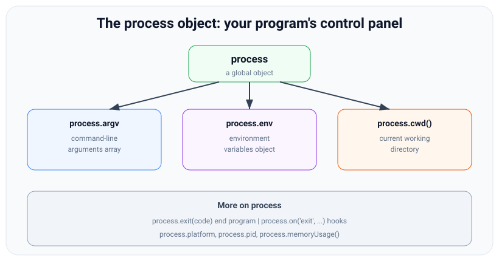

# The Global Object, process, and Environment

*9 min read · Updated 24 Jul 2026 Topic 4 of 70 Bookmark Mark done Why it matters Every real Node application needs to answer questions about itself and its surroundings · Topic 4 of 70*

**Source:** [https://www.geekyfrontend.in/learn/nodejs-backend-kit/global-process-env](https://www.geekyfrontend.in/learn/nodejs-backend-kit/global-process-env)

---

## Why it matters

Every real Node application needs to answer questions about *itself and its surroundings*: What arguments did the user pass on the command line? Which database URL should I connect to — the local one or the production one? What directory am I running in? Am I in development or production mode? How do I shut down cleanly? All of these answers come from one place: the global `process` object.

`process` is the single most important global in Node. It is how configuration flows into your app (through environment variables), how command-line tools read their inputs (through `process.argv`), and how servers manage their own lifecycle (through exit codes and signal handlers). Master `process` and you can configure, deploy, and operate real services. It also happens to be one of the clearest markers of Node fluency in interviews — the difference between someone who has run `node app.js` once and someone who has shipped something.

## The concept, simply

In the browser, the global object is `window` and it represents the browser tab. In Node, the global object is `global` and it represents the running program. There is **no `window`** in Node — that's a browser thing. A small set of things are available everywhere without importing them: `console`, `setTimeout`, `process`, `Buffer`, `__dirname`, and `__filename` (the last two only in CommonJS modules). The modern, portable way to refer to the global object itself is `globalThis`.

The star of the show is **`process`** — a global object that represents the current running Node process, like a control panel for your program. Through it you read command-line arguments, environment variables, the working directory, the process ID, memory usage, and platform; and you can hook into lifecycle events or exit the program.



The process object is your program's control panel: argv for arguments, env for config, cwd for location, plus lifecycle controls.

The three you will use constantly: `process.argv` (command-line arguments), `process.env` (environment variables — where configuration and secrets live), and `process.cwd()` (the directory the process was started from).

## How it works

**`process.argv` — command-line arguments.** This is an array of strings. Its first two elements are always fixed: index 0 is the path to the Node executable, and index 1 is the path to the script being run. Your *actual* arguments start at index 2. So to read what the user typed, you slice from index 2:

| Index | Value for `node app.js hello 42` |
| --- | --- |
| 0 | /usr/local/bin/node (the Node binary) |
| 1 | /path/to/app.js (your script) |
| 2 | hello (your first argument) |
| 3 | 42 (your second argument, as a string) |

Note that everything in `argv` is a *string* — `"42"`, not the number `42`. You must convert types yourself.

**`process.env` — environment variables.** This is a plain object whose keys and values are strings, populated from the environment the process was launched in. It is the standard way to pass *configuration* into an app without hard-coding it: database URLs, API keys, feature flags, and the all-important `NODE_ENV` (conventionally `"development"`, `"production"`, or `"test"`). Two rules: every value is a string (so `process.env.PORT` is `"3000"`, not `3000`), and any key you never set reads as `undefined`. Secrets belong in environment variables, never committed to source code.

**`process.cwd()` vs `__dirname`.** A subtle but interview-relevant distinction. `process.cwd()` returns the *current working directory* — wherever you were standing in the terminal when you launched Node. `__dirname` returns the directory of the *current file*. They are often different: if you're in `/home/me` and run `node ./scripts/build.js`, then `process.cwd()` is `/home/me` but `__dirname` is `/home/me/scripts`. Use `__dirname` to reliably locate files relative to your code; use `cwd()` for “wherever the user invoked me.”

**Lifecycle and signals.** `process.exit(code)` ends the program immediately with an exit code (0 = success, non-zero = failure). You can listen for events: `process.on('exit', ...)` for final cleanup, `process.on('SIGINT', ...)` to catch Ctrl-C for graceful shutdown, and `process.on('uncaughtException', ...)` as a last resort for unhandled errors. Well-behaved servers use these to finish in-flight requests and close database connections before exiting.

**Other useful `process` members:** `process.version` (the Node version), `process.platform` (`'darwin'`, `'linux'`, `'win32'`), `process.pid` (the OS process ID), `process.memoryUsage()` (heap stats), and `process.uptime()` (seconds running). And `global` itself lets you attach truly global values — though you should almost never do that.

## Code examples

**Example 1 — reading command-line arguments.** A tiny greeting CLI.

javascript

```
// greet.js
const args = process.argv.slice(2); // drop node path + script path
const name = args[0] || 'world';
const times = Number(args[1]) || 1;  // argv values are strings — convert!

for (let i = 0; i < times; i++) {
  console.log('Hello, ' + name + '!');
}

// Run:  node greet.js Ankit 3
// Output: Hello, Ankit!  (three times)
```

**Example 2 — configuration via environment variables.** The backbone of every deployable app.

javascript

```
// config.js
const config = {
  port: Number(process.env.PORT) || 3000,        // string -> number, with default
  nodeEnv: process.env.NODE_ENV || 'development',
  dbUrl: process.env.DATABASE_URL,               // required in production
  isProd: process.env.NODE_ENV === 'production',
};

if (config.isProd && !config.dbUrl) {
  console.error('DATABASE_URL is required in production');
  process.exit(1); // non-zero = failure, stops deploy scripts
}

console.log('Starting in ' + config.nodeEnv + ' on port ' + config.port);

// Run:  PORT=8080 NODE_ENV=production DATABASE_URL=... node config.js
```

**Example 3 — inspecting the environment and locating files.**

javascript

```
// info.js
const path = require('node:path');

console.log('Node version :', process.version);
console.log('Platform     :', process.platform);
console.log('Process ID   :', process.pid);
console.log('Launched from :', process.cwd());
console.log('This file dir :', __dirname);

// Build a path relative to THIS file, not the caller's location:
const dataFile = path.join(__dirname, 'data', 'seed.json');
console.log('Data file    :', dataFile);

const mb = (process.memoryUsage().heapUsed / 1024 / 1024).toFixed(1);
console.log('Heap used    :', mb + ' MB');
```

**Example 4 — graceful shutdown.** Catch Ctrl-C and clean up.

javascript

```
// shutdown.js
console.log('Running... press Ctrl-C to stop. PID:', process.pid);

process.on('SIGINT', () => {
  console.log('
Caught interrupt — closing connections, flushing logs...');
  // ...close DB, finish in-flight requests here...
  process.exit(0); // clean exit
});

setInterval(() => console.log('still working:', process.uptime().toFixed(0) + 's'), 1000);
```

## Common mistakes & gotchas

- **Forgetting to `slice(2)` on `process.argv`.** The first two entries are the Node binary and your script path, not user input. Reading `argv[0]` as an argument is a classic bug.
- **Treating `process.env` values as non-strings.** `process.env.PORT` is `"3000"`; `process.env.DEBUG` is `"true"` or `"false"` as strings. `"false"` is truthy! Convert explicitly with `Number()` and compare strings deliberately.
- **Hard-coding secrets instead of using `process.env`.** API keys and database passwords committed to source are a security incident waiting to happen. Read them from the environment.
- **Confusing `process.cwd()` with `__dirname`.** `cwd()` depends on where the user ran the command; `__dirname` is fixed to the file. Using `cwd()` to load a bundled file breaks when invoked from another directory.
- **Reaching for `window`.** It does not exist in Node — use `process`, or `globalThis` for the global object.
- **Calling `process.exit()` too eagerly.** It terminates immediately and can cut off pending writes (like buffered `console.log` or in-flight I/O). Prefer letting the program end naturally, or set `process.exitCode` and finish gracefully.
- **Polluting `global`.** Attaching your own values to `global` creates hidden, hard-to-test coupling. Pass values explicitly instead.

## Best practices

- **Centralise configuration.** Read all `process.env` values once into a single `config` object, validate required ones at startup, and fail fast with `process.exit(1)` if something critical is missing.
- **Always convert and default env values:** `Number(process.env.PORT) || 3000`. Never trust that a variable is set or is the right type.
- **Keep secrets in the environment** (or a secrets manager), and use a `.env` file locally that is git-ignored — loaded via a tool or Node's built-in `--env-file` flag.
- **Use `__dirname` with `path.join`** to locate files bundled with your code, so paths work regardless of the current directory.
- **Handle `SIGTERM` and `SIGINT` for graceful shutdown** in servers — close connections and finish requests before exiting so deploys don't drop traffic.
- **Prefer `globalThis` over `global`** when you need the global object, for portability with browser and edge runtimes.

## ⭐ Interview lens

> **Q: “What is the `process` object?”**  
> A: A global object representing the current running Node process. It exposes command-line arguments (`argv`), environment variables (`env`), the working directory (`cwd()`), process info (`pid`, `platform`, `version`, `memoryUsage()`), and lifecycle controls (`exit()`, signal events). It's how a program reads its inputs and manages itself.

> **Q: “What's in `process.argv[0]` and `[1]`?”**  
> A: Index 0 is the path to the Node executable, index 1 is the path to the running script; real arguments start at index 2, so you typically use `process.argv.slice(2)`. *Trap:* assuming user args start at index 0.

> **Q: “How do you pass configuration into a Node app, and why not hard-code it?”**  
> A: Through environment variables read via `process.env`. It keeps config and secrets out of source control, lets the same build run differently in dev/staging/prod, and follows twelve-factor principles. *Trap:* not mentioning that env values are always strings and need conversion.

> **Q: “Difference between `process.cwd()` and `__dirname`?”**  
> A: `process.cwd()` is the directory the process was launched from (varies with how it's invoked); `__dirname` is the directory of the current file (fixed). Use `__dirname` to locate bundled assets reliably.

> **Q: “Is there a `window` object in Node?”**  
> A: No — `window` is a browser global. Node's global object is `global`, and the portable reference is `globalThis`. The everyday global you actually use is `process`.

> **Q: “How would you implement graceful shutdown?”**  
> A: Listen for `SIGTERM`/`SIGINT` with `process.on(...)`, then stop accepting new connections, finish in-flight requests, close DB pools, and call `process.exit(0)` (or let the loop drain). *Trap:* calling `process.exit()` immediately, which drops pending work.

## Cheat-card

- **Global object:** `global` in Node (no `window`); portable = `globalThis`.
- **`process.argv`:** string array; real args at index 2 — `slice(2)`.
- **`process.env`:** config & secrets; all values are strings; missing = `undefined`.
- **`process.cwd()`** = launch dir; **`__dirname`** = file's dir.
- **Lifecycle:** `process.exit(code)`, `process.on('SIGINT'/'SIGTERM'/'exit')`.
- **Info:** `process.version`, `.platform`, `.pid`, `.memoryUsage()`.
- **Rule:** convert env values, never hard-code secrets, don't pollute `global`.
- **Env loaders:** `--env-file` → last file wins; `process.loadEnvFile()` and dotenv → first file wins; a variable already in the real environment beats every file.
- **Config:** `schema.safeParse(process.env)` once at start-up (zod: `z.coerce.number()`, `z.stringbool()`); print all issues and exit non-zero.
- **`util.parseArgs`:** string/boolean values only; strict by default (`ERR_PARSE_ARGS_*`, exit 1 if uncaught).
- **stdio:** fd 0/1/2; results → stdout, diagnostics → stderr; pipe writes are async on POSIX, so set `process.exitCode` instead of calling `process.exit()` after big writes.
- **Timing:** `process.hrtime.bigint()` = monotonic nanoseconds as a BigInt; `hrtime()` tuple is Legacy.
- **`beforeExit`:** fires when the loop is empty, may schedule more work; not emitted on `process.exit()`, uncaught exceptions or signals.
- **SIGTERM:** `server.close()` + `closeIdleConnections()` + an `unref()`'d deadline → `exit(0)`; no handler → killed, `code null`, shell 143.
- **Exit codes:** 1 uncaught, 9 bad option, 13 unsettled top-level await; signals = 128 + n (143 TERM, 137 KILL, 134 ABRT).

---

## Learn More

- [Process | Node.js API Documentation nodejs.org](https://nodejs.org/api/process.html)
- [Global objects | Node.js API Documentation nodejs.org](https://nodejs.org/api/globals.html)
- [How to read environment variables from Node.js nodejs.org](https://nodejs.org/en/learn/command-line/how-to-read-environment-variables-from-nodejs)
- [Learn Node.js - Full Tutorial for Beginners freeCodeCamp.org](https://www.youtube.com/watch?v=RLtyhwFtXQA)

---

## Additional topics

*Added 7 Oct 2026 · examples verified on Node v24.19.0*

### dotenv and `process.loadEnvFile()`

A `.env` file is a plain text file of `KEY=value` lines that you keep out of git. Some code has to read it and copy its keys into `process.env` before your config code runs. There are three ways to do that, and they differ in which value wins when the same key appears twice. **dotenv** (npm package, 18.0.6 here) is the original JavaScript loader. Node now has its own: the `--env-file` flag (added v20.6.0, stable since v24.10.0) and `process.loadEnvFile(path)` (added v21.7.0 / v20.12.0, stable since v24.10.0). Without any loader, a value that sits only in `.env` is `undefined` at run time, and the app quietly falls back to its defaults or crashes later on the first database call.

How it works:

1. The loader reads the file and parses each line: it strips quotes, drops `#` comments, ignores an `export ` prefix and joins quoted multi-line values.
2. For each key, it checks whether `process.env` already has that key. dotenv and `loadEnvFile` skip keys that are already set, unless you pass dotenv `override: true`.
3. It assigns the remaining keys as strings. Nothing is converted to a number or boolean.
4. With several files, the order decides which value wins, and the rule is different for each loader (see the run below).

**Example — dotenv 18.0.6, and the precedence of all three loaders.** `.env` holds `PORT=3000` and `LOG_LEVEL=info`; `.env.local` holds `PORT=4400`.

javascript

```
// dotenv-demo.js (dotenv 18.0.6)
const dotenv = require('dotenv');

const result = dotenv.config({ path: ['.env.local', '.env'] });
console.log('parsed:', result.parsed);
console.log('PORT =', process.env.PORT, '| LOG_LEVEL =', process.env.LOG_LEVEL);

const missing = dotenv.config({ path: 'nope.env', quiet: true });
console.log('missing file ->', missing.error?.code, '(no throw)');
```

bash

```
$ npm install dotenv@18.0.6
$ node dotenv-demo.js
◇ injected env (2) from .env.local,.env
parsed: { PORT: '4400', LOG_LEVEL: 'info' }
PORT = 4400 | LOG_LEVEL = info
missing file -> ENOENT (no throw)
$ PORT=1 node dotenv-demo.js
◇ injected env (1) from .env.local,.env
parsed: { PORT: '4400', LOG_LEVEL: 'info' }
PORT = 1 | LOG_LEVEL = info
missing file -> ENOENT (no throw)
```

dotenv prints a `◇ injected env` line unless you pass `quiet: true`. In the second run, `result.parsed` still says `4400` even though `process.env.PORT` stayed `1`: `parsed` is what the file contained, not what was applied. A missing file does not throw; it shows up as `result.error`.

javascript

```
// precedence.js: the same two files, three loaders. .env.local has PORT=4400, .env has PORT=3000.
const { execFileSync } = require('node:child_process');
const run = (args, code) =>
  execFileSync(process.execPath, [...args, '-e', code], { env: { PATH: process.env.PATH } }).toString().trim();

const show = 'console.log(process.env.PORT)';
console.log('--env-file=.env.local --env-file=.env :',
  run(['--env-file=.env.local', '--env-file=.env'], show));
console.log("loadEnvFile('.env.local') then ('.env'):",
  run([], "process.loadEnvFile('.env.local'); process.loadEnvFile('.env');" + show));
console.log("dotenv path ['.env.local', '.env']     :",
  run([], "require('dotenv').config({ path: ['.env.local', '.env'], quiet: true });" + show));
console.log('shell PORT=1 + --env-file=.env        :',
  execFileSync(process.execPath, ['--env-file=.env', '-e', show], { env: { PORT: '1' } }).toString().trim());

// Real output (Node v24.19.0, dotenv 18.0.6):
//   --env-file=.env.local --env-file=.env : 3000
//   loadEnvFile('.env.local') then ('.env'): 4400
//   dotenv path ['.env.local', '.env']     : 4400
//   shell PORT=1 + --env-file=.env        : 1
```

With `--env-file`, the **last** file wins. With `loadEnvFile` called twice, or a dotenv path array, the **first** file wins, because each later load skips keys that are already set. In all three, a variable set by the real environment (shell, Docker, CI) beats every file. Lesson 72 covers the flag's parser, `--env-file-if-exists` and `util.parseEnv()`: [Modern Node Features: A Guided Tour](72-modern-node-features-tour.md).

### Validating config with a schema at startup

`process.env` gives you a bag of optional strings. A **config schema** describes the object you actually want: which keys are required, their types, allowed values and defaults. A validator such as **zod** (4.6.5 here) checks `process.env` against the schema once, at start-up, and either returns a typed object or a list of every problem. Without this step, a typo such as `PORT=80a` turns into `NaN` and only fails when `listen()` runs. A missing `DATABASE_URL` fails on the first query, minutes after the deploy looked healthy.

How it works:

1. Load the `.env` file first (with any loader from the topic above), so that `process.env` is complete.
2. Define a `z.object({...})` whose keys are env var names. `z.coerce.number()` converts the string; `z.stringbool()` accepts `"true"/"false"/"1"/"0"/"yes"/"no"` and similar; `.default()` fills gaps.
3. Call `safeParse(process.env)`. It never throws: you get `{ success: true, data }` or `{ success: false, error }`.
4. On failure, print every issue at once (`z.prettifyError`) and exit with a non-zero code, before you open any port or connection.
5. Freeze the result and export it. The rest of the app imports `config`, never `process.env`.

**Example — a config module that refuses to start with bad input.**

javascript

```
// config.js (zod 4.6.5): parse process.env once, at startup, into a typed object
const { z } = require('zod');

const EnvSchema = z.object({
  NODE_ENV: z.enum(['development', 'test', 'production']).default('development'),
  PORT: z.coerce.number().int().min(1).max(65535).default(3000),
  DATABASE_URL: z.url(),
  DEBUG: z.stringbool().default(false),        // "true"/"false"/"1"/"0"/"yes"/"no"... -> boolean
});

const result = EnvSchema.safeParse(process.env);
if (!result.success) {
  console.error('Invalid configuration:');
  console.error(z.prettifyError(result.error));
  process.exit(78);                            // see "Exit codes" below
}
const config = Object.freeze(result.data);
module.exports = config;
if (require.main === module) console.log(config);
```

bash

```
$ npm install zod@4.6.5
$ DATABASE_URL=postgres://db/app PORT=8080 DEBUG=false node config.js
{
  NODE_ENV: 'development',
  PORT: 8080,
  DATABASE_URL: 'postgres://db/app',
  DEBUG: false
}
$ PORT=80a DEBUG=nope NODE_ENV=prod node config.js
Invalid configuration:
✖ Invalid option: expected one of "development"|"test"|"production"
  → at NODE_ENV
✖ Invalid input: expected number, received NaN
  → at PORT
✖ Invalid input: expected string, received undefined
  → at DATABASE_URL
✖ Invalid option: expected one of "true"|"1"|"yes"|"on"|"y"|"enabled"|"false"|"0"|"no"|"off"|"n"|"disabled"
  → at DEBUG
$ echo $?
78
```

`DEBUG=false` became the boolean `false`. A plain `Boolean(process.env.DEBUG)` would have given `true`, because `"false"` is a non-empty string.

### `util.parseArgs()`

`util.parseArgs()` (added v18.3.0 / v16.17.0, stable since v20.0.0) turns `process.argv.slice(2)` into `{ values, positionals }` according to an `options` description. It replaces hand-written `argv` loops, which tend to get `--port=80`, `-p 80`, `--` and repeated flags wrong.

How it works:

1. You declare each option with `type: 'string'` or `'boolean'`, plus optional `short`, `default` and `multiple`.
2. It walks the argument array, matches `--name`, `--name=value`, `-n value` and grouped short flags (`-vp 80`), and stops treating arguments as options after `--`.
3. With `strict: true` (the default) an unknown option, or a string option with no value, throws a `TypeError` with an `ERR_PARSE_ARGS_*` code. Uncaught, that ends the process with exit code 1.
4. Values stay strings. Converting and validating them is your job.

**Example — CLI flag beats environment variable beats default.**

javascript

```
// serve-cli.js: CLI flag > environment variable > default
const { parseArgs } = require('node:util');

const { values } = parseArgs({
  options: {
    port: { type: 'string', short: 'p' },
    help: { type: 'boolean', short: 'h' },
  },
});
if (values.help) {
  console.log('usage: node serve-cli.js [--port N]');
  process.exit(0);
}
const port = Number(values.port ?? process.env.PORT ?? 3000);
if (!Number.isInteger(port)) {
  console.error(`invalid port: ${values.port ?? process.env.PORT}`);
  process.exit(64);                       // EX_USAGE, see "Exit codes" below
}
console.log('port', port, typeof port);
```

bash

```
$ node serve-cli.js
port 3000 number
$ PORT=8080 node serve-cli.js
port 8080 number
$ PORT=8080 node serve-cli.js -p 9090
port 9090 number
$ node serve-cli.js --port abc
invalid port: abc
$ echo $?
64
$ node serve-cli.js -x
node:internal/util/parse_args/parse_args:102
      throw new ERR_PARSE_ARGS_UNKNOWN_OPTION(
      ^
…
TypeError [ERR_PARSE_ARGS_UNKNOWN_OPTION]: Unknown option '-x'
…
$ echo $?
1
```

Lesson 72 shows `allowPositionals`, `multiple` and `allowNegative` (`--no-color`).

### `process.stdin`, `process.stdout`, `process.stderr`

Every process starts with three open file descriptors: **0 = stdin** (input), **1 = stdout** (results) and **2 = stderr** (diagnostics). Node wraps them as streams: `process.stdin` is a Readable, while `process.stdout` and `process.stderr` are Writables. `console.log` writes to stdout and `console.error` writes to stderr. Keeping results and diagnostics on separate descriptors lets a shell pipe the results to another program (`| jq`) or a file (`> out.json`) while errors still reach the terminal. A CLI that prints its log lines on stdout breaks every pipeline it is used in.

How it works:

1. The shell connects each descriptor to a terminal (TTY), a file or a pipe before Node starts. `isTTY` is `true` only for a terminal.
2. Reading `process.stdin` with `for await` yields chunks until the writer closes the pipe (EOF).
3. Writes to stdout and stderr are synchronous for files, and for terminals on POSIX; for **pipes on POSIX they are asynchronous** (the docs' "A note on process I/O"). An asynchronous write that has not finished when the process ends is lost (see the edge case below).
4. `2>/dev/null` discards stderr; `2>&1 >/dev/null` keeps only stderr.

**Example — a Unix filter.**

javascript

```
// upper.js: a filter. Data in on stdin, results on stdout, diagnostics on stderr.
async function main() {
  if (process.stdin.isTTY) {
    console.error('usage: <something> | node upper.js');
    process.exitCode = 64;
    return;
  }
  let lines = 0;
  process.stdin.setEncoding('utf8');
  for await (const chunk of process.stdin) {     // stdin is a Readable stream
    lines += chunk.split('\n').length - 1;
    process.stdout.write(chunk.toUpperCase());    // stdout is a Writable stream
  }
  console.error(`[upper] ${lines} lines processed`); // console.error writes to stderr
}
main();
```

bash

```
$ printf "ada\nlin\n" | node upper.js
ADA
LIN
[upper] 2 lines processed
$ printf "ada\nlin\n" | node upper.js 2>/dev/null
ADA
LIN
$ printf "ada\nlin\n" | node upper.js 2>&1 >/dev/null
[upper] 2 lines processed
$ node upper.js            # stdin is a terminal (run inside `script -qec` to get a real TTY)
usage: <something> | node upper.js
$ echo $?
64
```

### `process.hrtime()` and `process.hrtime.bigint()`

`process.hrtime.bigint()` (added v10.7.0) returns nanoseconds as a BigInt, read from a **monotonic** clock. That clock counts from an arbitrary point (often boot), never jumps backwards, and is not changed by NTP or by someone setting the system time. `process.hrtime()` (added v0.7.6, now marked Legacy) returns the same clock as a `[seconds, nanoseconds]` pair. `Date.now()` is wall-clock time with millisecond resolution. If the clock is adjusted while you are measuring, a `Date.now()` difference can be wrong, even negative, so durations should come from the monotonic clock.

How it works:

1. Take `start = process.hrtime.bigint()` before the work and `end` after it.
2. `end - start` is a BigInt of nanoseconds. Convert with `Number(ns) / 1e6` to get milliseconds; mixing BigInt and Number in arithmetic throws a `TypeError`.
3. With the legacy tuple form, pass the earlier tuple back in (`hrtime(start)`) to get the difference.

**Example — timing a 50 ms timer.**

javascript

```
// timing.js: measure a duration with the monotonic clock
const { hrtime } = require('node:process');

const start = hrtime.bigint();            // nanoseconds since an arbitrary point, as a BigInt
const startTuple = hrtime();              // legacy form: [seconds, nanoseconds]

setTimeout(() => {
  const ns = hrtime.bigint() - start;     // BigInt minus BigInt
  const [s, n] = hrtime(startTuple);      // legacy: pass the old tuple to get the difference
  console.log('bigint :', ns, 'ns =', Number(ns) / 1e6, 'ms');
  console.log('tuple  :', [s, n], '=', s * 1e3 + n / 1e6, 'ms');
  try { ns / 1e6; } catch (err) { console.log('mixing :', err.constructor.name, '-', err.message); }
}, 50);

// Real output (Node v24.19.0; the numbers differ on every run):
//   bigint : 50562051n ns = 50.562051 ms
//   tuple  : [ 0, 50563245 ] = 50.563245 ms
//   mixing : TypeError - Cannot mix BigInt and other types, use explicit conversions
```

The timer was set for 50 ms and fired after about 50.5 ms: a timer delay is a minimum, not an exact time.

### The `'beforeExit'` event

`'beforeExit'` (added v0.11.12) is emitted when the event loop has **no work left**: no timers, sockets or pending I/O. Unlike `'exit'`, its listener may start new asynchronous work. If it does, the loop keeps running, and `'beforeExit'` fires again the next time the loop is empty. That makes it the place for a final flush of buffered data (log batches, metrics). It is **not** emitted when the process ends through `process.exit()`, an uncaught exception or a fatal signal.

How it works:

1. Your last callback returns and the loop finds nothing pending.
2. Node emits `'beforeExit'` with `process.exitCode` as its argument.
3. If a listener scheduled work, the loop runs that work and goes back to step 1.
4. If nothing was scheduled, Node emits `'exit'`. Only synchronous code runs there; a timer set inside `'exit'` never fires. Then the process ends.

**Example — flushing a queue, and what `process.exit()` skips.**

javascript

```
// before-exit.js: 'beforeExit' fires when the loop runs out of work; 'exit' fires on the way out
let flushes = 0;
const queue = ['a', 'b'];

process.on('beforeExit', (code) => {
  console.log(`beforeExit #${++flushes} (code ${code}), queued: ${queue.length}`);
  if (queue.length) {
    const batch = queue.splice(0);
    setTimeout(() => console.log('  flushed', batch), 10); // new async work: the loop keeps going
  }
});
process.on('exit', (code) => console.log(`exit (code ${code}); only sync code runs here`));

console.log('main script done');
if (process.argv[2] === 'hard') process.exit(0);
```

bash

```
$ node before-exit.js
main script done
beforeExit #1 (code 0), queued: 2
  flushed [ 'a', 'b' ]
beforeExit #2 (code 0), queued: 0
exit (code 0); only sync code runs here
$ node before-exit.js hard
main script done
exit (code 0); only sync code runs here
```

The listener must stop scheduling work at some point (here, once the queue is empty), or the process never exits.

### A complete SIGTERM handler

**SIGTERM** (signal 15) is the polite "please stop" that `kill <pid>`, `docker stop`, Kubernetes and systemd send before they escalate to **SIGKILL** (signal 9), which cannot be caught. If no listener is registered, Node's default action for SIGTERM is to die at once. The process then reports no exit code, only the signal, and any request in progress has its socket cut. A graceful handler turns SIGTERM into an orderly shutdown.

How it works:

1. `process.on('SIGTERM', fn)` registers a listener. Once one exists, Node no longer dies on SIGTERM, so your code is responsible for exiting.
2. `server.close(cb)` stops accepting new connections at once; new clients get `ECONNREFUSED`.
3. Requests already in progress finish. `closeIdleConnections()` drops keep-alive sockets that are idle, so they do not hold `close` open.
4. When the last connection ends, `cb` runs: close database pools, flush logs, then `process.exit(0)`.
5. A `setTimeout(...).unref()` deadline forces `exit(1)` if something hangs. Keep it shorter than the orchestrator's grace period (Kubernetes defaults to 30 s).

**Example — send a real SIGTERM mid-request, with and without a handler.**

javascript

```
// server.js: an HTTP server that shuts down cleanly on SIGTERM
const http = require('node:http');

const server = http.createServer((req, res) => {
  // a slow request: 500 ms of "work"
  setTimeout(() => res.end(`done ${req.url}\n`), 500);
});
server.listen(Number(process.env.PORT) || 4410, () => console.log(`pid ${process.pid} listening`));

let shuttingDown = false;
function shutdown(signal) {
  if (shuttingDown) return;                  // a second signal should not restart the sequence
  shuttingDown = true;
  console.log(`${signal} received: closing listener, waiting for in-flight requests`);

  server.close((err) => {                    // stops accepting; callback runs after the last connection ends
    console.log('all connections closed');
    // ...close DB pools, flush logs here...
    process.exit(err ? 1 : 0);
  });
  server.closeIdleConnections();             // drop idle keep-alive sockets now

  setTimeout(() => {                         // hard deadline, shorter than the orchestrator's grace period
    console.log('deadline hit: forcing exit');
    process.exit(1);
  }, 5000).unref();
}
process.on('SIGTERM', shutdown);
process.on('SIGINT', shutdown);
```

javascript

```
// bare-server.js: same server, no signal handling
const http = require('node:http');
http.createServer((req, res) => setTimeout(() => res.end(`done ${req.url}\n`), 500))
  .listen(Number(process.env.PORT) || 4410, () => console.log(`pid ${process.pid} listening`));
```

javascript

```
// send-sigterm.js: start server.js, start a slow request, send SIGTERM mid-request
const { spawn } = require('node:child_process');
const { setTimeout: sleep } = require('node:timers/promises');

async function trial(script) {
  const child = spawn(process.execPath, [script], { env: { ...process.env, PORT: '4410' } });
  child.stdout.on('data', (d) => process.stdout.write(`  [child] ${d}`));
  child.stderr.on('data', (d) => process.stdout.write(`  [child stderr] ${d}`));
  const exited = new Promise((resolve) => child.on('exit', (code, signal) => resolve({ code, signal })));
  await sleep(300);

  const inFlight = fetch('http://localhost:4410/report')
    .then(async (r) => `HTTP ${r.status} ${(await r.text()).trim()}`, (e) => `failed: ${e.cause?.code ?? e.message}`);
  await sleep(100);                       // the request is now being processed
  console.log(`  [parent] kill(${child.pid}, 'SIGTERM')`);
  child.kill('SIGTERM');

  console.log('  [parent] in-flight request ->', await inFlight);
  const after = await fetch('http://localhost:4410/late').then(() => 'accepted', (e) => `refused (${e.cause?.code})`);
  console.log('  [parent] new request after SIGTERM ->', after);
  console.log('  [parent] child exit ->', await exited);
}

(async () => {
  console.log('with the SIGTERM handler (server.js):');
  await trial('server.js');
  console.log('without a handler (bare-server.js):');
  await trial('bare-server.js');
})();

// Real output (Node v24.19.0; PIDs differ per run):
//   with the SIGTERM handler (server.js):
//     [child] pid 91454 listening
//     [parent] kill(91454, 'SIGTERM')
//     [child] SIGTERM received: closing listener, waiting for in-flight requests
//     [parent] in-flight request -> HTTP 200 done /report
//     [parent] new request after SIGTERM -> refused (ECONNREFUSED)
//     [child] all connections closed
//     [parent] child exit -> { code: 0, signal: null }
//   without a handler (bare-server.js):
//     [child] pid 91470 listening
//     [parent] kill(91470, 'SIGTERM')
//     [parent] in-flight request -> failed: UND_ERR_SOCKET
//     [parent] new request after SIGTERM -> refused (ECONNREFUSED)
//     [parent] child exit -> { code: null, signal: 'SIGTERM' }
```

With the handler, the in-flight request completed with `200` and the process exited with code `0`. Without it, the client's socket was cut (`UND_ERR_SOCKET`), and Node reports `code: null, signal: 'SIGTERM'`. A shell would show that as exit status 143 (next topic).

### Exit-code conventions

An **exit code** is the small integer a process hands to its parent when it ends; `$?` in a shell, `code` in a Node `'exit'` event. `0` means success and anything else means failure. CI systems, `&&` chains, Docker restart policies and systemd all decide what to do next from this number alone. A script that logs an error but exits 0 is reported as a success, so a broken deploy goes ahead.

How it works:

1. **Node's own codes** (from the docs' "Exit codes" table): `1` uncaught exception, `5` fatal V8 error, `7` an `uncaughtException` handler that itself threw, `9` invalid CLI option, `13` unsettled top-level `await`, `14` snapshot failure. `2` is reserved by Bash, and `3`, `4`, `6`, `10` are internal bootstrap failures you should never see.
2. **Your codes:** set `process.exitCode = n` and let the program end, or call `process.exit(n)`. Pick values that do not clash with Node's. Many CLIs borrow the BSD `sysexits.h` numbers: `64` EX_USAGE (bad command line), `70` EX_SOFTWARE, `78` EX_CONFIG (bad configuration). They are present in `/usr/include/sysexits.h` on this Linux machine.
3. **Signals:** a process killed by a signal has no exit code. The shell reports **128 + signal number**: SIGTERM 15 → `143`, SIGKILL 9 → `137`, SIGABRT 6 → `134`. Node's docs use the same rule for a fatal signal. In Node, `child.on('exit', (code, signal) => …)` gives `code === null` and `signal === 'SIGTERM'` instead.
4. Exit codes are 8-bit: `process.exit(256)` is seen as `0`. Stay within 0–125 for your own codes.

**Example — every case, run for real.**

bash

```
$ cat exit-codes.sh
# exit-codes.sh: run each case and print the status the shell sees
node -e "console.log('done')" >/dev/null;              echo "normal end            -> $?"
node -e "throw new Error('boom')" 2>/dev/null;         echo "uncaught exception    -> $?"
node -e "process.exitCode = 3" ;                       echo "process.exitCode = 3  -> $?"
node --no-such-flag 2>/dev/null;                       echo "unknown CLI option    -> $?"
node --input-type=module -e "await new Promise(() => {})" 2>/dev/null; echo "unsettled top-level await -> $?"
node -e "setInterval(() => {}, 1000)" & PID=$!; sleep 0.3; kill -TERM $PID; wait $PID; echo "killed by SIGTERM (15) -> $?"
node -e "setInterval(() => {}, 1000)" & PID=$!; sleep 0.3; kill -KILL $PID; wait $PID; echo "killed by SIGKILL (9)  -> $?"
node -e "process.exit(256)";                           echo "process.exit(256)     -> $?"
$ bash exit-codes.sh
normal end            -> 0
uncaught exception    -> 1
process.exitCode = 3  -> 3
unknown CLI option    -> 9
unsettled top-level await -> 13
killed by SIGTERM (15) -> 143
exit-codes.sh: line 8: 114025 Killed                     node -e "setInterval(() => {}, 1000)"
killed by SIGKILL (9)  -> 137
process.exit(256)     -> 0
```

The `134` case (SIGABRT) is what a JavaScript heap out-of-memory crash produces. Lesson 05 shows it with `--max-old-space-size`.

### Common mistakes & gotchas (additional topics)

- **Assuming every env loader resolves duplicates the same way.** With `--env-file`, the last file wins; with `loadEnvFile` and a dotenv path array, the first one wins. In all of them the real environment wins.
- **Trusting `dotenv.config().parsed`.** It shows what the file contained, not what ended up in `process.env`.
- **Validating config lazily.** Reading `process.env.X` deep inside a request handler moves a config error from deploy time to the first request that hits that code. Parse everything at start-up.
- **`Boolean(process.env.FLAG)`.** `"false"` and `"0"` are truthy strings. Use `z.stringbool()` or compare against explicit strings.
- **Logging to stdout in a CLI whose output is piped.** Diagnostics belong on stderr (`console.error`).
- **`process.exit()` straight after a large write to a pipe.** On POSIX, pipe writes are asynchronous and the tail of the data is lost (see the edge case below). Set `process.exitCode` and return.
- **Doing async work in `'exit'`.** Timers and promises created there never run. Use `'beforeExit'` for the last flush, and remember it does not fire on `process.exit()` or a signal.
- **Registering a SIGTERM listener that never exits.** Once a listener exists, Node does not die on SIGTERM. Without a `process.exit()` or a deadline, the orchestrator waits for its grace period and then sends SIGKILL (137).
- **Using `Date.now()` differences for durations.** Wall-clock time can jump when the clock is adjusted. Use `process.hrtime.bigint()` or `performance.now()`.

### Edge case worked through: `process.exit()` truncates piped stdout at 64 KiB

The docs say stdout writes to a **pipe** are asynchronous on POSIX. `process.stdout.write()` copies as much as the kernel pipe buffer accepts (64 KiB on Linux by default) and queues the rest in Node. `process.exit()` ends the process without waiting for that queue, so the rest is never written. A fast reader can hide the problem; a reader that is slow to start exposes it every time:

javascript

```
// big-out.js: write 1 MiB to stdout, then end the process one of two ways
const chunk = 'x'.repeat(1024 * 1024);
process.stdout.write(chunk);
if (process.argv[2] === 'exit') process.exit(0);    // hard stop
else process.exitCode = 0;                          // let the loop drain the pipe
```

bash

```
$ node big-out.js exit | wc -c
1048576
$ node big-out.js exit | (sleep 0.5; wc -c)
65536
$ node big-out.js exit | (sleep 0.5; wc -c)
65536
$ node big-out.js | (sleep 0.5; wc -c)
1048576
$ node big-out.js exit > out.txt; wc -c < out.txt
1048576
```

With a slow reader, `process.exit(0)` delivered exactly 65,536 bytes of the 1,048,576 written, and the exit status was still 0. Setting `process.exitCode` lets the event loop keep running until the queued write has drained. Writing to a file is synchronous, so the file got all the bytes. This is why log shippers sometimes lose a crashing service's last lines: `console.log(err); process.exit(1)` behind a pipe can drop them.

### ⭐ Interview lens (additional topics)

> **Q: “Your service exits 0 but its last log lines are missing. Why?”**  
> A: Probably `process.exit()` right after logging, with stdout connected to a pipe (a log collector, `| tee`, a container runtime). On POSIX, pipe writes are asynchronous, so data beyond the kernel pipe buffer is still queued when `exit()` ends the process. Set `process.exitCode` and let the loop drain, or write fatal messages synchronously (for example `fs.writeSync(2, msg)`). *Trap:* blaming the log collector.

> **Q: “What happens when Kubernetes stops your pod, and what exit codes can it see?”**  
> A: It sends SIGTERM, waits the grace period (30 s by default), then sends SIGKILL. With a handler, the app stops accepting connections (`server.close`), finishes in-flight requests, closes pools and exits 0. Without one, Node dies on SIGTERM, which the runtime reports as 143 (128 + 15). If the handler hangs, SIGKILL arrives and the status is 137.
