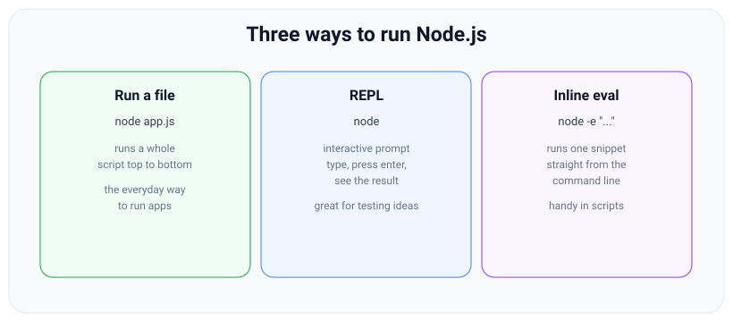
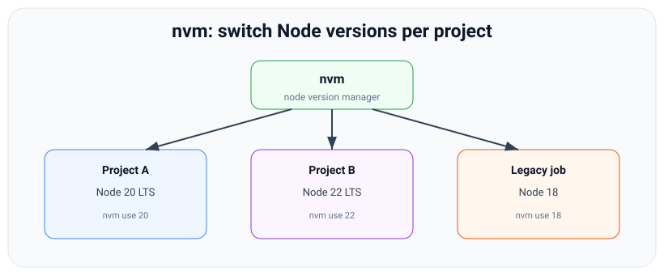

# Running Node: Scripts, the REPL, the CLI, and nvm

*10 min read · Updated 24 Jul 2026 Topic 5 of 70 Bookmark Mark done Why it matters Knowing the concepts is one thing · Topic 5 of 70*

**Source:** [https://www.geekyfrontend.in/learn/nodejs-backend-kit/running-node-repl](https://www.geekyfrontend.in/learn/nodejs-backend-kit/running-node-repl)

---

## Why it matters

Knowing the concepts is one thing; actually *running* Node fluently is what makes you productive day to day. There is a real difference between a developer who only knows `node app.js` and one who reaches for the REPL to test an idea in two seconds, uses `node -e` in a shell script, keeps the right Node version per project with nvm, and knows the CLI flags that turn a manual dev loop into an automatic one. These are small skills, but together they are the difference between fighting your tools and flowing with them.

They also come up constantly in interviews and on the job: “How do you check your Node version?”, “How would you quickly test whether this snippet works?”, “How do you run different Node versions for different projects?” This lesson gives you a confident answer to all of them and a mental map of the ways Node executes code.

## The concept, simply

There are three everyday ways to run JavaScript with Node, and it helps to picture them as three doors into the same runtime.

**1. Run a file:** `node app.js` executes a whole script from top to bottom. This is how you run real programs and servers — the everyday default.

**2. The REPL:** type `node` with no file and you drop into an interactive prompt (Read–Eval–Print Loop). You type an expression, press Enter, and Node immediately evaluates it and prints the result — perfect for experimenting, checking how an API behaves, or doing quick calculations.

**3. Inline evaluation:** `node -e "code"` runs a single snippet passed as a string, straight from the command line — handy inside shell scripts and one-off checks.



Three doors into the runtime: run a file, open the interactive REPL, or evaluate a one-line snippet inline.

On top of *how* you run Node sits *which version* of Node you run. Because projects target different Node versions, a tool called **nvm** (Node Version Manager) lets you install several versions side by side and switch between them per project — so an old client project on Node 18 and a new one on Node 22 can coexist on one machine.

## How it works

**Running a file.** `node path/to/file.js` starts a process, loads the file, runs it, and — importantly — keeps the process alive as long as there is pending asynchronous work (an open server, a timer, a pending Promise). A plain script with no async work exits as soon as the last line runs. This is why a web server “stays running”: `server.listen()` keeps the event loop busy. You can pass arguments after the filename (`node app.js --port 8080`), and read them via `process.argv`.

**The REPL in depth.** Start it with `node`. Each line you type is evaluated and its result printed. Useful REPL features:

- `_` holds the value of the last evaluated expression (like a calculator's answer memory).
- Tab completion works — type `process.` and press Tab to see available properties.
- Multi-line input is supported: an unfinished statement (an open brace or bracket) shows a `...` continuation prompt.
- Dot commands start with a period: `.help`, `.exit` (or Ctrl-D) to quit, `.clear` to reset the context, `.load file.js` and `.save file.js`.
- Core modules are pre-loaded lazily — you can just type `os.platform()` without requiring `os` first.

The REPL is the fastest way to answer “what does this actually return?” without creating a file.

**Handy CLI flags.** The `node` command has flags worth knowing:

| Command / flag | What it does |
| --- | --- |
| `node app.js` | Run a script file |
| `node` | Start the interactive REPL |
| `node -e "expr"` | Evaluate a snippet inline |
| `node -p "expr"` | Evaluate *and print* the result |
| `node --version` / `-v` | Print the Node version |
| `node --watch app.js` | Re-run automatically when files change (built in, v18.11+) |
| `node --env-file=.env app.js` | Load env vars from a file (built in, v20.6+) |
| `node --check app.js` | Syntax-check without running |
| `node --inspect app.js` | Enable the debugger (Chrome DevTools) |

`--watch` and `--env-file` are especially nice: modern Node can auto-restart on save and read a `.env` file without extra packages like `nodemon` or `dotenv` for simple cases.

**nvm basics.** Node versions matter because language features, performance, and security fixes differ between them, and each project may pin a version. nvm (on macOS/Linux; nvm-windows or alternatives like `fnm`/`Volta` elsewhere) manages this. The core commands:

| Command | Meaning |
| --- | --- |
| `nvm install 22` | Install Node 22 (latest of that major) |
| `nvm install --lts` | Install the latest LTS release |
| `nvm use 20` | Switch the current shell to Node 20 |
| `nvm ls` | List installed versions |
| `nvm alias default 22` | Set the default version for new shells |



nvm installs multiple Node versions side by side so each project can use the version it was built for.

A common workflow: put an `.nvmrc` file containing a version (e.g. `22`) in a project, and `nvm use` reads it automatically — so everyone on the team runs the same Node. Under the hood, LTS versions are the ones to prefer: even-numbered majors (18, 20, 22) get long-term support and security patches; odd ones are experimental and short-lived.

## Code examples

**Example 1 — a REPL session.** Everything after `>` is what you type.

javascript

```
$ node
Welcome to Node.js v22.11.0.
> 2 + 2
4
> _ * 10          // _ is the last result
40
> const os = require('node:os');
undefined
> os.platform()
'darwin'
> [1, 2, 3].map(n => n * n)
[ 1, 4, 9 ]
> .exit           // or press Ctrl-D
```

**Example 2 — inline evaluation for quick answers and scripts.**

javascript

```
# -e runs code; -p runs AND prints the result:
$ node -p "process.version"
v22.11.0

$ node -p "Math.max(3, 7, 2)"
7

# Useful inside shell scripts / CI:
$ node -e "console.log('Build at', new Date().toISOString())"
```

**Example 3 — running a file with the modern dev flags.**

javascript

```
// server.js
const http = require('node:http');
const port = Number(process.env.PORT) || 3000;

http.createServer((req, res) => res.end('ok'))
  .listen(port, () => console.log('listening on ' + port));

// Auto-restart on save + load env from a file — no extra packages:
//   node --watch --env-file=.env server.js
// The process stays alive because server.listen keeps the loop busy.
```

**Example 4 — checking and switching versions.**

javascript

```
# Which Node am I running?
$ node -v
v22.11.0

# Install and pin the LTS for a project:
$ nvm install --lts
$ echo "22" > .nvmrc
$ nvm use
Now using node v22.11.0 (npm v10.x)
```

## Common mistakes & gotchas

- **Expecting a plain script to “stay running.”** Node exits when there's no pending async work. A script only keeps running if something (a server, an interval) holds the event loop open.
- **Confusing `-e` and `-p`.** `node -e` runs code but prints nothing unless you `console.log`; `node -p` runs it *and* prints the returned value. Reaching for `-e` when you wanted the result is a common slip.
- **Treating REPL results as if they came from your program.** REPL variables and state vanish when you exit — it's a scratchpad, not persistence. Also, a statement like `const x = 5` shows `undefined` (the statement's value), which confuses beginners.
- **Version drift across a team.** Without an `.nvmrc` or pinned version, teammates run different Node versions and hit “works on my machine” bugs. Pin it.
- **Installing global packages under the wrong Node version.** With nvm, global installs are per-version — switch versions and your globally-installed CLI may “disappear” because it lives under the other version.
- **Using odd-numbered Node versions in production.** Odd majors (19, 21, 23) are short-lived and don't get long-term support; stick to LTS (even) majors for anything real.
- **Reaching for `nodemon` when `--watch` exists.** Modern Node restarts on file change natively; you often don't need an extra dependency for simple cases.

## Best practices

- **Use the REPL to learn APIs fast** — when unsure what a method returns, type it into `node` rather than guessing or writing a throwaway file.
- **Pin your Node version per project** with an `.nvmrc` (and an `engines` field in `package.json`) so everyone, including CI, runs the same version.
- **Prefer LTS versions** (even-numbered majors) for production; upgrade deliberately when an LTS line reaches end of life.
- **Lean on built-in flags before adding tools:** `--watch` for auto-restart, `--env-file` for env loading, `--inspect` for debugging — fewer dependencies, less to break.
- **Put run commands in `package.json` scripts** (`npm run dev`) so the exact flags are documented and shared, not re-typed from memory.
- **Know how to exit the REPL** (`.exit` or Ctrl-D, twice-Ctrl-C) so you're never stuck — a small thing that saves real friction.

## ⭐ Interview lens

> **Q: “What is the Node REPL and when would you use it?”**  
> A: REPL = Read–Eval–Print Loop, an interactive prompt started by running `node` with no file. You type expressions and see results immediately — ideal for testing snippets, exploring an API, or quick calculations without creating a file. `_` holds the last result. *Trap:* not knowing what the acronym stands for.

> **Q: “How do you run a one-off JavaScript snippet without a file?”**  
> A: `node -e "code"` to execute it, or `node -p "code"` to execute and print the result. Great for shell scripts and CI checks.

> **Q: “How do you run different Node versions on the same machine?”**  
> A: A version manager like nvm (or fnm/Volta). Install versions with `nvm install`, switch with `nvm use`, and pin per-project with an `.nvmrc` file so the team stays consistent. *Trap:* suggesting you reinstall Node each time — the point is coexistence.

> **Q: “Why does a Node web server keep running while a plain script exits?”**  
> A: Node exits when the event loop has no more work. A server calls `listen()`, which keeps a handle open and the loop alive; a plain synchronous script finishes its last line with nothing pending, so the process ends.

> **Q: “What's the difference between LTS and Current Node releases?”**  
> A: Even-numbered majors become LTS (Long-Term Support) with ~30 months of maintenance and security fixes — use these in production. Odd-numbered ‘Current’ releases are short-lived and carry the newest experimental features. *Trap:* recommending a bleeding-edge odd version for production.

> **Q: “How would you auto-restart a Node app during development without extra packages?”**  
> A: Use the built-in `node --watch app.js` (Node 18.11+), which restarts on file changes — historically people used `nodemon`, but it's now built in. Pair with `--env-file` to load a `.env` without `dotenv`.

## Cheat-card

- **Run a file:** `node app.js` (stays alive while async work is pending).
- **REPL:** `node` → interactive; `_` = last result; `.exit` / Ctrl-D to quit.
- **Inline:** `node -e "code"` runs; `node -p "code"` runs and prints.
- **Version:** `node -v`. **Dev flags:** `--watch`, `--env-file`, `--inspect`, `--check`.
- **nvm:** `install`, `use`, `ls`; pin with `.nvmrc` + `engines`.
- **Versions:** even = LTS (use in prod); odd = short-lived/experimental.
- **`node --run <script>`:** runs a `package.json` script without loading npm; no `pre`/`post` hooks, no `npm_*` variables.
- **`node --test`:** built-in runner (stable v20); `--test-reporter=dot|tap|junit`, `--test-name-pattern`.
- **`node app.ts`:** type stripping (stable v24.12.0), no type checking; `enum` → `ERR_UNSUPPORTED_TYPESCRIPT_SYNTAX`.
- **`NODE_OPTIONS`:** allow-listed flags only (`--test`, `--run`, `--eval`, `--env-file` → exit 9); inherited by every child process.
- **`--max-old-space-size=MiB`:** caps the old generation; OOM → `FATAL ERROR`, exit 134; keep it below the container limit.
- **Corepack:** bundled (0.35.0) in v24.19.0 but Experimental; not distributed from Node 25.

---

## Learn More

- [How to use the Node.js REPL nodejs.org](https://nodejs.org/en/learn/command-line/how-to-use-the-nodejs-repl)
- [Run Node.js scripts from the command line nodejs.org](https://nodejs.org/en/learn/command-line/run-nodejs-scripts-from-the-command-line)
- [REPL | Node.js API Documentation nodejs.org](https://nodejs.org/api/repl.html)
- [Node.js Crash Course Traversy Media](https://www.youtube.com/watch?v=fBNz5xF-Kx4)

---

## Additional topics

*Added 7 Oct 2026 · examples verified on Node v24.19.0*

### `node --run`

`node --run <name>` (added v22.0.0; v22.3.0 added the walk up to the nearest `package.json` and the `NODE_RUN_*` variables) runs a command from the `"scripts"` object of `package.json` without starting npm. `npm run` first loads npm itself, which is a large JavaScript program, and only then spawns your script. `node --run` does the lookup in the `node` binary: it skips npm's start-up but also npm's extras.

How it works:

1. Node finds the nearest `package.json`, starting in the current folder and walking up to the root.
2. It prepends `node_modules/.bin` of every ancestor folder to `PATH`, so locally installed CLIs (`eslint`, `tsc`) resolve.
3. It sets `NODE_RUN_SCRIPT_NAME` and `NODE_RUN_PACKAGE_JSON_PATH`, appends any arguments after `--`, and runs the script string in a shell in the folder that holds `package.json`.
4. It does **not** run `pre<name>`/`post<name>` hooks and does not set npm's `npm_*` variables (such as `npm_lifecycle_event`).

**Example — the same script both ways, and the start-up cost.**

json

```
{
  "name": "runcmp",
  "scripts": {
    "hello": "echo hello from $npm_lifecycle_event$NODE_RUN_SCRIPT_NAME"
  }
}
```

javascript

```
// bench.js: start-up cost of `node --run` vs `npm run`, 10 runs each
const { execFileSync } = require('node:child_process');

function avgMs(cmd, args) {
  const runs = 10;
  const t0 = process.hrtime.bigint();
  for (let i = 0; i < runs; i++) execFileSync(cmd, args, { stdio: 'ignore' });
  return Number(process.hrtime.bigint() - t0) / 1e6 / runs;
}
console.log('node --run hello:', avgMs(process.execPath, ['--run', 'hello']).toFixed(0), 'ms');
console.log('npm run hello   :', avgMs('npm', ['run', 'hello']).toFixed(0), 'ms');
```

bash

```
$ node --run hello
hello from hello
$ npm run -s hello
hello from hello
$ node bench.js
node --run hello: 13 ms
npm run hello   : 133 ms
$ node bench.js
node --run hello: 8 ms
npm run hello   : 144 ms
```

Under `npm run`, the name came from `$npm_lifecycle_event`; under `node --run`, it came from `$NODE_RUN_SCRIPT_NAME`. The start-up times differ between runs and machines; the roughly tenfold gap is the cost of loading npm. Lesson 72 shows the skipped `pre` hook and the "Missing script" listing: [Modern Node Features: A Guided Tour](72-modern-node-features-tour.md).

### `node --test`

`node --test` (added v18.1.0 / v16.17.0, stable since v20.0.0) starts the built-in test runner. Test files use the `node:test` module (`test`, `describe`, `it`, hooks, mocks) and `node:assert`. No Jest or Mocha install is needed, and there is no config file.

How it works:

1. With no file arguments, it collects files matching the default globs: `**/*.test.{cjs,mjs,js}`, `**/*-test.*`, `**/*_test.*`, `**/test-*.*`, `**/test.*` and `**/test/**/*.*`, plus their `.ts`/`.mts`/`.cts` forms unless `--no-strip-types` is set. `node_modules` is skipped.
2. It runs each file in its own child process (isolation `'process'` is the default), several at a time.
3. A reporter formats the results. `spec` is the default; `--test-reporter=dot|tap|junit|lcov` selects another.
4. The exit code is 1 if any test failed, 0 otherwise.

**Example — run, change the reporter, filter by name.**

javascript

```
// test/slug.test.js
const { describe, it } = require('node:test');
const assert = require('node:assert/strict');

const slug = (s) => s.trim().toLowerCase().replace(/[^a-z0-9]+/g, '-').replace(/^-|-$/g, '');

describe('slug', () => {
  it('lowercases and joins words', () => assert.equal(slug('Hello World'), 'hello-world'));
  it('drops punctuation', () => assert.equal(slug('  Node.js, v24! '), 'node-js-v24'));
  it('handles empty input', () => assert.equal(slug(''), ''));
});
```

bash

```
$ node --test
▶ slug
  ✔ lowercases and joins words (0.937335ms)
  ✔ drops punctuation (0.181722ms)
  ✔ handles empty input (0.182262ms)
✔ slug (2.521994ms)
ℹ tests 3
ℹ suites 1
ℹ pass 3
ℹ fail 0
ℹ cancelled 0
ℹ skipped 0
ℹ todo 0
ℹ duration_ms 91.946584
$ node --test --test-reporter=dot
....
$ node --test --test-name-pattern="punctuation"
▶ slug
  ✔ drops punctuation (0.978663ms)
✔ slug (2.213213ms)
ℹ tests 1
ℹ suites 1
ℹ pass 1
ℹ fail 0
ℹ cancelled 0
ℹ skipped 0
ℹ todo 0
ℹ duration_ms 78.292709
```

The `dot` reporter printed four dots: three tests plus the `describe` suite. Lessons 57–60 cover testing itself; lesson 72 shows why `*.spec.js` files are skipped by default.

### Built-in TypeScript type stripping

Node can run a `.ts` file directly: `node app.ts`. It does this by **type stripping**: it removes the type annotations (`: string`, `interface`, `as T`) and runs what is left as JavaScript. There is **no type checking**, so a type error still runs. History: added v22.6.0 behind `--experimental-strip-types`; enabled by default in v23.6.0 / v22.18.0; **stable** in v24.12.0, when the opt-out flag was renamed `--no-strip-types`.

How it works:

1. Node sees a `.ts`, `.mts` or `.cts` extension.
2. It replaces the type-only syntax with whitespace. Line and column numbers stay the same, so stack traces point at your source.
3. Syntax that would need *generated* JavaScript (`enum`, `namespace` with values, parameter properties) is rejected with `ERR_UNSUPPORTED_TYPESCRIPT_SYNTAX`; `--experimental-transform-types` handles those.
4. Run `tsc --noEmit` separately (in CI or your editor) to get type checking.

**Example — a `.ts` file with no build step, and an `enum` that is refused.**

typescript

```
// greet.ts
interface User { name: string; age: number }

function greet(user: User): string {
  return `Hello, ${user.name} (${user.age})`;
}

console.log(greet({ name: 'Ada', age: 36 }));
const wrong: number = 'not a number' as any as number;   // no type check happens at run time
console.log(typeof wrong);
```

bash

```
$ node greet.ts
Hello, Ada (36)
string
$ cat color.ts
enum Color { Red, Green }
console.log(Color.Green);
$ node color.ts
file://<cwd>/color.ts:1
enum Color { Red, Green }
^^^^^^^^^^^^^^^^^^^^^^^^^
console.log(Color.Green);

SyntaxError [ERR_UNSUPPORTED_TYPESCRIPT_SYNTAX]: TypeScript enum is not supported in strip-only mode
    …
$ node --no-strip-types greet.ts
<cwd>/greet.ts:2
interface User { name: string; age: number }
          ^^^^

SyntaxError: Unexpected identifier 'User'
    …
```

`<cwd>` stands for the working directory. The full story (`tsconfig` settings, `import type`, `.ts` extensions in imports) is in [TypeScript with Node](71-typescript-with-node.md).

### `NODE_OPTIONS`

`NODE_OPTIONS` (added v8.0.0) is an environment variable holding a space-separated list of `node` flags. Node reads it at start-up as if those flags had been typed before the ones on the command line. It is the way to pass flags to a `node` process you do not launch yourself: one started by npm, a test runner, a framework's CLI or a container entrypoint.

How it works:

1. Node parses `NODE_OPTIONS` first, then the real command line. For a flag that can appear only once, the command-line value wins.
2. Only an allow-list of flags is accepted (`process.allowedNodeEnvironmentFlags`, and the list in the docs under `NODE_OPTIONS`). Flags that pick *what* to run (`--eval`, `--print`, `--test`, `--run`, a script path) and `--env-file` are rejected, and the process exits with code 9.
3. Because it is an environment variable, every child process inherits it, and that includes every `node` process that npm, your tests or your tools start (see the edge case below).
4. On v24.19.0, `--max-old-space-size`, `--enable-source-maps`, `--require`, `--import`, `--inspect`, `--watch`, `--permission` and `--no-strip-types` were all on the allow-list.

**Example — allowed and rejected flags.**

bash

```
$ node -e "const f = process.allowedNodeEnvironmentFlags; for (const x of ['--max-old-space-size','--enable-source-maps','--require','--watch','--env-file','--test','--run','--eval']) console.log(x.padEnd(22), f.has(x))"
--max-old-space-size   true
--enable-source-maps   true
--require              true
--watch                true
--env-file             false
--test                 false
--run                  false
--eval                 false
$ NODE_OPTIONS="--test" node -p 1
node: --test is not allowed in NODE_OPTIONS
$ echo $?
9
$ NODE_OPTIONS="--env-file=.env" node -p 1
node: --env-file= is not allowed in NODE_OPTIONS
```

### `--max-old-space-size`

V8 splits the JavaScript heap into a small **young generation** (new objects, collected often) and a large **old generation** (objects that survived a few collections). `--max-old-space-size=<MiB>` caps the old generation. When live data cannot fit under the cap even after a full mark-compact collection, V8 aborts the process with `FATAL ERROR: … JavaScript heap out of memory`. Set the cap to fit the memory the container really has: if V8's default is larger than the container limit, the kernel OOM-killer ends the process first, with SIGKILL and no message.

How it works:

1. Without the flag, V8 picks a default from the machine's memory. On this 15 GB machine, `heap_size_limit` was 2240 MiB.
2. With the flag, `heap_size_limit` = your value + the young-generation size (192 MiB here: 512 → 704, 1024 → 1216).
3. As the heap approaches the limit, V8 runs more and more full collections (the "Last few GCs" in the crash log), and then aborts.
4. An abort is SIGABRT (signal 6), so the shell sees exit status 134 = 128 + 6.

**Example — read the limit, then hit it.**

javascript

```
// heap.js: print the heap limit, then (with "grow") allocate until the limit is hit
const v8 = require('node:v8');
const mib = (n) => Math.round(n / 2 ** 20);
console.log('heap_size_limit:', mib(v8.getHeapStatistics().heap_size_limit), 'MiB');

if (process.argv[2] === 'grow') {
  const keep = [];
  setInterval(() => {
    for (let i = 0; i < 1e5; i++) keep.push({ i, s: 'x'.repeat(20) + i });
    console.log('heapUsed:', mib(process.memoryUsage().heapUsed), 'MiB');
  }, 0);
}
```

bash

```
$ node heap.js
heap_size_limit: 2240 MiB
$ node --max-old-space-size=1024 heap.js
heap_size_limit: 1216 MiB
$ NODE_OPTIONS=--max-old-space-size=512 node heap.js
heap_size_limit: 704 MiB
$ NODE_OPTIONS=--max-old-space-size=512 node --max-old-space-size=1024 heap.js
heap_size_limit: 1216 MiB
$ node --max-old-space-size=32 heap.js grow
heap_size_limit: 224 MiB
heapUsed: 27 MiB

<--- Last few GCs --->

[94005:0x12dad000]       56 ms: Scavenge 19.4 (29.1) -> 19.2 (51.3) MB, pooled: 0 MB, 4.53 / 0.00 ms  (average mu = 1.000, current mu = 1.000) allocation failure; 
[94005:0x12dad000]      109 ms: Mark-Compact 36.0 (53.5) -> 33.1 (67.5) MB, pooled: 0 MB, 15.99 / 0.00 ms  (+ 10.1 ms in 235 steps since start of marking, biggest step 0.3 ms, walltime since start of marking 53 ms) (average mu = 0.748, current mu = 0.748)
FATAL ERROR: Reached heap limit Allocation failed - JavaScript heap out of memory
----- Native stack trace -----

 1: 0x75356c node::OOMErrorHandler(char const*, v8::OOMDetails const&) [node]
 …
$ echo $?
134
```

The fourth run shows the command-line flag (1024) winning over `NODE_OPTIONS` (512). Lesson 04's exit-code table explains the 134.

### Corepack

**Corepack** is a small tool bundled with Node that downloads and runs the exact pnpm or Yarn version a project names in the `"packageManager"` field of its `package.json`. You do not install the package manager globally. In v24.19.0 it is still bundled (`corepack --version` → `0.35.0`), but it is marked **Stability 1 Experimental** (added v16.9.0 / v14.19.0), and the v24 docs say: "Corepack will no longer be distributed starting with Node.js v25". After v24, install it from npm (`npm install -g corepack`) if you still want it.

How it works:

1. `package.json` declares `"packageManager": "pnpm@10.34.6"`.
2. `corepack pnpm …` (or a `pnpm` shim created by `corepack enable`) reads that field, downloads that exact version into its cache (`COREPACK_HOME`) on first use and runs it.
3. Calling a *different* package manager inside that project is refused, which stops lockfiles from mixing.
4. `corepack enable` writes shims (`pnpm`, `pnpx`, `yarn`, `yarnpkg`) next to the `corepack` binary (found the way `which corepack` would find it; in a standard install that is the folder holding `node`), or into the folder given with `--install-directory`.

**Example — run in a throwaway `COREPACK_HOME` and shim folder, so the real environment is not changed.**

bash

```
$ cat package.json
{
  "name": "cp-demo",
  "packageManager": "pnpm@10.34.6"
}
$ export COREPACK_HOME=$PWD/../home      # throwaway cache
$ corepack --version
0.35.0
$ corepack pnpm --version
10.34.6
$ corepack yarn --version
This project is configured to use pnpm because …/cp/proj/package.json has a "packageManager" field
$ echo $?
1
$ mkdir ../shims                          # enable fails with ENOENT if the folder is missing
$ corepack enable --install-directory ../shims
$ ls ../shims
pnpm
pnpx
yarn
yarnpkg
$ PATH=$PWD/../shims:$PATH pnpm --version
10.34.6
```

### Common mistakes & gotchas (additional topics)

- **Switching `npm run` to `node --run` in a project with `pre`/`post` hooks.** The hooks stop running and nothing warns you. Check for `pre*`/`post*` scripts first.
- **Thinking `node app.ts` type-checks.** It only strips types. Keep `tsc --noEmit` in CI.
- **Putting `--env-file` or `--test` in `NODE_OPTIONS`.** Both are rejected with exit code 9. Put them on the command line or in a `package.json` script.
- **Setting `NODE_OPTIONS` globally** (a shell profile, a Dockerfile `ENV`) for one app. Every Node process inherits it, including npm and build tools.
- **Setting `--max-old-space-size` larger than the container's memory limit.** The kernel OOM-killer then sends SIGKILL (exit 137) before V8 can report anything. Leave headroom for buffers, native memory and the young generation.
- **Relying on the bundled Corepack in new setups.** It is experimental and no longer bundled from Node 25.

### Edge case worked through: `NODE_OPTIONS` reaches every child process, a CLI flag does not

A flag on the command line applies to that one process. The same flag in `NODE_OPTIONS` is part of the environment, so every `node` started below it inherits it. That is useful for adding `--require ./tracing.js` to an app started by a framework CLI. It also means a memory cap meant for one server is applied to npm, the test runner and every worker those tools spawn.

javascript

```
// parent.js: print this process's heap limit, then a child's
const { execFileSync } = require('node:child_process');
const limit = "Math.round(require('node:v8').getHeapStatistics().heap_size_limit / 2 ** 20) + ' MiB'";
console.log('parent:', eval(limit), '| NODE_OPTIONS =', JSON.stringify(process.env.NODE_OPTIONS));
console.log('child :', execFileSync(process.execPath, ['-p', limit]).toString().trim());
```

bash

```
$ node --max-old-space-size=512 parent.js
parent: 704 MiB | NODE_OPTIONS = undefined
child : 2240 MiB
$ NODE_OPTIONS=--max-old-space-size=512 node parent.js
parent: 704 MiB | NODE_OPTIONS = "--max-old-space-size=512"
child : 704 MiB
```

With the CLI flag, the child got the default 2240 MiB. With `NODE_OPTIONS`, the child got the same 704 MiB cap as the parent. If you want a flag in one child only, pass `execArgv` to `fork()`, or give `spawn()` an `env` that drops or changes `NODE_OPTIONS`.

### ⭐ Interview lens (additional topics)

> **Q: “Your Node service in a 1 GiB container is killed with exit code 137 and no stack trace. What is happening and what do you change?”**  
> A: 137 is 128 + 9: the process got SIGKILL, here from the kernel OOM-killer because the container hit its memory limit. V8 never noticed, because its default heap limit is set from the machine's memory and can be larger than the container's limit. Set `--max-old-space-size` below the container limit (for example 700–768 MiB for 1 GiB, leaving room for the young generation, buffers and native memory). V8 then collects garbage harder and, if the data really does not fit, fails with a `FATAL ERROR` and exit 134 that you can see in the logs. *Trap:* raising the heap limit above the container limit.

> **Q: “`node --run` or `npm run`?”**  
> A: `node --run` starts much faster (about 10 ms versus about 140 ms in the run above), because it does not load npm. In return it has no `pre`/`post` hooks and no `npm_*` variables. Use it for scripts you run often in a dev loop, and keep `npm run` where hooks or npm variables matter.
