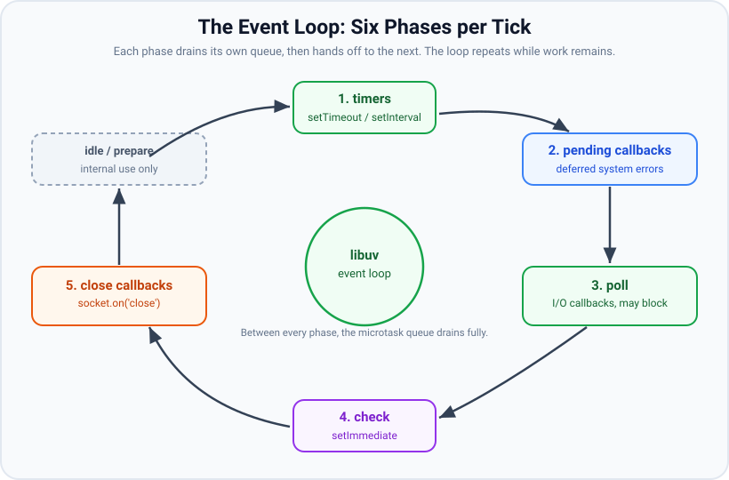
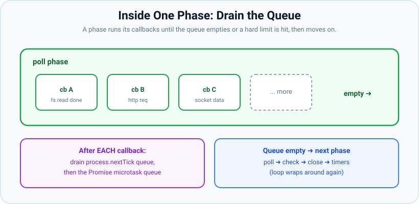

# The Event Loop Phases

*10 min read · Updated 24 Jul 2026 Topic 6 of 70 Bookmark Mark done Why it matters Node · Topic 6 of 70*

**Source:** [https://www.geekyfrontend.in/learn/nodejs-backend-kit/event-loop-phases](https://www.geekyfrontend.in/learn/nodejs-backend-kit/event-loop-phases)

---

## Why it matters

Node.js can serve thousands of simultaneous connections on a single thread, and the reason is the **event loop**. It is the scheduler at the heart of the runtime: a C-level loop, provided by the `libuv` library, that decides *which callback runs next*. Every timer that fires, every file that finishes reading, every HTTP request that lands on your server is a callback that the event loop picks up and hands to V8 to execute.

If you do not understand the phases of this loop, three categories of bug become impossible to reason about. First, **ordering bugs**: "why did my `setTimeout` callback run before my `setImmediate` callback here, but after it over there?" Second, **latency bugs**: "why does my server occasionally stall for 400ms even though every handler looks fast?" Third, **starvation bugs**: "why does this recursive callback freeze the whole process?" All three trace back to the same source of truth — the order in which the loop drains its queues.

This is also the single most reliably asked Node.js interview topic. Interviewers love it precisely because it separates people who have memorised "Node is non-blocking" from people who can predict the exact output of a snippet and explain *why*. That "why" is what this topic gives you.

## The concept, simply

Think of the event loop as a person working through a set of inboxes, in a fixed order, over and over. Each inbox — Node calls them **phases** — holds a specific kind of pending callback. The worker opens the first inbox, handles everything of that type, closes it, moves to the next inbox, and so on. When they reach the last inbox they loop back to the first. That full trip around the inboxes is one **tick** (more precisely, one iteration of the loop).

There are six phases, and their order never changes:

1. **timers** — runs callbacks scheduled by `setTimeout` and `setInterval` whose delay has elapsed.
2. **pending callbacks** — runs a small set of system-level callbacks deferred from a previous loop (e.g. certain TCP errors like `ECONNREFUSED`).
3. **idle, prepare** — internal to libuv only; you never schedule work here.
4. **poll** — the heart of the loop. Retrieves new I/O events and runs their callbacks (incoming data, completed file reads). This is the phase where the loop will *block and wait* if there is nothing else to do.
5. **check** — runs `setImmediate` callbacks.
6. **close callbacks** — runs `'close'` handlers, e.g. `socket.on('close', ...)`.

People usually shorten this to five that you actually schedule into: **timers → pending → poll → check → close**. The diagram below shows the ring the loop walks.



The event loop is a fixed ring of phases. Each phase drains its own queue before the loop advances to the next.

## How it works

Each phase owns a **FIFO queue** of callbacks. When the loop enters a phase, it executes callbacks from that phase's queue *one by one* until either the queue is empty or a system-dependent maximum number of callbacks has run. Then it moves to the next phase. Callbacks you schedule while inside a phase do not necessarily run in that same phase — they land in the appropriate phase's queue and are picked up when the loop next reaches it.



Within a phase the loop drains the queue callback by callback; when it empties, control passes to the next phase.

Two subtleties do most of the interview damage:

**1. The poll phase has special blocking behaviour.** When the loop reaches poll, it looks at the poll queue. If there are callbacks, it runs them. If the poll queue is empty, the loop does one of two things. If there are `setImmediate` callbacks waiting, it ends poll immediately and jumps to the check phase to run them. If there is no immediate work anywhere, it will *block* in poll, waiting for the operating system to deliver an I/O event — but only until the nearest timer is due. This is how an idle Node server uses ~0% CPU: it is parked in the poll phase inside a kernel call (`epoll_wait` on Linux), asleep until something happens.

**2. Between operations, two special queues drain — and they are not phases.** After the currently executing callback returns (and again at each phase boundary), Node fully drains the `process.nextTick` queue, then fully drains the Promise **microtask** queue, before doing anything else. These queues do not belong to any phase; they interleave *between* callbacks. This is why a promise `.then` always beats a `setTimeout(…, 0)`: the microtask queue is emptied before the loop is even allowed to advance to the next macrotask. We cover this fully in the microtasks topic — but you must hold the picture that phases are the coarse structure and microtasks squeeze in between every callback.

So the true rhythm of one turn is: run a phase callback → drain nextTick → drain microtasks → run the next phase callback → drain nextTick → drain microtasks → … → queue empty → advance phase. The phases give the skeleton; the microtask drains happen constantly in between.

One more framing that helps: the loop keeps running as long as there is any pending work — an open handle (a listening server, an active timer, an open socket). When no handles or requests remain, `uv_run` returns and the Node process exits naturally. That is why a bare script with a `setInterval` never exits, and why an HTTP server stays alive: the listening socket is a ref'd handle that keeps the loop turning.

## Code examples

**Example 1 — timers vs immediate at the top level is not guaranteed.**

javascript

```
setTimeout(() => console.log('timeout'), 0);
setImmediate(() => console.log('immediate'));

// Possible output A:        Possible output B:
//   timeout                   immediate
//   immediate                 timeout
```

At the top level the result is a race. `setTimeout(fn, 0)` is clamped to a 1ms minimum. Whether the loop reaches the timers phase and finds that 1ms already elapsed depends on how long process startup took — a few hundred microseconds of jitter decides the winner. Never rely on this ordering.

**Example 2 — inside an I/O callback, the order becomes deterministic.**

javascript

```
const fs = require('fs');

fs.readFile(__filename, () => {
  setTimeout(() => console.log('timeout'), 0);
  setImmediate(() => console.log('immediate'));
});

// Output (always):
//   immediate
//   timeout
```

The `readFile` callback runs in the **poll** phase. The very next phase is **check**, so the queued `setImmediate` fires first. The `setTimeout` has to wait for the loop to wrap all the way back around to the timers phase on the next iteration. This ordering is guaranteed, and it is a favourite interview question.

**Example 3 — the loop stays alive because of a ref'd handle.**

javascript

```
console.log('start');
const t = setInterval(() => console.log('tick'), 1000);
// The process never exits: the interval is an active handle.
// t.unref() would let the loop exit despite the timer still existing.

// Output:
//   start
//   tick   (every second, forever)
```

**Example 4 — microtasks jump the phase queue.**

javascript

```
setTimeout(() => console.log('timeout'), 0);
Promise.resolve().then(() => console.log('promise'));
console.log('sync');

// Output:
//   sync
//   promise
//   timeout
```

Synchronous code runs first. Before the loop advances to the timers phase, it drains the microtask queue, so `promise` prints before `timeout` even though the timer was scheduled first.

## Common mistakes & gotchas

- **Assuming `setTimeout(fn, 0)` runs "immediately".** It runs in the next timers phase, after the current stack, after all microtasks, and after a 1ms minimum clamp — potentially much later under load.
- **Believing phase order guarantees `setTimeout` before `setImmediate`.** Only true inside an I/O callback (and there it is the *reverse*). At the top level it is a race.
- **Thinking a callback scheduled during a phase runs in that same phase.** It is queued for the next time the loop reaches the relevant phase, not appended to the phase you are currently in.
- **Forgetting the poll phase can block.** If a timer is due in 200ms and there is no other work, the loop sleeps up to 200ms in poll — that is normal, not a hang.
- **Confusing "tick" meanings.** A libuv loop *iteration* is one trip through the phases; `process.nextTick` is unrelated to that — its name is historical and misleading.
- **Expecting `setInterval(fn, 100)` to run exactly every 100ms.** It fires no sooner than 100ms after the previous run *and* only when the loop reaches the timers phase; a busy loop makes intervals drift and coalesce.

## Best practices

- **Never depend on top-level timer vs immediate ordering.** If you need "run after I/O", use `setImmediate` inside the I/O callback; if you need "defer to next loop iteration", use `setTimeout(fn, 0)` and document why.
- **Use `setImmediate` to break up CPU work** so the loop can service I/O between chunks (see the blocking topic).
- **Call `.unref()` on background timers** (heartbeats, metrics flushers) that should not keep the process alive on their own.
- **Reason in terms of phases, not milliseconds.** "This runs in the check phase" is precise; "this runs in ~0ms" is a guess.
- **Keep individual callbacks short.** The loop is cooperative — it cannot preempt a callback that refuses to return.

## ⭐ Interview lens

> **Q: Name the phases of the event loop in order.**  
> Timers → pending callbacks → idle/prepare (internal) → poll → check → close callbacks. In practice you schedule into timers (`setTimeout`/`setInterval`), poll (I/O), check (`setImmediate`), and close. Between every callback the nextTick and microtask queues drain.

> **Q: What is the output?**  
> `setTimeout(() => console.log('A'), 0); setImmediate(() => console.log('B'));`  
> Indeterminate at the top level — could be A then B or B then A — because it depends on whether ~1ms has elapsed when the loop first reaches the timers phase. If you wrap both in an `fs.readFile` callback, it is always B then A, because the callback runs in poll and check comes next.

> **Q: Why does an idle Node server use almost no CPU?**  
> Because the loop parks in the poll phase inside a blocking kernel call (`epoll_wait`/`kqueue`/IOCP), sleeping until the OS delivers an I/O event or the next timer is due. It is not spinning.

> **Q: What keeps the event loop — and the process — alive?**  
> Pending work: active timers, open sockets, listening servers, pending thread-pool requests. These are "ref'd handles". When none remain, `uv_run` returns and the process exits. `unref()` marks a handle as not counting toward that.

> **Q: In the poll phase, when does the loop decide to move on instead of waiting?**  
> If the poll queue is non-empty it runs those callbacks. If it is empty but `setImmediate` callbacks exist, it ends poll and goes to check. If nothing is pending anywhere, it blocks in poll until an I/O event arrives or the nearest timer's threshold is reached.

> **Q: Is the event loop the same as a thread?**  
> No. The event loop is a scheduling algorithm running on the single main JS thread. libuv also manages a separate worker thread pool for certain blocking operations, but your JavaScript callbacks all execute on the one main thread, one at a time.

## Cheat-card

- **Order:** timers → pending → poll → check → close, then repeat.
- **timers:** `setTimeout`/`setInterval`. **poll:** I/O callbacks (can block). **check:** `setImmediate`. **close:** `'close'` events.
- Each phase drains its FIFO queue, then advances.
- nextTick + microtasks drain *between every callback*, not as a phase.
- Inside I/O callback: `setImmediate` beats `setTimeout(0)` — always.
- Top level: timer vs immediate order is a race — never rely on it.
- Loop lives while ref'd handles exist; `unref()` releases them.
- **ELU:** `performance.eventLoopUtilization(prev)` = share of time outside `epoll_wait` in the window since `prev` (added in v14.10.0); capacity, not latency.
- **ELU vs delay:** back-to-back short callbacks → ELU 1.0, delay fine; rare long block → ELU low, delay terrible. Watch both.
- **ESM entry:** top-level promise runs before top-level nextTick; timeout vs immediate is still a race.

---

## Learn More

- [The Node.js Event Loop nodejs.org](https://nodejs.org/en/learn/asynchronous-work/event-loop-timers-and-nexttick)
- [Overview of Blocking vs Non-Blocking nodejs.org](https://nodejs.org/en/learn/asynchronous-work/overview-of-blocking-vs-non-blocking)
- [Don't Block the Event Loop (or the Worker Pool) nodejs.org](https://nodejs.org/en/learn/asynchronous-work/dont-block-the-event-loop)
- [This is how the Node.js Event Loop really works Software Developer Diaries](https://www.youtube.com/watch?v=paI6J8my3Yw)
- [What the heck is the event loop anyway? | Philip Roberts | JSConf EU JSConf](https://www.youtube.com/watch?v=8aGhZQkoFbQ)

---

## Additional topics

*Added 7 Oct 2026 · examples verified on Node v24.19.0*

### `performance.eventLoopUtilization()`: how busy the loop is

**What it is.** Event Loop Utilization (ELU) is the share of wall-clock time the loop spent *outside* the kernel's event wait (`epoll_wait` on Linux), so it covers running callbacks, draining microtasks and Node's own work between phases. libuv records how long each poll-phase wait lasted (Node turns that bookkeeping on with libuv's `UV_METRICS_IDLE_TIME` loop option). `performance.eventLoopUtilization()` (added in v14.10.0 and v12.19.0; also exported as `perf_hooks.eventLoopUtilization`, added in v24.12.0) returns three numbers:

- `idle`: total milliseconds spent waiting inside the event provider;
- `active`: total milliseconds spent anywhere else since the loop started;
- `utilization`: `active / (idle + active)`, from 0 to 1.

**Why it exists.** CPU usage cannot tell you if the loop is saturated: a process that blocks in `spawnSync('sleep')` uses almost no CPU, but its loop serves nothing. Event-loop delay (lesson 10's `monitorEventLoopDelay`) only tells you how late timers fired. ELU answers a third question, "how close is this loop to having no spare time?", which is the number you want for load-shedding or autoscaling decisions.

How it works:

1. Called with no arguments, it returns cumulative totals since the loop started (all zeros if bootstrap has not finished).
2. Called as `eventLoopUtilization(prev)`, it returns the **delta** between `prev` and now, with `utilization` worked out for that window only. This is the form you use for "ELU over the last N seconds".
3. Called as `eventLoopUtilization(later, earlier)`, it returns the delta between two saved readings. You need this helper because ELU is a ratio, so you cannot subtract two `utilization` values directly.
4. The idle time only grows while the loop is parked in poll. Any callback, microtask drain or synchronous block adds to `active`.

**Example — an idle window, a busy window and the delta forms.**

javascript

```
const { performance } = require('node:perf_hooks');

function busy(ms) {               // burn CPU on the main thread
  const end = performance.now() + ms;
  while (performance.now() < end) {}
}
const fmt = (u) =>
  `idle=${u.idle.toFixed(0)}ms active=${u.active.toFixed(0)}ms utilization=${u.utilization.toFixed(2)}`;

setImmediate(() => {              // bootstrap is done once the loop runs
  const t0 = performance.eventLoopUtilization();
  setTimeout(() => {              // window 1: loop parked in epoll_wait
    const t1 = performance.eventLoopUtilization();
    console.log('idle window :', fmt(performance.eventLoopUtilization(t1, t0)));
    busy(500);                    // window 2: loop never reaches epoll_wait
    setImmediate(() => {
      console.log('busy window :', fmt(performance.eventLoopUtilization(t1)));
      console.log('since start :', fmt(performance.eventLoopUtilization(t0)));
    });
  }, 500);
});

// Real output (Node v24.19.0):
//   idle window : idle=501ms active=0ms utilization=0.00
//   busy window : idle=0ms active=507ms utilization=1.00
//   since start : idle=501ms active=507ms utilization=0.50
```

The busy window shows 507 ms instead of 500 because the `console.log` calls and the trip to the check phase also count as active time. Three runs gave the same three lines to within 1 ms.

**Example — ELU and event-loop delay measure different things.** Two workloads, each measured for 2 s: (A) 2 ms chunks of work back to back, each yielding with `setImmediate`; (B) a mostly idle loop with one 300 ms block every second.

javascript

```
const { performance, monitorEventLoopDelay } = require('node:perf_hooks');

function busy(ms) {
  const end = performance.now() + ms;
  while (performance.now() < end) {}
}

// Run `scenario` for 2 s, then report ELU and event-loop delay for that window.
function measure(name, scenario) {
  return new Promise((resolve) => {
    const h = monitorEventLoopDelay({ resolution: 10 });
    h.enable();
    const start = performance.eventLoopUtilization();
    const stop = scenario();
    setTimeout(() => {
      stop();
      h.disable();
      const u = performance.eventLoopUtilization(start).utilization;
      console.log(`${name.padEnd(28)} ELU=${u.toFixed(2)}  ` +
        `delay p50=${(h.percentile(50) / 1e6).toFixed(1)}ms max=${(h.max / 1e6).toFixed(1)}ms`);
      resolve();
    }, 2000);
  });
}

(async () => {
  // A: many short callbacks back to back (2 ms of work, then yield).
  await measure('A: 2 ms chunks, no gaps', () => {
    let on = true;
    (function chunk() { if (!on) return; busy(2); setImmediate(chunk); })();
    return () => { on = false; };
  });
  // B: mostly idle, one 300 ms block every second.
  await measure('B: one 300 ms block per 1 s', () => {
    const t = setInterval(() => busy(300), 1000);
    return () => clearInterval(t);
  });
})();

// Real output (Node v24.19.0), the same in 3 runs to within a few ms:
//   A: 2 ms chunks, no gaps      ELU=1.00  delay p50=10.2ms max=10.7ms
//   B: one 300 ms block per 1 s  ELU=0.15  delay p50=10.1ms max=305.4ms
```

Read it like this. The histogram samples every 10 ms, and on v24.19.0 each sample includes that 10 ms interval, so ~10 ms means "on time". Workload A has **no spare capacity** (ELU 1.00), yet every timer fires on time because no single callback runs long. Workload B has 85% spare capacity (ELU 0.15), yet one request in the wrong second waits 300 ms. Use ELU to answer "can this process take more load?" and delay to answer "are callbacks waiting too long?". A healthy service needs both numbers to look good.

### Ordering when the entry file is an ES module

**What changes.** The phases do not change. What changes is *where the entry file's top-level code runs*. A CommonJS entry is compiled and called as a plain function. When it returns, Node drains the `process.nextTick` queue and then the promise queue. An ES module entry is evaluated from inside Node's promise-based ESM loader, so the module body runs while V8 is already draining microtasks. Promise jobs queued by the body run in that same drain, and Node gets back to its nextTick queue only after the drain ends. The same rule appears in lesson 08: a nextTick scheduled inside a promise callback runs after the promises queued later.

How it works:

1. **CJS entry:** run the body → drain nextTick → drain promises → enter the loop (timers phase first).
2. **ESM entry:** the loader awaits the module's evaluation → the body runs inside a promise job → V8 keeps draining promise jobs (including ones the body queued) → Node drains nextTick → enter the loop.
3. **The timers vs check race** at the top level is decided later, in the first loop iteration. It depends only on whether 1 ms has passed between `setTimeout` being called and the timers phase checking the clock. So the race exists in both module systems.
4. Inside any macrotask callback (a timer, I/O, `setImmediate`), both module systems behave the same: nextTick first, then promises.

**Example — the same four lines as `.cjs` and `.mjs`.**

javascript

```
// order.cjs and order.mjs (identical bytes)
process.nextTick(() => console.log('top: nextTick'));
Promise.resolve().then(() => console.log('top: promise'));
setTimeout(() => {
  process.nextTick(() => console.log('timer: nextTick'));
  Promise.resolve().then(() => console.log('timer: promise'));
}, 0);
```

bash

```
$ node order.cjs
top: nextTick
top: promise
timer: nextTick
timer: promise
$ node order.mjs
top: promise
top: nextTick
timer: nextTick
timer: promise
```

Only the top-level pair flips. A `.js` file under a `package.json` with `"type": "module"` gave the `.mjs` output. 50 runs of each file never varied.

**Example — timeout vs immediate: still a race in ESM.** The two-line file from Example 1 (`setTimeout(…, 0)` and `setImmediate(…)`), saved as `tvi.cjs` and `tvi.mjs`, run 200 times per batch:

bash

```
$ for b in 1 2 3; do for f in tvi.cjs tvi.mjs; do printf "batch $b $f: "; for i in $(seq 200); do node $f | paste -sd' '; done | sort | uniq -c | paste -sd' '; done; done
batch 1 tvi.cjs:     178 immediate timeout      22 timeout immediate
batch 1 tvi.mjs:     190 immediate timeout      10 timeout immediate
batch 2 tvi.cjs:     193 immediate timeout       7 timeout immediate
batch 2 tvi.mjs:     189 immediate timeout      11 timeout immediate
batch 3 tvi.cjs:     183 immediate timeout      17 timeout immediate
batch 3 tvi.mjs:     191 immediate timeout       9 timeout immediate
```

On this machine `immediate` usually won, in both formats. The counts change from batch to batch, and running 16 copies in parallel (`xargs -P16`) moved both formats to 249/51 out of 300. ESM does not make the order deterministic. Two things do. Add 2 ms of synchronous work after scheduling (`timeout` won 200/200 in both formats). Or schedule from inside an I/O callback: `fs.readFile(import.meta.filename, …)` in an `.mjs` file gave `immediate timeout` 200/200, the same as the CJS Example 2 above (`import.meta.filename` was added in v21.2.0 and v20.11.0).

### Common mistakes & gotchas (additional topics)

- **Reading ELU as CPU usage.** ELU is time outside `epoll_wait`, not CPU time. A loop blocked in `spawnSync('sleep', …)` or `Atomics.wait(…, 300)` shows ELU 1.0 (the `Atomics.wait` case measured `1` on v24.19.0) while the CPU is idle.
- **Subtracting two `utilization` values.** They are ratios over different windows. Pass the earlier reading back in, as `eventLoopUtilization(prev)` or `eventLoopUtilization(later, earlier)`.
- **Measuring ELU at startup.** On the main thread the values are 0 until bootstrap finishes. Take the first reading inside the loop (for example in a `setImmediate`).
- **Treating low ELU as "fast".** ELU 0.15 with a 300 ms block is still a 300 ms stall for whoever was waiting. Watch event-loop delay alongside it.
- **Expecting ESM to fix the top-level timer race.** It doesn't. Whether `timeout` or `immediate` wins still depends on how many microseconds passed before the first timers phase.
- **Porting ordering-sensitive code from `.cjs` to `.mjs`.** Top-level nextTick vs promise order flips. Code that "worked" because a nextTick ran first (for example, attaching a listener) can break silently.

### Edge case worked through: one `import` line flips the order of a `.js` file

Since v22.7.0 (and v20.19.0), syntax detection is on by default: a `.js` file with no `"type"` field in its `package.json` (or no `package.json` at all) is treated as an ES module if it contains ES module syntax. So adding an `import` to such a file changes the order of its top-level code:

javascript

```
// detect/a.js: no package.json anywhere up the tree
process.nextTick(() => console.log('nextTick'));
Promise.resolve().then(() => console.log('promise'));

// detect/b.js: the same, plus one import line
import 'node:process'; // ESM syntax, no "type" field anywhere
process.nextTick(() => console.log('nextTick'));
Promise.resolve().then(() => console.log('promise'));
```

bash

```
$ node detect/a.js
nextTick
promise
$ node detect/b.js
promise
nextTick
```

Nothing about the two callbacks changed. `b.js` was loaded by the ESM loader, so its body ran inside a promise job. If ordering matters, don't infer the module system from the extension. Check it (`typeof require === 'function'` is false in ESM), or remove the dependency on top-level order altogether.

### ⭐ Interview lens (additional topics)

> **Q: “ELU is 0.2 but p99 latency is terrible. ELU is 1.0 on another service but latency is fine. How can both be true?”**  
> A: ELU is the share of time the loop was not waiting in `epoll_wait`, and event-loop delay is how late callbacks ran. A mostly idle loop with an occasional 300 ms synchronous block has low ELU and a terrible tail. A loop doing many 2 ms callbacks back to back has ELU near 1.0 (no headroom left) but every timer runs on time. Use ELU for capacity decisions and delay for latency alerts. *Trap:* answering "ELU is CPU usage".

> **Q: “Does `setTimeout(0)` vs `setImmediate` at the top level become deterministic in an ES module?”**  
> A: No. In both module systems it depends on whether 1 ms passed before the first timers phase. What ESM does change is the top-level nextTick vs promise order: the module body runs inside a promise job, so its promise callbacks run before its nextTick callbacks.
