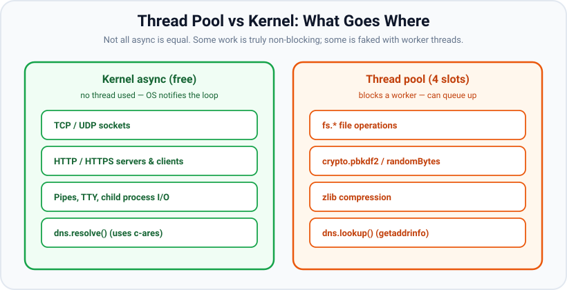

# libuv & the Thread Pool

*9 min read · Updated 24 Jul 2026 Topic 7 of 70 Bookmark Mark done Why it matters · Topic 7 of 70*

**Source:** [https://www.geekyfrontend.in/learn/nodejs-backend-kit/libuv-thread-pool](https://www.geekyfrontend.in/learn/nodejs-backend-kit/libuv-thread-pool)

---

## Why it matters

"Node.js is single-threaded" is the most repeated — and most misleading — sentence in backend interviews. Your *JavaScript* runs on a single thread. Node as a whole is emphatically multi-threaded: underneath your code sits **libuv**, a C library that owns the event loop *and* a pool of worker threads, plus it hands as much work as possible straight to the operating system's own asynchronous machinery. Understanding this layer is what lets you answer the real questions: why does reading 4 files concurrently sometimes serialise into two batches? Why does `crypto.pbkdf2` scale to exactly 4 parallel calls and then stall? Why is a DNS lookup mysteriously slow while an HTTP request to the same host is fast?

Every one of those has the same root: some operations are truly async at the OS level and cost no thread, while others are only *faked* as async by running them on libuv's small thread pool. Knowing which is which is the difference between an application that scales and one that intermittently freezes under load for reasons nobody can explain.

## The concept, simply

Picture Node as three cooperating layers. At the top, **V8** runs your JavaScript on one thread. In the middle, **libuv** is the plumbing: it runs the event loop on that same main thread, and it also manages a separate **thread pool** (four background worker threads by default). At the bottom is the **operating system kernel**, which has its own efficient event notification systems (`epoll` on Linux, `kqueue` on macOS/BSD, IOCP on Windows).


One JS thread runs your code; libuv gives Node real concurrency via the OS kernel and a worker thread pool.

When your code does something asynchronous, libuv routes it down one of two paths:

- **The kernel path (free concurrency):** network sockets — TCP, UDP, HTTP, HTTPS — are natively asynchronous in the OS. libuv just registers interest and the kernel notifies the poll phase when data arrives. *No thread is consumed.* You can have tens of thousands of idle connections for almost no cost.
- **The thread pool path (borrowed concurrency):** some operations have no async kernel API, or their API is blocking. The filesystem is the classic case. For these, libuv hands the work to one of its worker threads, which performs the blocking call and then posts the result back to the loop. Because there are only four workers by default, only four such operations run truly in parallel.

## How it works

**What actually uses the thread pool.** The list is short and worth memorising because it is exactly what interviewers probe:

- **File system** — almost all of `fs.*` (`readFile`, `writeFile`, `stat`, etc.). The POSIX file API is synchronous, so libuv offloads it.
- **crypto** — CPU-heavy async crypto: `crypto.pbkdf2`, `crypto.scrypt`, `crypto.randomBytes`, key generation.
- **zlib** — asynchronous compression/decompression (gzip, deflate, brotli).
- **`dns.lookup`** — because it calls the system resolver `getaddrinfo`, which is blocking. This is the sneaky one: it is what `http.get('http://example.com')` uses under the hood to resolve the hostname.



Network I/O rides the kernel for free; file, crypto, zlib and dns.lookup borrow one of four worker threads.

**What does NOT use the thread pool.** All network I/O. A thousand concurrent HTTP requests do not consume a thousand threads — they are multiplexed through the kernel and serviced in the poll phase. Confusingly, `dns.resolve()` (which speaks DNS directly via the bundled c-ares library over a socket) is kernel-async and does *not* touch the pool, while `dns.lookup()` (the default that `getaddrinfo` backs) *does*. Same-sounding functions, opposite thread behaviour.

**The pool has exactly four slots by default.** The environment variable `UV_THREADPOOL_SIZE` controls it (max 1024, and it must be set before the pool is created — practically, before you do any pool work). If you fire five `crypto.pbkdf2` calls at once, four start immediately and the fifth waits in a queue until a worker frees up. This produces a very recognisable performance signature: latency that is flat up to four concurrent operations, then rises in steps.

**Why the "single-thread myth" is half true and half dangerous.** It is true that your JS logic never runs on two threads at once — you get memory safety for free, no locks, no data races on your objects. It is dangerous when people conclude "so Node can't do parallel work". It can: I/O is parallel via the kernel, and heavy filesystem/crypto/zlib work is parallel via the pool. What is *not* parallel is your own CPU-bound JavaScript — a `for` loop crunching numbers occupies the one JS thread and blocks the loop (see the blocking topic, and use `worker_threads` for genuine JS parallelism).

## Code examples

**Example 1 — the four-slot ceiling is observable.**

javascript

```
const crypto = require('crypto');
const start = Date.now();

// Fire six identical CPU-bound hashes concurrently.
for (let i = 1; i <= 6; i++) {
  crypto.pbkdf2('secret', 'salt', 100000, 64, 'sha512', () => {
    console.log(`hash ${i} done in ${Date.now() - start}ms`);
  });
}

// Typical output (4-core machine, default pool of 4):
//   hash 1 done in ~180ms
//   hash 2 done in ~180ms
//   hash 3 done in ~180ms
//   hash 4 done in ~180ms   <- first four finish together
//   hash 5 done in ~360ms
//   hash 6 done in ~360ms   <- next two wait for a free worker
```

The first four run in parallel on the four workers; calls five and six queue and only start once a worker is free — so they finish in roughly double the time. This is the thread pool made visible.

**Example 2 — raise the ceiling with `UV_THREADPOOL_SIZE`.**

javascript

```
// Run with: UV_THREADPOOL_SIZE=8 node app.js
console.log(process.env.UV_THREADPOOL_SIZE); // '8'

// Now all six hashes above start immediately and finish together,
// because there are enough workers. Set it BEFORE any pool work;
// setting process.env.UV_THREADPOOL_SIZE at runtime is too late
// once the pool has been created.
```

**Example 3 — network I/O ignores the pool entirely.**

javascript

```
const https = require('https');
const start = Date.now();

// 50 concurrent requests — served via the kernel, not 50 threads.
for (let i = 0; i < 50; i++) {
  https.get('https://example.com', (res) => {
    res.on('data', () => {});
    res.on('end', () => console.log(`req ${i}: ${Date.now() - start}ms`));
  });
}
// All 50 progress concurrently regardless of UV_THREADPOOL_SIZE;
// the pool default of 4 does not cap network concurrency.
```

**Example 4 — the hidden DNS cost.**

javascript

```
const dns = require('dns');

dns.lookup('example.com', () => {});   // uses a thread-pool worker
dns.resolve4('example.com', () => {}); // uses c-ares over a socket, no worker

// Under heavy fs load, dns.lookup can queue behind file operations
// on the pool. If DNS feels slow, dns.resolve() often sidesteps it.
```

## Common mistakes & gotchas

- **Believing all async work is thread-pool work.** Network I/O is kernel-async and does not touch the pool; assuming otherwise leads people to raise `UV_THREADPOOL_SIZE` hoping to serve more HTTP connections — it does nothing for that.
- **Assuming the pool is unlimited.** Four workers by default. Heavy concurrent `fs` + `crypto` + `zlib` compete for the same four slots and can serialise.
- **Forgetting `dns.lookup` uses the pool.** A burst of outbound HTTP can flood the pool with `getaddrinfo` calls and slow down unrelated file reads.
- **Setting `UV_THREADPOOL_SIZE` too late.** It must be set in the environment before the first pool operation; mutating `process.env` mid-run after the pool exists has no effect.
- **Thinking `worker_threads` and the libuv thread pool are the same thing.** They are not. The pool is internal to libuv for I/O-ish native work; `worker_threads` are separate V8 isolates you use to run *your own* CPU-bound JavaScript in parallel.
- **Expecting `fs` to be "free" like sockets.** Filesystem calls are blocking under the hood; concurrency is bounded by the pool, not the disk.

## Best practices

- **Match `UV_THREADPOOL_SIZE` to your workload,** not blindly to CPU count. If you do heavy concurrent `fs`/`crypto`/`zlib`, a larger pool (e.g. 8–16) can help; measure before and after.
- **Use `dns.resolve()` instead of `dns.lookup()`** when you need many name resolutions and want to keep them off the pool.
- **Push genuine CPU-bound JavaScript to `worker_threads`** (or a separate process), never onto the libuv pool — the pool is for native I/O-style work.
- **Watch for the "flat then stepped" latency signature** under load; it usually means you have saturated the pool.
- **Do not conflate connection scaling with pool size.** To serve more sockets, tune the app and OS limits — the pool is irrelevant to network concurrency.

## ⭐ Interview lens

> **Q: Is Node.js single-threaded?**  
> Your JavaScript executes on a single main thread, so there are no data races on your objects. But Node itself is multi-threaded: libuv runs a thread pool (4 by default) for blocking native work like `fs` and `crypto`, and network I/O is handled asynchronously by the OS kernel. So "single-threaded" describes JS execution, not the whole runtime.

> **Q: Which operations use the libuv thread pool?**  
> Filesystem (`fs.*`), CPU-heavy crypto (`pbkdf2`, `scrypt`, `randomBytes`, key generation), `zlib`, and `dns.lookup` (because it wraps blocking `getaddrinfo`). Network sockets do *not* — they are kernel-async.

> **Q: You run 6 `pbkdf2` calls concurrently and the last two are twice as slow. Why?**  
> The default pool has 4 workers. The first four run in parallel; the fifth and sixth queue until a worker frees up, so they complete in roughly double the time. Raising `UV_THREADPOOL_SIZE` to ≥6 fixes it (given enough CPU cores).

> **Q: Does increasing `UV_THREADPOOL_SIZE` let my server handle more concurrent HTTP connections?**  
> No. HTTP/TCP is serviced via the kernel in the poll phase and does not consume pool threads. The pool size only affects `fs`/`crypto`/`zlib`/`dns.lookup` throughput.

> **Q: What is the difference between `dns.lookup` and `dns.resolve`?**  
> `dns.lookup` calls the OS resolver `getaddrinfo`, which is blocking, so it runs on the thread pool. `dns.resolve` (and its variants) queries DNS servers directly via c-ares over a socket — kernel-async, no pool thread. Under heavy pool load, `lookup` can queue while `resolve` stays fast.

> **Q: Thread pool vs `worker_threads` — same thing?**  
> No. The libuv pool is internal, runs native I/O-style work, and you cannot put arbitrary JS on it. `worker_threads` are separate V8 isolates you create explicitly to run your own CPU-bound JavaScript in parallel, communicating via message passing or `SharedArrayBuffer`.

## Cheat-card

- **1 JS thread** (V8) + **libuv** (event loop + thread pool) + **OS kernel**.
- **Kernel-async, no thread:** TCP/UDP/HTTP sockets, pipes, `dns.resolve`.
- **Thread pool (4 default):** `fs.*`, `crypto.pbkdf2/scrypt/randomBytes`, `zlib`, `dns.lookup`.
- Tune with `UV_THREADPOOL_SIZE` (max 1024); set it before any pool work.
- Pool ≠ network concurrency. Raising it won't serve more sockets.
- Real JS parallelism → `worker_threads`, not the pool.
- "Single-threaded" = JS execution only; the runtime is multi-threaded.
- **io_uring on Node 24:** files still go through the thread pool. The only ring is a non-SQPOLL one that batches `epoll_ctl`. `UV_USE_IO_URING=1` has no effect (CVE-2024-22017 fix, libuv ≥ 1.49).
- **Pool sizing:** `os.availableParallelism()` (added in v19.4.0) respects affinity and the cgroup quota; `os.cpus().length` reports the whole host.

---

## Learn More

- [Thread pool work scheduling docs.libuv.org](https://docs.libuv.org/en/v1.x/threadpool.html)
- [Don't Block the Event Loop (or the Worker Pool) nodejs.org](https://nodejs.org/en/learn/asynchronous-work/dont-block-the-event-loop)
- [Node.js Tutorial - 39 - Thread Pool Codevolution](https://www.youtube.com/watch?v=I1sqnbJ1Fno)
- [This is how the Node.js Event Loop really works Software Developer Diaries](https://www.youtube.com/watch?v=paI6J8my3Yw)

---

## Additional topics

*Added 7 Oct 2026 · examples verified on Node v24.19.0*

### io_uring on Linux: what Node 24 actually uses

**What it is.** io_uring is a Linux kernel interface (5.1+) made of two ring buffers shared between a process and the kernel. The process writes I/O requests into a *submission queue*, and the kernel posts results to a *completion queue*. With the SQPOLL mode, a kernel thread polls the submission queue, so the process does not even need a syscall per request. For files this offers real kernel-async I/O, which could replace the thread-pool path described above (a worker thread making a blocking `read()`).

**Why it matters, and why it is off.** libuv 1.45.0 (May 2023, shipped in Node 20.3.0) started sending file operations through an SQPOLL io_uring ring. Two kinds of trouble followed. The first was kernel bugs: libuv's ChangeLog has a run of entries such as "disable io_uring on 32 bits arm systems", "don't use io_uring on pre-5.10.186 kernels" and "disable io_uring on ppc64 and ppc64le". The second was a security hole. **CVE-2024-22017** (High), fixed in the 14 Feb 2024 security releases (Node 20.11.1 and 21.6.2): an io_uring ring created *before* `process.setuid()` kept the old credentials, so file operations could still run with root privileges after the process had "dropped" them. Node's fix was two commits: "deps: disable io_uring support in libuv by default", and "src,deps: disable setuid() etc if io_uring enabled". libuv 1.49.0 (Sept 2024) then made the opt-out official upstream: "linux: disable SQPOLL io_uring by default".

**The state on Node v24.19.0 (libuv 1.52.1), from its source:**

1. Every libuv loop creates one small io_uring ring without SQPOLL (the `ctl` ring) and uses it only to batch `epoll_ctl` calls. libuv 1.50.0's ChangeLog says "always use io_uring for epoll batching". No file I/O goes through it.
2. The SQPOLL ring that would carry file operations is created lazily, and only if **both** of these hold: the embedder calls `uv_loop_configure(loop, UV_LOOP_USE_IO_URING_SQPOLL)` (a loop option added in libuv 1.49.0), **and** the `UV_USE_IO_URING` environment variable is a positive number.
3. Node v24.19.0 calls `uv_loop_configure` only with `UV_LOOP_BLOCK_SIGNAL` and `UV_METRICS_IDLE_TIME`, never with the SQPOLL option. So **on Node 24, `fs` always uses the thread pool, and setting `UV_USE_IO_URING=1` changes nothing**.
4. `process.setuid()`, `setgid()`, `seteuid()`, `setegid()`, `setgroups()` and `initgroups()` check `uv_version()`. They throw `ERR_INVALID_STATE` ("io_uring may be enabled. See CVE-2024-22017.") only for libuv versions from 1.45.0 up to (not including) 1.49.0. This guards against a Node build linked to such a shared libuv. With the bundled 1.52.1 they work normally.

> ⚠️ Unverified: `UV_USE_IO_URING` is **not documented** on https://nodejs.org/api/cli.html (searched on 7 Oct 2026: the v24.x and current v26.10.0 pages mention `UV_THREADPOOL_SIZE` only). Everything above comes from the libuv ChangeLog, libuv v1.52.1 `src/unix/linux.c`, Node v24.19.0 `src/node.cc` / `src/node_credentials.cc`, and the strace run below, not from a Node doc page.

**Example — strace shows no SQPOLL ring and file reads on four pool threads, with or without the variable.**

javascript

```
// uring.js — 20 concurrent async reads of this file
const fs = require('node:fs');
let n = 0;
for (let i = 0; i < 20; i++) fs.readFile(__filename, () => { if (++n === 20) console.log('20 reads done'); });
```

bash

```
$ cat run.sh
node -p "process.versions.uv"
for v in 0 1; do
  echo "--- UV_USE_IO_URING=$v"
  UV_USE_IO_URING=$v strace -f -o trace$v.txt -e trace=io_uring_setup,openat node uring.js
  echo "rings created: $(grep -c 'io_uring_setup(' trace$v.txt), with SQPOLL: $(grep -c 'IORING_SETUP_SQPOLL' trace$v.txt)"
  echo "threads that opened uring.js (count, thread id):"
  grep 'uring.js' trace$v.txt | awk '{print $1}' | sort | uniq -c
done
$ sh run.sh
1.52.1
--- UV_USE_IO_URING=0
20 reads done
rings created: 3, with SQPOLL: 0
threads that opened uring.js (count, thread id):
      1 107378
      5 107385
      5 107386
      5 107387
      5 107388
--- UV_USE_IO_URING=1
20 reads done
rings created: 3, with SQPOLL: 0
threads that opened uring.js (count, thread id):
      1 107398
      5 107405
      5 107406
      5 107407
      5 107408
$ grep -o 'io_uring_setup(256, {flags=[A-Z_|]*' trace0.txt | sort | uniq -c
      3 io_uring_setup(256, {flags=IORING_SETUP_NO_SQARRAY
```

How to read it: the single open on the main thread (the lowest id) is the CommonJS loader reading the script. The 20 async opens are spread over four other thread ids, which are the four default pool workers (5/5/5/5 in this run; a rerun gave 6/4/6/4 and 3/2/6/9, but always four threads). The three rings all have 256 entries and no SQPOLL flag; these are the `epoll_ctl` batching rings. The output has the same shape with `UV_USE_IO_URING=1`. (Linux 7.0.0, `kernel.io_uring_disabled = 0`, strace 6.19; thread ids change every run.)

### `os.availableParallelism()` vs `os.cpus().length`

**What they are.** `os.cpus()` (added in v0.3.3) returns one object per logical CPU the *machine* has, read from `/proc` on Linux. `os.availableParallelism()` (added in v19.4.0 and v18.14.0) wraps libuv's `uv_available_parallelism()`, which estimates how many CPUs *this process* may actually use. On Linux it counts the CPUs in the process's affinity mask (`sched_getaffinity`), then lowers that to the cgroup CPU quota if there is one. libuv 1.49.0 lists "fix uv_available_parallelism using cgroup".

**Why it matters.** Containers and CPU pinning restrict the CPUs a process can use, but `os.cpus()` still reports the whole machine. If you size a worker pool or a cluster from `os.cpus().length` inside a `--cpus=2` container on a 64-core host, you start 64 CPU-bound workers that share 2 CPUs of quota. They spend their time being throttled and context-switching. Piscina's default `maxThreads` is derived from `os.availableParallelism()` for this reason (lesson 10).

How it works:

1. `uv_available_parallelism()` calls `sched_getaffinity(0, …)` and counts the bits set. `taskset -c 0 node …` limits that mask to one CPU.
2. It reads the process's cgroup (`/proc/self/cgroup`) and its `cpu.max` (quota and period). A quota of `200000 100000` means 2 CPUs.
3. It returns the smaller of the two, and never less than 1. A fractional quota rounds down: 1.5 CPUs gives 1.
4. Neither value changes the libuv thread pool. `UV_THREADPOOL_SIZE` still defaults to 4, whatever these functions return.

**Example — same machine, three restrictions.**

javascript

```
// par.js
const os = require('node:os');
console.log(`availableParallelism=${os.availableParallelism()} cpus().length=${os.cpus().length}`);
```

bash

```
$ node par.js
availableParallelism=8 cpus().length=8
$ taskset -c 0 node par.js
availableParallelism=1 cpus().length=8
$ taskset -c 0-2 node par.js
availableParallelism=3 cpus().length=8
$ systemd-run --user --scope -q -p CPUQuota=200% node par.js
availableParallelism=2 cpus().length=8
```

`systemd-run --user --scope` runs the command in a temporary cgroup whose `cpu.max` was `200000 100000` (quota and period in microseconds). The cgroup is removed when the command exits, so nothing on the host changes.

> ⚠️ Unverified: that `docker run --cpus=2` and Kubernetes CPU limits write the same `cpu.max` file, so they give the same result. No Docker daemon or cluster was available to run it.

### Common mistakes & gotchas (additional topics)

- **"Node 20+ uses io_uring for files."** That was only true for the releases between 20.3.0 and 20.11.1. Node 24 sends `fs` through the thread pool, and `UV_USE_IO_URING=1` does not change that, because Node never enables the SQPOLL loop option.
- **Seeing `io_uring_setup` in strace and concluding files use it.** Those rings have no SQPOLL flag and only batch `epoll_ctl`. Look at which thread made the `openat`/`read` calls.
- **Following old advice to set `UV_USE_IO_URING=0` "for security".** It is harmless, but on Node 24 it does nothing. The CVE fix is the libuv default plus the `setuid()` guard.
- **Sizing pools from `os.cpus().length` in containers.** It reports the host's CPUs. Use `os.availableParallelism()`, which respects affinity and cgroup quota.
- **Assuming `availableParallelism()` tunes `UV_THREADPOOL_SIZE`.** It does not. The pool stays at 4 unless you set the variable.

### Edge case worked through: a fractional CPU quota

Take a CPU quota of 1.5 CPUs (`CPUQuota=150%`, which is `cpu.max` = `150000 100000`). `os.availableParallelism()` rounds it down:

bash

```
$ systemd-run --user --scope -q -p CPUQuota=150% node par.js
availableParallelism=1 cpus().length=8
```

So code that does `Math.max(1, os.availableParallelism() - 1)` to "leave one core for the main thread" gets 1 worker under a 1.5-CPU limit, and also under a 1-CPU limit. If you want your pool to use the extra half CPU (for example under a container limit of 1.5 CPUs), size it yourself (for example from an environment variable set by the deployment), and measure it.

### ⭐ Interview lens (additional topics)

> **Q: “Does Node use io_uring for file I/O today?”**  
> A: Not by default, and on Node 24 not at all. libuv added it in 1.45 (Node 20.3). After kernel bugs and CVE-2024-22017 (a ring created before `setuid()` kept root's credentials), Node 20.11.1 turned it off, and libuv 1.49 made "SQPOLL off" the upstream default. On Node 24, file operations still run on the four-thread pool. The only io_uring use left is a non-SQPOLL ring that batches `epoll_ctl` calls. *Trap:* citing `UV_USE_IO_URING=1` as the switch. Node 24 never sets the loop option it needs.

> **Q: “Why use `os.availableParallelism()` instead of `os.cpus().length`?”**  
> A: `cpus()` lists the machine's logical CPUs. `availableParallelism()` counts the CPUs in the process's affinity mask, capped by the cgroup CPU quota. In a container limited to 2 CPUs on an 8-core host it returns 2, while `cpus().length` returns 8.
