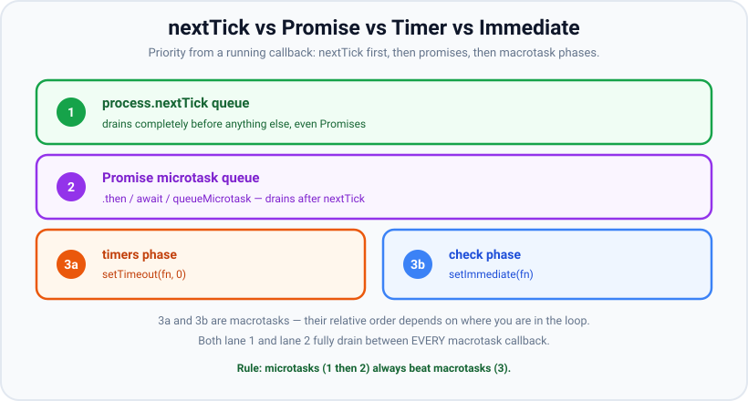

# process.nextTick vs setImmediate

*10 min read · Updated 24 Jul 2026 Topic 8 of 70 Bookmark Mark done Why it matters Three functions promise to · Topic 8 of 70*

**Source:** [https://www.geekyfrontend.in/learn/nodejs-backend-kit/nexttick-vs-setimmediate](https://www.geekyfrontend.in/learn/nodejs-backend-kit/nexttick-vs-setimmediate)

---

## Why it matters

Three functions promise to "run your callback later": `process.nextTick`, `setImmediate`, and `setTimeout(fn, 0)`. Their names are actively misleading. `nextTick` does *not* run on the next loop tick — it runs before the loop continues at all. `setImmediate` is not immediate — it runs in a specific later phase. And `setTimeout(fn, 0)` is not zero — it is clamped to at least 1ms. Every Node developer eventually ships a bug because they guessed at this ordering, and every serious Node interview tests whether you actually know it.

The stakes are higher than trivia. Choosing `nextTick` where you meant `setImmediate` can **starve the event loop** — a recursive `nextTick` will prevent timers and I/O from *ever* running, freezing your server while it looks busy. Choosing the wrong deferral in library code changes the observable order of user callbacks and breaks people who depend on it. This topic makes the ordering deterministic in your head.

## The concept, simply

Rank these deferral mechanisms by how soon they run, from a callback that is currently executing:

1. **`process.nextTick(fn)`** — soonest. Runs after the current operation finishes but *before* the event loop is allowed to proceed to any phase. It has its own dedicated queue that drains completely first.
2. **Promise callbacks** (`.then`, `await`, `queueMicrotask`) — the microtask queue, which drains right after the nextTick queue. (Full detail in the next topic.)
3. **`setImmediate(fn)`** — runs in the **check** phase of the loop. A macrotask.
4. **`setTimeout(fn, 0)`** — runs in the **timers** phase, subject to a ~1ms minimum. Also a macrotask.



nextTick outranks promises, and both drain before any macrotask. setImmediate and setTimeout are macrotasks whose order depends on context.

The headline: **nextTick and promises are not part of any phase** — they run *between* phases, before the loop can advance. `setImmediate` and `setTimeout` *are* phases. So microtask-family callbacks always win against timer/immediate callbacks scheduled at the same moment.

## How it works

**The nextTick queue is special and separate.** Node keeps a dedicated `nextTick` queue that is *not* the same as the Promise microtask queue, and it is drained *first*. After the currently running JavaScript returns — and at every phase boundary — Node does: drain the entire nextTick queue (including any nextTicks added while draining), then drain the entire microtask (Promise) queue. Only then does the loop move forward. Because the nextTick queue is emptied exhaustively before promises, a `process.nextTick` callback always fires before a `Promise.resolve().then` callback registered at the same point.

**Why nextTick can starve the loop.** Since the loop is not allowed to advance until the nextTick queue is empty, a callback that schedules another `nextTick`, which schedules another, and so on, creates an infinite queue that never empties. The loop is frozen at that boundary forever: no timers fire, no I/O completes, no `setImmediate` runs. `setImmediate` does not have this problem — each `setImmediate` you schedule from within a check-phase callback runs on the *next* loop iteration's check phase, so the loop still cycles through poll and timers in between, keeping I/O alive.


Recursion in the nextTick/microtask lane keeps the drain running and can freeze the loop; setImmediate recursion yields between iterations.

**setImmediate vs setTimeout(0): it depends where you are.** At the top level the order is non-deterministic (a startup-timing race, as in the phases topic). But *inside an I/O callback*, `setImmediate` always wins, because I/O callbacks run in the poll phase and the very next phase is check — the `setTimeout` must wait for the loop to wrap around to timers on the next iteration.

**Putting the four mechanisms side by side.** It helps to see exactly where each callback is parked and what governs its turn. The table below is the whole mental model in one place — memorise the "When it runs" column and most output-prediction questions collapse into a lookup.

| Mechanism | Queue / phase | When it runs | Can starve the loop? |
| --- | --- | --- | --- |
| `process.nextTick` | Dedicated nextTick queue (not a phase) | After the current op, before the loop advances; drained fully, ahead of promises | **Yes** — recursive scheduling never lets the loop move on |
| `Promise.then` / `await` / `queueMicrotask` | V8 microtask queue (not a phase) | Right after the nextTick queue empties, still before the loop advances | **Yes** — an endless promise chain drains forever |
| `setImmediate` | check phase | Once per loop iteration, when the loop reaches check | No — it yields between iterations |
| `setTimeout(fn, 0)` | timers phase | Next timers phase, once the ~1ms floor has elapsed | No — it yields between iterations |

**A subtlety that trips up seniors: nextTick and microtasks interleave *with each other* during a single drain.** Node does not run every nextTick once and then every promise once. It empties the whole nextTick queue, then the whole promise queue, then — if draining the promises produced new nextTicks — it goes back and drains those, then re-drains promises, alternating until *both* are genuinely empty. So the guarantee is not "all nextTicks before all promises" across the whole program; it is "nextTick beats promise when both are scheduled from synchronous code or a macrotask callback". The promise queue is never interrupted mid-drain: a promise callback that itself calls `process.nextTick` will see that nextTick run *after* every promise already queued — including ones scheduled after the nextTick — because Node only goes back to the nextTick queue once V8 has emptied the promise queue (see Example 2b; this matches the alternation described in the microtasks topic). Even so, this is exactly why an unbounded recursive `nextTick` is more dangerous than an unbounded promise chain: the nextTick queue is always re-checked and re-emptied first, so it can wedge the boundary shut while starving promises too.

**What is `nextTick` actually for?** Two legitimate uses. First, to let a function *appear* asynchronous consistently — e.g. deferring an error callback so it never fires synchronously in the same stack that called your function (the "don't release Zalgo" pattern). Second, to run cleanup or allow the caller to attach listeners before an event fires — emitting an event on `nextTick` gives the caller a chance to register a handler first. Both are about ordering guarantees, not about "running soon".

## Code examples

**Example 1 — the canonical ordering question.**

javascript

```
console.log('start');

setTimeout(() => console.log('setTimeout'), 0);
setImmediate(() => console.log('setImmediate'));
Promise.resolve().then(() => console.log('promise'));
process.nextTick(() => console.log('nextTick'));

console.log('end');

// Output:
//   start
//   end
//   nextTick        <- microtask family, drains first (before promises)
//   promise         <- microtask queue, right after nextTick
//   setTimeout / setImmediate  (these two race at the top level)
```

Synchronous `start`/`end` run first. Then the loop drains nextTick (beats `promise`), then promises. The last two are macrotasks whose relative order is not guaranteed at the top level.

**Example 2 — inside I/O, immediate is deterministic.**

javascript

```
const fs = require('fs');

fs.readFile(__filename, () => {
  setTimeout(() => console.log('setTimeout'), 0);
  setImmediate(() => console.log('setImmediate'));
  process.nextTick(() => console.log('nextTick'));
  Promise.resolve().then(() => console.log('promise'));
});

// Output (always):
//   nextTick
//   promise
//   setImmediate
//   setTimeout
```

nextTick and promise drain before the loop leaves the poll phase. Then check runs (`setImmediate`) before the loop wraps back to timers (`setTimeout`).

**Example 2b — a nextTick scheduled *inside* a promise callback waits for the promise queue.**

javascript

```
// ordering.js — run as CommonJS: node ordering.js
Promise.resolve().then(() => {
  console.log('promise A runs');
  process.nextTick(() => console.log('nextTick scheduled inside A'));
  Promise.resolve().then(() => console.log('promise B (queued inside A, after the nextTick)'));
});
Promise.resolve().then(() => console.log('promise C (queued before A ran)'));

// Real output (Node v24.19.0):
//   promise A runs
//   promise C (queued before A ran)
//   promise B (queued inside A, after the nextTick)
//   nextTick scheduled inside A
```

Once the promise queue is draining, V8 runs it to empty — `C` and the later-queued `B` both run — before Node goes back to the nextTick queue. "nextTick first" only holds when both are scheduled from synchronous code or a macrotask callback.

> **Why this was wrong:** an earlier version of this topic said the nextTick queue is re-checked *during* the promise drain. It is only re-checked *after* the promise queue empties, which is why `B` beats the nextTick above.

**Example 3 — nextTick recursion freezes everything.**

javascript

```
let count = 0;
setTimeout(() => console.log('timer fired'), 100);

function loop() {
  if (++count % 1000000 === 0) console.log('still ticking', count);
  process.nextTick(loop); // never lets the loop advance
}
loop();

// Output:
//   still ticking 1000000
//   still ticking 2000000
//   ... forever. 'timer fired' NEVER prints — the loop is starved.
```

Swap `process.nextTick(loop)` for `setImmediate(loop)` and the timer *does* fire, because `setImmediate` yields between loop iterations so timers and I/O still get their turn.

**Example 4 — nextTick to guarantee async, so listeners can attach.**

javascript

```
const EventEmitter = require('events');

class Thing extends EventEmitter {
  constructor() {
    super();
    // WRONG: emit here fires before caller can add a listener.
    // Defer so the 'ready' handler below is registered first.
    process.nextTick(() => this.emit('ready'));
  }
}

const t = new Thing();
t.on('ready', () => console.log('ready!')); // attached in time

// Output:
//   ready!
```

## Common mistakes & gotchas

- **Thinking `nextTick` runs "on the next tick of the loop".** It runs *before* the loop advances at all — sooner than any phase, sooner than promises.
- **Using recursive `nextTick` for chunked work.** It starves the loop. Use `setImmediate` for anything that should yield to I/O between iterations.
- **Assuming `nextTick` and `Promise.resolve().then` are interchangeable.** nextTick drains first; if you schedule both, nextTick's callback runs earlier.
- **Believing `setImmediate` means "right now".** It runs in the check phase, after poll — later than any pending microtask.
- **Expecting a fixed `setTimeout(0)` vs `setImmediate` order.** Deterministic only inside I/O callbacks (immediate first); a race at the top level.
- **Emitting an event synchronously from a constructor.** Listeners added after construction miss it; defer the emit with `nextTick`.
- **Assuming a `nextTick` scheduled from inside a promise callback jumps ahead of the remaining promises.** It does not. The promise queue drains to empty first — including promises queued *after* the nextTick — and only then does Node return to the nextTick queue (still before the loop advances, not on the next loop iteration). The same rule flips Example 1 in an ES module entry file: the module body is evaluated from inside Node's promise-based ESM loader, so `promise` prints before `nextTick` there (verified on Node v24.19.0 with the same two lines saved as `.cjs` vs `.mjs`).
- **Treating `setImmediate` as "faster" than `setTimeout(fn, 0)`.** Neither is inherently faster; they simply fire in different phases. The only firm rule is the I/O-callback case, where `setImmediate` precedes `setTimeout`.

## Best practices

- **Reach for `setImmediate`, not `nextTick`, to break up work** or to schedule "after this phase, but let I/O run".
- **Use `nextTick` only for ordering guarantees:** making an API consistently async, or deferring an emit so callers can subscribe first.
- **Never build an unbounded recursive `nextTick` chain.** If you must recurse in the microtask lane, cap it or hand off to `setImmediate` periodically.
- **Prefer promises/`queueMicrotask` over `nextTick` in new code** unless you specifically need to beat the microtask queue — it keeps intent clear and portable.
- **Document any ordering you rely on.** "This runs in the check phase after I/O" is a comment worth writing.

## ⭐ Interview lens

> **Q: `nextTick` vs `setImmediate` — one sentence each.**  
> `process.nextTick` runs its callback before the event loop continues, ahead of the Promise microtask queue and every phase. `setImmediate` runs in the check phase of the loop, as a macrotask, after the current poll phase and after all pending microtasks.

> **Q: Predict the output.**  
> `process.nextTick(() => console.log('a')); Promise.resolve().then(() => console.log('b')); setImmediate(() => console.log('c'));`  
> Output: `a`, `b`, `c`. nextTick drains first, then the microtask queue (`b`), then the check phase (`c`).

> **Q: How can `process.nextTick` freeze a Node server?**  
> The loop cannot advance until the nextTick queue is empty. A callback that schedules another `nextTick` indefinitely keeps the queue non-empty forever, so timers, I/O, and `setImmediate` never get to run. `setImmediate` recursion does not do this because it yields between loop iterations.

> **Q: Inside `fs.readFile`'s callback you schedule both `setTimeout(fn, 0)` and `setImmediate`. Which runs first?**  
> `setImmediate`, always. The callback runs in the poll phase; the next phase is check (`setImmediate`), while `setTimeout` waits for the timers phase on the next iteration.

> **Q: Why would a library emit an event via `process.nextTick` instead of synchronously?**  
> To let the caller attach listeners first. If a constructor emits `'ready'` synchronously, any `.on('ready')` added afterward misses it. Deferring the emit to `nextTick` guarantees the emit happens after the current stack unwinds, once listeners are registered.

> **Q: Is `setTimeout(fn, 0)` the same as `setImmediate`?**  
> No. `setTimeout(fn, 0)` is clamped to ~1ms and runs in the timers phase; `setImmediate` runs in the check phase with no delay clamp. At the top level their order races; inside an I/O callback `setImmediate` reliably wins.

## Cheat-card

- **Priority:** nextTick → promises → (timers | check macrotasks).
- `process.nextTick`: before loop advances; own queue; drains before promises.
- `setImmediate`: check phase; macrotask; yields between iterations.
- `setTimeout(fn,0)`: timers phase; ~1ms floor; macrotask.
- Inside I/O callback: `setImmediate` > `setTimeout(0)` (guaranteed).
- Recursive `nextTick` = starvation. Recursive `setImmediate` = safe.
- Use `nextTick` for ordering guarantees; `setImmediate` to yield to I/O.

---

## Learn More

- [The Node.js Event Loop (process.nextTick vs setImmediate) nodejs.org](https://nodejs.org/en/learn/asynchronous-work/event-loop-timers-and-nexttick)
- [Understanding setImmediate() nodejs.org](https://nodejs.org/en/learn/asynchronous-work/understanding-setimmediate)
- [process.nextTick(callback[, ...args]) — API docs nodejs.org](https://nodejs.org/api/process.html)
- [setImmediate(callback[, ...args]) — Timers API docs nodejs.org](https://nodejs.org/api/timers.html)
- [This is how the Node.js Event Loop really works Software Developer Diaries](https://www.youtube.com/watch?v=paI6J8my3Yw)
