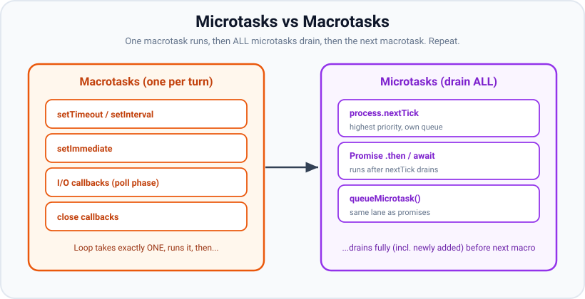
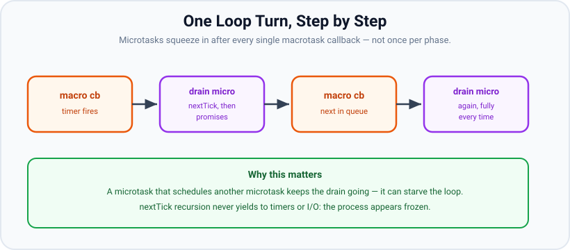

# Microtasks vs Macrotasks

*10 min read · Updated 24 Jul 2026 Topic 9 of 70 Bookmark Mark done Why it matters Every asynchronous callback in Node lands in one of two categories · Topic 9 of 70*

**Source:** [https://www.geekyfrontend.in/learn/nodejs-backend-kit/microtasks-vs-macrotasks](https://www.geekyfrontend.in/learn/nodejs-backend-kit/microtasks-vs-macrotasks)

---

## Why it matters

Every asynchronous callback in Node lands in one of two categories, and the category decides *when* it runs relative to everything else. **Macrotasks** are the phase-based callbacks — timers, I/O, `setImmediate`, close handlers. **Microtasks** are promise continuations and `queueMicrotask`, with `process.nextTick` as a special even-higher-priority sibling. The rule that governs their interplay is short and absolute: **after every single macrotask, the entire microtask queue is drained before the next macrotask runs.**

This is why `await` feels synchronous-ish but never blocks, why a promise chain always completes before a `setTimeout` that was scheduled earlier, and why a runaway promise chain can starve I/O just like a runaway `nextTick`. It is also the concept that unifies Node with the browser: the microtask/macrotask model is the same in both, which is why understanding it makes you better at *all* JavaScript, not just backend. Interviewers ask output-ordering questions precisely because they cannot be bluffed — either you can trace the queues or you cannot.

## The concept, simply

Two kinds of work, two different scheduling rules:

- **Macrotask:** the loop takes *one* per turn. `setTimeout`/`setInterval` (timers phase), I/O callbacks (poll phase), `setImmediate` (check phase), and close callbacks are all macrotasks. Each sits in a phase queue and the loop processes them as it walks the phases.
- **Microtask:** the loop drains *all* of them — repeatedly, including any newly scheduled during the drain — after each macrotask and at every phase boundary. Promise `.then`/`.catch`/`.finally`, the continuation after an `await`, and `queueMicrotask` are microtasks. `process.nextTick` is a separate, higher-priority queue that drains *before* the promise microtasks.



The loop takes one macrotask, then empties the whole microtask queue, then takes the next macrotask.

Mnemonic: **one macro, then all micros, then one macro, then all micros.** Microtasks are greedy; macrotasks are polite and take turns.

## How it works

**The drain is exhaustive.** When Node drains microtasks, it does not process a fixed snapshot — it keeps going until the queue is genuinely empty. If microtask A schedules microtask B, and B schedules C, all of them run in the same drain, before the loop is allowed to move on. This is what makes `await` chains resolve in one continuous burst. It is also the starvation risk: an endless chain of promises-that-schedule-promises never lets the loop reach the next macrotask, freezing timers and I/O — exactly the `nextTick` starvation problem, one lane over.



Microtasks drain fully after each macrotask; a self-scheduling microtask chain can starve the loop just like recursive nextTick.

**nextTick vs promise, precisely.** Node maintains two distinct queues in the microtask family. The `process.nextTick` queue is drained first and completely; then the V8 Promise microtask queue is drained. If a nextTick callback schedules a promise, and a promise callback schedules a nextTick, Node re-checks: after promises run, if new nextTicks appeared, it drains those too, then re-drains promises — it keeps alternating until both are empty. The net effect you can rely on: **at the same scheduling point, nextTick beats promise.**

**How `await` maps onto this.** An `await x` is sugar for "evaluate `x`, then schedule the rest of this function as a promise microtask". Everything before the first `await` runs synchronously; the moment you hit `await`, the function suspends and control returns to the caller. The continuation resumes as a microtask once the awaited value settles. So an `async` function is partly synchronous (up to the first `await`) and partly a series of microtasks (each resumption after an `await`).

**Where macrotasks fit around all this.** The loop enters a phase, runs one macrotask callback, then drains nextTick + promises fully, then runs the next macrotask callback in that phase, drains again, and so on until the phase queue empties — then advances. So microtasks are not "once per loop" or "once per phase"; they are *once per macrotask callback*. That granularity is the crux of most trick questions.

**The two families at a glance.** The table fixes the distinction that every ordering puzzle turns on — *how many* the loop takes per turn, and *when* it comes back for more.

| Property | Macrotask | Microtask |
| --- | --- | --- |
| Examples | `setTimeout`, `setInterval`, `setImmediate`, I/O, close callbacks | `Promise.then/catch/finally`, `await` continuation, `queueMicrotask`, `process.nextTick` (higher-priority sibling) |
| Lives in | A phase queue (timers, poll, check, close) | The nextTick queue and the V8 microtask queue — neither is a phase |
| How many run per turn | Exactly one callback, then the loop pauses to drain microtasks | The entire queue, exhaustively, including any scheduled mid-drain |
| When it next runs | Next time the loop reaches that phase | After every macrotask callback and at every phase boundary |
| Starvation risk | Low — always yields between callbacks | High — a self-scheduling chain never lets the loop advance |

**A concrete trace that exposes the "once per macrotask" rule.** Suppose two timers are both due, and each timer callback schedules a promise. The loop enters the timers phase, runs timer A, and *before touching timer B* it fully drains the microtask queue — so A's promise runs. Only then does it run timer B, and again drains microtasks, so B's promise runs. The output is `A, A-promise, B, B-promise`, never `A, B, A-promise, B-promise`. If microtasks drained "once per phase" instead, you would see the second, wrong ordering. Reproducing this by hand is the single best way to prove to yourself that the drain happens between the two macrotasks, not after both.

## Code examples

**Example 1 — micro always beats macro.**

javascript

```
console.log('sync 1');
setTimeout(() => console.log('macro: timeout'), 0);
Promise.resolve().then(() => console.log('micro: promise'));
console.log('sync 2');

// Output:
//   sync 1
//   sync 2
//   micro: promise    <- microtask drains before the loop reaches timers
//   macro: timeout
```

**Example 2 — a chain of promises drains before any timer.**

javascript

```
setTimeout(() => console.log('timeout'), 0);

Promise.resolve()
  .then(() => console.log('p1'))
  .then(() => console.log('p2'))
  .then(() => console.log('p3'));

// Output:
//   p1
//   p2
//   p3
//   timeout
```

Each `.then` schedules the next as a microtask; the whole chain empties in one drain before the timers phase gets its turn.

**Example 3 — async/await ordering.**

javascript

```
async function main() {
  console.log('A');
  await null;          // suspends here; rest becomes a microtask
  console.log('C');
}

console.log('start');
main();
console.log('end');

// Output:
//   start
//   A         <- runs synchronously up to the await
//   end       <- control returned to caller at the await
//   C         <- resumes as a microtask after sync code finishes
```

**Example 4 — the full six-way ordering trap.**

javascript

```
console.log('1: sync');
setTimeout(() => console.log('2: setTimeout'), 0);
setImmediate(() => console.log('3: setImmediate'));
Promise.resolve().then(() => console.log('4: promise'));
process.nextTick(() => console.log('5: nextTick'));
(async () => { await null; console.log('6: await'); })();
console.log('7: sync');

// Output:
//   1: sync
//   7: sync
//   5: nextTick        <- nextTick queue drains first
//   4: promise         <- then the promise microtask queue...
//   6: await           <- ...including the await continuation (FIFO)
//   2: setTimeout / 3: setImmediate  (macrotasks; order races at top level)
```

Sync code (1, 7) first. Then all microtask-family work: nextTick (5) ahead of promises, then the promise queue in FIFO order (4 before 6, because `.then` was scheduled before the `await` continuation). Finally the two macrotasks, whose order is a top-level race.

## Common mistakes & gotchas

- **Thinking microtasks run "once per loop iteration".** They drain after *every* macrotask callback and at every phase boundary — far more often.
- **Assuming `setTimeout(fn, 0)` beats a promise scheduled just before it.** It never does; the microtask queue empties before the loop reaches the timers phase.
- **Believing `await` blocks.** It suspends the async function and returns control to the caller; the rest resumes later as a microtask.
- **Creating an unbounded microtask chain** (a promise that always schedules another) — it starves timers and I/O exactly like recursive `nextTick`.
- **Confusing FIFO within a queue with priority across queues.** Within the promise queue it is FIFO; but nextTick as a queue outranks the whole promise queue.
- **Forgetting synchronous code beats everything.** Nothing async runs until the current call stack is empty.
- **Assuming microtasks drain "once per phase".** They drain after *each macrotask callback* — so two due timers interleave with their own microtasks (`A, A-promise, B, B-promise`), not `A, B, A-promise, B-promise`.
- **Expecting a single big microtask drain to be interruptible by I/O.** It is not — until the queue is empty the loop cannot reach the poll phase, so a long promise chain delays every pending socket read just like blocking code would.

## Best practices

- **Prefer `queueMicrotask` or promises over `process.nextTick`** in application code unless you specifically need to beat the promise queue.
- **For CPU-bound chunking, use `setImmediate` (a macrotask), not microtasks,** so I/O gets serviced between chunks.
- **Do not throw inside a microtask without handling it** — an unhandled promise rejection propagates differently and can crash the process on modern Node defaults.
- **Trace ordering by drawing the two queues** when a bug depends on it, rather than adding `setTimeout(…, 100)` "to be safe".
- **Keep microtask work small.** Long synchronous work inside a `.then` still blocks the loop just as much as anywhere else.

## ⭐ Interview lens

> **Q: Define microtask vs macrotask in Node.**  
> A macrotask is a phase-based callback — `setTimeout`, I/O, `setImmediate`, close handlers — and the loop runs one per turn. A microtask is a promise continuation, `queueMicrotask`, or (higher-priority) `process.nextTick`; the entire microtask queue drains after every macrotask and at each phase boundary.

> **Q: Output?** `setTimeout(() => console.log('t'), 0); Promise.resolve().then(() => console.log('p'));`  
> `p` then `t`. The microtask queue empties before the loop advances to the timers phase, so the promise wins regardless of scheduling order.

> **Q: How often do microtasks drain — once per loop, once per phase, or more?**  
> More: after *every* macrotask callback, plus at each phase transition. That is why a promise chain fully resolves before the next timer, and why a self-scheduling microtask can starve the loop.

> **Q: Trace this async snippet.** `console.log(1); (async()=>{console.log(2); await null; console.log(4);})(); console.log(3);`  
> Output: 1, 2, 3, 4. Code runs synchronously to the `await` (1, 2), control returns to the caller (3), then the continuation resumes as a microtask (4).

> **Q: Between a `process.nextTick` and a `Promise.then` scheduled together, which runs first, and why?**  
> The nextTick callback. Node drains the dedicated nextTick queue completely before draining the Promise microtask queue, so nextTick always wins at the same scheduling point.

> **Q: Can microtasks starve the event loop like `nextTick` can?**  
> Yes. Because the microtask queue is drained exhaustively — including newly added microtasks — an endless chain of promises-that-schedule-promises never yields to the loop, freezing timers and I/O. The fix is to move periodic work onto `setImmediate`.

## Cheat-card

- **Rule:** one macrotask → drain ALL microtasks → next macrotask.
- **Macrotasks:** `setTimeout`, `setInterval`, `setImmediate`, I/O, close.
- **Microtasks:** promise `.then`/`await`, `queueMicrotask`; `nextTick` = higher-priority sibling.
- Priority order: sync → nextTick → promises → macrotasks.
- Microtasks drain after every macrotask + every phase boundary (not once per loop).
- `await` = suspend + resume-as-microtask; never blocks.
- Endless microtask chains starve the loop → use `setImmediate` to yield.
- **Thenable ticks:** resolving with a native promise costs +2 ticks, with a sync thenable +1; `await nativePromise` costs +0, `await thenable` +1.
- **`return await p`** in an `async` fn settles 1 tick sooner than `return p` (Node 12+), and it is the only form its own `try/catch` can catch.
- **ESM entry / after top-level `await`:** promises queued there run before nextTicks queued there; inside macrotask callbacks nextTick still wins.

---

## Learn More

- [Using microtasks in JavaScript with queueMicrotask() developer.mozilla.org](https://developer.mozilla.org/en-US/docs/Web/API/HTML_DOM_API/Microtask_guide)
- [In depth: Microtasks and the JavaScript runtime environment developer.mozilla.org](https://developer.mozilla.org/en-US/docs/Web/API/HTML_DOM_API/Microtask_guide/In_depth)
- [Understanding setImmediate() (nextTick / microtask / macrotask queue order) nodejs.org](https://nodejs.org/en/learn/asynchronous-work/understanding-setimmediate)
- [JavaScript Visualized - Event Loop, Web APIs, (Micro)task Queue Lydia Hallie](https://www.youtube.com/watch?v=eiC58R16hb8)
- [Jake Archibald: In The Loop — event loop, setTimeout, micro tasks (JSConf.Asia) JSConf](https://www.youtube.com/watch?v=cCOL7MC4Pl0)

---

## Additional topics

*Added 7 Oct 2026 · examples verified on Node v24.19.0*

### Thenables cost extra microtask ticks

**What it is.** A *thenable* is any object with a callable `then` method, and native promises are thenables too. When a promise is *resolved with* a thenable (you return one from a `.then` callback, call `resolve(thenable)`, or return one from an `async` function), the spec does not copy the value across directly. It queues a **NewPromiseResolveThenableJob**: one microtask whose only job is to call `thenable.then(resolve, reject)`. If the thenable is a native promise that is already fulfilled, that `then` call queues *another* microtask (the reaction job) to deliver the value. So "the same value, wrapped in a promise" arrives one or two ticks later than the plain value would.

**Why it matters.** It doesn't matter for throughput, because the cost is a couple of microtasks. It matters for **ordering**: two code paths that "both resolve with 42" can finish in different orders depending on whether one of them wrapped the value. It also explains a common interview puzzle: why `async` functions that `return somePromise` finish later than ones that `return await somePromise`.

How it works (per hop, measured below):

1. **Plain value:** the derived promise is fulfilled right away, and its reaction is queued. Baseline.
2. **Native promise:** tick 1 runs the ResolveThenableJob, which calls `p.then(…)`. Because `p` is already fulfilled, tick 2 runs the reaction that finally resolves the outer promise. **+2 ticks.**
3. **Custom thenable whose `then` calls back synchronously:** tick 1 runs the ResolveThenableJob, the `then` resolves immediately, and nothing more is queued. **+1 tick.**
4. **`await` is special.** It uses `PromiseResolve`, which hands back a native promise *as is* instead of wrapping it. So `await nativePromise` costs the same as `await 42`. This is the spec change V8 shipped in v7.2 and Node 12 picked up (see v8.dev/blog/fast-async). A non-native thenable still gets wrapped, so `await thenable` costs **+1 tick**.

**Example — counting ticks with an interleaved `.then` ladder.** The ladder logs `tick 1`, `tick 2`, … one per microtask turn. Each case logs where its value arrives.

javascript

```
const p = Promise.resolve();

// Ticker: one log line per microtask turn.
p.then(() => console.log('tick 1'))
 .then(() => console.log('tick 2'))
 .then(() => console.log('tick 3'))
 .then(() => console.log('tick 4'))
 .then(() => console.log('tick 5'));

p.then(() => 'plain').then((v) => console.log(`  ${v} value arrives`));
p.then(() => Promise.resolve('promise')).then((v) => console.log(`  ${v} arrives`));
p.then(() => ({ then: (ok) => ok('thenable') })).then((v) => console.log(`  ${v} arrives`));

// Real output (Node v24.19.0), the same as .cjs and .mjs:
//   tick 1
//   tick 2
//     plain value arrives
//   tick 3
//     thenable arrives
//   tick 4
//     promise arrives
//   tick 5
```

`return 'plain'` from `.then` arrives alongside tick 2. `return thenable` arrives one tick later, and `return Promise.resolve(…)` two ticks later.

**Example — `await`, `resolve()` and `async` return values side by side.**

javascript

```
const thenable = { then: (ok) => ok('x') };

Promise.resolve()
  .then(() => console.log('tick 1'))
  .then(() => console.log('tick 2'))
  .then(() => console.log('tick 3'))
  .then(() => console.log('tick 4'));

(async () => { await 'x';                 console.log('  await plain value'); })();
(async () => { await Promise.resolve('x'); console.log('  await native promise'); })();
(async () => { await thenable;            console.log('  await thenable'); })();
new Promise((r) => r('x')).then(() => console.log('  resolve(plain value)'));
new Promise((r) => r(Promise.resolve('x'))).then(() => console.log('  resolve(native promise)'));
new Promise((r) => r(thenable)).then(() => console.log('  resolve(thenable)'));
(async () => Promise.resolve('x'))().then(() => console.log('  async fn: return promise'));
(async () => await Promise.resolve('x'))().then(() => console.log('  async fn: return await promise'));

// Real output (Node v24.19.0), identical in 30 runs and as .mjs:
//   tick 1
//     await plain value
//     await native promise
//     resolve(plain value)
//   tick 2
//     await thenable
//     resolve(thenable)
//     async fn: return await promise
//   tick 3
//     resolve(native promise)
//     async fn: return promise
//   tick 4
```

| Hand-off | Extra ticks vs a plain value (observed) |
| --- | --- |
| `await nativePromise` | 0 |
| `await thenable` | +1 |
| `resolve(thenable)` / `.then(() => thenable)` | +1 |
| `resolve(nativePromise)` / `.then(() => nativePromise)` | +2 |
| `async` function `return nativePromise` (vs `return value`) | +2 |
| `async` function `return await nativePromise` (vs `return value`) | +1 |

### Microtask order when the entry file is an ES module

**What changes.** The microtask rules themselves don't change. What changes is the context the top-level code runs in. A CommonJS entry runs as a plain function call. When it returns, Node drains `process.nextTick` first and then the promise queue, which is the "nextTick beats promise" rule above. An ES module entry is evaluated from inside Node's promise-based ESM loader, so its body is *already running inside a microtask drain*. Promise jobs it queues run in that same drain, and Node returns to the nextTick queue only once V8 has emptied the promise queue. Lesson 08 shows the same rule: a nextTick scheduled inside a promise callback runs after the promises queued later. The ESM entry body behaves like one big promise callback.

How it works:

1. **CJS:** body → nextTick queue → promise queue → event loop.
2. **ESM:** loader awaits evaluation → body (inside a promise job) → rest of the promise queue, including the body's `.then`s and `await` continuations → nextTick queue → event loop.
3. Code after a top-level `await` resumes as a promise continuation, so it too runs inside a microtask drain. Its promises still run before its nextTicks, even when the awaited thing was a timer.
4. Inside a macrotask callback (a timer, I/O, `setImmediate`), CJS and ESM behave the same: nextTick first.

**Example — this lesson's Example 4, saved as `.cjs` and as `.mjs`.**

bash

```
$ node six.cjs
1: sync
7: sync
5: nextTick
4: promise
6: await
3: setImmediate
2: setTimeout
$ node six.mjs
1: sync
7: sync
4: promise
6: await
5: nextTick
3: setImmediate
2: setTimeout
```

The three microtask lines were in this order in 50 of 50 runs of each file. The last two lines are the top-level timer race and varied: `setImmediate` printed first in 29 of 50 `.cjs` runs and 32 of 50 `.mjs` runs. So the answer to the "six-way ordering trap" depends on the module system. Give the CJS answer and say that it assumes CJS.

**Example — after a top-level `await`, promises still beat nextTick.**

javascript

```
// tla.mjs
await new Promise((r) => setTimeout(r, 10));   // module resumes from a timer
process.nextTick(() => console.log('after TLA: nextTick'));
Promise.resolve().then(() => console.log('after TLA: promise'));

// Real output (Node v24.19.0):
//   after TLA: promise
//   after TLA: nextTick
```

The timer callback only *resolves* the promise. The module body continues in the microtask drain that follows, so it is inside a promise job when it schedules both callbacks.

### Common mistakes & gotchas (additional topics)

- **"Returning a promise from `.then` is free."** It costs two extra microtask ticks compared with returning the value. That is usually harmless, but it reorders work against other chains running at the same time.
- **Assuming `await promise` and `await thenable` are the same.** Native promises pass through `await` unwrapped. Any other thenable (a hand-rolled one, or a promise object from a userland library, which is not a native `Promise`) is wrapped and costs one more tick.
- **Writing ordering tests that depend on tick counts.** They break when someone refactors `return x` to `return Promise.resolve(x)`. If order matters, chain explicitly.
- **Quoting "nextTick before promise" without the module system.** It holds for CJS top-level code and inside macrotask callbacks. In an ESM entry body, and after a top-level `await`, promises queued there run first.

### Edge case worked through: `return await` is one tick *faster* than `return`, and the only one that catches

An `async` function that returns a promise has its result promise *resolved with* that promise, which costs +2 ticks. `return await p` waits for `p` inside the function (`await` costs 0 extra for a native promise) and then returns a plain value, so it costs one tick in total. It also keeps the rejection inside the function's `try`:

javascript

```
const slow = async () => Promise.resolve('x');        // returns a promise
const fast = async () => await Promise.resolve('x');  // awaits it first

Promise.resolve()
  .then(() => console.log('tick 1'))
  .then(() => console.log('tick 2'))
  .then(() => console.log('tick 3'));

slow().then(() => console.log('  return promise'));
fast().then(() => console.log('  return await promise'));
(async () => { try { return await Promise.reject(new Error('boom')); } catch (e) { return 'caught here'; } })()
  .then((v) => console.log(`  with try/catch: ${v}`));
(async () => { try { return Promise.reject(new Error('boom')); } catch (e) { return 'caught here'; } })()
  .catch((e) => console.log(`  without await: escaped the try -> ${e.message}`));

// Real output (Node v24.19.0):
//   tick 1
//   tick 2
//     return await promise
//     with try/catch: caught here
//   tick 3
//     return promise
//     without await: escaped the try -> boom
```

The old advice "don't write `return await`, it adds ticks" was true before the V8 7.2 `await` change. The same file on Node v10.24.1 (V8 6.8, via `npx -y node@10`) printed `return promise` right after `tick 3` and `return await promise` after that, and Node v12.22.12 already matched the v24 output. On Node 24, `return await` is one tick shorter and is the only form whose `try/catch` sees the rejection.

### ⭐ Interview lens (additional topics)

> **Q: “Two `.then` chains start together. One returns `42`, the other returns `Promise.resolve(42)`. Which next `.then` runs first, and by how much?”**  
> A: The plain value, by two microtask ticks. Resolving a promise with a thenable queues a ResolveThenableJob that calls `p.then`, and because `p` is already fulfilled that queues one more reaction job before the outer promise settles. A custom thenable that calls back synchronously costs one tick. `await` of a native promise costs none, because `await` uses `PromiseResolve` and does not wrap it.

> **Q: “In an `.mjs` file, does `process.nextTick` still run before `Promise.then` at the top level?”**  
> A: No. The ESM entry is evaluated inside the loader's promise job, so top-level promise callbacks run in the same drain, before Node gets back to the nextTick queue. In a `.cjs` file, or inside any timer, I/O or `setImmediate` callback in either format, nextTick runs first. *Trap:* claiming nextTick "always" wins.
