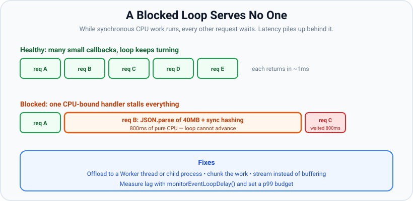

# Blocking the Event Loop

*9 min read · Updated 24 Jul 2026 Topic 10 of 70 Bookmark Mark done Why it matters Node · Topic 10 of 70*

**Source:** [https://www.geekyfrontend.in/learn/nodejs-backend-kit/blocking-event-loop](https://www.geekyfrontend.in/learn/nodejs-backend-kit/blocking-event-loop)

---

## Why it matters

Node's whole performance model rests on one fragile assumption: **callbacks return quickly**. The event loop is cooperative, not preemptive — it cannot interrupt a callback that is busy. So the instant one callback runs a long synchronous loop, parses a giant JSON string, or hashes a password on the main thread, *the entire process stops serving everyone else*. No other request is handled, no timer fires, no I/O completes, health checks time out, and your p99 latency detonates. One slow function can take down a server that is otherwise 99% idle.

This is the number-one production failure mode for Node services, and the number-one senior-level interview probe: "your service is fast in testing but freezes under load — what happened?" The answer is almost always a blocked event loop. This topic covers what blocks it, how to keep CPU-bound work off the main thread, and how to *measure* loop lag so you catch it before customers do.

## The concept, simply

Because all your JavaScript runs on one thread, the event loop can only advance when the current callback *returns control*. A callback that takes 800ms of pure CPU means the loop is frozen for 800ms. Every request that arrives during that window waits in line; a request that would have taken 1ms now takes 801ms. The work is not lost — it is delayed — but the tail latency is catastrophic and the throughput collapses.



A healthy loop turns constantly; one CPU-bound handler stalls every request queued behind it.

The mental test is simple: **"Does this callback do a lot of work without `await`ing or returning?"** If yes, it blocks the loop for the whole duration. Asynchronous I/O (a DB query, an HTTP call, a file read) does *not* block, because it hands off and the callback returns immediately — the loop is free while the OS or thread pool does the waiting.

## How it works

**What actually blocks.** Anything CPU-bound and synchronous on the main thread:

- **Tight loops** over large arrays; nested loops with big *n*; regex with catastrophic backtracking (ReDoS).
- **Large `JSON.parse` / `JSON.stringify`** — these are synchronous and scale with payload size; a 50MB body can block for hundreds of milliseconds.
- **Synchronous crypto and compression** — `crypto.pbkdf2Sync`, `bcrypt`'s sync API, `zlib.gzipSync`.
- **The `*Sync` filesystem calls** — `fs.readFileSync` on a large file blocks the loop for the whole read, unlike the async version which uses the thread pool.
- **Heavy template rendering, image/PDF manipulation in pure JS, big sorts.**

**Why async I/O does not block.** `fs.readFile` (async) offloads to the libuv thread pool and its callback returns instantly; the loop keeps serving others while a worker thread does the blocking read. A DB driver sends bytes over a socket (kernel-async) and registers a callback — the loop is free until the response arrives. The blocking happens only when *your JavaScript* occupies the main thread continuously.

**How to keep the loop free.** There are four standard strategies:

1. **Offload to a Worker thread.** `worker_threads` gives you a real second thread with its own V8 isolate. Run the CPU-bound function there and post the result back — the main loop never stalls. This is the right tool for genuine parallel computation (hashing, parsing, image work).
2. **Offload to a child process or external service.** For heavyweight or isolatable work, spawn a process (`child_process`) or push the job to a queue/worker pool.
3. **Chunk the work and yield.** Split a long computation into pieces and schedule the next piece with `setImmediate`, letting the loop service I/O between chunks. This trades total time for responsiveness.
4. **Stream instead of buffering.** Process data incrementally (streaming JSON parsers, `zlib` streams, line-by-line readers) so you never hold — or synchronously chew through — a huge blob at once.

**Measuring loop lag.** "Lag" is how late a timer fires versus when it was due; rising lag is the earliest signal the loop is falling behind.


Event loop lag is the gap between when a callback was due and when it actually ran — a direct measure of loop health.

The crude way is a self-correcting timer: schedule `setTimeout(fn, N)` and measure how much later than `N` it actually fires. The precise way is `perf_hooks.monitorEventLoopDelay()`, which gives you a high-resolution histogram (mean, p50, p99, max). Watch the **tail** (p99/max), not the mean — a healthy-looking average can hide periodic multi-hundred-millisecond stalls. Alert when p99 lag crosses a budget (say, 50–100ms).

## Code examples

**Example 1 — a blocking handler stalls the whole server.**

javascript

```
const http = require('http');

http.createServer((req, res) => {
  if (req.url === '/block') {
    // Synchronous CPU work — freezes the loop for ~2s.
    const end = Date.now() + 2000;
    while (Date.now() < end) {}
    res.end('done blocking');
  } else {
    res.end('fast'); // normally instant...
  }
}).listen(3000);

// While ONE client hits /block, every request to '/' also hangs
// for up to 2 seconds. One handler blocks all of them.
```

**Example 2 — measuring lag with a self-correcting timer.**

javascript

```
let last = Date.now();
setInterval(() => {
  const now = Date.now();
  const lag = now - last - 500; // expected gap is 500ms
  if (lag > 50) console.warn(`event loop lag: ${lag}ms`);
  last = now;
}, 500);

// If some other callback blocks for 400ms, this logs ~400ms of lag.
```

**Example 3 — the precise way with perf\_hooks.**

javascript

```
const { monitorEventLoopDelay } = require('perf_hooks');

const h = monitorEventLoopDelay({ resolution: 20 });
h.enable();

setInterval(() => {
  console.log('p50:', (h.percentile(50) / 1e6).toFixed(1), 'ms',
              '| p99:', (h.percentile(99) / 1e6).toFixed(1), 'ms',
              '| max:', (h.max / 1e6).toFixed(1), 'ms');
  h.reset();
}, 1000);

// Values are in nanoseconds; divide by 1e6 for milliseconds.
// A healthy idle service shows p99 well under a few ms.
```

**Example 4 — offloading CPU work to a Worker thread.**

javascript

```
// main.js
const { Worker } = require('worker_threads');

function hashOffMainThread(password) {
  return new Promise((resolve, reject) => {
    const w = new Worker('./hash-worker.js', { workerData: password });
    w.on('message', resolve);
    w.on('error', reject);
  });
}

// The event loop stays responsive while the worker hashes.
hashOffMainThread('secret').then((hash) => console.log('hashed:', hash));

// hash-worker.js
// const { workerData, parentPort } = require('worker_threads');
// const crypto = require('crypto');
// const out = crypto.pbkdf2Sync(workerData, 'salt', 200000, 64, 'sha512');
// parentPort.postMessage(out.toString('hex'));
```

## Common mistakes & gotchas

- **Using `*Sync` APIs on the request path.** `fs.readFileSync`, `crypto.pbkdf2Sync`, `zlib.gzipSync` block the loop for their full duration — fine at startup, disastrous per-request.
- **Parsing huge payloads synchronously.** `JSON.parse` of a multi-megabyte body is CPU-bound and blocks; use size limits and streaming parsers.
- **Assuming `Promise` or `async` makes CPU work non-blocking.** Wrapping a synchronous loop in a promise does *not* yield the thread — it still runs to completion on the main thread and blocks.
- **Regex backtracking (ReDoS).** A pathological pattern on attacker-controlled input can peg the loop for seconds; validate and bound input, prefer safe patterns.
- **Watching only average lag.** The mean hides periodic stalls; alert on p99/max.
- **Reaching for the libuv thread pool for CPU work.** The pool is for native I/O-style tasks; your own CPU-bound JS belongs in `worker_threads`.
- **Chunking with `process.nextTick`.** That does not yield to I/O; use `setImmediate` between chunks.

## Best practices

- **Keep per-callback work bounded.** Treat "how long can this callback run?" as a first-class design constraint on the request path.
- **Offload CPU-bound work to `worker_threads`** (or a child process / job queue) — hashing, image/PDF processing, big parsing.
- **Prefer async I/O everywhere on the hot path;** reserve `*Sync` calls for startup/CLI scripts.
- **Stream large data** instead of buffering-then-parsing; enforce request body size limits.
- **Chunk long loops with `setImmediate`** when offloading is overkill, so I/O still gets serviced.
- **Instrument loop lag in production** with `monitorEventLoopDelay()`; set a p99 budget and alert on it.
- **Load-test with concurrency,** not just single-request timing — blocking only shows up when requests compete for the one thread.

## ⭐ Interview lens

> **Q: Your Node service is fast in a single-request test but freezes under load. What's the likely cause?**  
> A blocked event loop: some handler does synchronous CPU-bound work (large `JSON.parse`, sync crypto, a tight loop, a `*Sync` call, or ReDoS). Because the loop is single-threaded and cooperative, that one busy callback delays every other request queued behind it, spiking p99 latency.

> **Q: Does async I/O block the event loop?**  
> No. Async I/O offloads to the OS kernel (network) or the libuv thread pool (`fs`, crypto) and its callback returns immediately, so the loop stays free. Only synchronous CPU work — or a `*Sync` API — that runs continuously on the main thread blocks it.

> **Q: How do you run CPU-bound work without blocking the loop?**  
> Move it off the main thread: `worker_threads` for parallel JS computation, a child process or external job queue for heavier/isolatable work, or chunk the computation and yield with `setImmediate` between pieces. Streaming avoids holding huge buffers in the first place.

> **Q: Does wrapping CPU work in a Promise make it non-blocking?**  
> No. A promise only affects *scheduling* of the callback, not *where* the code runs. A synchronous loop inside a `.then` still executes to completion on the main thread and blocks the loop just as much.

> **Q: How do you measure event loop lag, and what do you watch?**  
> Crudely, a self-correcting `setInterval` that reports how much later than expected it fired. Precisely, `perf_hooks.monitorEventLoopDelay()`, which yields a nanosecond histogram (p50/p99/max). Watch the tail (p99/max), not the mean, and alert when it exceeds a budget like 50–100ms.

> **Q: Why offload to `worker_threads` rather than the libuv thread pool for CPU work?**  
> The libuv pool is reserved for Node's native I/O-style operations (`fs`, crypto, zlib) and you cannot schedule arbitrary JavaScript on it. `worker_threads` give you a real second V8 isolate where your own CPU-bound JavaScript runs in parallel, communicating via message passing or `SharedArrayBuffer`.

## Cheat-card

- **Loop is cooperative:** one long callback stalls every request.
- **Blocks:** tight loops, big `JSON.parse`, sync crypto/zlib, `*Sync` fs, ReDoS.
- **Doesn't block:** async I/O (kernel or thread pool) — callback returns instantly.
- **Fixes:** `worker_threads`, child process/queue, `setImmediate` chunking, streaming.
- Promise/async does NOT move CPU work off the main thread.
- CPU work → `worker_threads`, not the libuv pool.
- **Measure:** `perf_hooks.monitorEventLoopDelay()`; alert on p99/max, not mean.
- **Pool, not per-task workers:** piscina 5.3.2: `new Piscina({ filename })`, `await pool.run(task)`; set `maxThreads`, `maxQueue`, `idleTimeout`.
- **Histogram baseline:** on v24.19.0 each `monitorEventLoopDelay` sample includes the `resolution`; subtract it. A stall before the first sample is not recorded.
- **Profile:** `node --cpu-prof` (stable since v22.4.0) → `.cpuprofile` JSON; self time = sum of `timeDeltas` per `samples` node. 0x 6.0.0 for flame graphs.
- **clinic.js 13.0.0:** README says not actively maintained (last release 2023-06-28); needs `NO_INSIGHT=1` when run without a TTY, or it exits 0 and does nothing.

---

## Learn More

- [Don't Block the Event Loop (or the Worker Pool) nodejs.org](https://nodejs.org/en/learn/asynchronous-work/dont-block-the-event-loop)
- [Overview of Blocking vs Non-Blocking nodejs.org](https://nodejs.org/en/learn/asynchronous-work/overview-of-blocking-vs-non-blocking)
- [What the heck is the event loop anyway? | Philip Roberts | JSConf EU JSConf](https://www.youtube.com/watch?v=8aGhZQkoFbQ)
- [This is how the Node.js Event Loop really works Software Developer Diaries](https://www.youtube.com/watch?v=paI6J8my3Yw)

---

## Additional topics

*Added 7 Oct 2026 · examples verified on Node v24.19.0*

### Worker pools with piscina

**What it is.** Example 4 above starts a new `Worker` for every task. That costs a fresh V8 isolate, a module load and time every time: on this machine `new Worker(...)` took 56–64 ms to reach `'online'` (5 runs). Nothing limits how many workers run at once either. A **worker pool** keeps a fixed set of `worker_threads` alive, puts incoming tasks in a queue, and hands each task to the next idle worker. **piscina** (version 5.3.2, `engines: node >=20.x`) is a widely used pool. It has three parts:

- a **pool object** on the main thread (`new Piscina({ filename })`) that owns the workers and the task queue;
- a **worker file** whose default export (or `module.exports`) is the function that runs each task;
- **`pool.run(task)`**, which structured-clones `task` to an idle worker and returns a promise for the function's return value. If the function throws, the promise rejects.

**Why it exists.** Without a pool you either block the loop (inline work) or pay the worker startup cost on every request, with no backpressure. With a pool, the main thread only does `postMessage` and promise bookkeeping, so its timers and sockets keep being served while N cores do the CPU work.

How it works:

1. The constructor starts `minThreads` workers. The README gives the defaults as `minThreads` = `os.availableParallelism()` and `maxThreads` = `os.availableParallelism() * 1.5` (see lesson 07 for why that function is used instead of `os.cpus().length`).
2. `pool.run(task)` puts the task in the queue. When a worker is idle, piscina posts the task to it (by default using `Atomics` for faster signalling).
3. The worker calls your exported function with the task and posts the result back. piscina resolves the promise on the main thread.
4. If all workers are busy, tasks wait in the queue (unbounded by default; `maxQueue` caps it, and `'auto'` sets it to `maxThreads²`). `idleTimeout` controls how long an idle worker lives. The README says the default is "immediate", so set it explicitly if workers keep being torn down and restarted.
5. `pool.close()` waits for running tasks and stops the threads. `pool.destroy()` stops them at once and rejects pending tasks.

**Example — the same 8 CPU-bound jobs, inline vs piscina, with the main loop's timer lateness measured.**

javascript

```
// fib.js — the CPU-bound task (deliberately slow recursive Fibonacci)
function fib(n) { return n < 2 ? n : fib(n - 1) + fib(n - 2); }
module.exports = (n) => fib(n);
```

javascript

```
// compare.js — run 8 fib(34) jobs inline, then through piscina,
// while a histogram measures how late the main loop's timers fire.
const path = require('node:path');
const { monitorEventLoopDelay, performance } = require('node:perf_hooks');
const { Piscina } = require('piscina');
const fib = require('./fib.js');

const sleep = (ms) => new Promise((r) => setTimeout(r, ms));
const RES = 10; // histogram samples every 10 ms; values include this interval
async function measure(label, work) {
  const h = monitorEventLoopDelay({ resolution: RES });
  h.enable();
  await sleep(50);               // let the histogram take its first samples
  const t0 = performance.now();
  await work();
  const ms = performance.now() - t0;
  await sleep(50);               // and a last one after the work
  h.disable();
  const late = (ns) => Math.max(0, ns / 1e6 - RES).toFixed(1);
  console.log(`${label.padEnd(8)} wall=${ms.toFixed(0)}ms  ` +
    `worst timer lateness=${late(h.max)}ms (${h.count} samples)`);
}

(async () => {
  const jobs = Array(8).fill(34);
  await measure('inline', async () => { for (const n of jobs) fib(n); });

  const pool = new Piscina({ filename: path.resolve(__dirname, 'fib.js'), maxThreads: 4 });
  await measure('piscina', () => Promise.all(jobs.map((n) => pool.run(n))));
  console.log('piscina', Piscina.version, '| threads:', pool.threads.length,
    '| completed:', pool.completed);
  await pool.close();
})();

// Real output (Node v24.19.0, piscina 5.3.2, 8 logical CPUs), three runs:
//   inline   wall=516ms  worst timer lateness=516.6ms (9 samples)
//   piscina  wall=149ms  worst timer lateness=0.5ms (24 samples)
//   piscina 5.3.2 | threads: 4 | completed: 8
//   inline   wall=518ms  worst timer lateness=518.7ms (9 samples)
//   piscina  wall=157ms  worst timer lateness=0.8ms (25 samples)
//   piscina 5.3.2 | threads: 4 | completed: 8
//   inline   wall=515ms  worst timer lateness=514.3ms (9 samples)
//   piscina  wall=249ms  worst timer lateness=3.9ms (33 samples)
//   piscina 5.3.2 | threads: 4 | completed: 8
```

Inline, one timer fired more than 500 ms late, so every request arriving in that half-second would have waited that long. Through the pool, the worst lateness was under 4 ms, and the jobs finished 2–3.5× sooner because four cores shared them. The pool's wall time includes starting its 4 workers.

### Profiling CPU hotspots: `--cpu-prof`, 0x and clinic.js

**What it is.** Measuring lag tells you *that* the loop is blocked. A CPU profile tells you *which function* is blocking it. V8's sampling profiler interrupts the main thread at a fixed interval (1000 µs by default), records the JavaScript stack, and builds a call tree. Functions that show up in many samples are where the time goes.

How it works:

1. **`node --cpu-prof app.js`** (added in v12.0.0, stable since v22.4.0 and v20.16.0) starts the profiler at startup and writes `CPU.<date>.<time>.<pid>.<tid>.<seq>.cpuprofile` when the process exits. `--cpu-prof-dir` picks the folder, `--cpu-prof-name` the file name, and `--cpu-prof-interval` the sampling interval in µs (added in v12.2.0).
2. The file is JSON with `nodes`, `startTime`, `endTime`, `samples` and `timeDeltas`. Each node has a `callFrame` (`functionName`, `url`, 0-based `lineNumber`), a `hitCount`, `positionTicks` (per-line hits) and `children`. `samples[i]` is the id of the node on top of the stack for `timeDeltas[i]` µs. Adding those up per function gives its **self time**.
3. You can read the file with a script, as below, or load it into a profile viewer such as Chrome DevTools.

> ⚠️ Unverified: loading the `.cpuprofile` into Chrome DevTools or VS Code. It was not done here (headless session); only the JSON was parsed.
4. **0x** (version 6.0.0, released 2025-07-07; its README lists Node v20 and above) wraps your command, collects V8's tick log, and writes a self-contained **flame graph** HTML file. It works headless; it opens a browser only with `--open`.
5. **clinic.js** (version 13.0.0) bundles `doctor` (event-loop delay, CPU and memory heuristics), `flame` (built on 0x), `bubbleprof` and `heapprofiler`. Its README now says it is **not actively maintained**. See the evidence below before you rely on it.

**Example — run `--cpu-prof` and read the top functions.**

javascript

```
// hot.js — a workload with one obvious hotspot and one small one
function slowParse(n) {            // the hotspot: repeated JSON round-trips
  let o = { items: [] };
  for (let i = 0; i < n; i++) o = JSON.parse(JSON.stringify({ items: [...o.items.slice(-50), i] }));
  return o.items.length;
}
function cheapSum(n) { let s = 0; for (let i = 0; i < n; i++) s += i; return s; }

console.log(slowParse(60000), cheapSum(1e6));
```

javascript

```
// top-functions.js — print the functions with the most self time in a .cpuprofile
const fs = require('node:fs');
const path = require('node:path');

const file = process.argv[2];
const prof = JSON.parse(fs.readFileSync(file, 'utf8'));
const byId = new Map(prof.nodes.map((n) => [n.id, n]));

// samples[i] is the node that was on top of the stack for timeDeltas[i] microseconds
const selfUs = new Map();
prof.samples.forEach((id, i) => {
  const { functionName, url, lineNumber } = byId.get(id).callFrame;
  const key = `${functionName || '(anonymous)'} ${url ? path.basename(url) + ':' + (lineNumber + 1) : ''}`;
  selfUs.set(key, (selfUs.get(key) || 0) + (prof.timeDeltas[i] || 0));
});

const total = [...selfUs.values()].reduce((a, b) => a + b, 0);
console.log(`${prof.samples.length} samples, ${(total / 1000).toFixed(0)} ms profiled`);
[...selfUs].sort((a, b) => b[1] - a[1]).slice(0, 6).forEach(([k, us]) =>
  console.log(`${(us / 1000).toFixed(1).padStart(8)} ms ${(100 * us / total).toFixed(1).padStart(5)}%  ${k}`));
```

bash

```
$ node --cpu-prof --cpu-prof-dir=prof hot.js
51 499999500000
$ ls prof
CPU.20261007.170552.114258.0.001.cpuprofile
$ node top-functions.js prof/*.cpuprofile
148 samples, 176 ms profiled
   125.5 ms  71.4%  slowParse hot.js:2
    21.0 ms  11.9%  (program) 
    16.3 ms   9.3%  (garbage collector) 
     4.6 ms   2.6%  (anonymous) hot.js:1
     2.8 ms   1.6%  cheapSum hot.js:7
     2.2 ms   1.3%  compileForInternalLoader realm:383
```

The `slowParse` node in that file was `{"functionName":"slowParse", … "lineNumber":1, …}, "hitCount":114, "positionTicks":[{"line":4,"ticks":114}]`. All 114 samples landed on line 4, the `JSON.parse(JSON.stringify(…))` line. `(program)` is time in native code outside JavaScript, and `(garbage collector)` is GC (heavy here because each round trip allocates new objects). Sample counts and milliseconds change from run to run, and so does the order of the small entries (`(program)` and `(garbage collector)` swapped between two runs). `slowParse` was first by a wide margin every time.

**Example — 0x flame graph, headless.**

bash

```
$ node node_modules/0x/cmd.js -D flame hot.js
🔥  Profiling51 499999500000
🔥  Process exited, generating flamegraph
🔥  Flamegraph generated in
file:///…/l10/flame/flamegraph.html
$ ls flame
flamegraph.html
isolate-0x1a308000-114654-114654-v8.log
isolate-0x1a308000-114654-114654-v8.log.json
isolate-0x1a308000-114654-114654-v8.log.preprocess-ready
meta.json
```

(The terminal control codes 0x uses to redraw its status line were removed from this output. The `isolate-…-v8.log` file is V8's tick log, which 0x turns into stacks. On this machine `/tmp` is mounted `noexec`, so the `0x` bin shim could not run directly and `node node_modules/0x/cmd.js` was used. `npx 0x` works where scripts can execute.) The 492 KB HTML file includes the `slowParse` frames. In the graph, width is the share of samples, so the widest bar near the top of the stacks is your hotspot.

> ⚠️ Unverified: what the flame graph looks like on screen. The HTML file was generated and grepped for `slowParse`, but it was not opened in a browser (headless session).

**Example — clinic.js: maintenance status and what happens on Node 24.**

javascript

```
// long.js — 3 s of 30 ms blocks separated by short idle gaps
const end = Date.now() + 3000;
(function round() {
  const stop = Date.now() + 30; while (Date.now() < stop) {}
  if (Date.now() < end) setTimeout(round, 5);
})();
```

bash

```
$ npm view clinic version time.modified
version = '13.0.0'
time.modified = '2026-08-31T10:08:51.521Z'
$ npm view clinic time --json | tail -3
  "12.1.0": "2023-03-15T21:02:40.117Z",
  "13.0.0": "2023-06-28T13:06:55.146Z"
}
$ HOME=$PWD/h1 node node_modules/clinic/bin.js doctor --open=false -- node long.js; echo "exit $?"; ls .clinic
(node:115160) [DEP0174] DeprecationWarning: Calling promisify on a function that returns a Promise is likely a mistake.
(Use `node --trace-deprecation ...` to show where the warning was created)
exit 0
ls: cannot access '.clinic': No such file or directory
$ HOME=$PWD/h1 NO_INSIGHT=1 node node_modules/clinic/bin.js doctor --open=false -- node long.js
To generate the report press: Ctrl + C
Analysing data
Generated HTML file is file:///…/l10/.clinic/115198.clinic-doctor.html
exit 0
$ grep -o '"issues":{"delay":"[a-z]*","cpu":"[a-z]*"' .clinic/*.clinic-doctor.html
"issues":{"delay":"performance","cpu":"performance"
```

What the evidence shows (checked 7 Oct 2026):

- **Releases:** the last release, 13.0.0, came out on 2023-06-28. The 2026 `time.modified` value is registry metadata, not a release. The GitHub repo (clinicjs/node-clinic) is not archived, but its last push was 2024-09-19.
- **README:** "Clinic.js is not being actively maintained. Due to its strong ties to Node.js internals, it may not work or the results you get may not be accurate."
- **First run with a fresh `HOME`:** without a TTY, the anonymous-usage prompt is the problem. clinic wraps `insight.askPermission` in `promisify`, but insight 0.11.1's `askPermission` returns a promise and never calls a callback (that is the `DEP0174` warning). So the wrapped promise never settles, the loop runs empty, and clinic **exits 0 without running your script**. Setting `NO_INSIGHT=1`, an environment variable checked in clinic's `bin.js`, skips the prompt.
- **With `NO_INSIGHT=1`:** `clinic doctor` and `clinic flame` both produced HTML reports on Node v24.19.0, and doctor flagged event-loop delay and CPU. A shorter script (`hot.js`, about 150 ms) instead gave "Profile data collected seems to be empty, report may not be generated".
- **Dependencies:** `npm audit` in a project with clinic 13.0.0, 0x 6.0.0 and piscina 5.3.2 reported 24 vulnerabilities (2 critical, 4 high). `clinic` was the only direct dependency flagged, through packages such as `request`, `form-data`, `tmp` and `d3-color`.

**Recommendation.** Use `--cpu-prof` first: it is built in, stable and scriptable. Use 0x when you want a flame graph. Treat clinic as optional: install it only in a throwaway or dev-only setting, run it with `NO_INSIGHT=1`, and check its findings against `--cpu-prof` or `monitorEventLoopDelay`.

### Common mistakes & gotchas (additional topics)

- **Starting a `new Worker` per request.** Each one costs isolate startup and nothing limits the count. Use a pool (piscina) and size it from `os.availableParallelism()`.
- **Sending huge objects to workers.** `pool.run(task)` structured-clones `task`, and the clone runs on the main thread. Pass `transferList` for `ArrayBuffer`s, or send a file path or id instead of the data.
- **Moving async I/O into workers.** The piscina README notes that `fs`, crypto and zlib are already parallel through libuv. Workers help with *synchronous JavaScript* CPU work.
- **Leaving the queue unbounded.** With the default `maxQueue`, a traffic spike queues tasks in memory without limit. Set `maxQueue` and reject or shed load when `pool.queueSize` is high.
- **Reading `monitorEventLoopDelay` values as pure lateness.** On v24.19.0 every sample includes the `resolution` interval: an idle loop with `resolution: 20` showed min 19.12 ms, p50 20.25 ms and max 21.00 ms. Subtract the resolution, or compare with the idle baseline.
- **Trusting a profile of a 100 ms script.** At 1 sample/ms that is about 100 samples. Profile long enough (or under load) to get thousands.
- **Running clinic in CI without `NO_INSIGHT=1`.** On a fresh `HOME` it exits 0 and does nothing, so the step "passes".

### Edge case worked through: a stall right after `enable()` is invisible

`monitorEventLoopDelay()` samples with a libuv timer. A stall that starts in the same synchronous run as `h.enable()`, before the histogram's timer has fired once, is **not recorded at all**:

javascript

```
const { monitorEventLoopDelay } = require('node:perf_hooks');
const block = (ms) => { const end = Date.now() + ms; while (Date.now() < end) {} };
const ms = (ns) => (ns / 1e6).toFixed(1);

function report(label, h) {
  h.disable();
  console.log(`${label.padEnd(30)} samples=${h.count} min=${ms(h.min)}ms max=${ms(h.max)}ms`);
}

// Trial 1: block in the same synchronous run as enable().
const h1 = monitorEventLoopDelay({ resolution: 10 });
h1.enable();
block(300);
setTimeout(() => {
  report('block right after enable()', h1);

  // Trial 2: let the histogram's timer start first, then block.
  const h2 = monitorEventLoopDelay({ resolution: 10 });
  h2.enable();
  setTimeout(() => {
    block(300);
    setTimeout(() => report('block 50 ms after enable()', h2), 100);
  }, 50);
}, 100);

// Real output (Node v24.19.0), the same pattern in 3 runs:
//   block right after enable()     samples=9 min=10.1ms max=10.1ms
//   block 50 ms after enable()     samples=14 min=10.1ms max=304.3ms
```

The same 300 ms block shows as max 10.1 ms (that is, nothing) in trial 1 and as 304 ms in trial 2. This is why `compare.js` waits 50 ms after `enable()`. It also means a monitor enabled in the same tick as a slow synchronous startup step (loading config, building a cache) will not report that step. Measure startup separately, for example with `performance.now()` around it or with `--cpu-prof`.

### ⭐ Interview lens (additional topics)

> **Q: “You moved a CPU-heavy function into `worker_threads` and p99 got better but throughput got worse. What would you check?”**  
> A: Check whether a worker is started per task. Isolate startup adds tens of ms per call (about 60 ms measured here), so use a pool such as piscina with a fixed `maxThreads` and a set `idleTimeout`. Check how much data is cloned per task (the clone happens on the main thread). And check that the pool is not larger than `os.availableParallelism()`, so threads are not fighting over the cgroup's CPU quota. Measure loop delay and the pool's `waitTime`/`runTime` before and after.

> **Q: “How do you find what is blocking the event loop in production-like conditions?”**  
> A: First confirm it with `monitorEventLoopDelay` (p99/max, minus the resolution) or ELU. Then capture a CPU profile under load with `node --cpu-prof` (or the inspector) and rank functions by self time, using the `samples`/`timeDeltas` arrays or DevTools. Use 0x for a flame graph. clinic.js still runs on Node 24 with `NO_INSIGHT=1`, but it has been unmaintained since 2023, so check what it finds with the built-in tools.
